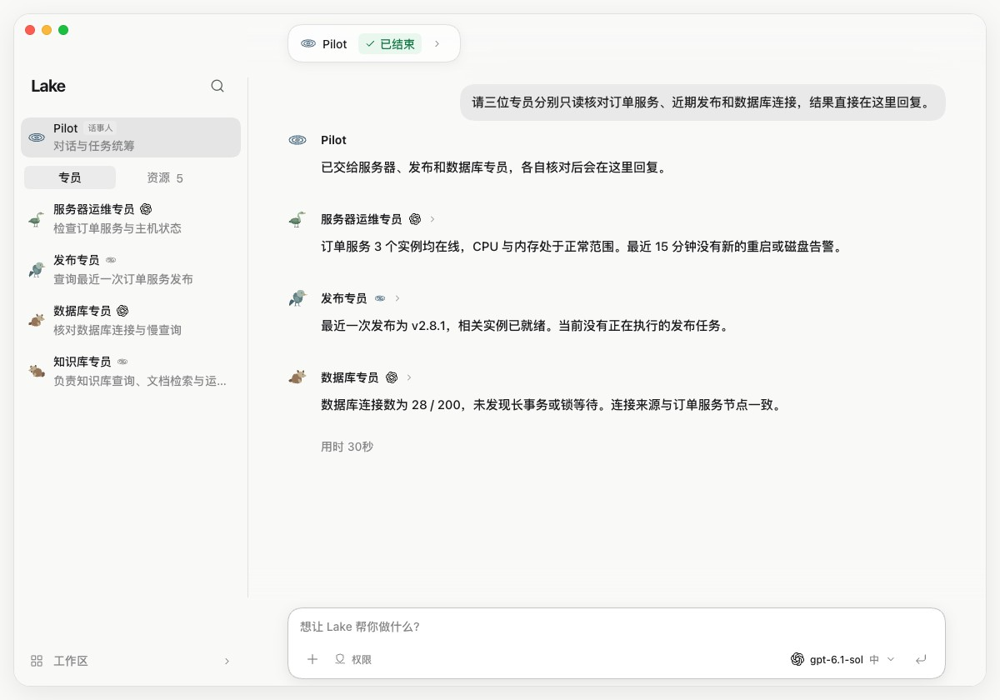
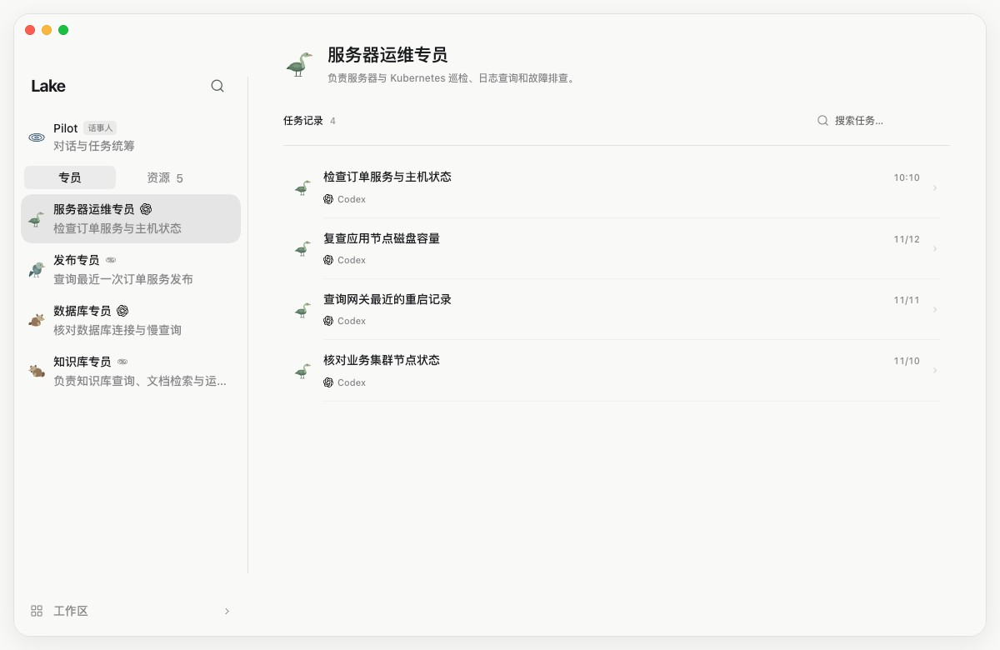

<div align="center">

# Lake

**English** · [简体中文](README.zh-CN.md)

**An AI operations workspace for SREs**

Give Pilot a goal, hear from each specialist, and keep resources and execution records in one workspace.

[Download for macOS](https://github.com/Clean-Lakes/Lake/releases/latest) · [Quick start](#quick-start) · [Pilot guide](docs/lake-pilot.md)

</div>

<br>

<!-- v0.3.33: shipping React UI, fictional read-only demonstration data. -->
<picture>
  <source media="(prefers-color-scheme: dark)" srcset="docs/images/lake-workbench-dark.jpg">
  <source media="(prefers-color-scheme: light)" srcset="docs/images/lake-workbench-light.jpg">
  
</picture>

<p align="center"><sub>macOS interface preview · v0.3.33 · Fictional demo data · UI shown in Chinese</sub></p>

## Built for operations

- **Pilot brings specialists into the conversation.** Each specialist responds under its own name in the same chat. Pilot tracks missing replies and combines the responses when you ask for a summary.
- **Resources stay in context.** Switch between specialists and project resources in the sidebar. Reference resources, Skills, and MCP tools when describing the work.
- **Execution stays visible.** Use native Lake specialists or Codex through ACP, follow the actual executor and task records, and review tool calls and approvals. Historical failed or unknown operations remain available.

## A task history for each specialist

Open a specialist to see its task records, then inspect a task for execution details. The fixed Pilot entry returns to the main conversation; the **Specialists / Resources** tabs keep each list's position and expanded folders.

<picture>
  <source media="(prefers-color-scheme: dark)" srcset="docs/images/lake-specialist-tasks-dark.jpg">
  <source media="(prefers-color-scheme: light)" srcset="docs/images/lake-specialist-tasks-light.jpg">
  
</picture>

<p align="center"><sub>Specialist task history · Fictional demo data</sub></p>

## Plan mode

Enter `/plan` to toggle planning, or `/plan <goal>` to start a planning request. Lake investigates with read-only tools, asks about material choices, and presents a reviewable plan. Revise it in the conversation or choose **Execute plan** to continue under the existing session permissions. Mode and plans persist per conversation.

## Quick start

1. [Download the current release](https://github.com/Clean-Lakes/Lake/releases/latest) for macOS Apple Silicon, requiring macOS 13.5 or later.
2. Connect a model in settings, or connect through [Magpie Agent](https://github.com/Clean-Lakes/magpie-agent-lake). For Codex specialists, sign in to Codex locally and complete its setup in **Agent** settings.
3. Add project resources, Skills, and MCP integrations. Type `@` to reference them in a request to Pilot.
4. Ask Pilot to assign work or bring specialists into the conversation. Each specialist's sidebar entry opens its task records.

Pilot is the built-in coordinator in the sidebar. Its permission settings govern specialist operations; saved project restrictions and read-only Plan scope still apply. [Usage and current scope (Chinese) →](docs/lake-pilot.md)

The current stable release, **v0.3.33**, provides macOS packages only. Some earlier functionality remains in progress; see the [release notes](client/macos/RELEASE_NOTES.md) and [compatibility status](runtime/typescript/parity.json) for the current limits.

**Lake Memory (experimental):** separately opt in to automatic accumulation and scoped preference use. Current instructions take precedence; consolidation runs in the background. Ordinary conversations and Pilot coordinator replies can use expression preferences; facts and operational experience still need verification. Manual strategy assets retain compatibility management. Online correction, candidate extraction, and new comparison experiments are retired; existing content and historical records are retained. Ordinary requests no longer write experimental prompt manifests. See the [Lake Memory guide (Chinese)](docs/lake-memory.md).

<details>
<summary>Local development</summary>

Create a working branch from `develop`, open a PR into `develop`, and validate changes in Lake Dev. Production changes reach `master` through a `develop → master` release PR. Before editing, read the [branch and release workflow](docs/development-workflow.md) and [contributing guide](CONTRIBUTING.md). AI agents must also follow the root `AGENTS.md`.

You need Go 1.26.6 (see `go.mod`), Node.js 24, and pnpm. Before your first macOS build, run `scripts/setup_lake_signing.sh`. Then build and launch the isolated Lake Dev app:

```sh
pnpm --dir web-agent install --frozen-lockfile
scripts/build_lake_desktop.sh --dev --install
open "$HOME/Applications/Lake Dev.app"
```

Dev uses `~/.lake-dev`, separate from production data. The built application embeds the frontend and does not require Node.js at runtime. See [Contributing](CONTRIBUTING.md) for CLI and standalone web development.

</details>

## Community and feedback

Using Lake? We welcome real-world use cases and suggestions.

<p>
  &nbsp; <strong>WeChat</strong>&nbsp; <code>13025452443</code>
</p>

---

[Usage and development](web-agent/README.md) · [macOS](client/macos/README.md) · [Windows development](client/windows/README.md) · [Contributing](CONTRIBUTING.md) · [Apache-2.0](LICENSE-APACHE)
