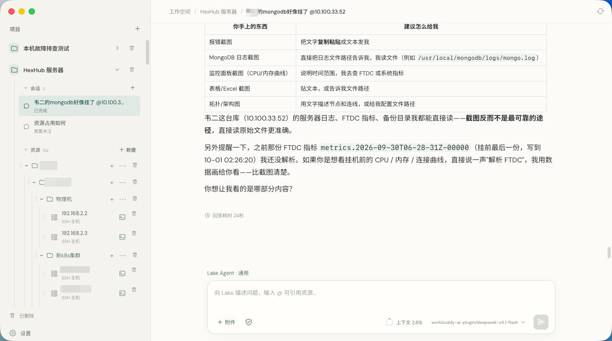

# Lake

Lake 是一个面向运维场景的 AI 工作台。用自然语言调查主机、集群和服务问题，把资源、终端、执行过程和证据放在同一个界面中。



## 功能

- 按项目管理资源与会话，支持本机、SSH、数据库、Redis 和 Docker。
- 通过自然语言查询资源状态、查看日志、分析 Kubernetes 和服务故障。
- Lake 主 Agent 与内置子 Agent 协同调查，展示任务进度与取证结果。
- 持续终端、操作确认和会话记录，方便人工接管与继续排查。

## 开始使用

1. 从 [GitHub Releases](https://github.com/Clean-Lakes/Lake/releases) 下载客户端：macOS 支持 Apple Silicon（M 系列），Windows 支持 x86_64。
2. 在设置中配置模型供应商、接口与 API 密钥。
3. 创建项目，添加或导入资源，在聊天中使用 `@资源` 发起调查。

图片识别需要所选模型支持图片输入。

## 本地运行

构建需要 Go 1.25、Node.js 24 和 pnpm。macOS 首次构建先运行 `scripts/setup_lake_signing.sh`，配置本地签名身份。

```sh
pnpm --dir web-agent install --frozen-lockfile
scripts/build_lake.sh
bin/lake web --open
```

默认访问 `http://localhost:4177`。构建后的程序内嵌前端，运行时不需要 Node.js。

更多说明：[运行与开发](web-agent/README.md) · [macOS 客户端](client/macos/README.md) · [Windows 客户端](client/windows/README.md)。

## License

[Apache-2.0](LICENSE-APACHE)
