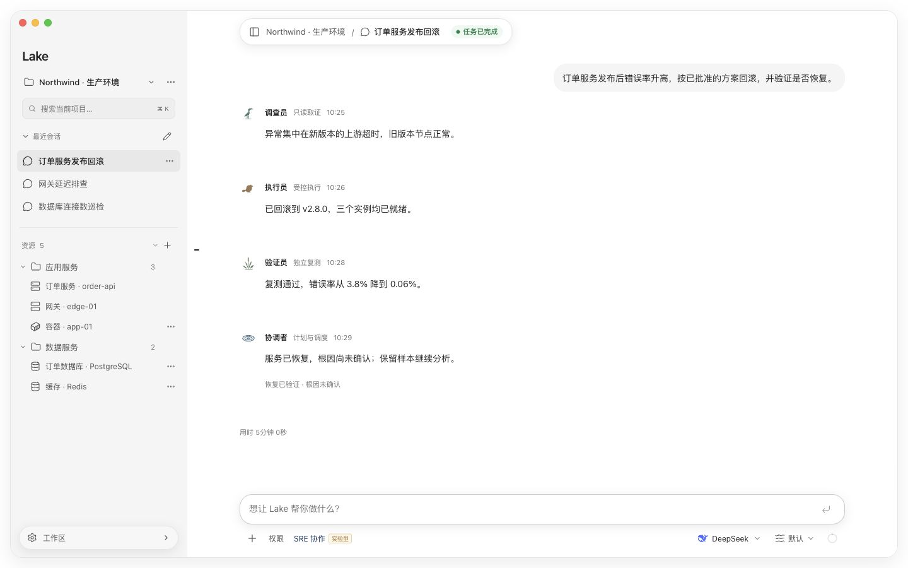

<div align="center">

# Lake

[English](README.md) · **简体中文**

**面向 SRE 的 AI 运维工作台**

连接资源，协同排障，让执行有迹可循。

[下载客户端](https://github.com/Clean-Lakes/Lake/releases) · [快速开始](#快速开始) · [SRE 协作](docs/sre-collaboration.md)

</div>

<br>

<picture>
  <source media="(prefers-color-scheme: dark)" srcset="docs/images/lake-workbench-dark.jpg">
  <source media="(prefers-color-scheme: light)" srcset="docs/images/lake-workbench-light.jpg">
  
</picture>

<p align="center"><sub>macOS 界面预览 · v0.3.21 · 演示数据</sub></p>

## 为运维工作而设计

- **资源就在上下文里。** 按项目组织主机、数据库、Redis 和 Docker，将资源、会话和终端放在一起。
- **过程可以追溯。** 从工具调用到操作确认，再到执行记录与证据，随时查看，也能人工接管。
- **专员共同推进。** 开启实验性 SRE 协作，由协调者、调查员、执行员和验证员按需分工；用 Plan 跟进任务，用独立验证核对结果。

## 快速开始

1. [下载客户端](https://github.com/Clean-Lakes/Lake/releases)。支持 macOS Apple Silicon 与 Windows x86_64。
2. 在设置中连接模型，或通过 [Magpie Agent](https://github.com/Clean-Lakes/magpie-agent-lake) 接入。
3. 添加资源，描述要排查的问题。输入 `@` 可引用资源、Skills 和 MCP；开启 SRE 协作后也可引用专员。

普通模式由 Lake 直接处理。需要多人分工时，在输入框旁开启 **SRE 协作 · 实验性**；操作沿用会话权限。[了解使用与边界 →](docs/sre-collaboration.md)

策略资产、候选学习与有界只读纠错目前为默认关闭的实验能力。手写资产、版本采用、来源追溯、预算及退出方法见[使用说明](docs/strategy-learning.md)。

<details>
<summary>本地开发</summary>

日常开发从 `develop` 创建工作分支，经 PR 合入 `develop`，在 Lake Dev 验证和累积；生产只通过 `develop → master` 发布 PR 提升。开始修改前阅读 [分支与发布规范](docs/development-workflow.md) 和 [开发规范](CONTRIBUTING.md)，AI 同时遵守根目录 `AGENTS.md`。

需要 Go 1.26.6（以 `go.mod` 为准）、Node.js 24 和 pnpm。macOS 首次构建先运行 `scripts/setup_lake_signing.sh`，然后启动独立的 Lake Dev：

```sh
pnpm --dir web-agent install --frozen-lockfile
scripts/build_lake_desktop.sh --dev --install
open "$HOME/Applications/Lake Dev.app"
```

Dev 使用 `~/.lake-dev`，与正式版数据分离。构建后的程序内嵌前端，运行时无需 Node.js。CLI 和独立 Web 开发见 [开发规范](CONTRIBUTING.md)。

</details>

## 交流与反馈

如果你正在使用 Lake，欢迎聊聊实际场景与改进建议。

<p>
  &nbsp; <strong>WeChat</strong>&nbsp; <code>13025452443</code>
</p>

---

[使用与开发](web-agent/README.md) · [macOS](client/macos/README.md) · [Windows](client/windows/README.md) · [贡献指南](CONTRIBUTING.md) · [Apache-2.0](LICENSE-APACHE)
