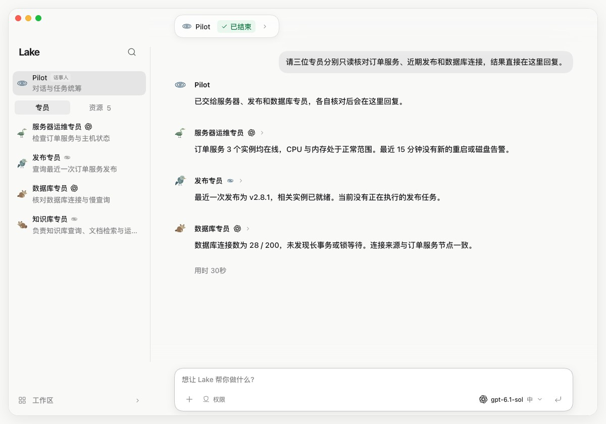
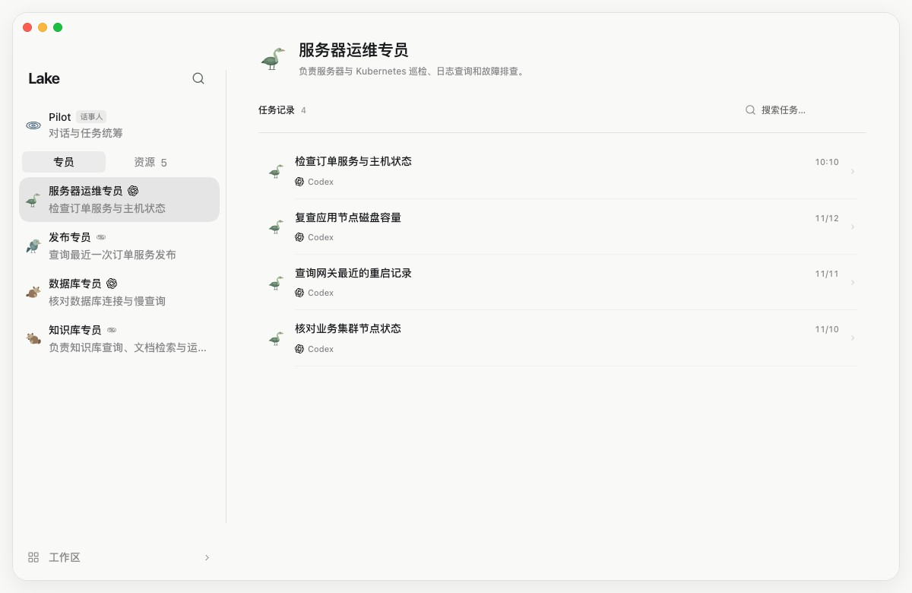

<div align="center">

# Lake

[English](README.md) · **简体中文**

**面向 SRE 的 AI 运维工作台**

把目标交给 Pilot，让专员各自回复，将资源与执行记录留在同一工作区。

[下载 macOS 客户端](https://github.com/Clean-Lakes/Lake/releases/latest) · [快速开始](#快速开始) · [Pilot 使用说明](docs/lake-pilot.md)

</div>

<br>

<!-- v0.3.33: shipping React UI, fictional read-only demonstration data. -->
<picture>
  <source media="(prefers-color-scheme: dark)" srcset="docs/images/lake-workbench-dark.jpg">
  <source media="(prefers-color-scheme: light)" srcset="docs/images/lake-workbench-light.jpg">
  
</picture>

<p align="center"><sub>macOS 界面预览 · v0.3.33 · 虚构演示数据</sub></p>

## 为运维工作而设计

- **Pilot 召集专员参与对话。** 每位专员在当前对话中以自己的身份回复；Pilot 追踪未响应的成员，在你要求总结时综合实际回复。
- **资源就在上下文里。** 侧栏切换专员与项目资源，描述工作时可以引用资源、Skills 和 MCP 工具。
- **执行过程可以追溯。** 使用原生 Lake 专员或通过 ACP 接入 Codex，查看实际执行 Agent、任务记录、工具调用与操作确认。历史失败和结果未知的操作继续保留。

## 每位专员都有任务记录

点击专员查看其任务记录，进入具体任务查看执行详情。侧栏固定的 Pilot 返回主对话；“专员 / 资源”页签分别保留列表位置和目录展开状态。

<picture>
  <source media="(prefers-color-scheme: dark)" srcset="docs/images/lake-specialist-tasks-dark.jpg">
  <source media="(prefers-color-scheme: light)" srcset="docs/images/lake-specialist-tasks-light.jpg">
  
</picture>

<p align="center"><sub>专员任务记录 · 虚构演示数据</sub></p>

## Plan 模式

输入 `/plan` 切换规划模式，或用 `/plan <目标>` 开始规划。Lake 使用只读工具调查，对重要选择提问，并生成可审阅的计划。可以继续对话修订，或选择“执行计划”，沿用当前会话权限继续处理。模式和计划按会话保存。

## 快速开始

1. [下载当前正式版](https://github.com/Clean-Lakes/Lake/releases/latest)，适用于 macOS Apple Silicon，需要 macOS 13.5 或更新版本。
2. 在设置中连接模型，或通过 [Magpie Agent](https://github.com/Clean-Lakes/magpie-agent-lake) 接入。使用 Codex 专员时，先在本机登录 Codex，再到“Agent”设置完成配置。
3. 添加项目资源、Skills 和 MCP 集成，在给 Pilot 的请求中输入 `@` 引用。
4. 让 Pilot 派发任务或召集专员参与对话；从侧栏的专员入口查看各自任务记录。

Pilot 是侧栏中的内置话事人，其权限设置统一作用于专员操作；已有项目限制和 Plan 只读范围继续生效。[了解使用与当前范围 →](docs/lake-pilot.md)

当前正式版 **v0.3.33** 仅提供 macOS 安装包，部分旧版能力仍在完善；具体范围见[发布说明](client/macos/RELEASE_NOTES.md)和[兼容状态](runtime/typescript/parity.json)。

**Lake Memory · 实验**：自动积累和使用自然偏好分别主动开启，当前要求优先；后台整理与压缩补采不阻塞交流。普通会话与 Pilot 协调回复按范围使用偏好，事实与经验仍需核实。人工策略资产保留兼容管理。在线纠错、候选提取和新增对照实验已停用，已保存内容和历史记录保留，见[Lake Memory 使用说明](docs/lake-memory.md)。

<details>
<summary>本地开发</summary>

日常开发从 `develop` 创建工作分支，经 PR 合入 `develop`，在 Lake Dev 验证和累积；生产只通过 `develop → master` 发布 PR 提升。开始修改前阅读 [分支与发布规范](docs/development-workflow.md) 和 [开发规范](CONTRIBUTING.md)，AI 同时遵守根目录 `AGENTS.md`。

需要 Go 1.26.6（以 `go.mod` 为准）、Node.js 24 和 pnpm。macOS 首次构建先运行 `scripts/setup_lake_signing.sh`，然后启动独立的 Lake Dev：

```sh
pnpm --dir web-agent install --frozen-lockfile
scripts/build_lake_desktop.sh --dev --install
open "$HOME/Applications/Lake Dev.app"
```

Dev 使用 `~/.lake-dev`，与正式版数据分离。构建后的程序内嵌前端，运行时无需 Node.js。CLI 和独立 Web 开发见 [开发规范](CONTRIBUTING.md)。

</details>

## 交流与反馈

如果你正在使用 Lake，欢迎聊聊实际场景与改进建议。

<p>
  &nbsp; <strong>WeChat</strong>&nbsp; <code>13025452443</code>
</p>

---

[使用与开发](web-agent/README.md) · [macOS](client/macos/README.md) · [Windows 开发说明](client/windows/README.md) · [贡献指南](CONTRIBUTING.md) · [Apache-2.0](LICENSE-APACHE)
