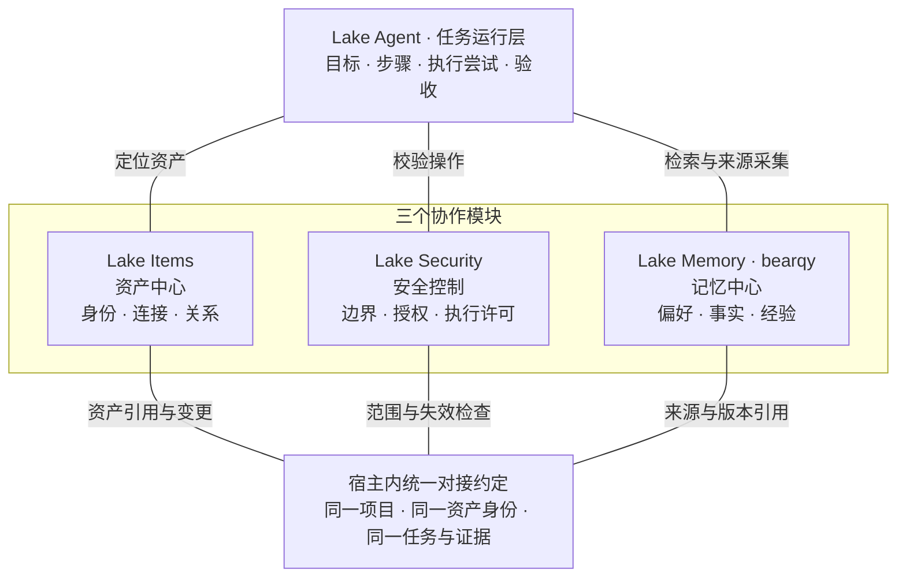

# Lake Super-agent 内核与三模块协作约定

更新日期：2026-11-03。本文记录用户确认的架构方向，供后续 Agent 和模块维护者共同遵循。它不代表所有能力已经实现，也不改变 `AGENTS.md`、`CONTRIBUTING.md` 和 `docs/development-workflow.md` 中的开发、合并、发布与数据隔离要求。

## 0. 统一 Super-agent 内核方向（实施中）

Lake 的目标业务架构统一为持续的 **Pilot Router + 独立任务 Worker**：Pilot 接收用户要求、路由工作、跨任务协调并统一回复；Worker 使用官方 ADK 完成执行，复杂任务内部按同一受控协议组织专员。普通操作、Plan、SRE、保存工作流、日程和外部结果逐步进入同一事件与任务链路，不维护彼此竞争的接单、调度与结清内核。用户无需管理执行会话；内部 Session、原 RootTurnID、操作句柄、审批和证据继续保留。 Pilot 与 Worker 复用当前项目原资源目录和已有权限，不新增用户管理的资源勾选层；未配置过独立策略时由可信宿主接入既有会话权限适配器，明确策略和项目隔离继续生效。

项目可以显式选择继承全局已启用的 MCP。该选择和单服务绑定按项目持久化，专员复用项目的有效目录及操作权限。纯 MCP 或技能任务可使用空资产清单建单。专员普通任务自动注册计划并推进，根据真实工具回执验收；Plan 模式先确认计划。原任务期限、资源权限和具体操作审批继续生效，既有人工或显式业务验收契约不自动改写。详见 [任务计划与结果验收](docs/security/task-confirmation.md)。

2026-11-03 用户明确要求取消单任务累计 token 上限：Super-agent 主/子专员继续累计用量，不以累计 token 总数拒绝后续调用；保留模型单次上下文与输出限制、累计调用轮数、绝对期限、并发、当前权限和验收约束。旧 token 暂停仅解除相应拦截，原用量、操作、资源范围与其他暂停原因保留，不触发历史操作重放。

任务主记录与闭环沿现有 WorkGoal/验收账本收敛，旧 SRE 通过兼容映射分阶段迁移；事件、订阅、Worker 和投递记录不建立另一份任务完成权威。Memory 作为 Router 与 Worker 的横向知识服务，继续以 bearqy 的方案为主；当前 N5 专员/工作流限制、同意与使用开关、运维 V2 门控不会因目标架构改变而自动放开。

长期专员可由 Pilot 独立创建、列出和编辑名称/职责，创建不附带任务或许可；按稳定 RoleID 复用。任务创建时冻结职责版本，后续编辑不改写已有任务。详见 [长期专员管理](docs/lake-pilot.md#长期专员管理)。

长期专员入口与执行上下文分离：同一项目/准确 RoleID 使用一个连续角色频道，每项工作仍有独立 Task、Worker 和 ADK Session。频道不能签发许可或隐式扩大旧任务；跨任务比较只读取显式登记且当前可读的证据。实现和验收进度见 [长期专员频道计划](plan/feature-specialist-channel-1.md)，不改变下述 Memory 所有权和门控。

完整对象、职责、迁移、Memory 对接、分期任务及验收见 [Lake 统一 Super-agent 内核实施方案](plan/architecture-lake-superagent-1.md)。该计划状态为 In progress；以任务勾选及实际验证记录为准，未完成接入的能力不视为已启用。下面的 Items、Security、Memory 分工继续有效。

## 1. 总体分工

| 模块 | 定位 | 权威职责 |
| --- | --- | --- |
| **Lake Items** | 资产中心 | 管理稳定资产身份、访问入口、连接配置与版本、项目归属，以及已登记/确认的资产关系 |
| **Lake Security** | 安全控制中心 | 管理访问与执行边界、授权、审批、操作资格、撤销和安全恢复约束 |
| **Lake Memory** | 记忆中心，**以 bearqy 的方案和实现为主** | 管理偏好、事实、方法、历史经验、关系断言及其来源、时间、版本、冲突、撤销和遗忘 |

**Lake Items 不是任务中心。** 目标、步骤、执行尝试、进度、证据关联和验收由现有任务运行层负责，继续使用官方 ADK 与原操作/证据账本。

连线是模块协作关系，不是执行步骤。“统一对接约定”是宿主内类型和适配接口，不是新增服务或数据库。

## 2. Memory 以 bearqy 设计为主

- 延续 bearqy 已交付的 N1–N5：来源与同意、自然偏好形成、空闲整理、压缩前增量捕获、按范围召回。保留现有 SQLite、outbox、worker、前台抢占、版本重验、撤销及遗忘机制；以增量适配完成三模块协作。
- Memory 内部的知识模型、来源资格、时间语义、归并/冲突、检索、正文版本及整理调度由 bearqy 维护；跨模块接口和职责调整需要与其方案对齐。本约定不授权向其本地分支写代码或替其启用功能。
- 保留“以资产组织知识”的方向。资产注册、创建、绑定、合并、拆分和真实入口配置归 Items；Memory 保存资产引用、知识关联、历史与观测断言。资产型 Memory 草稿中的相应管理设计按此边界调整，不在 Memory 内再建立竞争的资产事实源。
- Items 保存已登记/确认的拓扑；Memory 可以保存带来源、观测时间和可信状态的关系断言。一次历史观测或推断不会直接覆盖当前登记关系，核实后通过 Items 的正常变更入口更新。
- SQLite 保存记忆正式记录；Markdown、索引和知识卡是可重建投影。投影编辑不自动变成可信来源或反向改写连接配置。
- 自动积累与使用已有记忆各自独立，沿用现有同意与开关语义。取得一次任务授权不等于同意长期采集、无限后台模型调用或未来资产操作。
- 当前已合入的自然偏好仍按现有实验、角色和范围限制工作；运维 V2 保持实际门控和独立启用验收。不能把设计文档、测试夹具或 N5 完成当作完整资产记忆已经上线。

## 3. 三组必须对齐的接口

| 接口组 | 提供者 | 使用约定 |
| --- | --- | --- |
| 资产快照与变更 | Items | 提供实际资产/入口身份、当前连接版本、项目归属、关系两端和持久变更通知；Memory 与 Security 使用同一份权威引用 |
| 安全资格 | Security ＋ 宿主 | 分别判定记忆读取、管理、采集、后台模型派发和资产操作资格；Memory 继续保留来源、版本、同意、冲突及遗忘检查 |
| 执行与验收来源 | 任务运行层 | 提供已提交消息、操作、证据及可核验的验收引用；Memory 提炼知识，不修改真实执行状态或目标完成状态 |

共享 `projectID/sessionID`、资产/入口引用、轮次、操作与证据身份。有可信关联时才附带 `goalID/stepID/attemptID/acceptanceID/securityTaskID`；普通偏好允许没有 goalID，禁止用会话或轮次 ID 伪造目标关联。

资产身份版本、连接版本、记忆 revision、同意 epoch 和 Security recoveryEpoch 各有独立语义。现有 `resourceID/generation` 保留兼容；稳定 assetID 未交付前不按名称/IP 自动合并，V2 generation 不能直接充当完整 Security 连接版本。

可信上下文由宿主从实际会话、资产配置和账本解析，模型参数、工具 stdout、记忆正文与压缩摘要均不能签发授权或自报可信身份。凭据继续通过原宿主密钥引用处理，不写入记忆与共享模型上下文。

## 4. 联动与任务闭环

- 每次记忆索引、准确正文读取、provider 续接和后续工具执行按现有规则重验资格；后台模型派发前和事务提交前重新检查同意、来源、资产版本、gate、租约及取消状态。
- 资产改名不改变对象身份或历史归属；换连接、换实际对象、依赖入口变化、归档恢复或权限收窄使受影响的绑定、缓存及执行资格重新核验，不能把旧事实自动激活为当前事实。
- 资产事件必须持久、幂等并可重送；最终读取/派发查询权威版本。通知只是失效加速，不能替代实际安全检查或跨库派发的事务/barrier。
- 关系记忆校验全部必要资产和来源范围，不能通过一端资产、全局表达偏好、准确 ID、分页、缓存或导出泄露另一项目的私有资料。
- 撤回、遗忘和关闭使用沿现有 Memory 语义失效正文、支持来源、缓存和投影；原操作、审批、证据及未知副作用记录保持原状态。关闭积累停止新增，但不等于删除已有内容。
- 一次操作成功不等于整个目标验收通过。失败、unknown、孤儿或未验收结果不能被总结成成功经验；任务 B 成功不能自动关闭任务 A，Memory 的结论也不能解除原未决风险。
- 标准 SOP 作为独立的版本化作业定义；Memory 保存其适用线索、条件和历史案例。任务运行层组织步骤，Security 校验执行。SOP 清单 UI 继续按独立方案交付，三模块后端对接不捆绑 UI 改造。

## 5. 实施顺序

1. **先接已有能力**：以 bearqy 的 N1–N5 和现有项目记忆为基础，接宿主上下文、当前资源引用、gate、项目范围与同意检查；保持现有角色边界。不能用无条件 allow 桩冒充尚未完成的 Security。
2. **再接资产中心**：Items 交付稳定身份、通用连接版本和持久变更事件后，Memory 增量接入资产绑定、关系范围、缓存失效及迟到提交拒绝。
3. **最后接任务闭环**：任务运行层及 Security 实际交付目标/尝试/证据/验收和任务授权后，Memory 引用这些真实记录，完成经验来源与安全联动；运维 V2 另行验收、单独提出启用变更。

每批都有相应的兼容、范围、撤回、版本变化、后台迟到和恢复测试，并记录 tested SHA。文档修改不能宣称运行验收通过；未完成的依赖保持待实施，不默认开启功能。

## 6. 详细规格与维护

[Lake Super-agent 完整产品方案（二期规划）](plan/architecture-lake-superagent-2.md)承接本机内核与长期专员，分阶段规划外部 Trigger、订阅直通、全双工验收、独立巡检、云端控制面和设备执行。各阶段按独立验收记录更新交付状态。

- [统一 Super-agent 内核实施方案（待实施）](plan/architecture-lake-superagent-1.md)
- [三模块对接说明、当前进度、接口与验收矩阵](docs/design/items-security-memory-integration.md)
- [分阶段实施计划与 12 项待实施任务](plan/feature-items-security-memory-integration-1.md)
- [Memory 当前使用与兼容说明](docs/lake-memory.md)及[自然记忆 N1–N5 计划](plan/feature-natural-memory-1.md)
- [Security 设计](docs/design/lake-security-v1.md)及[实施计划](plan/feature-lake-security-1.md)
- [运维 V2 的门控与未完成验收](docs/validation/lake-operational-memory-v2.md)

变更前重新核对实际代码、已合入 PR 与维护者当前方案。发现旧草稿或历史阶段记录与本文职责约定不一致时，明确记录差异并更新对应规格，不把未交付能力写成现状；用户后续明确调整架构时同步维护本文件与详细说明。
