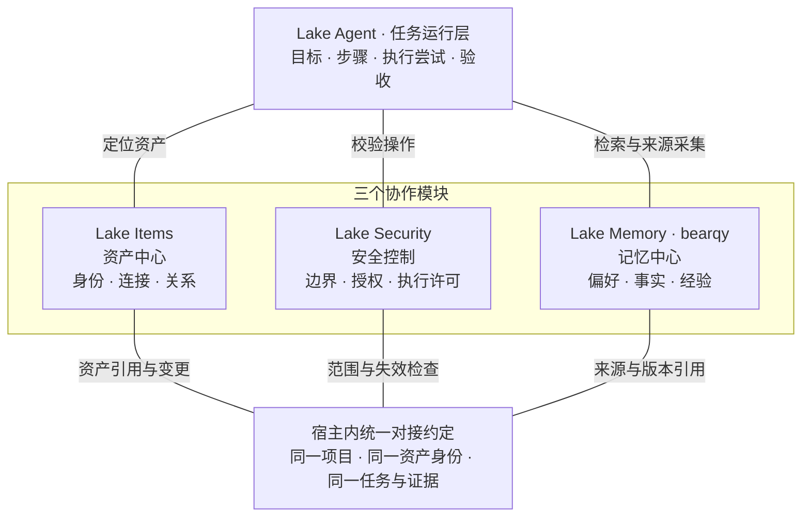

# Lake Super-agent 内核与三模块协作约定

2026-11-10 用户提出让专员、任务 Worker 及任务内 subagent 通过 ACP 驱动 Codex、Claude Code 等独立 Agent。方向为统一可选执行后端：长期专员保存新任务默认配置，Worker 与逻辑 child 使用独立任务会话，原生 Worker/child 也可调用外部执行段；Task、权限、Memory 和验收仍归原模块。ACP 通知与外部回答只提供过程和结果线索，真实业务证据来自 Lake 工具桥或宿主独立验证。协议本身不提供沙箱，外部工具约束须按适配器版本和平台实测；不能以全量自动批准替代当前 Pilot 权限。详见 [ACP 外部 Agent 执行设计](plan/architecture-acp-agent-execution-1.md)。用户最新修订仅保留 Codex 外部后端：移除 runtime-acp 启动与私有模型代理，历史绑定只读且禁止改派或重放；Lake 自身的公开 SDK 保留。未设置偏好的专员默认 Codex，执行选择统一在聊天框模型菜单；启用时自动识别本机 Node/npm 并准备固定连接，独立 Codex 不依赖普通模型 Key。按用户后续明确要求，直接复用宿主 CODEX_HOME（默认 ~/.codex）已有登录和模型/服务配置，取消 Lake 项目独立 Key；不复制凭据或改写本机配置。新 profile 升级 schema2，账号/配置变化递增 revision，同账号令牌刷新保持身份；旧 Worker/run 不改写。仍固定已验证引擎与模型工具目录，启动及线程层逐个禁用继承 MCP、hooks、notify，业务工具走私有 Lake MCP/ToolExecutor；SQLite 与日志保留在 Lake 私有目录。详见[本机登录实施](plan/refactor-codex-local-login-1.md)。详见[统一模型入口实施](plan/refactor-codex-composer-1.md)。项目设置按需启用，现有任务及一层逻辑 child 约定保持；实际验证与剩余范围见 [兼容记录](docs/validation/acp-agent-execution/compatibility.md)。

2026-11-09 用户要求专员统一跟随 Pilot 的执行偏好，开启相应自动执行后不再额外确认。TypeScript 的 Pilot、独立 Worker 和原生 child 共用当前项目 Pilot 的分类开关及共享默认值；Python/动态脚本的风险等级、SDK build 模式、MCP stdio 发现、旧策略可用能力的单次 ask 不再形成第二套操作审批。关闭开关时，实际工具调用在 I/O 前等待原生审批。文件/搜索/技能/网页读取、写入、命令/主机检查、数据库只读查询及 MCP 发现/调用分别使用对应开关。风险和只读证明保持原样；自动执行不改变资源归属、明确 deny、连接/凭据/SSH 指纹、Plan/明确只读范围、停止/代次/期限、Memory 与结果验收。原待确认调用不自动批准或重放；人的终端接管与任务计划确认保留原协议。专员频道与 Worker 只投影 Pilot 的有效权限，不维护独立权限配置。见[实施计划](plan/refactor-pilot-operation-permissions-1.md)。

2026-11-09 调查文件与聊天结论分别交付：普通任务已有本轮实际操作却未提交 `work_finish` 时，通过 SDK 原生 Stop hook 在同一轮内请求一次结论补报，不创建新的任务、执行上下文或自定义模型循环。补报只使用已有结果、原后台任务汇合和结果提交，不重复调查命令或追加文件。正常提交的完整/部分总结直接沿原频道投递；仍未提交时明确显示未完成。显式计划、正在等待的人工输入、停止、原操作结果及任务/共同验收仍由原账本负责，不从调查文件推断成功。实现与验证见[结论补报记录](docs/validation/typescript-candidate/final-report-2026-11-09.md)。

2026-11-09 用户明确要求彻底取消“旧操作待核实阻断命令”的机制：TypeScript 的新 Bash 调用不再因原任务、同项目、旧 Go、共同任务或同 SSH 目标的历史 unknown/dispatched、已核实变更目录及命令去重而拒绝派发；不以只读分类证明作为绕过旧锁的前提。同一原调用 ID 仍幂等、不自动重放；失败/unknown 原样记录，不能当成功证据。当前项目权限、准确资源与配置、SSH 指纹、有效执行代次/停止/期限、显式 Plan 或用户只读范围继续独立生效。非命令适配器保留原合同。此条替代下文旧方案中关于命令冲突锁与变更目录重放围栏的要求，见[实施计划](plan/refactor-command-pending-gates-1.md)。

2026-11-09 只读复查回执修复：长工具输出通过 `read_tool_output` 按本轮准确调用 ID 分页读取原 Operation，重验任务/代次/子执行归属、资源、策略与输出哈希；不读取模型指定的 SDK 文件、不启动本机命令、不新增业务证据。普通 Bash 资源与参数预检失败沿 SDK 的可恢复工具校验返回，权限解析和实际 I/O 前仍重验；虚拟化探测仅准确查询参数可证明只读。原 unknown、记忆依赖和验收保持。见[修复计划](plan/refactor-readonly-recheck-output-1.md)。

2026-11-09 记忆失效续查修复：旧 Worker 的记忆来源失效时，保留其原上下文与读取依赖，不通过清空记录继续执行。新的真实人工输入通过 followup 或 create + predecessor_task_id，均可为同一稳定专员建立独立只读复查，限于原明确资源与原截止时间；跳过旧任务摘要、SDK 历史及长期知识注入。原 Task、unknown、显式计划及共同验收不改写；新复查的完成不能结清原任务。缺少准确范围、显式计划、共同任务、期限到达或原 Worker 尚在运行时不自动建立复查。宿主真实记忆错误优先显示，准确匹配旧报告及失败 root/error 卡片时仅修正读取展示。见[实施计划](plan/feature-memory-invalid-readonly-recheck-1.md)。

2026-11-09 SSH 恢复修复：有界 `date` ISO 显示、`last` 重启记录及禁用分页的 `journalctl` 查询按准确参数识别只读，不把同名程序的维护/写入选项一并放开。SSH 宿主保存命令派发阶段；明确在 exec 前失败的调用保留真实失败，可在当前授权内发起新调用。原调用 ID 仍不可重放，exec 请求后断线保持未知，独立只读查询可继续但不能解除原未知结果或验收整项。旧记录缺少阶段证明时不根据错误文字自动结清。见[修复计划](plan/refactor-ssh-readonly-recovery-1.md)。

2026-11-09：Pilot 的资源工作默认创建或复用稳定专员执行，简单 SSH 检查、数据库查询和知识库读取也遵循此分工；没有专员时由 Pilot 创建并派单。纯对话、解释已有结果和协调仍直接答复。用户在当前请求中明确要求 Pilot 亲自执行时，保留完整通用能力，临时子智能体不替代默认的长期专员交接。这是模型协调策略，不是权限裁剪或授权。普通 Pilot 任务与专员统一使用宿主自动记账及结果提交；已有显式计划保留原验收路径。旧自动任务已验收步骤的收尾须重新核对原回执、当前执行代次、策略和资源，不能因最终正文而补造成功。见[修复计划](plan/feature-pilot-delegation-and-completion-1.md)。

2026-11-08 用户明确选择当前 TypeScript 后端用于本次 macOS 0.3.28 正式发布，允许发布当前功能水位；本条仅取代下文的 Dev-only 分发限制，不代表完整等价矩阵通过。macOS 默认包使用签名 TS SEA，正式身份明确传入 `--production`，Dev 使用 `--dev`，两者 Home 不混用。迁移只读取所选 Home 的原数据和凭据引用，旧 Go 账本保留、不重放历史。未完成能力、升级与回退边界见 [0.3.28 发布说明](client/macos/RELEASE_NOTES.md)。

TypeScript Dev 的本机 Watchdog 周期性读取每个专员分工的进展，遇到持续停滞或到达复核间隔时使用独立模型上下文审阅。项目选择「允许纠偏」后，可以向原执行会话发送提示，或在模型暂时故障且成员尚未调过工具时有限重试。任务、证据、审批、权限、记忆及共同验收由各自的原账本管理。跨进程监督和实际工作负载的误报评估见 [Watchdog 实施方案](plan/feature-typescript-watchdog-1.md)。

2026-11-07：TypeScript Dev 支持长期专员与任务多对多。同一公共 Task 在各参与角色的频道可见；每个分工有独立的 Worker、Session、attempt 和 Operation，按稳定 RoleID 投递。成员贡献回执不是目标验收：只有全部成员的真实证据复核通过，任务账本才生成一张统一验收回执。这个约定更新了下文早期阶段「每个目标只有一个专员」的假设；原任务期限、累计轮数、项目权限、未决操作、角色记忆范围及旧任务历史继续保留。见[多专员共同任务](docs/lake-pilot.md#多位专员共同处理一项任务typescript-dev)。

更新日期：2026-11-06。本文记录用户确认的架构方向，供后续 Agent 和模块维护者共同遵循。它不代表所有能力已经实现，也不改变 `AGENTS.md`、`CONTRIBUTING.md` 和 `docs/development-workflow.md` 中的开发、合并、发布与数据隔离要求。

## 后端迁移方向（2026-11-05，Dev 预览）

2026-11-06 用户确认：Worker 是 Lake 为任务分配的执行实例；开启 原生子智能体供 Worker 按需组织任务内工作。临时子智能体不创建长期专员或独立目标完成权威。原 Task 持有目标、权限、尝试、业务工具回执及验收；子执行使用独立上下文，当前仅允许一层，继续受父任务范围与权限约束。点击任务在第三联展示 Worker、真实子智能体过程与工具结果，多资源保留项目原目录层级，跨资源汇总放任务层。实施与验收见 [任务 Worker 原生子智能体计划](plan/feature-worker-native-subagents-1.md)，未验证项不作为已交付能力。

用户确认保留 Lake UI，直接使用 Agent SDK v3.17.2 源码，将后端语言迁为 TypeScript，并要求**全部既有功能保留并验收后进行完整切换**。2026-11-05 用户进一步明确授权将 TypeScript Dev 覆盖现有 Dev，增加显式 `--dev --ts-candidate --install` 入口；这不等于全量验收或正式切换。新后端直接使用 AgentRuntime 与 Node adapters，不通过 Go 模型代理；普通默认构建与正式版继续维持当前实现。TS Dev 使用独立命名的 SQLite，旧 Go 数据保留；当前增量迁入项目/专员/频道稳定身份及只读历史，不自动重派任务。真实 Pilot/独立 Worker、文件工具回执验收和只读失败恢复已进入候选验证，完整资源、安全、Memory 及平台等价验收仍待交付。

Items、Security、Memory、任务与证据的权威职责、bearqy 当前记忆方案、范围/同意/撤回及 unknown 不重放约束继续有效。不能将上游通用权限、会话或工具能力当作 Lake 对应安全与业务合同已经迁移。独立候选使用独立 Home；已授权的原生 Dev 预览可用 `.lake-dev`，正式 Home 始终拒绝，旧运行账本不改写。下面关于 ADK 的实现说明记录现有完整产品水位；目标 TS 对接按 [迁移计划](plan/refactor-typescript-backend-1.md)、[候选边界与验证](runtime/typescript/README.md) 和完整等价矩阵逐项推进，不提前开启未完成能力。

## 0. 统一 Super-agent 内核方向（实施中）

2026-11-08 用户确认取消任务模型轮次硬上限。TypeScript 的 Pilot、专员 Worker、临时子智能体和共同任务继续记录实际调用量，不再由累计 modelRounds、旧 roundLimit 或旧 maxSteps 拒绝派单、续接、模型调用与恢复；详情不显示轮次用量/上限。历史计数与旧配置留作原始记录，既有轮次暂停须经当前输入或明确恢复后继续，不在升级时自动重跑。任务绝对期限、停止、权限、未决操作及业务验收继续有效；本条取代下文和旧计划中关于累计轮次门禁的约束。

2026-11-06 用户进一步确认：Pilot、长期专员对应的 Task Worker 和临时 child 共享通用 Agent 执行能力，职责不用于裁剪 Shell、文件、搜索或工具使用。Pilot 默认协调和委派，也可直接调查与执行；首次实际执行按本轮受信输入建立原 Task/attempt/Operation，纯对话及派单不制造业务任务。直接任务在连续 Pilot 展示入口内保留独立的目标、操作、待办与有界请求工作集；专员 Worker 和 child 仍使用独立 SDK Session。SSH Bash 通过准确资源与当前配置版本接入已有凭据/指纹，模型可使用远端已安装的 kubectl、mysql 等工具自主调查；缺少专用适配器不等于没有通用执行能力。计划切换与工具延迟加载均经过同一权限包装，后台进程汇合和停止沿原 Task 记账。完整通用 Agent 接入及外部可选服务边界见[实施计划](plan/feature-typescript-agent-capabilities-1.md)和[验证记录](docs/validation/typescript-candidate/agent-capabilities.md)。此方向取代下面历史阶段的“Pilot 只路由/固定诊断”限制，既有资源、安全、记忆及未知操作职责继续有效。

Lake 的目标业务架构统一为持续的 **Pilot Router + 独立任务 Worker**：Pilot 接收用户要求、路由工作、跨任务协调并统一回复；Worker 使用官方 ADK 完成执行，复杂任务内部按同一受控协议组织专员。普通操作、Plan、SRE、保存工作流、日程和外部结果逐步进入同一事件与任务链路，不维护彼此竞争的接单、调度与结清内核。用户无需管理执行会话；内部 Session、原 RootTurnID、操作句柄、审批和证据继续保留。 Pilot 与 Worker 复用当前项目原资源目录和已有权限，不新增用户管理的资源勾选层；未配置过独立策略时由可信宿主接入既有会话权限适配器，明确策略和项目隔离继续生效。

项目可以显式选择继承全局已启用的 MCP。该选择和单服务绑定按项目持久化，专员复用项目的有效目录及操作权限。纯 MCP 或技能任务可使用空资产清单建单。专员普通任务自动注册计划并推进，根据真实工具回执验收；Plan 模式先确认计划。原任务期限、资源权限和具体操作审批继续生效，既有人工或显式业务验收契约不自动改写。详见 [任务计划与结果验收](docs/security/task-confirmation.md)。

2026-11-05 用户授权精简 TypeScript Dev 的对话执行架构：保留 Pilot 与独立 Worker，Pilot 请求工作集保留当前频道最近四轮对话、公开专员报告、任务焦点与实际适配器能力。旧阻碍是历史观察，不能代替当前检查。普通新任务由宿主自动建立步骤/attempt、关联真实工具回执；专员以 `work_finish(summary, outcome)` 明确提交完成或部分结果，不再逐次手填步骤和证据 ID。明确 Plan、多步骤旧契约和既有验收保持；旧 TS 普通单步未验收任务可保留原记录接管，旧 Go 任务仍只读。模型回复本身不构成完成，真正完成仍须当前有效的成功业务回执。未知写入不能重放，宿主证明且权限允许的独立只读诊断可继续；结果未知时整个任务不能冒充验收完成。需确认只对应当前真实交互。实施与验证见 [普通任务改造计划](plan/refactor-typescript-conversation-runtime-1.md)和 [验证记录](docs/validation/typescript-candidate/conversation-runtime.md)。

2026-11-04 用户确认远程 MCP 按稳定服务 ID 隔离未决调用：无资产绑定的远程 MCP 不受旧主机/数据库未决操作全局阻断，同一服务的未决调用仍阻断跨任务、跨项目重试。服务身份不明的旧 MCP 调用仍阻断 MCP；本机 stdio、带资产绑定的调用和恢复阻断沿用原检查。MCP 仍为 opaque，具体调用审批与配置/目录/凭据版本重验不变。

项目专员的普通任务统一继承 Pilot 当前权限，不维护独立权限入口；Pilot 可选择自动调用项目 MCP 工具，明确项目策略与服务未决操作检查继续生效。操作绑定真实 Pilot 来源与权限版本，已提交历史结果保留原权限快照，旧待确认提案不会自动转成人工批准。

2026-11-06 程序发现误锁修复：字面量 `command -v/-V` 只检查程序是否存在，缺少可选程序的非零退出不产生写入不明。旧 TS 仅包含字面量 hostname 与程序查找、且有准确 SDK 调用和完整宿主失败回执的记录，可由宿主另存“无写入”核验凭证；原 Operation、执行结果和尝试不改写、不重放，也不作为业务成功。任意 CLI、SQL、动态脚本、超时/中断及来源不全的 unknown 保持原核实要求；新执行继续重验当前权限与资源版本。

2026-11-03 用户明确要求取消单任务累计 token 上限：Super-agent 主/子专员继续累计用量，不以累计 token 总数拒绝后续调用；保留模型单次上下文与输出限制、累计调用轮数、绝对期限、并发、当前权限和验收约束。旧 token 暂停仅解除相应拦截，原用量、操作、资源范围与其他暂停原因保留，不触发历史操作重放。

任务主记录与闭环沿现有 WorkGoal/验收账本收敛，旧 SRE 通过兼容映射分阶段迁移；事件、订阅、Worker 和投递记录不建立另一份任务完成权威。Memory 作为 Router 与 Worker 的横向知识服务，继续以 bearqy 的方案为主；当前 N5 专员/工作流限制、同意与使用开关、运维 V2 门控不会因目标架构改变而自动放开。

交互任务与资源选择解耦：任务可以先建立目标和步骤，再按执行需要发现所属项目的数据库、主机、集群、MCP 或技能。同一目标补充资源不另建 Task/Worker，不冻结首次目录为资源白名单。任务中的资源字段是历史参考；每次操作仍绑定准确资源、当前连接版本、参数、权限及原操作句柄。明确的用户/父任务边界、保存工作流的冻结模板、未决副作用和验收条件继续由各自原账本约束。无完整受信操作描述的旧自动恢复保留原保守核验，不自动迁移或重放。

长期专员可由 Pilot 独立创建、列出和编辑名称/职责，创建不附带任务或许可；按稳定 RoleID 复用。任务创建时冻结职责版本，后续编辑不改写已有任务。详见 [长期专员管理](docs/lake-pilot.md#长期专员管理)。

长期专员入口与执行上下文分离：同一项目/准确 RoleID 使用一个连续角色频道，每项工作仍有独立 Task、Worker 和 ADK Session。频道不能签发许可或隐式扩大旧任务；跨任务比较只读取显式登记且当前可读的证据。实现和验收进度见 [长期专员频道计划](plan/feature-specialist-channel-1.md)，不改变下述 Memory 所有权和门控。

完整对象、职责、迁移、Memory 对接、分期任务及验收见 [Lake 统一 Super-agent 内核实施方案](plan/architecture-lake-superagent-1.md)。该计划状态为 In progress；以任务勾选及实际验证记录为准，未完成接入的能力不视为已启用。下面的 Items、Security、Memory 分工继续有效。

## 1. 总体分工

| 模块 | 定位 | 权威职责 |
| --- | --- | --- |
| **Lake Items** | 资产中心 | 管理稳定资产身份、访问入口、连接配置与版本、项目归属，以及已登记/确认的资产关系 |
| **Lake Security** | 安全控制中心 | 管理访问与执行边界、授权、审批、操作资格、撤销和安全恢复约束 |
| **Lake Memory** | 记忆中心，**以 bearqy 的方案和实现为主** | 管理偏好、事实、方法、历史经验、关系断言及其来源、时间、版本、冲突、撤销和遗忘 |

**Lake Items 不是任务中心。** 目标、步骤、执行尝试、进度、证据关联和验收由现有任务运行层负责，继续使用官方 ADK 与原操作/证据账本。

连线是模块协作关系，不是执行步骤。“统一对接约定”是宿主内类型和适配接口，不是新增服务或数据库。

## 2. Memory 新主线：Agent 自主管理本地文件

2026-11-06 用户确认 TypeScript 采用原生 Memory 引擎并保留 Super-agent 分层：用户明确保存的跨项目偏好、项目共享和稳定 RoleID 经验。TS 候选通过公开 AgentRuntime 的原生提取、私有暂存与 Lake 单一发布者接入；Provider 每次读取重验范围与来源，临时 child 不建立长期库。项目及角色共用积累/使用开关，新 Home 默认关闭；全局偏好仅明确保存。设置支持来源、更正和遗忘，旧 Go 数据不自动导入。当前边界及验收见 [TS 分层记忆](docs/design/typescript-layered-memory.md)和[实施计划](plan/feature-typescript-layered-memory-1.md)。以下 ADK/FM 描述保留旧 Go 产品及历史计划，TS 不另建并行 ADK 提取器；未验收平台和完整迁移仍保持原门禁。

- 当前唯一开发主计划为 [Agent 本地文件记忆](plan/feature-agent-file-memory-1.md)。旧项目记忆、运维 V2、自然记忆和三模块旧对接任务路线已替代；历史交付事实与必要审计保留，未完成项不再按旧内容继续开发。
- 目标采用两阶段后台 ADK Agent：会话/任务来源提取 → SQLite 中间结果与运行状态 → 文件整理 Agent → 本地摘要、手册、来源总结及方法资料。程序安排资格、调度和恢复，模型自主组织知识；用户控制开关、查看、纠正和删除，不建设逐条审核、采用和晋升平台。
- 当前源码仍是 SQLite 记忆正文与 Markdown 投影，新流水线尚未实现。目标中 SQLite 保留同意、提取结果、outbox、租约、用量和抑制状态；文件保存 Agent 整理的成品。迁移不能让两套成品长期并行写入或重复注入，也不要求所有历史字段都改成文件资产。
- N1–N5 的真实来源、独立同意、压缩前捕获、前台优先、撤回/遗忘和幂等可复用；旧条目管理、内容整理算法、注入/投影与 UI/API 在新链路接管后下线。无实际依赖的 V2 代码分批删除，不翻转旧门控来完成新功能。
- Memory 内部设计和实现继续由 bearqy 维护。Items 管理资产身份、连接与登记关系；Security 管理执行资格；Memory 只保存知识与原记录引用，不维护另一套资产注册表或任务完成权威。历史观测不覆盖当前拓扑，文件和摘要不能签发权限。
- Pilot 首批接入分层读取；Worker 在任务/资源范围视图单独验收前保持 unavailable。原任务历史证据读取、ADK、普通 Skills、会话压缩、操作/审批/验收/unknown 账本不随旧 Memory 一并退役。
- 不自动重新扫描开启前历史，不复活退役策略资产、在线纠错或自动可执行 Skill；本期不引入向量模型、外部基础设施或端云记忆同步。新计划合入不代表运行开关已改变或新角色已启用。

### 2.1 上下文与角色长期知识方向（2026-11-05，分批实施）

用户确认参考 xAI Grok Bot 的分层思路：专员按 `storeID + projectID + RoleID` 长期保留知识，每项新任务使用独立 Task/Worker/ADK Session，Pilot 只接收必要任务摘要与准确引用。频道是连续展示入口，不是共享执行历史；改名保留知识，同名新角色不继承。任务当前状态/未决操作和长期知识分开，动态观测需重查。

[上下文与角色知识总方案](plan/architecture-context-role-memory-1.md)的 CM 阶段负责请求工作集、摘要、预算和角色范围适配；[文件记忆主计划](plan/feature-agent-file-memory-1.md)的 FM 阶段继续独占来源提取、整理、文件发布及旧实现退役。角色文件纳入同一 Memory 流水线，不新增每角色学习器；2026-11-06 用户要求试接 Claude-Mem，TS 候选现以可选私有本地检索索引接入，原生 Memory 与 Lake 单一成品发布者保持；不成为强制正文库，也不启用第二套 observer。见 [本地检索适配](runtime/claude-mem/README.md)。

CM 首批已接通 Pilot 短任务摘要、准确引用/hash 与实际请求历史投影，并提供基础身份/范围类型。原始档案保留；完整 Task 工作集及角色文件写入、读取、遗忘尚未交付。当前字段与限制见[首批契约](docs/design/context-role-memory-contract.md)，不能将基础类型视作 FM 发布者已经运行。

角色知识视图须按准确身份、当前项目权限、来源和使用设置独立验收。现有 Worker unavailable、N5 限制和 V2 关闭状态保持至对应代码/验证交付；不通过复制全项目知识补齐，不新增专员权限配置或任务资源勾选层。清理模型上下文不删除知识或执行账本；纠正、遗忘和角色删除沿同一来源抑制与清理协议。

## 3. 三组必须对齐的接口

| 接口组 | 提供者 | 使用约定 |
| --- | --- | --- |
| 资产快照与变更 | Items | 提供实际资产/入口身份、当前连接版本、项目归属、关系两端和持久变更通知；Memory 与 Security 使用同一份权威引用 |
| 安全资格 | Security ＋ 宿主 | 分别判定记忆读取、管理、采集、后台模型派发和资产操作资格；Memory 继续保留来源、版本、同意、冲突及遗忘检查 |
| 执行与验收来源 | 任务运行层 | 提供已提交消息、操作、证据及可核验的验收引用；Memory 提炼知识，不修改真实执行状态或目标完成状态 |

共享 `projectID/sessionID`、资产/入口引用、轮次、操作与证据身份。有可信关联时才附带 `goalID/stepID/attemptID/acceptanceID/securityTaskID`；普通偏好允许没有 goalID，禁止用会话或轮次 ID 伪造目标关联。

资产身份版本、连接版本、记忆 revision、同意 epoch 和 Security recoveryEpoch 各有独立语义。现有 `resourceID/generation` 保留兼容；稳定 assetID 未交付前不按名称/IP 自动合并，V2 generation 不能直接充当完整 Security 连接版本。

可信上下文由宿主从实际会话、资产配置和账本解析，模型参数、工具 stdout、记忆正文与压缩摘要均不能签发授权或自报可信身份。凭据继续通过原宿主密钥引用处理，不写入记忆与共享模型上下文。

## 4. 联动与任务闭环

- 每次记忆索引、准确正文读取、provider 续接和后续工具执行按现有规则重验资格；后台模型派发前和事务提交前重新检查同意、来源、资产版本、gate、租约及取消状态。
- 资产改名不改变对象身份或历史归属；换连接、换实际对象、依赖入口变化、归档恢复或权限收窄使受影响的绑定、缓存及执行资格重新核验，不能把旧事实自动激活为当前事实。
- 资产事件必须持久、幂等并可重送；最终读取/派发查询权威版本。通知只是失效加速，不能替代实际安全检查或跨库派发的事务/barrier。
- 关系记忆校验全部必要资产和来源范围，不能通过一端资产、全局表达偏好、准确 ID、分页、缓存或导出泄露另一项目的私有资料。
- 撤回、遗忘和关闭使用沿现有 Memory 语义失效正文、支持来源、缓存和投影；原操作、审批、证据及未知副作用记录保持原状态。关闭积累停止新增，但不等于删除已有内容。
- 一次操作成功不等于整个目标验收通过。失败、unknown、孤儿或未验收结果不能被总结成成功经验；任务 B 成功不能自动关闭任务 A，Memory 的结论也不能解除原未决风险。
- 标准 SOP 作为独立的版本化作业定义；Memory 保存其适用线索、条件和历史案例。任务运行层组织步骤，Security 校验执行。SOP 清单 UI 继续按独立方案交付，三模块后端对接不捆绑 UI 改造。

## 5. 实施顺序

按 [新主计划 FM 阶段](plan/feature-agent-file-memory-1.md#3-分批实施) 推进，历史遗留清理优先级最高：先审计 caller 和存储/恢复契约，立即删除已无依赖的旧运行代码；每批实现前重复清理，不推迟到最终验收。仍支撑实际链路的旧 Memory 在后台提取、文件整理和 Pilot 读取接替后迁移，停止旧写入/注入再移除；随后接 Worker 范围读取及质量验收。保留项必须说明依赖和退出条件，见 [首批遗留审计](docs/design/agent-file-memory-legacy-audit.md)。

CM 的 Pilot 工作集/摘要可在 FM 新流水线启用前独立交付；角色持久知识与 Worker 读取按 CM/FM 依赖完成后验收，不把本方案当成开关授权。

三模块的资产身份、权限、来源、时间和撤回边界继续有效；旧 12 项条目管理对接任务不再是排期前提。Super-agent 外部事件主线可以在 Worker 知识视图 unavailable 时继续。每批记录准确 tested SHA 与平台缺口，经 develop PR 交付，不将文档替代视作运行下线或验收完成。

## 6. 详细规格与维护

[Lake Super-agent 完整产品方案（二期规划）](plan/architecture-lake-superagent-2.md)承接本机内核与长期专员，分阶段规划外部 Trigger、订阅直通、全双工验收、独立巡检、云端控制面和设备执行。各阶段按独立验收记录更新交付状态。

- [统一 Super-agent 内核实施方案（待实施）](plan/architecture-lake-superagent-1.md)
- [三模块对接说明、当前进度、接口与验收矩阵](docs/design/items-security-memory-integration.md)
- [Agent 本地文件记忆主计划（当前）](plan/feature-agent-file-memory-1.md)
- [上下文与角色长期知识总方案（In progress）](plan/architecture-context-role-memory-1.md)
- [三模块旧实施路线（已替代，仅历史参考）](plan/feature-items-security-memory-integration-1.md)
- [Memory 当前使用与兼容说明](docs/lake-memory.md)及[自然记忆 N1–N5 历史交付](plan/feature-natural-memory-1.md)
- [Security 设计](docs/design/lake-security-v1.md)及[实施计划](plan/feature-lake-security-1.md)
- [旧运维 V2 门控与历史验收](docs/validation/lake-operational-memory-v2.md)

变更前重新核对实际代码、已合入 PR 与维护者当前方案。发现旧草稿或历史阶段记录与本文职责约定不一致时，明确记录差异并更新对应规格，不把未交付能力写成现状；用户后续明确调整架构时同步维护本文件与详细说明。

2026-11-10 已授权首批 ACP 执行后端实施：runtime-acp 与 Codex，保留 Task/Security/Memory 既有职责。见 [架构与实施进度](plan/architecture-acp-agent-execution-1.md) 和 [兼容记录](docs/validation/acp-agent-execution/compatibility.md)。
