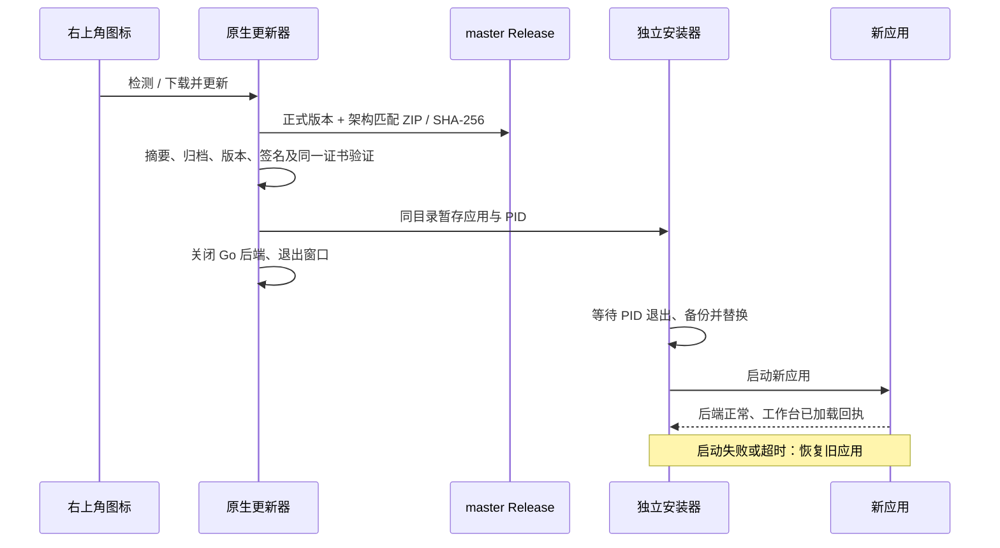

# Lake macOS

点击窗口关闭按钮只隐藏工作台，保留同一个 WebView、会话、终端连接和后台任务。点击 Dock 图标、再次打开应用，或选择 Lake 菜单中的“显示工作台”恢复窗口；“退出 Lake”或 ⌘Q 才执行正常退出和后台清理。此行为不改变系统休眠规则。

当前 Go/React 工作台的 AppKit + WKWebView 客户端，macOS 13+，仅 Apple Silicon（M 系列）arm64，运行不需要 Node、pnpm 或 Electron。应用启动内置签名 `lake web --port 0`，使用系统分配的 loopback 端口。已有同数据目录的 Go 服务时复用；更新客户端时保留独立启动的 CLI 服务，替换客户端后继续连接同一服务。

```sh
pnpm --dir web-agent install --frozen-lockfile
scripts/build_lake_desktop.sh
scripts/build_lake_desktop.sh --install
```

CLI 构建始终经过 `scripts/build_lake.sh`。CLI 与应用使用持久 `Lake Local Development Code Signing` 身份，缺少时显式运行 `scripts/setup_lake_signing.sh`，没有未签名构建路径。`VERSION` 同时控制 CLI、应用和资产名；输出 `dist/macos/<version>/<architecture>/Lake.app`、DMG、ZIP 和 SHA-256。默认不覆盖现有安装；`--install` 安装到 `~/Applications/Lake.app`；先校验暂存的新应用，替换成功后删除本次旧备份，失败恢复旧应用。

本地测试请运行 `scripts/build_lake_desktop.sh --dev --install`，然后打开 `~/Applications/Lake Dev.app`。如果 Dev 已经运行，安装后先正常退出 Dev 再重开，避免继续使用旧进程；不必重启正式版。测试版显示 `DEV` 标记，使用独立 bundle ID `com.cleanlakes.lake.desktop.dev`、偏好设置和 `~/.lake-dev`（包含 `web-agent` 数据目录及凭据），可以与正式版同时启动、单独退出或重启。测试版初始项目和模型配置为空，不复制正式数据，也不检测或安装正式版更新。它忽略继承的 `LAKE_HOME`、`LAKE_WEB_DATA_DIR` 和 `LAKE_WEB_TOKEN`；需要自定义测试目录时使用 `LAKE_DEV_HOME` / `LAKE_DEV_WEB_DATA_DIR`，或显式传入 `--lake-home` / `--lake-data`，目标不得指向正式版数据目录。测试构建产物位于 `dist/macos/<version>/<architecture>/dev/`，`--install` 仅替换 `Lake Dev.app`。完整流程见 [开发规范](../../CONTRIBUTING.md)。

右上角图标和 Lake 菜单可手动检测，启动及每 5 分钟自动检查。GitHub Releases API 选择 `target_commitish=master`、非草稿/预发布、版本更高且架构匹配的发布，忽略旧 Electron 包。资产格式为 `Lake-<version>-macos-arm64.zip` 与同名 `.zip.sha256`，发布命令必须带 `--target master`。下载进度来自 URLSession 实际写入字节，以发布资产大小计算百分比；即使 CDN 未返回 Content-Length 仍可更新。传输期间最多显示 99%，文件长度校验通过后进入 100% / 签名校验阶段；取消或失败不报告完成。下载并重启更新依次验证摘要、归档路径、版本、bundle ID、整个应用代码签名和当前证书；准备替换后退出后端及窗口。安装期间保留旧应用，等待新应用加载工作台回执；45 秒未就绪则回滚。收到版本一致的成功回执后自动删除本次旧应用和下载缓存；客户端继续清理 Lake 管理的旧备份及完成任务目录，未知目录、符号链接、其他应用和未来版本不会被清理。DMG 运行、App Translocation 和不可写应用目录不直接更新，应先安装到可写 Applications。



验证：`swift run --package-path client/macos --build-system native LakeUpdateTests`、`python3 scripts/test_lake_macos_installer.py`、`go test -race ./...` 和前端测试。Swift 独立测试可执行文件可在不含 XCTest 的 Xcode Command Line Tools 环境运行。

发布：创建并推送 `master`，构建 arm64 后运行 `scripts/publish_lake_macos.sh`。脚本校验摘要/签名和 HEAD=origin/master；有 GitHub CLI 登录时直接上传，否则通过 SSH Git 推送临时资产标签，由流水线以 `--target master` 发布，成功后自动删除临时标签，不创建发布分支。二进制资产不进入 master 的文件树。未来版本必须使用相同持久签名证书，不能每次临时生成证书，证书轮换须单独设计迁移。当前本地证书未公证；已有 Electron 版本应首次手动安装。
