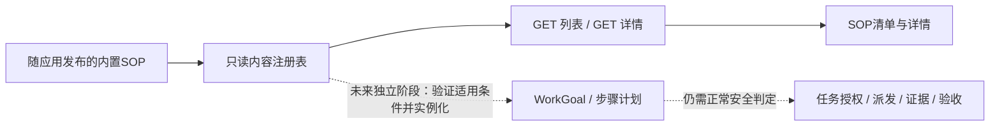

# 内置 SOP 清单 v1 设计

状态：提案，尚未实现。日期：2026-10-30。对应[独立实施计划](../../plan/feature-builtin-sop-catalog-1.md)。本轮先纳入设计，后续通过独立功能PR实施，不在本次文档PR里增加前端代码。

## 1. 产品范围

增加一个独立的“SOP”入口，首期提供内置流程的列表与详情浏览。用户可以知道Lake提供哪些标准流程、适用场景、前置条件、执行步骤、停止条件和验收方法。列表来自随应用发布的内置目录，不读取用户凭据、真实资源或聊天历史。

这是[Lake Security](lake-security-v1.md)后端方案之外的独立UI功能。Security的目标闭环、授权和孤儿治理维持后端改造范围；SOP清单的前端和只读API单独规划、单独PR验证。浏览SOP不是选择执行方案，也不生成任务或授权。

首期只有浏览与本地筛选：不提供新增、编辑、删除、导入、导出、市场、用户上传、模型自动学习、启用/禁用或发布；也不提供“运行”“应用到任务”“申请授权”等按钮。后端不开放对应写入/执行接口，避免仅隐藏按钮但实际可以调用。

## 2. 入口与交互

使用现有工作区菜单增加“SOP”独立条目，与“定时任务”“设置”等同层，图标复用Glyph的book。点击打开专用SOP浏览面板，不进入权限设置、聊天记录或隐藏的工作流功能。

现有 `App.tsx` 的Workflows入口由 `showWorkflows=false` 控制，不能为了显示SOP而打开该开关或复用其创建/执行逻辑。新增独立的打开状态及组件即可。浏览不要求模型已配置，也不要求选择目标资源；内置目录全应用一致，切换项目不修改清单内容。

面板布局：

```text
SOP                                                  关闭
搜索 SOP                  分类：全部 / 服务诊断 / 数据同步

内置流程列表              选中的 SOP 详情
  服务故障诊断              名称、版本、内置来源、流程影响
  数据同步与校验            用途与适用条件
                            前置条件
                            步骤与依赖
                            停止与失败处理
                            验收条件
```

- 列表显示名称、一句摘要、分类、版本及“内置”标识；流程含写操作时显示“包含数据变更”，不能因清单只读就把流程影响标成只读。
- 搜索只匹配名称、摘要与分类，筛选只影响显示，不改变目录或后端状态。
- 首次打开默认不自动选执行目标；可选择第一条详情用于浏览，不具有执行含义。
- 详情默认展开用途、适用条件和主要步骤；长内容使用现有DisclosureSummary折叠技术说明，避免塞满命令和参数。
- 面板关闭后保留聊天草稿、资源选择和正在运行的任务，焦点回到仍可见的工作区入口；菜单保持打开时才回到SOP条目；打开/关闭/浏览不开始、暂停或取消任务。
- 窄窗口改成列表→详情的单列浏览，提供返回列表；分类用AppSelect，图标用Glyph，使用共享主题和曲线。支持Escape关闭、键盘选择、焦点恢复、浅深色和长列表滚动。

本期不增加SOP编辑器、版本对比页、授权表单或执行控制面板。

## 3. 首批内置条目

| sopID / version | 名称 | 用途 | 流程影响 |
| --- | --- | --- | --- |
| `service-diagnostics` / `1.0.0` | 服务故障诊断 | 确认目标→采集状态/日志→形成假设→给出处置建议→复核证据 | 读取检查；建议不自动执行 |
| `data-sync-verification` / `1.0.0` | 数据同步与校验 | 确认源/目标/快照→冲突与覆盖规则→同步→逐项比较→闭环 | 包含数据变更；任何未来执行仍须另行授权 |

内置内容使用资源A/B、服务名等参数名，不写实际IP、密码、数据库地址或某次真实任务的成功结论。每个条目都说明参数是流程所需信息，本期详情不提供可提交执行的参数表单。

服务诊断的前置条件包括目标明确、时间范围和读取权限；步骤采集健康状态、日志、指标并区分事实与假设。停止条件包括目标身份变化、日志可能含秘密、需要未授权变更。输出是证据与处置建议，验收是检查覆盖及结论可追溯，不能把“已给建议”说成“服务已恢复”。

数据同步的前置条件包括固定源快照/目标基线、集合与冲突规则、备份或补偿可行性；步骤明确ID/字段保留、不覆盖条件和独立校验。结果不明先核查部分写入，不直接重跑。验收比较指定ID集合、内容及原记录保护，不只看条数或脚本退出码。没有安全补偿方法时明确“需人工处置”，不能承诺所有同步都可回滚。

## 4. 内容模型与只读API

新增 `internal/sop` 作为应用内独立只读内容包，与ADK、模型和工具执行器解耦。`builtin/*.json`由go:embed随签名应用打包；应用升级可以更新内置条目，本期不在线下载或把目录写入用户数据库。

固定模型：`id/version/source=builtin/title/summary/category/impact/applicability/parameters/preconditions/steps/stopConditions/failureHandling/acceptanceCriteria`。step包含稳定id、title、description、dependsOn、expectedEvidence；parameters只描述名称/类型/用途，不保存值。可选rollback说明放failureHandling中，必须区分取消、补偿和不可逆影响。

包加载时验证ID/版本唯一、source固定builtin、步骤ID唯一且依赖存在/无环、前置/停止/验收内容非空。以排序后的内容hash生成catalogVersion；坏条目使目录加载返回明确错误，不发布半份内容。

| 拟新增接口 | 行为 |
| --- | --- |
| `GET /api/sops` | 返回catalogVersion及内置摘要列表，顺序稳定；不触发项目/资源/模型查询 |
| `GET /api/sops/:id?version=...` | 返回匹配版本的完整详情；未知ID返回404，版本变化返回明确刷新提示 |

沿用 `Server.authorized/protect` 的本地认证与来源检查。只返回注册的内置字段；不接受文件路径，不加载远程URL，不包含Shell运行端点。不支持POST/PUT/PATCH/DELETE和执行子路径；明确返回405或404，不转发到workflow、SRE工具或命令bridge。

前端增加独立SopSummary/SopDetail类型与api读取方法是本SOP功能的改动，不作为Security控制面协议的扩张。加载/错误/重试/筛选为空均使用普通已有界面模式，禁止静默将失败当“没有SOP”。文本按普通React文本/受限Markdown展示，不启用原始HTML或脚本。

## 5. 与任务闭环的边界



虚线部分不属于首期。浏览版本号或“内置”标识不代表任何任务已获授权；即使后续引入“应用SOP”，也必须由后端按可信sopID/version/contentHash取得模板，不信任前端传回的步骤或模型生成的同名文档。SOP只是步骤与验收模板，不能成为跳过Security的凭证。

## 6. 实施位置与验收

拟新增：`internal/sop/catalog.go`、`builtin/*.json`、`internal/web/sop_routes.go`、`web-agent/web/src/SopCatalog.tsx`和独立样式/前端测试。现有 `server.go`注册只读路由；`SidebarUtilities.tsx/App.tsx`接入口和打开状态；shared/contracts.ts/api.ts只增加目录读取类型/方法。具体任务见[独立计划](../../plan/feature-builtin-sop-catalog-1.md)。

验收要求：两个条目内容完整、列表详情版本一致、搜索/分类正确、无项目/无模型也能浏览、加载错误可恢复、窄窗和键盘可用；打开/切换/关闭SOP时调用记录仅有目录GET，不创建goal/workflow、调用模型、申请权限或执行命令。检查无写接口、无执行入口、无真实资源数据泄漏。未来功能实施需在独立PR运行相应Go/前端检查与Lake Dev验证；本次只是设计文档。
