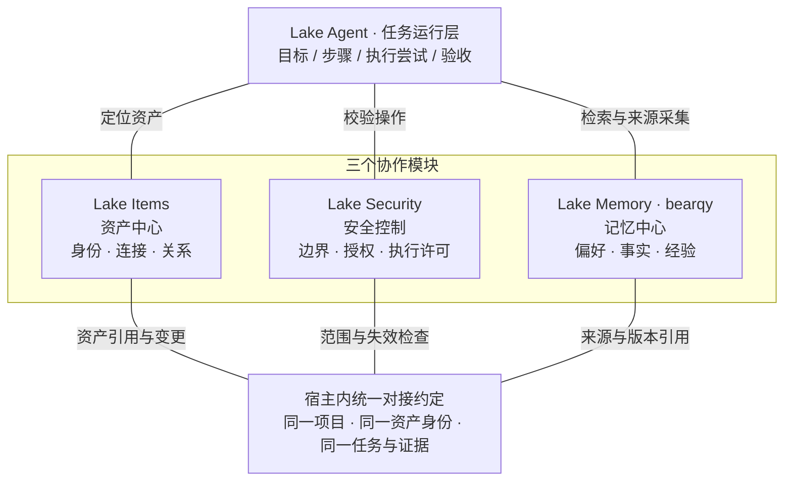

# Lake Items × Lake Security × Lake Memory 对接说明

日期：2026-11-01。面向 bearqy（Lake Memory）及 Items、Security、任务运行层实现者。状态：**协作设计，待各模块确认；本文件不表示新增接口已经上线**。

核对基线：`origin/develop@23363614c2ba8792077533878d73c98dee66ae5f`；正式版 `v0.3.24@b921d078044ef5cc0616970a4726fc15039e413e`。两者文件树相同。本轮仅交付文档，不修改运行代码、数据库、开关或产品 UI。

整体架构约定见根目录 [agent.md](../../agent.md)：Memory 以 bearqy 的方案和现有实现为主，三模块通过增量适配协作；其内部知识、来源、整理和召回设计继续由 bearqy 维护。

## 1. 先统一三个模块的职责

| 模块 | 自己负责的权威数据 | 向其他模块提供 |
| --- | --- | --- |
| Lake Items · 资产中心 | 资产身份、访问入口、连接配置、项目归属、已登记/确认的关系及其版本 | 经过宿主解析的资产快照、连接版本、资产变更事件 |
| Lake Security · 安全控制 | 当前策略、任务授权、单次审批、执行边界与安全判定 | 读取/写入/后台派发资格、操作准备与执行许可、失效原因 |
| Lake Memory · 记忆中心（bearqy） | 记忆正文、来源、范围、版本、支持与冲突、撤销/遗忘、采集和使用记录 | 当前允许使用的偏好/知识索引及准确版本正文；经校验的记忆变更 |

任务运行层继续负责目标、步骤、执行尝试、进度与验收，沿用官方 ADK 和既有操作/证据账本。**Lake Items 不是任务中心**。SOP 清单仍按独立方案交付，其标准作业文本不自动成为资产事实或执行权限。

资产当前连接以 Items 为准；操作是否可以执行以 Security 为准；记忆内容和来源状态以 Memory 为准；操作真实结果和任务是否完成以任务/执行账本为准。

Memory 可保留带来源、时间和可信状态的关系断言；历史观测或推断不直接覆盖 Items 登记的当前拓扑。核实后的变更通过 Items 正常入口提交，避免把二者的关系数据误当作竞争事实源。

## 2. 协作架构

下面是目标架构中的模块依赖图，连线表示协作接口，不表示按顺序执行的流程。

图中的“统一对接约定”是现有宿主中的类型与适配接口，不是新增微服务、共享数据库或另一套执行队列。业务调用及后台提交仍分别经过实际宿主与 Security 检查。

### 模块间实际交换什么

| 方向 | 接口内容 | 保持的边界 |
| --- | --- | --- |
| Items → Security | 真实资源、入口身份、当前连接版本、项目归属、changing/ready 状态 | 名称、目录选择和模型自报目标均不能签发权限 |
| Items → Memory | 资产引用、连接版本、关系两端及变更原因 | 历史事实保留原观测时间；连接更新不能把旧知识重新验证为当前事实 |
| Security → Memory | 当前读取/写入/后台模型派发资格及拒绝原因 | 记忆使用许可、采集同意、模型端点范围和资产操作许可分别判定 |
| Memory → Agent | 经范围过滤的短索引和准确 revision 正文 | 文本作为资料；不产生 grant，不修改当前目标，不证明任务完成 |
| 执行账本 → Memory | 已提交的操作/证据身份、结构化观测、状态和时间 | 普通 stdout、退出码 0 和模型总结不能自报为已验证事实 |
| Memory → Items | 可展示的记忆引用和“建议核实”线索 | 不直接写入真实连接、凭据、资产身份或当前健康状态 |

## 3. bearqy 当前进度：以已合入代码为准

2026-11-01 核查 GitHub 中 bearqy 的已合并 PR、现有设计/验收记录及上述代码基线；未发现其开放 PR。此结论只覆盖可访问的提交，不代表其本地未提交工作。

| 已有工作 | 证据 | 对本次对接的意义 |
| --- | --- | --- |
| N1 基础、同意与来源契约 | [#111](https://github.com/Clean-Lakes/Lake/pull/111) | 保留来源、epoch、revision 和独立同意，不另建学习器 |
| N2 自然长期偏好形成与撤销 | [#112](https://github.com/Clean-Lakes/Lake/pull/112) | 复用真实用户来源和提交后通知，不以“任务已授权”代替采集同意 |
| N3 空闲增量整理 | [#113](https://github.com/Clean-Lakes/Lake/pull/113) | 复用批处理、租约、前台抢占和迟到提交重验 |
| N4 压缩前来源捕获 | [#114](https://github.com/Clean-Lakes/Lake/pull/114) | 复用同一 outbox 与覆盖记录；摘要不成为新的来源 |
| N5 按范围使用自然偏好 | [#116](https://github.com/Clean-Lakes/Lake/pull/116) | 沿用独立使用开关、准确版本读取和每请求重验；自然偏好仍为实验、默认受控 |
| C3/C4 清理与兼容验收 | [#117](https://github.com/Clean-Lakes/Lake/pull/117)、[#119](https://github.com/Clean-Lakes/Lake/pull/119) | 继续使用现有统一入口与验收工具 |
| 旧策略资产完全退出 | [#121](https://github.com/Clean-Lakes/Lake/pull/121) | 旧资产只读归档，旧 API 410；本次不恢复旧采用、学习、实验或 Skill 导入链 |
| 运维记忆 V2 有范围/来源/代次实现 | `internal/web/project_memory_v2_schema.go` | `operationalMemoryV2Ready=false`，尚不能当成已启用的资产事实记忆能力 |

现有自然偏好用于普通/Plan 会话和 Pilot 协调表达；专员及 workflow 不继承。原项目记忆按自己的设置和范围工作。**“N1–N5 已合入”不等于资产中心已经建成、运维 V2 已开启或所有 Agent 都已接通新记忆。**

另检索到本地会话“设计 Lake 资产记忆组件”中的 `plan/design-lake-memory-1.md` 草稿：以 Go + SQLite + Markdown 组织资产型记忆，状态 Planned、未提交。它不是本基线的已交付能力。本次职责调整后，其中“资产身份注册表”应归 Items 维护，Memory 保留知识与资产引用；原草稿由其维护者另行修订，不在这里覆盖。

## 4. 现有代码的对接落点

| 已有文件/入口 | 本次需要接入的内容 |
| --- | --- |
| `internal/web/store.go:Resource/CreateResource`、`resource_edit.go:EditTerminalResource`、`resource_import.go`、`resource_tree.go` | Items 的资源读取与变更入口；补一致的身份/连接版本与变更出口，覆盖新增、编辑、导入同步、归档/恢复和依赖入口变化 |
| `internal/web/project_memory_retrieval.go:ResolveMemoryReadScope` | 由宿主解析当前项目和实际可读资源，接收 Security 缩窄后的范围 |
| `internal/web/natural_recall.go:naturalRecallProvider`、`internal/ai/natural_memory_recall.go` | 保持 N5 用户/项目表达偏好语义，增加统一资格检查适配；不把资源事实混入自然偏好 |
| `internal/web/project_memory_bridge.go:projectMemoryBridge`、`project_memory_v2_bridge.go` | 索引、准确正文、手动保存/遗忘均执行相同范围和版本重验 |
| `internal/ai/project_memory_snapshot.go:MemoryTurnSnapshot/MemoryResourceBinding/MemoryEvidenceContext` | 复用宿主来源、资源绑定、采集时间和 hash；增量补任务/操作/资产引用，模型不能填可信字段 |
| `internal/web/project_memory_outbox.go:EnqueueMemoryTurn` | 保持持久来源与幂等入队；与压缩捕获复用覆盖机制 |
| `internal/web/project_memory_worker.go`、`natural_consolidation_worker.go:processNaturalConsolidation/commitNaturalBatch` | 在模型发送与最终事务提交两个位置重验同意、目标版本、gate、撤回与后台租约 |
| `internal/web/project_memory_scope.go` | 已有 V2 `MemoryResourceBindings/BumpMemoryResourceGeneration` 可作为适配参考，不能以打开 V2 来补齐 Items 的通用连接版本 |
| `internal/web/project_memory_v2_files.go`、`project_memory_files.go` | Markdown 是私有投影；遗忘、撤回、来源删除后同步清理，不能作为新事实回灌 |
| `internal/ai/adk_services.go:nativeMemory` | 继续使用官方 ADK 的同一 memory 服务边界，避免绕开检索资格检查 |
| `internal/ai/security_home.go`、`internal/web/agent.go:bridge`、`security_readonly.go` | 当前已有 gate/owner 基础；新任务授权与逐派发事务按 Security 计划后续接入 |

## 5. 拟新增的宿主内部契约

以下类型和方法是**待实现建议**，不是已存在的 HTTP API。不新增对外 `/api/items`、grant 或 Memory 接口承诺；优先用 Go 宿主接口适配现有 API，避免逼 bearqy 重写 N1–N5。

### 5.1 统一上下文（拟：`internal/coordination/context.go`）

| 字段 | 来源与规则 |
| --- | --- |
| `projectID/sessionID` | 宿主从已鉴权业务会话解析，不采信模型传参；不将本机 Home owner 冒充跨设备用户身份 |
| `rootTurnID` | 现有真实运行轮次，绑定本次调用和来源 |
| `goalID/stepID/attemptID/securityTaskID` | 有可信关联时填写；当前未具备完整闭环时允许缺省。禁止把 sessionID 或 turnID 伪装成 goalID |
| `storeID/recoveryEpoch` | 从 SecurityHome 读取；恢复/身份变化后旧上下文必须重新解析 |
| `resources[]` | Items 输出的完整资源集合，不接受模型传入一项来代表整个关系或双端操作 |
| `memoryPurpose` | `preference_use / knowledge_read / capture / consolidate / manage / export`，由宿主入口确定 |
| `memorySettingsEpoch` | 使用与积累分别记录实际用到的设置版本；项目/用户范围分别验证 |

统一上下文不是可序列化回模型再接收的授权凭证。凭据只留在现有宿主密钥引用和连接执行器中，不进入上下文的模型可见投影。

### 5.2 资产与入口必须分开

| 字段 | 含义与交付顺序 |
| --- | --- |
| `resourceID` | 现有访问入口 ID；第一批继续兼容既有 `MemoryResourceBinding.ResourceID` |
| `assetID` | Items 管理的稳定逻辑资产 ID，待资产注册表交付后接入；首批允许为空，不虚构自动合并 |
| `connectionRevision` | Items/宿主维护的通用入口版本，连接身份或依赖入口变化时递增；当前基线尚无本契约完整实现 |
| `assetIdentityRevision` | 实际对象身份变更、合并或拆分时变化；资产改名不等于更换对象 |
| `relationRevision` | 关系两端及方向的版本；不能仅从单端权限推导读取另一端 |
| `generation` | 现有 V2 记忆绑定代次，保留原语义；不直接当作完整 Security 连接版本或自动开启 V2 的理由 |

同名/IP 相同/经同一跳板机访问不是同一资产的充分证明。明确绑定前按独立入口隔离记忆。替换目标时旧观测继续作为旧对象历史，重新核实后才建立新绑定；不能更新一个版本字段就将旧事实激活。

### 5.3 建议的方法边界

| 拟新增接口 | 提供方 | 输入/返回与约束 |
| --- | --- | --- |
| `ResolveItemsSnapshot` | Items 宿主适配 | 输入已鉴权会话与目标引用；返回同项目、当前版本、无秘密的资产/入口集合；无法确定返回待解析 |
| `AuthorizeMemoryAccess` | Security 适配 | 输入宿主上下文、purpose、完整资源集合及条目/来源引用；返回允许/拒绝/需确认及原因；没有完整 Security 时先用现有 gate、范围、同意规则拒绝越权，不能用无条件 allow 桩替代 |
| `BuildMemoryIndex / ReadMemoryRevision` | Memory 适配 | 复用现有范围检索与准确 revision 读取；返回正文/索引及来源状态，不返回可执行 Permit |
| `CaptureCommittedSource` | 任务运行层 → Memory | 输入已提交消息或操作/证据引用，校验原账本后形成 outbox 来源；持久化成功才推进采集水位 |
| `RevalidateMemoryUse` | Memory + Security 宿主 | 在新 provider 请求、正文读取、后续工具执行前重验已实际使用的条目、来源、设置和范围；失败移除旧缓存/停止该续接，不自动重放工具 |
| `ApplyAssetChange` | Items → Memory/Security | 接收持久事件后失效缓存、标记绑定需重验并撤销受影响资格；当前读取/派发仍查询权威版本，不依赖事件恰好已送达 |

共同原因码建议：`scope_denied / source_unavailable / asset_changed / consent_changed / recovery_required / revision_conflict / unresolved_operation / backend_unavailable`。Security 错误不得转成“允许”；可选记忆检索不可用时可按原规则不附带记忆继续普通回答，但受保护的资源操作仍必须独立通过安全检查。

## 6. 来源、验收和学习资格

| 来源状态 | 允许的处理 |
| --- | --- |
| 明确长期偏好 + 当前真实用户来源 + 有效同意 | 继续按现有 N2/N5 契约形成或使用偏好；不要求存在运维任务或验收记录 |
| 用户陈述的资产信息 | 可保留为用户陈述/待核实；不能升级为已验证现场配置 |
| 已提交的结构化观测 + 当前资产绑定可核对 | 可按 V2 资格形成带观测时间的事实；先完成该能力验收，保持原编译期门控 |
| 本次成功操作 | 保留真实操作成功状态；整体目标完成仍取决于该目标验收，不由单次退出码决定 |
| 有来源、有关联验收的历史经验 | 可形成条件式历史经验，返回时要求复核当前环境 |
| failed / unknown / running / orphaned / 未验收 | 保留原记录；可以形成明确带“不确定/失败”状态的线索，但不能作为“成功方法”“当前已恢复”或任务结清依据 |
| 模型总结、压缩摘要、外部文档和普通 shell/MCP 文本 | 资料或提案；不能自行签出可信资产身份、审批、执行成功或结构化事实 |

同一目标的新尝试可覆盖原失败步骤的业务需求，但原尝试和副作用状态保留。任务 B 成功不自动关闭任务 A。Memory 中记录“已恢复”也不修改原 unknown。未来对接 `goalID/attemptID/acceptanceID` 时引用原记录，不在 Memory 复制一套任务结清权威。

## 7. 变更、撤回与恢复的联动

| 事件 | Items | Security / 执行层 | Memory |
| --- | --- | --- | --- |
| 改名/移目录，连接与归属不变 | 更新显示与索引版本 | 不凭显示名变更创建新授权 | 更新索引；保留身份、原观测和来源 |
| 改连接/同步凭据引用/依赖入口变化 | 新连接版本；按 Security 设计走 changing → ready | 旧准备操作/许可失效，派发重新核验 | 旧资源事实不作为当前事实；丢弃受影响缓存与迟到提交 |
| 资产/项目归档、恢复或权限收窄 | 更新可见性与身份/入口版本 | 阻止旧范围派发；恢复不能复活旧 grant | 检索、准确 ID 读取、导出、关系两端都重新过滤 |
| 关闭积累或使用 | 保留资产 | 根据实际用途重新检查背景/前台资格 | 两开关独立；停止积累不删除正文，停止使用不再注入 |
| 撤销/遗忘/来源删除 | 保留资产 | 原操作、审批、证据与未决风险保留 | 按既有 revision/墓碑语义清理正文、派生支持、缓存和 Markdown，防止重提取复活 |
| Home 迁移异常/恢复 epoch 改变 | 暂停需要写入的资产变化 | 按当前门禁停止模型/工具/后台运行 | 只读恢复不启动 Memory worker；旧后台资格重新取得，未知模型用量仍保留 |

### 提交与事件的一致性

Items/Memory 现有业务 SQLite 的资产变更与待通知事件可在同一事务提交；通知采用至少一次投递，以 `eventID + aggregateID + revision` 幂等。乱序事件不回滚当前版本，消费失败保留待处理，不推进完成水位。

ADK/native 操作账本与 Web SQLite 是两个事务域，不假设一次跨库原子提交。来源发布以已提交的 operation/evidence 身份与内容 hash 为锚点，可扫描重送并幂等入队；不存在的来源拒绝，重复入队不重复学习或记账。Safety 决策与执行登记的最终排序沿用 Security 设计的 barrier/事务方案，异步通知只做失效加速，不是派发安全屏障。

后台提炼在模型请求发出前与落库前都重验；原始未决调用/用量、租约和取消记录不由 Memory 自行清零。前台新任务抢占后，即使旧模型返回也不能跨设置、资产或恢复版本迟到提交。

## 8. 给 bearqy 的实施交接

| 顺序 | Memory 侧工作 | 对方需先提供 | 完成判据 |
| --- | --- | --- | --- |
| 第一批：现有能力接桥 | 保留 N1–N5、V1 及默认开关；在检索、正文读取、outbox、模型派发和提交处接统一宿主上下文与资格检查 | Items 的当前入口快照适配；Security 的 gate/范围/同意适配 | 普通/Plan/Pilot 行为保持；越权、来源撤回与旧缓存拒绝；V2 仍关闭 |
| 第二批：资产变更联动 | 消费资产版本事件，扩展来源引用与失效测试；区分稳定资产和入口 | Items 通用连接版本、明确资产映射与持久变更事件；Security 版本重验 | 改名保留归属；改对象不继承旧事实；关系双端、迟到提交和漏事件均不能越界 |
| 第三批：任务与验收关联 | 加 goal/attempt/operation/evidence/acceptance 的可选引用；经校验的结果才形成经验 | 任务闭环与受信验收记录；Security 任务授权/逐派发检查 | 失败、unknown、孤儿及未验收不能写成成功；另一个目标成功不能关闭原目标 |
| 第四批：运维事实能力放量 | 补齐 V2 的质量、平台和恢复矩阵，通过后单独提启用 PR | 三模块联调与原生平台验收完成 | 不因接桥、加字段或 N5 已合入就翻转 V2 门控 |

具体原子任务与文件分工见[实施计划](../../plan/feature-items-security-memory-integration-1.md)。bearqy 对 Memory 数据契约、现有范围/来源兼容及开关语义负责；Items 实现者对资产身份和连接版本负责；Security 实现者对权限、判定及派发一致性负责；任务运行层实现者对执行归属和验收负责。本轮不向 bearqy 的本地分支写代码或替其启用功能。

## 9. 对接验收矩阵

| 场景 | 必须满足 |
| --- | --- |
| 已知其他项目的 memory/asset ID | 索引、正文、分页、导出与关系查询都不能绕过项目范围 |
| 关系 A → B，只有 A 在范围内 | 不泄露 B 的正文、名称或事实；缺一端资格即拒绝该关系记忆 |
| 相同 IP/名称但对象身份不同 | 不合并资产、不串用事实、不复用旧执行许可 |
| 更新连接后事件尚未消费 | 读取/派发按权威版本拒绝旧缓存和许可，不等待事件追上 |
| 归档/恢复、依赖 SSH 入口变更 | 派生容器/集群入口和关系端同步重新核验 |
| 项目 A 来源形成全局表达偏好 | 可用表达经去敏；不暴露 A 的私有来源、名称、资源和原话 |
| provider 请求前遗忘/关闭使用 | 沿用 N5 语义，移除失效条目或停止续接，不自动重放工具 |
| 关闭积累、前台抢占、epoch 改变后模型迟到 | 拒绝提交；保留派发/用量与待办状态，不虚报已记忆 |
| 轮次结束、压缩和恢复重复捕获 | 同一真实来源幂等；摘要不成为来源；预算裁掉部分不越过覆盖水位 |
| 任务 A unknown，任务 B 成功 | A 未决状态保留；经验不得把 A 标为成功，也不能关闭 A 的风险 |
| 自然偏好普通对话没有 goalID | 允许按原同意和范围处理；不伪造任务关联，不影响现有 N5 |
| 资产观测完成、目标尚未验收 | 可保留有来源的观测；不得标为目标已完成或完整成功经验 |
| 旧 schema / 关闭 gate 的恢复路径 | 保持 v0.3.24 只读兼容，不访问缺失新表、不运行记忆后台任务 |
| 旧策略资产和旧学习开关 | 保持归档/API 410；不能借本次接桥恢复旧注入 |

## 10. 联调交付物与确认点

交付物应包含：固定候选 SHA、接口版本与兼容表、合成测试结果、签名 Dev/隔离 Home 验收、未验证的平台和质量项。当前文档校验不冒充这些运行测试。

各维护者先确认三个具体问题：Items 的稳定资产与连接入口映射版本；Memory 能接受的现有 DTO 增量字段及拒绝语义；Security 第一批可提供的资格适配边界。未确认或未实现的能力保持未启用，不使用 permissive stub、不修改真实 Home，也不自行放开专员/workflow 的记忆范围。

## 11. 相关依据

- [当前 Memory 使用与兼容说明](../lake-memory.md)
- [自然记忆 N1–N5 计划](../../plan/feature-natural-memory-1.md)
- [N5 召回契约](natural-memory-recall-n5.md)与[验收](../validation/natural-memory-recall-n5.md)
- [运维记忆 V2 验收与未启用门槛](../validation/lake-operational-memory-v2.md)
- [旧策略资产退出](legacy-asset-exit.md)
- [Security 详细设计](lake-security-v1.md)与[实施计划](../../plan/feature-lake-security-1.md)
- [工作区 SOP 独立设计](builtin-sop-catalog-v1.md)
- [开发规范](../../CONTRIBUTING.md)与[发布流程](../development-workflow.md)

## 11. Super-agent 宿主适配增量（2026-11-02）

[Super-agent 运行记录](lake-superagent-runtime.md)已接真实项目/Pilot/Worker 与 canonical WorkGoal 关联。`SuperMemoryContext` 提供额外读取旁注，包含准确任务 revision、尝试、操作、验收/证据引用；无唯一任务的消息保持无 taskID。子角色没有冻结 Security scope 时返回不可用，不能继承整项目知识。

该增量未改变 bearqy 的 MemoryTurnSnapshot/hash、N1–N5 采集整理及来源契约。Worker task knowledge、任务经验采集、完整资产/入口版本协作仍未启用；运维 V2 仍为 false。上述独立计划的任务、负责人和依赖状态继续有效，不因 UI 显示来源关联而标记已交付。
