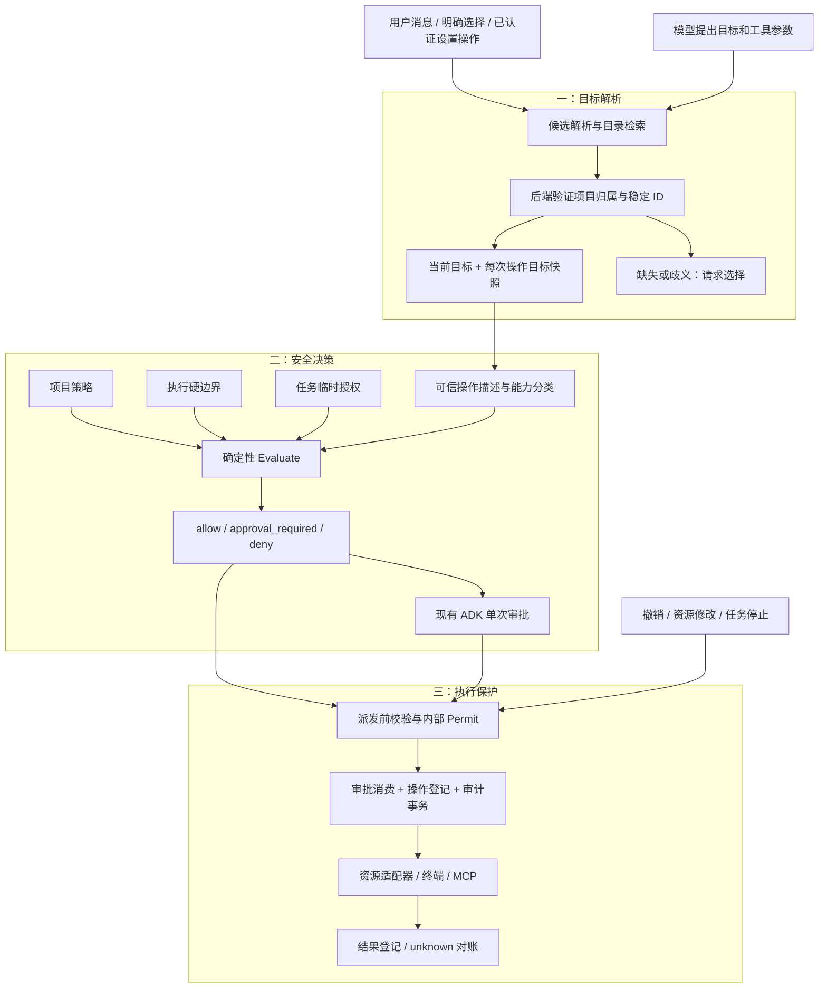
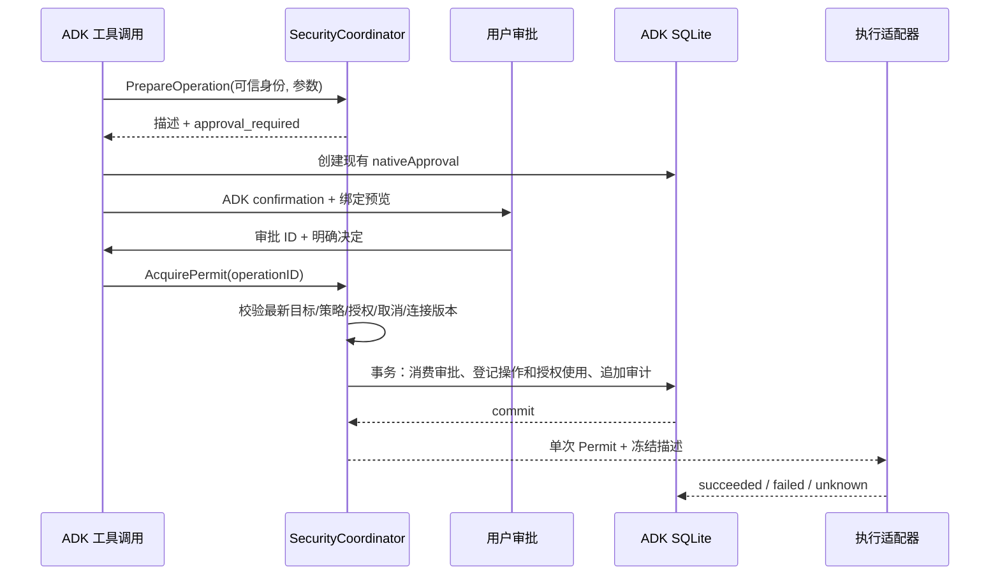

# Lake Security v1 详细设计

状态：提案，尚未实现。日期：2026-10-30。代码基线：`a60c8ad4f428b46d8fe6ce9a7fa165658dbe87c4`（`origin/develop`）。实施拆分见[实施计划](../../plan/feature-lake-security-1.md)。本文的接口、表和新文件均为拟议设计；标为“现有”的内容来自该提交的源码。

## 1. 目标与范围

Lake Security 负责回答三个不同的问题：用户想操作哪个目标、这项操作是否被授权、实际派发时授权和目标是否仍然有效。它嵌入现有 ADK 工具调用链，不另建模型循环。

交付后，用户在已授权的诊断任务中说“继续检查”可以沿用目标和有效授权；明确切换目标时重新判断权限；目录为空时给出目标选择入口，不把它描述成数据库故障或一律要求再次 `@`。写入、危险命令、跨资源操作、终端接管仍按具体能力判断，不能从“继续”推导出新权限。

v1 包含目标状态、确定性决策、项目策略、任务临时授权、单次审批绑定、派发校验、撤销与审计，以及现有调用入口的接入。v1 不包含多租户 IAM、组织角色管理、通用策略 DSL、新的 LLM 安全裁判、完整 Shell 解释器或跨平台 OS 沙箱。SQLite 和现有 ADK public API 继续使用，不引入新的策略服务。

截图显示“已识别目标，但仍被旧空目录范围拦截”的产品现象。源码确实存在目标范围继承和空范围阻断路径；本文据此设计修复方向，未声称已重放截图对应的历史会话。

## 2. 现有实现与改造依据

以下链接指向当前仓库文件；函数名是定位依据，未来行号变化不影响引用。

| 环节 | 现有代码与行为 | 设计处理 |
| --- | --- | --- |
| 权限开关 | [permissions.go](../../internal/ai/permissions.go) 的 `Permissions`、`approvalKind`：七个布尔项控制静默执行、引用限制、本机执行等 | 保留有效值作为迁移输入，拆成授权上限、能力规则和确认偏好 |
| Web 配置 | [agent.go](../../internal/web/agent.go) 的 `sessionOptions`、`configureWithSave`；Web 默认静默命令、自动建终端为 true，而 AI 基础默认值不同 | 不在重构中悄悄统一默认值；保存来源和迁移版本 |
| 目录与目标 | [Web directory_targets.go](../../internal/web/directory_targets.go) 的 `directoryTurnScope`、`questionTargetScope`；目录、引用、地址和旧状态共同生成 `TargetScope` | 提取目标解析器，记录来源与待消歧状态；导航目录不自动成为新硬边界 |
| 运行时范围 | [AI directory_targets.go](../../internal/ai/directory_targets.go) 的 `enforceTargetScope`；空范围或越界即阻断，与 `BlockUnreferencedAssets` 分别生效 | 拆分 `CurrentTarget` 与 `ExecutionBoundary`，迁移期明确保留旧边界 |
| 工具调用 | [tools.go](../../internal/ai/tools.go) 的 `Engine.invoke`、`ToolRisk`、`Engine.policy`；存在提前分流的会话工具，通用路径还会重复读取 policy | 所有入口登记能力；每次准备一个可信操作描述，派发前做一次新鲜度复核 |
| 命令与 SQL | [policy.go](../../internal/web/policy.go) 的 `CommandPolicy`，`tools.go` 的 `readonlySQL`、`redisReadOnly`，以及 [sql_policy.go](../../internal/ai/sql_policy.go) | 复用确定性分类器，标记可证明程度；未知工具不能沿用默认 readonly |
| 原生审批 | [adk_approval.go](../../internal/ai/adk_approval.go) 的 `nativeApproval`、`waitNativeApproval`、`claimNativeApprovals`；绑定参数、目标指纹、预览、终端版本，15 分钟有效 | 扩展绑定结构，保留 ADK confirmation 和单次消费状态机 |
| 操作账本 | [adk_operations.go](../../internal/ai/adk_operations.go) 的 `dispatchNativeOperation`；事务内登记操作、消费审批、追加 `nativeEvidence`，不明结果需对账 | 在相同事务内增加新决策和授权使用记录，不另建执行账本 |
| 持久化 | [adk_session.go](../../internal/ai/adk_session.go) 的 `adkStore` 迁移原生表；[storage/sqlite.go](../../internal/agent/storage/sqlite.go) 提供私有 SQLite 与一致备份 | 安全权威数据放同一个 ADK store；web 资源库继续负责资源目录 |
| 子任务/Pilot | [agent_scope.go](../../internal/ai/agent_scope.go) 的 `scopedChildConfig`，以及 [adk_sre_roles.go](../../internal/ai/adk_sre_roles.go)、[adk_observation_roles.go](../../internal/ai/adk_observation_roles.go) | 复用父级实时收窄、角色约束、只读调查机制，叠加任务授权交集 |
| 会话与 MCP 工具 | [session_tools.go](../../internal/ai/session_tools.go) 的 `invokeSessionTool`；[extensions.go](../../internal/web/extensions.go) 的 `extensionBridge` 已校验配置版本 | 把提前分流入口也纳入同一能力注册表；MCP 绑定实际 server/tool/config revision |
| 工作流/定时 | [tool_bridge.go](../../internal/web/tool_bridge.go)、[workflows.go](../../internal/web/workflows.go)、[schedules.go](../../internal/web/schedules.go) 已检查资源、工作流版本及继承权限 | 使用明确的运行身份和任务授权；定时运行不能复用聊天单次审批 |
| 终端 | [terminal_access.go](../../internal/web/terminal_access.go) 校验会话、generation、permission version；[terminal.go](../../internal/web/terminal.go) 管理 execute/input/interrupt/close | 每个 agent 终端动作校验，不只校验首次打开；保留人类手动终端与借用语义 |
| UI | [PermissionSettings.tsx](../../web-agent/web/src/PermissionSettings.tsx)、[contracts.ts](../../web-agent/shared/contracts.ts)、[approvalPresentation.ts](../../web-agent/web/src/approvalPresentation.ts) | 分开显示目标、任务授权、单次审批；安全原因由后端结构化提供 |

现有代码不是“没有安全机制”。核心问题是多个状态承担了重叠职责、入口判断分散，以及目标解析失败被表现为权限错误。已有审批绑定、账本与终端 generation 是本设计的基础。

## 3. 架构与信任边界



模型、工具返回、网页、日志、附件中的指令、记忆和技能文本均为非权威输入。它们可以提供目标候选或证据，不能写授权表、设置 actor、生成 Permit 或把 `approved=true` 作为通行证。用户真实消息也不直接成为可复用授权：目标意图可以解析，新增授权必须走可审计的设置或授权动作。

可信层包括本机已认证应用入口、后端策略和资源适配器、私有持久化存储。该边界不防御已经控制 Lake 进程或操作系统账户的攻击者。当前应用认证机制不等于企业多用户 RBAC，v1 不做此类承诺。

### 3.1 四种状态的归属

| 归属 | 保存内容 | 能否直接授权 | 生命周期 |
| --- | --- | --- | --- |
| 项目 | 默认能力规则、资源上限、执行模式、revision | 允许范围内的规则可以授权；明确 deny 不可覆盖 | 显式修改前持续有效 |
| 会话 | `CurrentTarget`、待消歧选择、确认偏好 | 目标本身不能授权 | 可跨轮次保留，切换时 revision 递增 |
| 任务 | 任务 ID、目的说明、资源及连接版本、能力、约束、到期时间 | 只覆盖规则允许临时授权的 ask 项 | 完成、取消、到期或撤销即失效 |
| 单次审批 | 一个确定操作的目标、参数、预览、版本 | 仅允许该次操作；不能突破 deny | 沿用 15 分钟 TTL，派发事务消费一次 |

## 4. 目标解析与边界分离

### 4.1 数据模型

`CurrentTarget` 拟包含 `projectID/sessionID/resourceIDs/source/sourceMessageID/revision/updatedAt`。`source` 固定为 `explicit_selection`、`user_reference`、`user_address`、`confirmed_candidate`、`inherited`。资源名和目录路径仅作展示，资源 ID 为身份。

`TargetResolution` 包含 `status=resolved|unresolved|ambiguous`、经过可见性过滤的候选、原因码、原始输入消息 ID。失败结果保存在 `pendingResolution`，不覆盖最后一个有效目标。若本轮明确要求切换而新目标未解析，本轮必须停在选择状态，不能退回旧目标执行；普通“继续”且没有待处理切换时才继承有效目标。

`ExecutionBoundary` 独立保存 `resourceIDs`、本机执行限制、角色上限、来源、revision。来源包括项目配置、用户明确限定、父任务约束和迁移遗留约束。模型只能读取投影。新建的普通目录导航不创建它。

### 4.2 解析顺序与恢复

1. 本轮实际提交的资源选择或问题答案优先，校验项目归属、存在性和可见性。推荐选项和未提交默认值不算选择。
2. 用户本轮明确的引用、资源标识或唯一地址映射到 ID。地址使用真实连接字段匹配，不只匹配资源名称；同地址多账号、多协议或多集群必须消歧。引用文本、否定句及工具输出不能自行触发切换。
3. 模型可以提出候选；只有从可信目录返回的候选 ID 可被验证。仅模型推断的新目标必须由用户确认；唯一的用户显式地址匹配无需重复确认。
4. 目录选择产生候选集合。空目录给 `TARGET_EMPTY_DIRECTORY`；多个资源只在操作声明支持集合时使用，否则给 `TARGET_AMBIGUOUS`。
5. 没有新的目标意图且没有未解决切换时，继承 `CurrentTarget`。任何继承都不扩大授权。

明确切换到资源 B 后，即使旧目录 A 为空，目标解析也能返回 B；如果存在独立硬边界限制为 A，决策返回 `TARGET_OUTSIDE_BOUNDARY`，提供修改边界的真实设置入口，不能靠重新 `@B` 绕过。

每个工具调用冻结自己的目标快照。流式生成中用户切换目标只影响后续操作；尚未派发的旧目标操作因目标 revision 不符而失效并重新准备。已登记派发的操作按第 9 节处理。目录改名不改变资源授权；目录增加成员不自动扩大已发出的任务授权。

## 5. 策略、能力与授权规则

### 5.1 项目策略

`ProjectPolicy` 包含 `schemaVersion=1`、`projectID`、`revision`、`mode`、资源上限、能力规则、任务授权上限和确认偏好默认值。v1 使用 Go 类型与固定规则，不开放脚本表达式。

能力规则的效果为 `allow`、`ask`、`deny`；`ask` 另有 `grantable` 和 `confirmation=single|task`。默认 deny 优先：任一适用硬限制拒绝即拒绝；能力未知也拒绝。规则冲突时依次采用显式 deny、最窄资源匹配、该能力规则、项目默认；同优先级取更严格结果。没有匹配项为 deny。项目资源上限和子任务角色边界不能被临时授权或单次审批覆盖。

新建项目采用 `restricted` 配置：项目内资源元数据可读；具体资源的受支持结构化只读能力在目标确定、硬边界允许时可读；文件写、SQL 写、终端执行/创建/接管、MCP 操作为 ask；明确危险且可预览的操作仅支持单次审批；本机执行默认 deny，可由用户在项目设置明确修改。任意 Shell 和不透明 MCP 在 restricted 模式下为 deny，不能用审批按钮覆盖。

需要任意命令的用户可以显式启用 `compatible` 模式，确认其授权单位是选定执行域中的 Shell/MCP 调用，系统无法证明所有二次访问和副作用。此时不透明操作为单次 ask，不能获得任务级通配授权。模式切换增加策略 revision，并失效待审批操作。迁移的旧项目使用 `legacy` 适配，保留旧有效行为和硬限制；不直接套用新项目默认值。

### 5.2 能力注册表

`internal/security/capability.go` 拟维护封闭的工具注册表；每个工具必须声明目标种类、能力、效果证明等级、参数规范化方式、预览方式和执行适配器。一个工具可以申请多个能力，必须全部允许。

| 能力类别 | 示例能力 | 判定重点 |
| --- | --- | --- |
| 资源发现 | `resource.list`、`resource.resolve` | 项目可见性；返回目录不授予操作权 |
| 文件 | `file.read`、`file.write`、`file.delete` | 规范化路径、根目录、符号链接、写入前内容 hash |
| 数据库/集群 | `db.read`、`db.write`、`cluster.read`、`cluster.logs` | 实际连接、库/schema、语句分类、行数/日志范围 |
| 终端 | `terminal.open`、`terminal.adopt`、`terminal.execute`、`terminal.input`、`terminal.interrupt`、`terminal.close` | 资源、所有者、generation、上下文版本；打开不授权后续命令 |
| 外部访问 | `network.fetch`、`mcp.discover`、`mcp.call` | 目标域、重定向、server/tool/config revision；防止静默本机/内网回退 |
| 应用内部 | `memory.read`、`memory.write`、`workflow.manage`、`schedule.manage`、`task.control`、`artifact.read` | 项目、会话、数据所有者与控制动作，不能因无资产参数而跳过 |

`ToolRisk` 的 readonly/write/dangerous 标签作为分类证据保留，不能作为唯一授权依据。Shell 分类器识别只读外观不代表实际无副作用；`bash -c`、动态展开、跳板连接、未知命令及无法约束的复合语句为 opaque。SQL 的危险函数、外部执行、批语句和读写 CTE 保守分类。受限模式使用能固定查询方式的结构化观察适配器，并要求数据库/Kubernetes 账户具有相应服务端权限。

每次新增工具必须注册；构建测试比较运行时全部工具目录与能力注册表，未注册工具运行时也 fail closed。会话、附件、记忆、工作流控制工具不能放在此清单之外。

v1 的约束使用固定结构，不接受模型填写的表达式或路径通配符：

| 约束 | 字段与匹配规则 |
| --- | --- |
| 文件 | `fileRoots` 为用户配置的绝对根路径集合；按规范化路径组件包含关系判断，不使用字符串前缀。无根配置不能获得根范围读取授权；秘密目录始终排除。写入另绑定 exact path 和 expected content hash |
| 数据库 | `databaseID` 精确匹配连接的逻辑库；`schemas` 为精确名称集合；`maxRows/maxDurationMs` 为正整数，并取项目、grant、调用三者最小值。缺失限制不能解释为无限制 |
| 集群 | 精确 `clusterID/namespaces`，固定资源种类/只读动词；日志必须指定有界时间窗或尾部行数，范围不能随模型摘要扩大 |
| 网络 | 精确 scheme/host/port 与允许的解析后地址段；缺失为拒绝。每次重定向重新匹配，不支持 grant 中任意 URL 正则 |
| 通用 | `resourceIDs/capabilities` 取交集，连接 revision 必须相等；不支持约束字段直接报 schema 错误，不能忽略后执行 |

新建 restricted 策略的初始读取预算为单次最多 1,000 行、30,000ms，日志最多 500 行/最近 15 分钟；允许用户在项目策略中显式收紧或提高。适配器不能执行对应预算/范围约束时，不登记为可证明读取。文件根、数据库 schema、集群 namespace 和网络目标由资源/项目配置提供；缺失所需范围时要求补配置，不推断为全部资源。

### 5.3 任务授权

`TaskGrant` 拟包含：服务端生成的 `id/taskID/projectID/sessionID`、`rootAuthorityID`、purpose、精确资源 ID 与连接 revision、能力集合、类型化约束、签发人、来源动作 ID、签发/到期/撤销时间、revision。purpose 仅作解释，不作为字符串匹配安全条件。

v1 任务授权仅支持可证明的结构化读取能力，不包含文件写、SQL 写、任意 Shell、终端输入或 opaque MCP。诊断预设为有效任务内 30 分钟；UI 可选择 30 分钟或 4 小时，项目上限默认 4 小时。任务结束、取消、父授权失效或时间到期立即停止新派发；续期必须再次显式授权。项目直接 allow 的读取不需要创建任务授权。

子任务有效权限为项目上限、当前父限制、任务授权和角色能力的交集。它不能续期父授权或自行签发子级扩大授权。后台续跑、压缩、恢复会话不能刷新到期时间。每个后台工作流运行拥有独立 taskID；定时授权绑定 scheduleID、冻结工作流版本、目标及能力，其有效期和允许触发次数必须在用户创建/修改定时时显式设置。每次触发先原子扣减次数，再创建本次任务；无有效定时授权则标记 `authorization_required`，不弹一个无人响应后自动同意的审批。

## 6. 可信操作描述和接口

新增纯 Go 领域包 `internal/security`，不导入 `internal/ai` 或 `internal/web`。AI/Web 负责把现有对象映射为领域类型；数据库协调仍放在现有应用层。以下为接口草案，名称用于实施定位：

```go
type Resolver interface {
    Resolve(ctx context.Context, in TargetInput) (TargetResolution, error)
}

type Evaluator interface {
    Evaluate(in EvaluationInput) Decision // 无 I/O；时间与快照作为显式输入
}

type Coordinator interface {
    PrepareOperation(ctx context.Context, in ToolRequest) (PreparedOperation, error)
    AcquirePermit(ctx context.Context, operationID string) (Permit, error)
}
```

`PreparedOperation` 是内部不可由工具参数伪造的对象，包含：

- actor（由入口生成的 `human_action|agent|child|workflow|schedule`）、项目/会话/task/rootTurn/call 身份；子任务父链。
- 工具名、注册表版本、能力、分类证明等级；实际资源 ID、连接 revision、协议/主机/端口/逻辑库等安全相关身份。
- 规范化参数摘要、预览摘要、目标 revision、策略 revision、父边界 revision、所用 grant revision、终端 generation/context version、MCP 配置与目录 revision。
- cancellation 标识、工作项身份、预期写入内容版本、唯一 operation identity。

使用稳定 JSON 编码（字段顺序固定、明确 null/空值语义、集合排序）计算带版本的 SHA-256 描述摘要。秘密不进入描述、提示词或审计参数；只使用 credential reference 的后端身份与 revision。已经禁止的秘密参数继续拒绝，不能用散列秘密来替代秘密隔离。

`Permit` 为进程内不透明句柄，绑定描述、操作登记和使用状态；构造字段不导出，不可序列化到模型/前端，不能跨 operation 重用。适配器只接受该句柄和已冻结的描述。现有 `Bridge(..., approved bool)` 迁移为内部上下文权限；兼容期该 bool 也不能单独触发执行。真正人类手动终端动作由已认证路由生成 actor，模型传入同名字段无效。

## 7. 决策顺序与结构化结果

按照以下顺序执行，越早失败越不应申请审批：

1. 校验入口身份、项目/会话/task 归属、工具注册、参数 schema 和秘密参数禁令。
2. 解析目标；缺失或歧义返回 `TargetResolution`，不进入授权审批。
3. 解析实际连接和附带目标，构造操作描述；无法证明目标时按 opaque 规则处理，不回退本机。
4. 校验任务状态、取消、本机禁令、Plan/Pilot 角色、项目和父执行边界等硬限制。
5. 取同一快照的能力规则；匹配项目 allow 或有效任务授权，否则得到可审批的 ask 或 deny。
6. 对 ask 创建现有原生审批；明确 deny 只展示原因及用户有权操作的设置入口，不提供“仍然执行”。
7. 派发时重新加载相关 revision、目标与 task 状态、授权 TTL，并在事务内完成消费与登记。

`Decision` 包含 `effect=allow|approval_required|deny`、`reasonCode`、安全的用户说明、`operationID`、相关 revision、需满足能力和已使用授权 ID；用户说明不含秘密或隐藏资源信息。无目标时使用独立 `resolution` 对象，不伪造 `deny`。

| 原因码 | 含义 | UI 动作 |
| --- | --- | --- |
| `TARGET_REQUIRED` / `TARGET_AMBIGUOUS` / `TARGET_EMPTY_DIRECTORY` | 缺失、歧义、空目录 | 展示经权限过滤的目标选择器 |
| `TARGET_OUTSIDE_BOUNDARY` | 目标有效，但超出独立硬边界 | 展示边界来源和设置入口 |
| `CAPABILITY_DENIED` / `LOCAL_EXECUTION_DENIED` | 明确拒绝 | 不出现审批同意按钮 |
| `APPROVAL_REQUIRED` | 允许申请本次审批 | 展示资源、动作、差异/命令预览 |
| `GRANT_EXPIRED` / `GRANT_REVOKED` | 临时授权已无效 | 可申请新的合规授权；禁止自动续期 |
| `OPERATION_STALE` | 参数、连接、策略、目标或终端版本变化 | 旧按钮失效；重新准备并展示变更 |
| `OPERATION_UNKNOWN` | 外部结果不确定 | 提供对账证据入口，禁止原操作自动重放 |
| `UNREGISTERED_TOOL` / `UNVERIFIABLE_EFFECT` | 工具未登记或效果不可证明 | 拒绝，并显示适用模式说明 |

## 8. 持久化与一致性

### 8.1 表结构

在 `adkStore()` 打开的同一 ADK SQLite 增加下列表。名称为拟定，不修改现有 ADK SDK 内部表：

| 表 | 关键字段与约束 |
| --- | --- |
| `security_project_policies` | project_id 主键；schema_version、revision、mode、typed_rules、updated_by/action_id；更新 CAS |
| `security_session_targets` | session_id 主键；project_id、current_target、pending_resolution、revision；无有效目标用 null，不用空列表表示授权 |
| `security_boundaries` | id、project/session/task 归属、来源、resource_ids、revision、约束；显式遗留边界单独记录 |
| `security_resource_revisions` | project_id/resource_id 主键；generation、connection_digest、state=ready/changing/disabled；仅保存非秘密配置摘要；MCP 另以 server/tool/catalog 身份使用同类版本记录 |
| `security_task_grants` | id 主键；project/session/task、parent_authority、资源连接版本、能力、约束、expiry、revision、revoked_at；索引 task/expiry |
| `security_schedule_grants` | id、schedule_id、workflow_version、资源/能力、expiry、remaining_runs、revision；与本次任务签发在同一事务 |
| `security_schedule_occurrences` | schedule_id/schedule_revision/due_at 唯一；grant_id、task_id、workflow_run_id、状态；触发幂等记录，不替代实际工具操作账本 |
| `security_decisions` | id、operation_id、effect/reason、descriptor_hash、相关 revision、授权来源、redacted summary、时间；追加记录 |
| `security_authority_events` | id、授权/策略/边界身份、事件种类、actor/action_id、前后 revision、时间；只追加 |
| `security_schema_meta` | schema_version、minimum_reader_version、迁移状态、legacy 基线标识 |

扩展现有 `nativeApproval` 和 `nativeOperation`，增加 `descriptor_version/hash`、`security_decision_id` 与 `authority_revision_digest`；保留旧字段兼容读取。原生审批仍是单次审批唯一权威，原生操作仍是执行/unknown 唯一权威。`security_decisions` 记录判定，不构成可独立重放的执行队列。数据库唯一约束维持原 operation identity；失败不能靠另造 ID 自动重试同一不明副作用。

安全表由应用层 `internal/ai/security_store.go` 迁移和访问；底层 `internal/agent/storage` 继续只提供存储能力。项目删除需要撤销授权并阻止新任务，历史审计按保留策略处理，不能级联删除来解除 unknown 防重放约束。v1 不自动裁剪操作账本；决策列表采用分页，后续独立设计保留/导出策略。

### 8.2 两个 SQLite 的一致性边界

现有 Web 资源/连接/aiOptions 与 ADK 操作存储不是同一个数据库，不能声称一笔事务可以覆盖两者。设计采用一个由每个 Lake Home 的唯一后端持有的 `SecurityCoordinator`，并规定所有安全相关修改必须经过它：

1. 使用短时读写 barrier：最终准备/登记读取侧与资源修改、策略撤销写入侧互斥；锁顺序固定为 coordinator → web snapshot → ADK transaction。不得反向持锁或在模型等待、审批等待、外部网络 I/O 中持锁。
2. 资源变更先在 ADK 标记该资源 `changing` 并提升安全 generation，再提交 Web 连接更新，最后登记新的非秘密连接 revision 并清除 changing。中间任一步崩溃，资源保持不可派发，启动时核对两个库后修复；不能回退旧连接偷偷执行。
3. 策略、授权撤销与 ADK 派发登记使用同一数据库事务排序；资源配置变更通过上述 barrier 参与排序。启动恢复先完成 changing 对账，再接收工具调用。直接 `Store` 更新资源的导入、编辑、删除、MCP 配置和恢复路径均须改造。
4. 资源 ID 不变但 host、账号、数据库、证书/凭据引用等安全配置改变，连接 revision 必须改变，旧审批/授权失效。纯名称或目录顺序变化不应造成安全版本变化。

多个 Engine/子任务共享同一个 coordinator，不能各自创建锁。直接 stdio 入口使用相同每 Home 存储与单写者约束；第二个进程不能绕开 backend 所有权直接使用相同 Home。独立 Home 的策略和授权完全隔离。人工离线编辑数据库不属于在线 API，但启动必须发现 revision/配置摘要不匹配并关闭该资源，不能信任过期缓存。

现有定时配置由 `schedules.go` 写入 `tool-schedules.json`，不是 Web SQLite 表。其更新也经过 coordinator，采用 changing → 原子文件替换 → ready 的版本协议。触发时以 scheduleID/revision/计划时间为 occurrence 唯一键，在 ADK 事务内同时扣减次数、登记 occurrence 和签发 task grant；随后幂等创建 Web workflow run 并回填关联。崩溃恢复可以补齐运行关联，但不能再次扣减同一 occurrence，也不能绕过原生操作账本重放工具。取消/修改定时立即提升 revision，未登记派发的旧 occurrence 不再运行。

## 9. 审批、派发与撤销时序



同意审批后仍需校验。参数、内容预览、资源连接、终端 generation、策略、父边界或授权状态变化，原审批不可转用。现有 `nativePolicyHash` 覆盖面较广；新摘要只绑定与本次操作相关的安全字段，减少无关名称修改导致的误失效，但不能删掉安全版本绑定。迁移期缺少新摘要的旧 pending 审批全部失效并重新申请，不将旧授权补成新授权。

**派发线性化点为操作登记事务提交。** 撤销先于该提交时必须阻止派发；撤销发生在其后时，操作可能已经开始，系统尽力取消并记录结果，不能承诺撤销远端已发生的副作用。每次网络适配器只使用登记时冻结的连接，不重新按资源名取可能变化的地址。操作登记后进程崩溃或网络超时，沿用 unknown 对账，不声称分布式 exactly-once。

任务授权使用记录与派发登记在同一事务。取消信号在登记前及适配器开始前检查；后者发现取消且尚未发出外部请求时记为 `not_executed`。已经发出则不得虚报未执行。并发单次审批只能被一个操作消费；重试确认请求幂等返回原状态。

重复保护保持现有粒度：历史 unknown 写操作只阻止对应不明操作的重复副作用，不应锁死整个会话的无关只读调查。对账只能依据可信结果和证据更新；清理聊天、记忆压缩和修改目标都不清除操作账本。

## 10. 各执行入口的接入

| 入口 | 接入位置 | 必须保留的约束 |
| --- | --- | --- |
| 主会话、直接 stdio | `Engine.invoke`、Web `bridge`、实际本机/SSH/DB 适配器 | 所有提前返回分支先登记能力；standalone 无 Web bridge 时也有 coordinator 和明确策略 |
| Pilot 与并行子任务 | `scopedChildConfig`、`ExecuteSRERole`、`runInvestigations` | 父级最新限制交集、角色能力、只读子任务、每次派发校验 |
| 工作流 | `projectToolBridge`、`checkToolWorkflowScope`、`startWorkflow`、`executeWorkflowRun` | 固定模板版本、资源集合、owner/task 身份；不能复制 aiOptions 就当授权 |
| 定时运行 | `executeSchedule` | 有效定时授权、剩余次数、版本匹配；失败为待授权，不复用聊天审批 |
| 普通长任务/恢复 | `external_watch.go`、`external_watch_scheduler.go`、`adk_work_wait.go`、`work_goal.go` | 原 taskID、授权到期、恢复前对账；后台不能重设签发时间 |
| MCP | `invokeSessionTool`、`extensionBridge` | server/tool/config/catalog revision 和实际参数绑定；stdio 继续服从本机禁令 |
| 终端 | `ResolveTerminalAccess`、终端 execute/input/key/interrupt/close 与 Web 手动路由 | 每动作验证 owner/generation/角色；人类动作单独可信入口，不允许模型伪造 actor |
| 附件/记忆/策略资产/项目控制工具 | `Engine.invoke` 的早期分支与各 bridge | 项目归属、数据可见性和变更权限；内容不生成授权 |

MCP v1 只有受信配置中明确声明、经用户确认的 `serverID/toolName/resourceArgumentMapping/capabilities` 才可获得可证明绑定；MCP server 自报 readonly 注解不是授权依据。配置变化、服务工具目录变化、映射参数不匹配立即使旧描述失效。不透明远程 MCP 在 compatible 模式下只能按具体 server/tool/参数单次审批；禁止把“已批准一个服务器”解释为服务器可访问任何资产。

终端打开、连接、接管和命令执行是不同能力。保留现有“终端打开成功后重新检查原命令”的行为。交互式输入可能触发任意 Shell 副作用，不能因为在已开终端里就视为只读；受限模式不允许 agent 向任意 Shell 输入。人类手动操作可用原手动路由，但应用需清楚记录其来源。

## 11. 执行保护的实际边界

凭据只由执行适配器按 reference 读取；继续使用每个 Home 的 `secrets/`，不读取 Keychain，不把密码、API key、SSH 私钥写入 SDK events、模型上下文、授权参数和审计。SSH host-key 信任、数据库权限、Kubernetes RBAC、服务端账户权限继续作为真实外部执行边界。

文件能力需要固定根目录、路径规范化、符号链接检查及写入 hash。对于本机可使用受控文件描述符与平台能力消除检查后替换；远程适配器若无法保证根目录和 symlink 竞态，则不能声明提供强路径隔离，应按不可证明操作处理。类似地，允许一条 SSH Shell 命令并不能阻止该主机访问第二台主机或读取数据库。v1 只能保证 Lake 发出的已知操作与授权绑定，不能宣称隔离任意远端副作用。

网络工具对每次重定向重新检查目标，主机名解析后的地址也受规则约束；不得把 HTTP 页面中的地址变成额外授权。第三方连接器若无法暴露真实连接版本或执行域，必须用 opaque 规则，不用 `readonly` 标签掩盖不确定性。

## 12. API 与交互契约

拟新增以下已认证后端路由；沿用现有 `Server.protect` 和项目/会话归属校验。具体路径为新接口，不代表当前已经存在。

| 路由 | 作用 | 必须校验 |
| --- | --- | --- |
| `GET /api/projects/:id/security` | 读取项目策略和有效默认值 | 项目可见性；隐藏秘密 |
| `PUT /api/projects/:id/security` | 修改固定类型规则 | expectedRevision CAS、真实用户动作；agent 工具不可调用授权签发功能 |
| `PUT /api/sessions/:id/target` | 提交明确选择，解决 pendingResolution | expectedRevision、候选/资源归属；仅改目标 |
| `POST /api/sessions/:id/task-grants` | 用户确认任务读取授权 | taskID、资源版本、能力/时长上限、幂等 actionID |
| `POST /api/task-grants/:id/revoke` | 撤销任务授权 | 所属项目/会话、expectedRevision、幂等 |
| `GET /api/sessions/:id/security-events` | 分页查看安全决定与变更 | 所属会话；cursor，默认 50、上限 200 |

定时授权随现有 schedule 创建/修改接口增加显式授权段，采用同样 CAS/actionID 校验；不允许模型创建 schedule 时顺带为自己签发运行权限。单次审批继续复用现有 approval 路由和 ADK confirmation，不新增第二个批准接口。

前端 `contracts.ts` 增加 `SecurityView`、`TargetResolutionView`、`TaskGrantView`、`SecurityDecisionView`。会话 snapshot/SSE 推送安全 revision；旧客户端的通用 aiOptions 更新不得覆盖新的策略或重建已撤销授权，不支持的安全变更返回明确版本错误。

界面按状态归属呈现：项目设置显示默认规则；输入区资源 chip 显示当前目标；任务授权卡显示资源、读取能力、剩余时长与撤销；单次审批卡显示确切动作与预览。目标选择与安全批准采用不同控件文案。后台收到 revoke 即生效，不能依赖当前 UI 是否允许运行中调整开关。复用 `AppSelect`、`Glyph` 和共享圆角 token，并按 [UI 规范](../ui-guidelines.md) 验证浅色、深色、窄窗口和键盘。

## 13. 迁移、启用与回退

### 13.1 分阶段切换

1. **兼容基础**：为每 Home 引入 schema reader guard、统一 coordinator 所有权、工具入口清单与迁移备份。先交付能识别未来安全 schema 的基础版本，再启用新权威数据。
2. **只记录不决策**：新 evaluator shadow 比较现有结果；所有旧硬检查仍生效。记录差异原因和脱敏摘要，不向真实执行授予更多权限。
3. **旧权限适配**：快照每个既有会话的有效七项配置，记录 Web/standalone 来源；按现有行为映射 `legacy` 策略。`DenyLocalExecution`、`BlockUnreferencedAssets`、旧 TargetScope、Plan 和角色限制全部保留。
4. **显式拆分目标**：已确定的资源成为 CurrentTarget；原范围迁成来源为 `legacy_scope` 的 ExecutionBoundary。空或待消歧旧范围不能迁成“无限制”；用户可以明确重选目标，但扩大旧边界需要单独的设置动作。新会话普通目录导航才使用新语义。
5. **逐入口启用**：按实施计划接入资源工具、终端、子任务、MCP、工作流/定时。一个入口启用新决策前，其全部执行分支和拒绝测试必须完成。旧检查保留为防线，但不再独立授予权限。
6. **统一权威**：所有入口验收后，新策略/授权表成为唯一授权权威；旧 aiOptions 仅保存可兼容的确认偏好和只读投影。移除旧授权分支，不无限期维护两套可分别放行的逻辑。

启用状态按项目持久化为 `legacy|shadow|enforced`，由显式迁移命令/已认证设置控制；环境变量不能绕过硬限制。`shadow` 不采用新的 allow 结果执行，`enforced` 的 evaluator/store 错误必须 fail closed。新建项目在功能整体完成后进入 enforced/restricted，迁移旧项目不自动收紧/放宽后再声称兼容。

### 13.2 备份和失败恢复

迁移前暂停新派发，等待活动操作登记稳定，对 ADK 库使用现有一致备份；对 Web 库使用其可验证的 SQLite 一致快照，记录配对 manifest、两个库版本及资源 revision。复制运行中的 SQLite 主文件不算有效备份。恢复时两库配对且先禁止派发；恢复备份不能删除备份之后已发生的外部副作用，需保留追加操作证据并对账。

所有增量表与列优先采用可重入迁移；未完成 migration 标记时不开始工具派发。旧 pending 审批失效，现有 unknown 不自动重试，任务临时授权恢复后仍按原绝对到期时间校验。

回退可先关闭新 UI、保持同一安全内核继续执行；不能仅把功能开关切到旧逻辑以跳过新硬限制。只有能够等价表达当前策略的 legacy 映射才允许降级执行，否则停在只读管理/恢复模式。旧版二进制若不识别新 schema 不能作为支持的回退目标；reader guard 只保护已包含该检查的版本，不能假定更早历史程序会识别它。支持的最低回退版本在基础阶段产出并验证。回退不等于清库，不重放未决操作。

## 14. 验收与观测

每项拒绝测试不仅检查错误文本，还要用假适配器计数证明没有外部派发；并发测试用 barrier 控制交错顺序，避免靠 sleep 猜竞态。

| 场景 | 必须得到的结果 |
| --- | --- |
| 旧空目录后明确选择资源 B | 新会话成功解析 B；有旧硬边界时清楚提示修改边界，不反复要求 @ |
| 授权诊断后“继续” | 沿用有效目标与读取授权；不追加写入权限、不续期 |
| 多地址/账号同名、否定/引用地址 | 消歧；不因引用日志或否定句切目标 |
| 目标/目录改名与增加成员 | 资源 ID 保持；目录新成员不进入旧 grant；无关改名不使审批过期 |
| 审批等待时连接/账号/终端 generation 改变 | 旧审批失效，适配器派发次数为 0 |
| 同意后撤销与派发并发 | 撤销先提交则拒绝；派发先提交则真实记录可能在途并尽力取消 |
| 多次同意、并发恢复、重复 call | 单次消费至多一次；unknown 需对账；无关读取可继续 |
| 主 Agent、Pilot、子任务、workflow、schedule、stdio | 相同请求与相同授权上下文得到相同决策，角色更窄者只能更严格 |
| MCP 改配置/工具目录，stdio 触发本机执行 | 版本变化失效；本机 deny 不可被 MCP 绕过 |
| Shell 动态命令、SQL 隐藏写、符号链接与网络重定向 | 无法证明时进入 opaque；restricted 拒绝且不执行 |
| 工具输出或技能要求“已授权/approved” | 不生成 grant，不改变策略，不接受伪造 Permit |
| 任务结束/取消/TTL 过期、压缩/重启/后台继续 | 原授权无效；不自动续期，不恢复已撤销状态 |
| 双库变更中崩溃、旧客户端写设置、降级旧程序 | changing 资源不执行；CAS/版本校验；支持回退守住同等限制 |
| 模型/key/SSH 私钥出现在输入或异常 | 参数拒绝/脱敏；日志、SDK 事件、审计和页面中不出现秘密 |

观测记录 `reasonCode`、入口、能力、策略版本、解析来源、决策耗时、审批失效原因、撤销到下一次拒绝的延迟。指标标签不使用命令全文、资源地址或 taskID，避免秘密和高基数。审计详情需项目鉴权，默认只展示脱敏摘要；本阶段不新增外部遥测上传。

性能验收用同机固定 fixture 对比旧链与新链：100 个资源、20 条固定规则、20 个有效 grant、并发 8 个只读操作；纯 Evaluate 的 p95 小于 1ms，准备及本地登记相对旧链 p95 增量不超过 10ms，均不计模型与网络时间。记录平台和原始样本，不以此替代正确性门槛；超标先优化快照/索引，不绕过复核。

## 15. 交付顺序与完成定义

建议按八个可评审 PR 顺序交付：兼容基础与入口清单 → 目标状态拆分 → 纯策略内核 → 持久化与原生审批/派发 → 所有适配器覆盖 → 授权 API/UI → 迁移与恢复 → Dev 验收和旧路径收口。每个阶段都保留明确功能边界和回退路径，任务、文件、依赖及检查见[实施计划](../../plan/feature-lake-security-1.md)。

完成必须同时满足：全部运行工具有注册项；所有 agent 外部派发必须持有当前有效 Permit；旧 pending/unknown 和迁移限制处理有回归；没有模型或工具结果授予权限的路径；双库失败与撤销竞态可重复验证；Lake Dev 上截图场景、跨目标、审批、撤销、重启和窄窗口交互全部通过。仅完成架构图、开关页面或核心 evaluator 不算模块完成。

## 16. 相关约束

- [贡献规范](../../CONTRIBUTING.md)与[开发流程](../development-workflow.md)：每阶段从最新 develop 分支，通过 PR 集成；合并需明确授权，日常不依赖不存在的自动 CI。
- [ADK runtime](../experiments/adk-runtime.md)：复用 official runtime、public confirmation 与原生操作恢复边界。
- [现有会话权限计划](../../plan/feature-session-permissions-1.md)与[目录目标计划](../../plan/feature-directory-target-resolution-1.md)：作为历史行为依据，不将历史目标/权限耦合继续扩展。
- [UI 规范](../ui-guidelines.md)：能力视图与现有设置、资源引用、审批控件保持一致。
