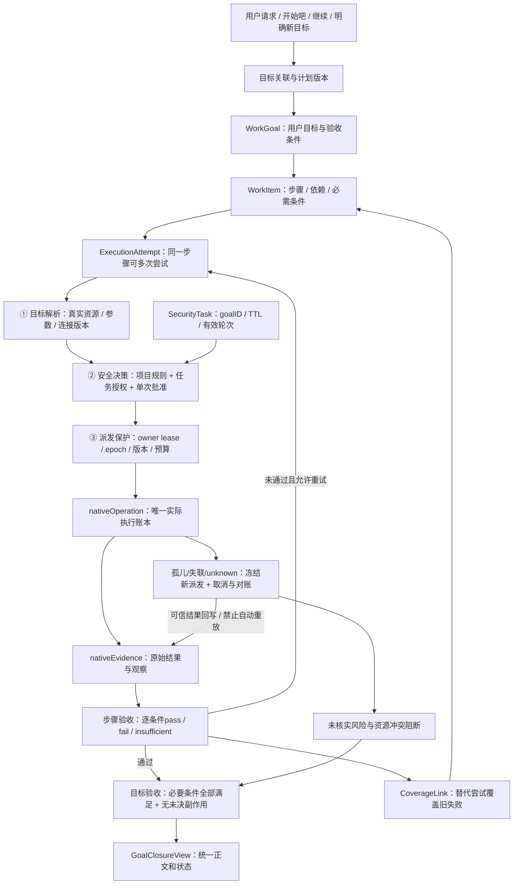
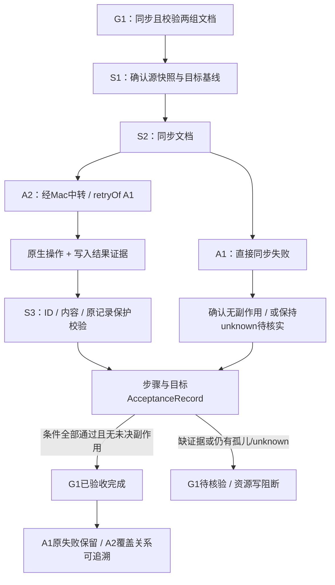
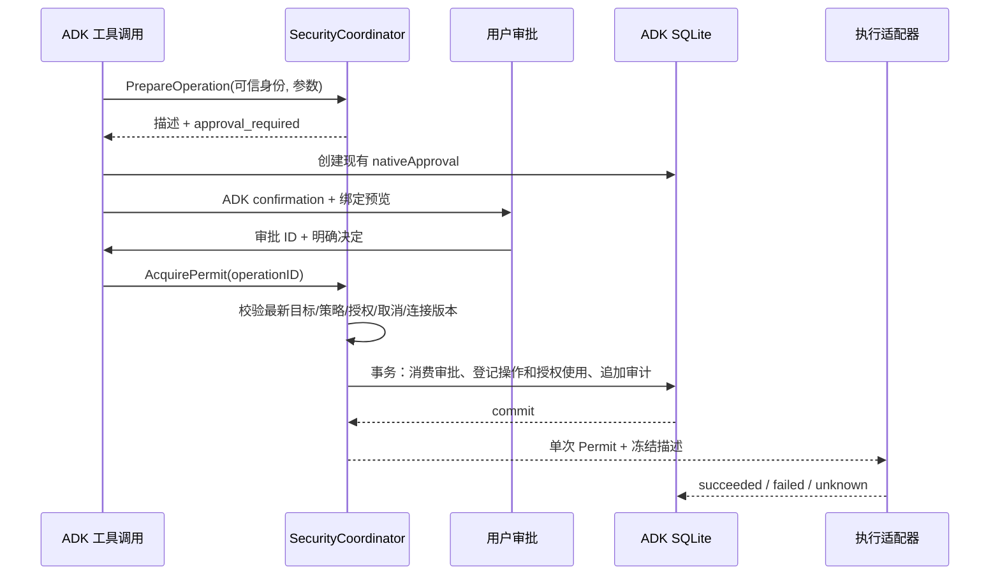
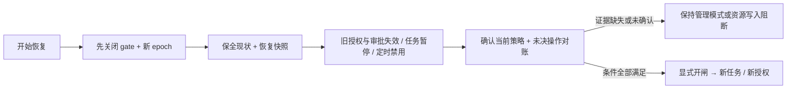

# Lake Security v1 详细设计 · 修订 4

状态：提案，尚未实现。修订日期：2026-10-30。修订4对照代码基线：`be656805d345466f11bbb9c2c4af92e670da7420`（develop；交付PR记录完整SHA）。产品范围仍是 Lake Security v1；保留文件名以维持已有链接。实施拆分见[实施计划](../../plan/feature-lake-security-1.md)。本文的接口、表和新文件均为拟议设计；标为“现有”的内容来自该提交的源码。

本次重设计解决四项评审问题：新增可跨明确续接轮次的 SecurityTask；按来源迁移旧目录状态并提供边界修改闭环；统一项目允许、任务授权、单次审批的判定规则；恢复备份时切换安全 epoch，使旧授权不能复活。另明确 Web/stdio 的统一存储位置，以及定时配置版本和运行状态版本的区别。

修订 3 将“任务一次授权、范围内自动执行、范围外再确认”设为主要交互。TaskGrant 从纯读取扩展到可机械校验的命令模板及明确维护动作；不透明自由 Shell 仍不获得按任务通配授权。新项目可通过现有审批明确包含本机的受控命令，无须先进入设置开启全部本机执行；已有显式 deny 继续生效。

修订4采用目标闭环：复用WorkGoal作为持久目标，WorkItem作为版本化步骤，关联多次执行尝试、原生operation/evidence和验收记录。SecurityTask改为目标下的限时执行上下文；轮次结束、换执行路径或授权过期都不能抹掉原目标及风险。新增孤儿执行治理：无有效归属禁止派发，失联操作追踪到停止或核实，不能由其他任务成功自动结清。

**本期范围约束：仅改后端执行、授权、持久化、验收和兼容投影；不涉及UI改造。不得修改前端组件、页面、布局、样式、按钮、交互或shared/contracts.ts，不新增任务条/授权卡/恢复页/风险看板。复用现有消息、问题、审批、停止、执行记录和核实入口；需要的管理动作由后端API/CLI承载。**

## 1. 目标与范围

Lake Security 负责回答三个不同的问题：用户想操作哪个目标、这项操作是否被授权、实际派发时授权和目标是否仍然有效。它嵌入现有 ADK 工具调用链，不另建模型循环。

交付后，“先确认数据量→开始吧→换条路径重试→校验结果”都关联同一目标；“开始吧/继续”只推进绑定目标，不签发或扩大权限。明确换目标时选择新目标，旧目标保持未完成/暂停并可找回。所有尝试都回写原步骤，最终以证据验收目标，正文与状态使用相同结果。目录为空时给出选择入口；写入、跨资源和终端接管仍独立判断权限。

v1 包含目标状态、确定性决策、项目策略、任务临时授权、单次审批绑定、派发校验、撤销与审计，以及现有调用入口的接入。v1 不包含多租户 IAM、组织角色管理、通用策略 DSL、新的 LLM 安全裁判、完整 Shell 解释器或跨平台 OS 沙箱。SQLite 和现有 ADK public API 继续使用，不引入新的策略服务。

截图显示“已识别目标，但仍被旧空目录范围拦截”的产品现象。源码确实存在目标范围继承和空范围阻断路径；本文据此设计修复方向，未声称已重放截图对应的历史会话。

## 2. 现有实现与改造依据

以下链接指向当前仓库文件；函数名是定位依据，未来行号变化不影响引用。

| 环节 | 现有代码与行为 | 设计处理 |
| --- | --- | --- |
| 权限开关 | [permissions.go](../../internal/ai/permissions.go) 的 `Permissions`、`approvalKind`：七个布尔项控制静默执行、引用限制、本机执行等 | 保留有效值作为迁移输入，拆成授权上限、能力规则和确认偏好 |
| Web 配置 | [agent.go](../../internal/web/agent.go) 的 `sessionOptions`、`configureWithSave`；Web 默认静默命令、自动建终端为 true，而 AI 基础默认值不同 | 不在重构中悄悄统一默认值；保存来源和迁移版本 |
| 目录与目标 | [Web directory_targets.go](../../internal/web/directory_targets.go) 的 `directoryTurnScope`、`questionTargetScope`；目录、引用、地址和旧状态共同生成 `TargetScope` | 提取目标解析器，记录来源与待消歧状态；导航目录不自动成为新硬边界 |
| 运行时范围 | [AI directory_targets.go](../../internal/ai/directory_targets.go) 的 `enforceTargetScope`；空范围或越界即阻断，与 `BlockUnreferencedAssets` 分别生效 | 拆分 `CurrentTarget` 与 `ExecutionBoundary`，迁移期明确保留旧边界 |
| 工具调用 | [tools.go](../../internal/ai/tools.go) 的 `Engine.invoke`、`ToolRisk`、`Engine.policy`；存在提前分流的会话工具，通用路径还会重复读取 policy | 所有入口登记能力；每次准备一个可信操作描述，派发前做一次新鲜度复核 |
| 目标与步骤 | [work_goal.go](../../internal/ai/work_goal.go) 已有WorkGoal/WorkItem/依赖/evidence引用及后台lease；[work_tools.go](../../internal/ai/work_tools.go) 的work_update要求成功观察 | 扩展这些权威对象，补稳定尝试、逐项验收和失败覆盖关系，不再新建平行目标账本 |
| 界面聚合 | [AIPanel.tsx](../../web-agent/web/src/AIPanel.tsx) 按本轮卡片统计失败数；[replyDurationState.ts](../../web-agent/web/src/replyDurationState.ts) 展示轮次状态 | 分开轮次结束、目标验收和尝试失败计数；完成状态不得靠正文或失败卡片计数推断 |
| 命令与 SQL | [policy.go](../../internal/web/policy.go) 的 `CommandPolicy`，`tools.go` 的 `readonlySQL`、`redisReadOnly`，以及 [sql_policy.go](../../internal/ai/sql_policy.go) | 复用确定性分类器，标记可证明程度；未知工具不能沿用默认 readonly |
| 原生审批 | [adk_approval.go](../../internal/ai/adk_approval.go) 的 `nativeApproval`、`waitNativeApproval`、`claimNativeApprovals`；绑定参数、目标指纹、预览、终端版本，15 分钟有效 | 扩展绑定结构，保留 ADK confirmation 和单次消费状态机 |
| 操作账本 | [adk_operations.go](../../internal/ai/adk_operations.go) 的 `dispatchNativeOperation`；事务内登记操作、消费审批、追加 `nativeEvidence`，不明结果需对账 | 在相同事务内增加新决策和授权使用记录，不另建执行账本 |
| 持久化 | [adk_session.go](../../internal/ai/adk_session.go) 的 `adkStore` 迁移原生表；[storage/sqlite.go](../../internal/agent/storage/sqlite.go) 提供私有 SQLite 与一致备份 | 安全权威数据放同一个 ADK store；web 资源库继续负责资源目录 |
| 子任务/Pilot | [agent_scope.go](../../internal/ai/agent_scope.go) 的 `scopedChildConfig`，以及 [adk_sre_roles.go](../../internal/ai/adk_sre_roles.go)、[adk_observation_roles.go](../../internal/ai/adk_observation_roles.go) | 复用父级实时收窄、角色约束、只读调查机制，叠加任务授权交集 |
| 会话与 MCP 工具 | [session_tools.go](../../internal/ai/session_tools.go) 的 `invokeSessionTool`；[extensions.go](../../internal/web/extensions.go) 的 `extensionBridge` 已校验配置版本 | 把提前分流入口也纳入同一能力注册表；MCP 绑定实际 server/tool/config revision |
| 工作流/定时 | [tool_bridge.go](../../internal/web/tool_bridge.go)、[workflows.go](../../internal/web/workflows.go)、[schedules.go](../../internal/web/schedules.go) 已检查资源、工作流版本及继承权限 | 使用明确的运行身份和任务授权；定时运行不能复用聊天单次审批 |
| 终端 | [terminal_access.go](../../internal/web/terminal_access.go) 校验会话、generation、permission version；[terminal.go](../../internal/web/terminal.go) 管理 execute/input/interrupt/close | 每个 agent 终端动作校验，不只校验首次打开；保留人类手动终端与借用语义 |
| 现有前端兼容边界 | [PermissionSettings.tsx](../../web-agent/web/src/PermissionSettings.tsx)、[contracts.ts](../../web-agent/shared/contracts.ts)、[approvalPresentation.ts](../../web-agent/web/src/approvalPresentation.ts) | 仅作为现有协议/显示能力依据，不列入改动文件；后端输出兼容现有字段和交互 |

现有代码不是“没有安全机制”。核心问题是多个状态承担了重叠职责、入口判断分散，以及目标解析失败被表现为权限错误。已有审批绑定、账本与终端 generation 是本设计的基础。

## 3. 架构与信任边界



模型、工具返回、网页、日志、附件中的指令、记忆和技能文本均为非权威输入。它们可以提供目标候选或证据，不能写授权表、设置 actor、生成 Permit 或把 `approved=true` 作为通行证。用户真实消息也不直接成为可复用授权：目标意图可以解析，新增授权必须走可审计的设置或授权动作。

可信层包括本机已认证应用入口、后端策略和资源适配器、私有持久化存储。该边界不防御已经控制 Lake 进程或操作系统账户的攻击者。当前应用认证机制不等于企业多用户 RBAC，v1 不做此类承诺。

### 3.1 状态归属与控制面

| 归属 | 保存内容 | 能否直接授权 | 生命周期 |
| --- | --- | --- | --- |
| 项目 | 默认能力规则、资源上限、执行模式、revision | 允许范围内的规则可以授权；明确 deny 不可覆盖 | 显式修改前持续有效 |
| 会话 | `CurrentTarget`、待消歧选择、确认偏好 | 目标本身不能授权 | 可跨轮次保留，切换时 revision 递增 |
| 任务 | SecurityTask 身份/生命周期；另存 TaskGrant 的资源、能力和到期时间 | 任务存在不授权；grant 只满足可授权 ask | 任务结束或 grant 到期/撤销失效，两个时钟分别检查 |
| 单次审批 | 一个确定操作的目标、参数、预览、版本 | 仅允许该次操作；不能突破 deny | 沿用 15 分钟 TTL，派发事务消费一次 |
| Home 恢复控制 | storeID、随机 recoveryEpoch、RecoveryGate、规范 runtimeRoot | 不授予能力；可禁止整个 Home 派发 | 不随普通备份回滚，恢复时先轮换 epoch |

GoalCoordinator复用WorkGoal管理目标闭环，TaskManager管理限时执行上下文，TargetResolver管资源意图，PolicyEvaluator管授权，DispatchCoordinator与OwnerReconciler管理派发/孤儿治理；各层通过可信关联协作。SecurityTask 不包含可自由扩大的权限列表，TaskGrant 不负责猜测用户是否换题。模型工具可以提议完成或切换，但不能直接操作授权签发、恢复开闸或边界放宽接口。控制面令牌不作为工具参数或模型环境变量向 agent 委托。

## 4. 目标解析与边界分离

### 4.1 数据模型

`CurrentTarget` 拟包含 `projectID/sessionID/resourceIDs/source/sourceMessageID/revision/updatedAt`。`source` 固定为 `explicit_selection`、`user_reference`、`user_address`、`confirmed_candidate`、`inherited`。资源名和目录路径仅作展示，资源 ID 为身份。

`TargetResolution` 包含 `status=resolved|unresolved|ambiguous`、经过可见性过滤的候选、原因码、原始输入消息 ID。失败结果保存在 `pendingResolution`，不覆盖最后一个有效目标。若本轮明确要求切换而新目标未解析，本轮必须停在选择状态，不能退回旧目标执行；普通“继续”且没有待处理切换时才继承有效目标。

`ExecutionBoundary` 独立保存 `resourceIDs`、本机执行限制、角色上限、来源、revision。来源包括项目配置、用户明确限定、父任务约束和迁移遗留约束。模型只能读取投影。新建的普通目录导航不创建它。

边界增加 `ownerKind=project|session|task|parent`、`provenance=explicit_restriction|legacy_unclassified|task_envelope` 和原始动作证据 ID。只有用户拥有的 session/task 边界可通过边界接口调整；项目/父任务边界不能从下级修改。存量导航证据不成为永久 deny，未知来源在一次迁移确认前暂停该会话执行，见第 13 节。

### 4.2 解析顺序与恢复

1. 本轮实际提交的资源选择或问题答案优先，校验项目归属、存在性和可见性。推荐选项和未提交默认值不算选择。
2. 用户本轮明确的引用、资源标识或唯一地址映射到 ID。地址使用真实连接字段匹配，不只匹配资源名称；同地址多账号、多协议或多集群必须消歧。引用文本、否定句及工具输出不能自行触发切换。
3. 模型可以提出候选；只有从可信目录返回的候选 ID 可被验证。仅模型推断的新目标必须由用户确认；唯一的用户显式地址匹配无需重复确认。
4. 目录选择产生候选集合。空目录给 `TARGET_EMPTY_DIRECTORY`；多个资源只在操作声明支持集合时使用，否则给 `TARGET_AMBIGUOUS`。
5. 没有新的目标意图且没有未解决切换时，继承 `CurrentTarget`。任何继承都不扩大授权。

明确切换到资源 B 后，即使旧目录 A 为空，目标解析也能返回 B；如果存在独立硬边界限制为 A，决策返回 `TARGET_OUTSIDE_BOUNDARY`，通过现有提问/审批或管理API/CLI修改用户可管理边界，不能靠重新 `@B` 绕过。

每个工具调用冻结自己的目标快照。流式生成中用户切换目标只影响后续操作；尚未派发的旧目标操作因目标 revision 不符而失效并重新准备。已登记派发的操作按第 9 节处理。目录改名不改变资源授权；目录增加成员不自动扩大已发出的任务授权。

### 4.3 目标、步骤、尝试与验收的关联

沿用 `WorkGoal.id` 作为 `goalID`，`WorkItem.id` 作为 `stepID`，扩展既有模型与 `nativeWorkGoal` 持久化。`RootTurnID` 只是一次交互；新的 `SecurityTask` 是目标下的限时执行上下文，不能取代用户目标。原SRE attempt是执行适配器记录，与下表通用attempt一一映射或明确分组关联，不复制其operation账本。

| 对象 | 身份与关键字段 | 职责 |
| --- | --- | --- |
| WorkGoal | goalID、project/session、originMessageID、selectedGoalID、goalRevision、progressRevision、activePlanRevision、acceptanceSpec | 保存用户要交付的结果、限制和验收条件，跨消息、失败和授权过期保留 |
| WorkItem | stepID、goalID、stepRevision、required、dependsOn、acceptanceCriteria、coveragePolicy | 表达目标内的必要步骤；重试不换stepID，改计划新增版本并保留旧版 |
| ExecutionAttempt | attemptID、goalID/planRevision/stepID/stepRevision、securityTaskID、retryOf、strategy、state、closureState | 表达某步骤的一次执行路径；失败后替代执行仍关联原步骤 |
| nativeOperation | operationID、attemptID、可信目标/参数、lease owner/generation、handle、status | 保留实际工具派发与结果的唯一账本；一个attempt可包含多项operation |
| nativeEvidence | evidenceID、operationID、目标身份、观察时间、内容摘要 | 保存可信观察；模型生成的成功文字不成为证据 |
| AcceptanceRecord | acceptanceID、goal/plan/step版本、criteriaResults、evidenceIDs、verifierVersion、state、coverageLinks | 后端按具体条件判定pass/fail/insufficient；为尝试、步骤和目标提供可解释的完成依据 |
| SecurityTask/TaskGrant | taskID、goalID、state/revisions/epoch、TTL、授权范围 | 限制哪些目标/步骤可执行哪些动作；身份有效不代表目标已成功 |

关联链为 `goal → versioned step → attempt → nativeOperation → nativeEvidence → acceptance → 原step/goal`。所有外部派发，包括短时诊断，都要求完整关联；纯解释性回答可以没有执行目标，但不能借解释入口访问资源。数据库外键/应用校验同时验证同project/goal及当前版本，模型不能自填任意关联ID获取权限。

goalRevision/stepRevision只在目标契约、约束或步骤定义改变时增加；日常进度与状态另用progressRevision/attemptRevision。正常收集证据、等待审批不改契约版本，避免审批自行失效；验收提交同时CAS检查进度版本和未决operation集合。

目标状态、执行上下文状态、实际操作状态分别投影，禁止混成一个“已完成”：

- Goal：`draft/running/waiting_user/paused/blocked/verifying/completed/cancelled`。只有验收通过才completed。一次attempt失败可让步骤blocked或准备重试，不自动终结目标。
- Step：`pending/running/blocked/verifying/passed/waived/superseded`。当前计划必要步骤只能passed；移除或waive必要条件需要用户确认计划变更，不能由模型跳过。superseded只标记有版本关联的旧路线，不减少当前必需条件。
- Attempt执行状态：`prepared/running/succeeded/failed/unknown/not_executed/cancelled`；另有 `closureState=open/covered/reconciled`。覆盖失败不改写原failed，不把unknown抹成失败。
- SecurityTask：`active/idle/waiting/paused/completed/cancelled/expired`。completed只表示该执行上下文已关闭，后端不得将其投影为“目标已完成”；关闭未达标目标使用取消/暂存动作，保留未交付状态。

### 4.4 跨轮次推进与目标切换

当前 `Engine.ExecuteTurn` 每轮清空WorkGoalID，不能将此行为延续为新方案的目标归属策略。新增由后端维护的 `selectedGoalID` 与 `TaskIntent`：`continue_goal/new_goal/select_goal/clarify`。输入绑定真实 `sourceMessageID`、goalID、expectedGoalRevision和当前有效执行上下文；模型只能提议关联。

| 输入/事件 | 目标与步骤行为 | 授权行为 |
| --- | --- | --- |
| 首次真实执行请求 | 创建/选择WorkGoal及验收条件；执行前至少明确目标和步骤 | 创建SecurityTask，按当前规则取得必要grant |
| 同一目标的补充、开始、继续、重试 | 保持goalID；沿用或新增该步骤attempt，保留之前失败 | 有效task/grant可复用，不自动扩大或续TTL |
| 唯一绑定的待开始/待回答事件收到“开始吧”“继续”“继续检查” | 验证原用户交互ID/goalRevision，推进该目标；不要求新建目标 | 该消息只表示推进，写入仍必须有独立有效授权 |
| 带内容的跟进，例如“换成经Mac中转” | 客户端保留当前goal关联；后端判断是否改变资源/验收范围，必要时展示计划/授权差异 | 新本机或中转资源需确认；不能从策略变更文本推导权限 |
| 归属不明确、存在多个候选目标 | 返回clarify选择原目标/新目标；未选定不派发 | 不沿用不确定的grant |
| 明确新任务/新目标操作 | 创建新goal/task；旧goal保留为未完成或paused，可从待办找回 | 不复制旧grant；默认旧前台上下文暂停/关闭未派发轮次并请求取消在途操作。仅已明确允许后台续跑且有效owner/授权仍在的旧任务可继续 |
| 切回旧目标 | 读取原步骤、未决attempt及资源占用，再决定合法恢复 | task过期或epoch变化则创建新task关联同goal并重新授权 |
| 当前轮次回复结束 | 更新轮次结束和goal进度，不自动完成goal | SecurityTask进入idle，grant仍按原绝对TTL计时 |

运行中补充沿用现有 `AdmitSupplement` 的原RootTurn与工具上下文，绑定同goal；抢先接入模型推理不取消已派发工具，也不改变授权。若补充要求换资源、撤销或新目标，先经后端目标/范围控制处理，不能只让模型在prompt里改归属。

没有绑定目标时，精确短语也不能自行猜一个历史目标。带内容的继续请求和新请求有歧义时通过一次选择确定，不用“每条新消息都新任务”或只匹配两个固定词。切换目标不会取消其他目标、隐去失败或释放仍未核实的写入。明确取消可关闭待办，但未停止的外部操作继续占用风险记录。

目标默认 `backgroundPolicy=foreground_only`；用户明确选择 `monitored_background` 后，才允许有持久owner、原handle、有效grant和deadline的后台继续。这里的切换指开始执行另一目标，单纯查看历史检查栏不改变运行状态。暂停/请求取消旧执行上下文不等于取消旧目标；其未完成步骤和在途风险继续展示。

### 4.5 执行上下文和版本

`SecurityTask` 字段为 `id/goalID/projectID/sessionID/kind/parentTaskID/state/stateRevision/executionRevision/recoveryEpoch/createdAt/expiresAt/closedReason`。默认上下文最长24小时；TaskGrant默认30分钟、可选4小时且不超过上下文deadline。上下文或grant到期不删除goal，也不把goal改为成功。新上下文只能复用目标和证据，不能复用旧grant/审批。

只有active且目标/步骤有效时可新派发；idle表示该轮已结束，waiting表示无可运行分支，paused表示暂停。完成目标、用户关闭上下文、取消或过期会终结上下文；用户主动结束未完成目标必须记录cancelled及未验收条件，而不是completed。普通重启暂停上下文，持久目标仍在；备份恢复按第13节轮换epoch。

stateRevision用于后端交互绑定/CAS；executionRevision在暂停、终结、取消、过期时递增，废止旧prepared/approval。正常active→waiting→active不增加executionRevision，不使审批自己失效。grant绑定taskID/goalID/epoch/自身revision与TTL，不绑定executionRevision。并行分支单独waiting不冻结其他可运行scope。

RootTurn/scope关联另记active/waiting/closed：审批continuation保留原轮次；下一轮继续先关闭旧轮次未派发调用，但保留已派发operation的观察/清理通道。新轮次不能让旧call复活，旧回调只能回写对应operation/证据，不能启动新的副作用。真实目标/计划修改另增加goal/step版本，旧审批与待派发尝试重新校验。

### 4.6 失败覆盖、验收与统一结果

1. attempt执行成功只表示操作层成功，必须进入步骤验收，不能直接完成goal。验收规则在执行前形成有版本的结构：expected target、必需条件、比较方法、输入证据身份/时效及预期值；模型可建议，后端验证器负责读取原始记录并判定。只有模型文字或exitCode=0不足以证明业务交付。
2. 新尝试成功后，对同step/version记录 `CoverageLink(failedAttemptID,replacementAttemptID,acceptanceID,criteriaIDs,reason)`。纯执行策略的planRevision变化可跨版本关联，但须保存旧/新版本及相同验收契约摘要；条件改变则逐项重新验收，不能继承旧pass。只覆盖被证据证明已满足的原要求。普通已确认无副作用的失败/未执行尝试可covered；failed原因是权限拒绝时仍保留拒绝审计，覆盖不产生权限。
3. 旧unknown/dispatched/未停止后台进程不能仅凭新路径成功标covered。先对原operation核实副作用和资源占用，可信证据证明停止/结果后才记reconciled。不能重写旧执行状态，也不能通过换attemptID绕过同一写入的防重放。
4. 更换方案可使旧路线步骤变为superseded，但必须明确映射新步骤覆盖哪些旧条件。必要步骤未执行只能由等价替代验收覆盖，或经用户确认修改验收契约；不能自动记waived。独立步骤可以继续，依赖未满足的步骤不能执行。
5. 目标completed要求当前计划所有required条件pass、有效步骤依赖满足、无未处理的相关写入unknown/孤儿/后台副作用，且相应资源lease已释放或有已确认的目标外移交。验证器在同一事务检查goal/step/证据版本并登记目标AcceptanceRecord，防止拿旧验收覆盖新变更。
6. cancelled保留未满足条件；用户表示“算了”只能取消目标及请求取消执行，不能把未知副作用变为安全。外部风险未清零时另保留riskState=attention，安全看板与资源阻断仍有效。

AcceptanceRecord追加保存，包含 `scope=step|goal`、精确版本、逐条 `pass/fail/insufficient`、证据引用、方法及验证器版本。配置可验证规则无法覆盖的业务验收采用明确人工核验入口，记录核验人/动作/原始依据；不能用模型“已完成”代替。用户接受部分交付时生成新的goalRevision和条件差异，再按新契约验收。

验证器采用受信注册表及固定类型化比较方法，不执行模型提供的验收脚本。若验收需要新的远程查询，该查询仍登记goal/step/attempt并通过当前授权派发，再以取得的证据验收；不能从“校验”入口绕过资源权限或孤儿阻断。

后端生成内部 `GoalClosureView(goalStatus,acceptanceState,requiredRemaining,openRiskCount,attemptFailures,operationFailures,recoveredFailures)`，最终回复的验收事实、现有状态字段与执行记录都从同一份结果投影。它不是新前端View或协议。本期不新增目标图谱浏览器、风险看板或任务卡。

兼容层只使用现有AIView/ReplyTiming/work goal/operation outcome和消息字段；枚举与响应形状保持旧客户端可理解。原始工具失败计数继续表示历史失败，后端不删除失败卡片或把失败改写为成功来减少计数。当前目标验收通过后，用现有状态及正常结论文本解释替代/核验结果；尚缺证据时不提供成功的生成事实。历史轮次失败仍保留，不能反改历史计时冒充当时成功。

完整goal/step/attempt/evidence/acceptance关联留在后端账本、现有work_read/执行记录和管理API。G2完成不隐藏G1未决风险：继续保留原operation outcome/需关注状态及必要的现有系统消息，不增设新清单组件。旧前端无法完整展示的新关系不属于本期可视化交付；运行时仍必须按这些关系强制拦截。

### 4.7 孤儿执行治理属于安全边界

孤儿执行包括：无有效goal/step/attempt/task归属；owner失联或lease过期；父任务取消但子队列仍在；后台handle失去追踪；恢复后回调仍试图续跑。界面关闭、用户换目标、模型回复结束都不是释放执行所有权的依据。

- 每个nativeOperation必须登记goal/step/version/attempt/task、资源连接身份、ownerID/generation、leaseUntil及可取消/观察handle；队列/outbox、终端agent占用、文件操作和外部watch引用同一归属。已有nativeWorkGoal调度lease可复用其机制，但不能把调度锁误作远端进程已停止的证明。
- 派发前在同事务校验完整关联、当前owner generation、未过期lease、授权与依赖；缺失归属fail closed。lease默认15秒、owner每5秒续期，续期不延长grant/上下文/命令deadline；单次运行deadline独立校验。取消/撤销/过期同步阻断后续派发。
- 启动恢复及每5秒的sweeper检查过期owner和未决handle；扫描周期不成为授权宽限期。发现孤儿后冻结队列、废止待审批和prepared、使旧owner不能续跑，发出适配器取消请求，标记 `orphaned/reconciling` 风险。已派发operation保留真实dispatched/unknown状态，直到核实。
- 取消结果按 `requested/confirmed/unsupported/unknown` 登记。进程实际退出、远程作业终态或可信人工核实才允许确认；超时、连接断开、卡片消失不等于已停止。孤儿租约过期后回来的旧callback可以登记原结果，不能重新取得权限或新派发。
- 本机命令用受控进程组与deadline；远程命令/服务API依赖可验证的停止或有界执行机制。strict任务自动执行模板禁止detach和不受控后台派生；适配器无法给出边界时转opaque并在授权前说明，不能承诺停止本地连接就停止远端命令。
- 原写入/进程无法核实时，持久阻断该资源上相关冲突变更；若影响范围不明，按恢复规则扩大阻断。新的成功尝试/独立目标不能清除此阻断。已授权的独立只读对账仍可进行，管理取消入口不受无active任务的限制。
- 人工接管/转交必须显式确认目标、handle、generation与责任人，获取新授权和有效owner；旧grant不转移，旧owner被fence。确认转交只改变责任归属，不把unknown副作用变成已完成。

取消和最低限度状态核实由后端内部清理权限执行，只允许原登记handle及其受信取消/状态API，不接受模型指定的新命令、目标或数据读取；grant到期不能阻止安全清理，也不能把清理权限借给agent续跑。缺少可信agent所有权证据的旧进程只进入人工核实清单，禁止自动杀掉可能属于用户的进程/终端。

因此不存在“任务1失败后直接不管”的正常路径：必须是重试/等价替代并验收、暂停待处理、明确取消并核实停止，或有审计的移交。保留孤儿风险与待办，直到真实执行闭环；安全状态不能随着另一条成功回复消失。

### 4.8 数据同步场景的验收示例

以下为模拟fixture，不代表截图中的真实数据库已核验。G1目标是将两组文档从资源A同步到B，保留_id与字段、不覆盖既有记录，并核对指定源快照。步骤S1确认范围/数量，S2执行同步，S3独立比较目标结果；S2依赖S1，S3依赖同步证据。源快照为service 2条、tiles 1442条；验收还要核对文档ID集合、内容摘要和既有目标记录未改变，不能只比较总条数。



“先确认有多大数据→开始吧”绑定G1的原待开始事件，第二条消息不会另建G2。“改经Mac中转”新增A2/计划版本并申请必要本机范围；不会忽略A1的可能部分写入。A1有证据证明未写入，且A2/S3完成，才显示“目标已验收，历史尝试失败1次已替代”。A1仍unknown时，即使A2返回成功也必须保留G1待核实和相关写阻断。用户另开无关G2并完成，不影响G1待办/风险。

## 5. 策略、能力与授权规则

### 5.1 项目策略

`ProjectPolicy` 包含 `schemaVersion=1`、`projectID`、`revision`、`mode`、资源上限、能力规则、任务授权上限和确认偏好默认值。v1 使用 Go 类型与固定规则，不开放脚本表达式。

能力规则的效果为 `allow`、`ask`、`deny`；`ask` 另有 `grantable` 和 `confirmation=single|task|either`。受控命令默认either，允许任务授权或单次批准；单次专属操作不能被任务grant覆盖。默认 deny 优先：任一适用硬限制拒绝即拒绝；能力未知也拒绝。规则冲突时依次采用显式 deny、最窄资源匹配、该能力规则、项目默认；同优先级取更严格结果。没有匹配项为 deny。项目资源上限和子任务角色边界不能被临时授权或单次审批覆盖。

每项能力统一按下面规则判断，主任务和子任务使用同一个函数：

```text
HardOK = 恢复闸门开放 ∧ epoch相同 ∧ 任务active且未过期 ∧ 未取消
         ∧ goal/plan/step/attempt关联有效 ∧ 步骤依赖满足
         ∧ owner generation与lease有效 ∧ 无相关未决副作用冲突
         ∧ 项目资源上限 ∧ 显式执行硬边界 ∧ 父链限制 ∧ 角色上限
         ∧ (本任务确认范围内 OR 用户批准的精确单次任务范围例外)
AuthorityOK(capability) = 当前规则allow
                         OR (当前规则是可授权ask AND 有匹配的有效TaskGrant)
                         OR (当前规则ask允许单次确认 AND 有匹配的有效单次审批)
Allow(operation) = HardOK AND 每项能力的AuthorityOK
```

任何匹配 deny 先行拒绝；单次审批不可拿来满足只允许更窄方式的规则。没有 TaskGrant 不等于空权限：项目已 allow 的读取，父子任务都可按边界执行。项目从 allow 变 ask 后，旧的 allow 决策不再是授权来源；必须取得当前规则允许的 grant/审批。每项能力在决策中记载实际 authority source，复核时重新检查，不只验证一个旧摘要。

新建项目采用 `restricted` 配置：项目内资源元数据可读；受支持结构化只读能力在目标确定、硬边界允许时可读。受控命令、具体服务重启动作为可任务授权的 ask；本机受控执行同样为 ask，现有审批说明必须明确显示“本机”、机器资源 ID 和能力范围。文件写、SQL 写及任意交互终端输入不接受任务通配授权；明确危险且可预览的操作仅支持单次审批。任意自由 Shell 和不透明 MCP 在 restricted 模式下为 deny。用户显式设置的本机/资源 deny 仍是硬限制，不能用任务授权覆盖。

需要任意命令的用户可以显式启用 `compatible` 模式，确认其授权单位是选定执行域中的 Shell/MCP 调用，系统无法证明所有二次访问和副作用。此时不透明操作为单次 ask，不能获得任务级通配授权。模式切换增加策略 revision，并失效待审批操作。迁移的旧项目使用 `legacy` 适配，保留旧有效行为和硬限制；不直接套用新项目默认值。

### 5.2 能力注册表

`internal/security/capability.go` 拟维护封闭的工具注册表；每个工具必须声明目标种类、能力、效果证明等级、参数规范化方式、预览方式和执行适配器。一个工具可以申请多个能力，必须全部允许。目标种类明确为 `resource|resource_set|project|session|none`：只有前两者需要资源解析；项目发现、选择恢复和任务控制不会因尚无 CurrentTarget 而被拦在资源选择之前。控制面恢复/撤销不走普通 agent 的 active-task 派发路径，避免失效任务无法被用户管理。

| 能力类别 | 示例能力 | 判定重点 |
| --- | --- | --- |
| 资源发现 | `resource.list`、`resource.resolve` | 项目可见性；返回目录不授予操作权 |
| 文件 | `file.read`、`file.write`、`file.delete` | 规范化路径、根目录、符号链接、写入前内容 hash |
| 数据库/集群 | `db.read`、`db.write`、`cluster.read`、`cluster.logs` | 实际连接、库/schema、语句分类、行数/日志范围 |
| 终端 | `terminal.open`、`terminal.adopt`、`terminal.execute`、`terminal.input`、`terminal.interrupt`、`terminal.close` | 资源、所有者、generation、上下文版本；打开不授权后续命令 |
| 受控命令 | `command.diagnostics`、`service.restart`、`local.execute` | 受信模板及版本、真实 executable/argv、参数约束、资源/服务集合、调用预算；本机额外满足local.execute |
| 外部访问 | `network.fetch`、`mcp.discover`、`mcp.call` | 目标域、重定向、server/tool/config revision；防止静默本机/内网回退 |
| 应用内部 | `memory.read`、`memory.write`、`workflow.manage`、`schedule.manage`、`task.control`、`artifact.read` | 项目、会话、数据所有者与控制动作，不能因无资产参数而跳过 |

`ToolRisk` 的 readonly/write/dangerous 标签作为分类证据保留，不能作为唯一授权依据。Shell 分类器识别只读外观不代表实际无副作用；`bash -c`、动态展开、跳板连接、未知命令及无法约束的复合语句为 opaque。SQL 的危险函数、外部执行、批语句和读写 CTE 保守分类。受限模式使用能固定查询方式的结构化观察适配器，并要求数据库/Kubernetes 账户具有相应服务端权限。

每次新增工具必须注册；构建测试比较运行时全部工具目录与能力注册表，未注册工具运行时也 fail closed。会话、附件、记忆、工作流控制工具不能放在此清单之外。

v1 的约束使用固定结构，不接受模型填写的表达式或路径通配符：

| 约束 | 字段与匹配规则 |
| --- | --- |
| 文件 | `fileRoots` 为用户配置的绝对根路径集合；按规范化路径组件包含关系判断，不使用字符串前缀。无根配置不能获得根范围读取授权；秘密目录始终排除。写入另绑定 exact path 和 expected content hash |
| 数据库 | `databaseID` 精确匹配连接的逻辑库；`schemas` 为精确名称集合；`maxRows/maxDurationMs` 为正整数，并取项目、grant、调用三者最小值。缺失限制不能解释为无限制 |
| 集群 | 精确 `clusterID/namespaces`，固定资源种类/只读动词；日志必须指定有界时间窗或尾部行数，范围不能随模型摘要扩大 |
| 网络 | 精确 scheme/host/port 与允许的解析后地址段；缺失为拒绝。每次重定向重新匹配，不支持 grant 中任意 URL 正则 |
| 通用 | `resourceIDs/capabilities` 取交集，连接 revision 必须相等；不支持约束字段直接报 schema 错误，不能忽略后执行 |

新建 restricted 策略的初始读取预算为单次最多 1,000 行、30,000ms，日志最多 500 行/最近 15 分钟；允许用户在项目策略中显式收紧或提高。适配器不能执行对应预算/范围约束时，不登记为可证明读取。文件根、数据库 schema、集群 namespace 和网络目标由资源/项目配置提供；缺失所需范围时要求补配置，不推断为全部资源。

### 5.3 任务授权

`TaskGrant` 拟包含：服务端生成的 `id/taskID/goalID/projectID/sessionID`、`rootAuthorityID/recoveryEpoch`、purpose、精确资源ID/连接revision、能力与约束、签发动作、绝对expiry和revision。taskID必须指向同goal的有效SecurityTask；计划允许grant跨该goal的多个attempt复用，但每次仍验证当前step/策略/范围。purpose仅解释，不能构成授权匹配。

v1 任务授权支持结构化读取、受信命令模板和精确服务集合的重启动作。文件写、SQL 写、自由 Shell、任意终端输入及 opaque MCP 仍不接受任务通配授权。诊断预设为有效任务内 30 分钟；可在现有提问选项中选择30分钟或4小时，项目上限默认 4 小时。任务结束、取消、父授权失效或时间到期立即停止新派发；续期必须再次显式授权。项目直接 allow 的读取不需要创建任务授权。

子任务先按第 5.1 节满足能力规则，再收窄到父任务当前边界与角色能力；TaskGrant 是可选授权来源，不是必须存在的交集项。子任务不得自行续期或扩大授权。父任务拥有的 grant 只能在显式关联的子 scope 中使用，资源/能力/TTL 均不变；单次审批仍绑定该具体子调用。后台续跑、压缩、普通重启不能刷新到期时间。

每个后台 workflow run 拥有独立 SecurityTask；定时授权绑定 scheduleID、configRevision、冻结 workflow version、精确资源/能力、expiry、remainingRuns、recoveryEpoch。创建/修改定时时必须由用户显式设置到期与允许次数。每次触发在一笔事务中扣减次数并创建 occurrence、SecurityTask 和对应读取 grant，其到期为 `min(scheduleExpiry, taskExpiry, now+4h)`。无有效授权则标记 `authorization_required`，不自动同意。v1 定时 grant 也只允许结构化读取；写操作不能通过项目 allow 反向扩大本次定时运行的显式能力上限。

### 5.4 任务命令授权与超范围确认

通过现有通用审批的标题、说明和预览字段展示任务授权：目标资源/连接身份、是否包含本机、命令模板及参数范围、读取路径或服务集合、禁止项、次数/时长预算、到期时间。用户批准后签发 TaskGrant，并建立来源为该真实用户动作的任务执行范围；权限由程序逐调用匹配，模型提供的“本次仍属排障”说明不参与授权判定。

现有审批一次列出模板执行所需的全部可授权能力，包括限定资源的建连能力，避免命令已获批却反复申请同一连接。跨会话接管人类终端仍单独确认。决策先检查项目/父/显式硬限制，再检查task_envelope：仅本任务范围越界且允许申请时进入范围确认；不能先按普通hard deny终止所有范围外请求，也不能为等待确认的请求先执行部分命令。

| 项目 | v1 规则 |
| --- | --- |
| 范围表示 | `resourceIDs + capabilities + commandProfiles(profileID, version, typedArgs) + serviceIDs + maxUses + expiry`；不接受命令字符串前缀、任意正则或“所有排障命令” |
| 诊断预设 | 固定读取模板，如磁盘使用量、进程快照、指定服务状态、限定日志范围；命令累计默认50次、每次30秒、任务授权默认30分钟，预算在主/子任务间共享 |
| 维护预设 | 用户明确选择的服务重启，精确服务ID/实例/资源绑定，默认累计1次；不能从“读取服务状态”推导出重启权 |
| 命令执行 | 新增 `internal/security/command_profiles.go` 定义封闭模板；`internal/ai/command_dispatch.go` 把模板与类型化参数编译成冻结的 executable/argv/工作目录/安全环境后执行。不得校验模板后再执行模型原始Shell文本 |
| Shell输入 | 只有可无歧义转换为受信模板的输入才进入自动路径；管道、重定向、命令替换、动态脚本、未知子命令、提权和交互输入不能靠前缀匹配获批。适配器无法保证模板语义则降为opaque |
| 次数消费 | 与nativeOperation派发登记同事务扣减；并发主/子调用共享额度。登记后unknown不返还额度，确认not_executed才可事务性返还一次 |
| 范围内 | scope、当前策略、grant、模板版本、预算、任务状态均有效即自动派发，不重复弹命令审批 |
| 范围外 | 返回 `TASK_SCOPE_EXTENSION_REQUIRED`，展示目标/动作/参数/预算差异；可“仅批准这一次”或“扩展本任务范围”。等待期间不执行、不扩范围 |
| 不可确认项 | 项目/父边界明确deny、角色禁令、restricted下opaque仍拒绝，展示设置原因；不把所有拒绝变成“仍然执行”按钮 |

“超范围再确认”也适用于项目已allow的能力：用户已确认的本任务范围是执行限制，不能用另一条项目allow绕过它。新建任务未指定限制时仍按项目策略判定。任务范围调整与授权来源分别存储，扩展动作以CAS同时修改用户任务边界并签发新grant/revision；不得修改父/项目硬边界。单次批准使用一个绑定确切操作的任务范围例外，只覆盖本次task_envelope，不覆盖其他显式执行限制，仍受全部父/项目限制；不修改后续调用的范围。

扩展授权必须明确展示新增资源/模板/服务及预算，默认继承原到期时间和未消费预算；只有用户明确确认增加次数/延长时间才可更改。旧版本未消费审批/已准备描述失效；并发调用在派发事务读取最新版本。自由Shell在compatible模式下若无法证明其实际效果属于该任务范围，不能直接自动执行；现有单次审批说明必须明确其可观察执行域和未知影响。单次批准不生成永久命令规则。

示例：用户一次允许“在服务器A读取磁盘、进程、nginx状态和最近15分钟日志，30分钟内最多50次”。这些调用自动执行；重启nginx、访问服务器B、扩大日志路径或执行未知脚本时才再次请求授权。批准一次重启后，其他重启仍不被自动授权；若明确扩展为“本任务nginx可重启1次”，仅该预算内自动执行。

## 6. 可信操作描述和接口

新增纯 Go 领域包 `internal/security`，不导入 `internal/ai` 或 `internal/web`。AI/Web 负责把现有对象映射为领域类型；数据库协调仍放在现有应用层。以下为接口草案，名称用于实施定位：

```go
type Resolver interface {
    Resolve(ctx context.Context, in TargetInput) (TargetResolution, error)
}

type Evaluator interface {
    Evaluate(in EvaluationInput) Decision // 无 I/O；时间与快照作为显式输入
}

type Coordinator interface {
    PrepareOperation(ctx context.Context, in ToolRequest) (PreparedOperation, error)
    AcquirePermit(ctx context.Context, operationID string) (Permit, error)
}

type TaskManager interface {
    Begin(ctx context.Context, in TrustedTaskAction) (SecurityTask, error)
    Continue(ctx context.Context, in TrustedTaskAction) (SecurityTask, error)
    Transition(ctx context.Context, in TrustedTaskTransition) (SecurityTask, error)
}
```

`PreparedOperation` 是内部不可由工具参数伪造的对象，包含：

- actor（由入口生成的 `human_action|agent|child|workflow|schedule`）、项目/会话/goal/planRevision/step/stepRevision/attempt/securityTask/rootTurn/call 身份；子任务父链、task executionRevision、storeID 和 recoveryEpoch；不绑定因正常审批等待而变化的 stateRevision。
- 工具名、注册表版本、能力、分类证明等级；实际资源 ID、连接 revision、协议/主机/端口/逻辑库等安全相关身份。
- 规范化参数摘要、预览摘要、目标 revision、策略 revision、父边界 revision、所用 grant revision、终端 generation/context version、MCP 配置与目录 revision。
- cancellation标识、ownerID/generation/leaseUntil、预期写入内容版本、唯一operation identity；完整执行关联不可缺失。

使用稳定 JSON 编码（字段顺序固定、明确 null/空值语义、集合排序）计算带版本的 SHA-256 描述摘要。秘密不进入描述、提示词或审计参数；只使用 credential reference 的后端身份与 revision。已经禁止的秘密参数继续拒绝，不能用散列秘密来替代秘密隔离。

`Permit` 为进程内不透明句柄，绑定描述、操作登记和使用状态；构造字段不导出，不可序列化到模型/前端，不能跨 operation 重用。适配器只接受该句柄和已冻结的描述。现有 `Bridge(..., approved bool)` 迁移为内部上下文权限；兼容期该 bool 也不能单独触发执行。真正人类手动终端动作由已认证路由生成 actor，模型传入同名字段无效。

## 7. 决策顺序与结构化结果

按照以下顺序执行，越早失败越不应申请审批：

1. 校验入口身份、项目/会话/goal/step/attempt/task归属、当前计划/步骤依赖、owner有效性、工具注册、参数schema和秘密参数禁令；无归属不派发。
2. 按注册的 target kind 解析资源或项目/会话归属；需要资源的工具缺失或歧义时返回 `TargetResolution`，不进入授权审批。发现和控制工具不要求先选资源。
3. 解析实际连接和附带目标，构造操作描述；无法证明目标时按 opaque 规则处理，不回退本机。
4. 校验 RecoveryGate、storeID/epoch、任务 active/expiry、executionRevision、有效 RootTurn/child scope 和取消，本机禁令、Plan/Pilot 角色、项目和父执行边界等硬限制。
5. 取同一快照的能力规则；逐能力匹配项目 allow、符合规则的有效任务授权或本次审批，按第 5.1 节统一公式得到结果。无 grant 的项目 allow 同样适用于子任务。
6. 对 ask 创建现有原生审批；明确 deny 只展示原因及用户有权操作的设置入口，不提供“仍然执行”。
7. 派发时重新加载相关 revision、目标与 task 状态、授权 TTL，并在事务内完成消费与登记。

`Decision` 包含 `effect=allow|approval_required|deny`、`reasonCode`、安全的用户说明、`operationID`、相关 revision、需满足能力和已使用授权 ID；用户说明不含秘密或隐藏资源信息。无目标时使用独立 `resolution` 对象，不伪造 `deny`。

| 后端原因码 | 含义 | 复用既有交互或管理动作 |
| --- | --- | --- |
| `TARGET_REQUIRED` / `TARGET_AMBIGUOUS` / `TARGET_EMPTY_DIRECTORY` | 缺失、歧义、空目录 | 用现有提问返回经过权限过滤的资源候选 |
| `TARGET_OUTSIDE_BOUNDARY` | 目标有效，但超出独立硬边界 | 用现有消息解释来源，复用审批或管理API/CLI调整 |
| `LEGACY_SCOPE_CONFIRMATION_REQUIRED` | 旧范围缺少可靠来源 | 展示一次迁移确认，不将未知范围直接固化为永久 deny |
| `GOAL_BINDING_REQUIRED` / `STEP_NOT_READY` | 缺少执行归属或必要依赖未满足 | 选择目标/处理前置步骤，不派发 |
| `ORPHANED_EXECUTION` / `SIDE_EFFECT_UNRESOLVED` | owner失联或原副作用未核实 | 冻结新派发、取消/核实/可信接管；保留资源阻断 |
| `ACCEPTANCE_REQUIRED` | 操作执行结束但目标条件未验证 | 展示缺失条件/证据，不能显示已交付 |
| `TASK_NOT_ACTIVE` / `TASK_ENDED` | 暂停/空闲或已终结 | 合法继续/恢复入口，或新建任务 |
| `RECOVERY_CONFIRMATION_REQUIRED` | 恢复后策略未确认或账本未对齐 | 通过现有消息/管理API或CLI处理恢复；不派发agent操作 |
| `CAPABILITY_DENIED` / `LOCAL_EXECUTION_DENIED` | 明确拒绝 | 不出现审批同意按钮 |
| `APPROVAL_REQUIRED` | 允许申请本次审批 | 展示资源、动作、差异/命令预览 |
| `GRANT_EXPIRED` / `GRANT_REVOKED` | 临时授权已无效 | 可申请新的合规授权；禁止自动续期 |
| `OPERATION_STALE` | 参数、连接、策略、目标或终端版本变化 | 旧按钮失效；重新准备并展示变更 |
| `OPERATION_UNKNOWN` | 外部结果不确定 | 提供对账证据入口，禁止原操作自动重放 |
| `UNREGISTERED_TOOL` / `UNVERIFIABLE_EFFECT` | 工具未登记或效果不可证明 | 拒绝，并显示适用模式说明 |

## 8. 持久化与一致性

### 8.1 表结构

在规范 RuntimeRoot 下 `adkStore()` 打开的同一 ADK SQLite 增加下列表。名称为拟定，不修改现有 ADK SDK 内部表。授权与运行描述带storeID/epoch；旧epoch授权不能作为当前允许依据。持久goal/step/证据跨epoch保存关联，恢复后重核目标验收/未决风险，使用新上下文授权继续同goal。

| 表 | 关键字段与约束 |
| --- | --- |
| `security_project_policies` | project_id 主键；schema_version、revision、mode、typed_rules、updated_by/action_id；更新 CAS |
| `security_legacy_session_policies` | session_id 主键；迁移前有效七项权限与入口来源、revision、epoch；只用于已迁移 legacy 会话，禁止覆盖同项目其他会话 |
| `security_tasks` | id主键；goal_id、project/session/kind/parent/state/state_revision/execution_revision/epoch、绝对expiry；只管执行上下文 |
| `security_task_bindings` | task_id/kind/execution_id唯一；同scope仅一个active owner代次，历史绑定保留；映射taskID/goalID与RootTurn/SRE/workflow/child scope |
| `work_execution_attempts` | attempt_id主键；goal_id/plan_revision/step_id/step_revision/task_id/retry_of、state/closure_state、revision；不保存第二份operation结果 |
| `work_acceptance_records` | acceptance_id主键；goal/plan/step版本、条件结果、evidence引用、验证器版本、state；只追加 |
| `work_coverage_links` | failed_attempt_id/replacement_attempt_id/acceptance_id/criteria_ids；同一目标、当前契约、验收通过才可写 |
| `security_session_targets` | session_id 主键；project_id、current_target、pending_resolution、revision；无有效目标用 null，不用空列表表示授权 |
| `security_boundaries` | id、ownerKind、project/session/task 归属、provenance、sourceActionID、resource_ids、revision、约束；未知来源须先确认 |
| `security_resource_revisions` | project_id/resource_id 主键；generation、connection_digest、state=ready/changing/disabled；仅保存非秘密配置摘要；MCP 另以 server/tool/catalog 身份使用同类版本记录 |
| `security_task_grants` | id 主键；project/session/goal/task、parent_authority、资源连接版本、能力、约束、expiry、revision、revoked_at；索引 task/expiry |
| `security_schedule_grants` | id、schedule_id/config_revision、workflow_version、资源/能力、expiry、remaining_runs、authority_revision、epoch；与本次任务签发在同一事务 |
| `security_schedule_occurrences` | schedule_id/config_revision/due_at 唯一；grant_id、task_id、workflow_run_id、状态；触发幂等记录，不替代实际工具操作账本 |
| `security_decisions` | id、operation_id、effect/reason、descriptor_hash、相关 revision、授权来源、redacted summary、时间；追加记录 |
| `security_authority_events` | id、授权/策略/边界身份、事件种类、actor/action_id、前后 revision、时间；只追加 |
| `security_schema_meta` | schema_version、minimum_reader_version、迁移状态、legacy 基线标识 |

另有 Home 私有文件 `<Home>/security/control.json`：`formatVersion/storeID/recoveryEpoch/runtimeRoot/gate/recoveryID`。它是恢复控制记录，不是第二个策略/操作账本；只存少量状态并采用权限私有、写临时文件、fsync、原子替换。普通备份不包含它，跨机器导入必须新建 storeID/epoch。文件缺失、格式不兼容、与数据库 epoch 不同均进入管理模式，不能自动按“全新安装”放行已有数据。

扩展现有nativeWorkGoal/WorkItem的版本化步骤、验收条件、选中目标和进度字段；扩展nativeApproval/nativeOperation的goal/step/attempt关联、owner/generation/lease和描述/决策摘要，保留旧字段兼容读取。孤儿风险和取消结果附于原nativeOperation及审计，不另建副作用账本。原生审批仍是单次审批唯一权威，原生操作仍是执行/unknown 唯一权威。`security_decisions` 记录判定，不构成可独立重放的执行队列。数据库唯一约束维持原 operation identity；失败不能靠另造 ID 自动重试同一不明副作用。

安全表由应用层 `internal/ai/security_store.go` 迁移和访问；底层 `internal/agent/storage` 继续只提供存储能力。项目删除需要撤销授权并阻止新任务，历史审计按保留策略处理，不能级联删除来解除 unknown 防重放约束。v1 不自动裁剪操作账本；决策列表采用分页，后续独立设计保留/导出策略。

### 8.2 两个 SQLite 的一致性边界

现有 Web 资源/连接/aiOptions 与 ADK 操作存储不是同一个数据库，不能声称一笔事务可以覆盖两者。设计采用一个由每个 Lake Home 的唯一后端持有的 `SecurityCoordinator`，并规定所有安全相关修改必须经过它：

1. 使用短时读写 barrier：最终准备/登记读取侧与资源修改、策略撤销写入侧互斥；锁顺序固定为 coordinator → web snapshot → ADK transaction。不得反向持锁或在模型等待、审批等待、外部网络 I/O 中持锁。
2. 资源变更先在 ADK 标记该资源 `changing` 并提升安全 generation，再提交 Web 连接更新，最后登记新的非秘密连接 revision 并清除 changing。中间任一步崩溃，资源保持不可派发，启动时核对两个库后修复；不能回退旧连接偷偷执行。
3. 策略、授权撤销与 ADK 派发登记使用同一数据库事务排序；资源配置变更通过上述 barrier 参与排序。启动恢复先完成 changing 对账，再接收工具调用。直接 `Store` 更新资源的导入、编辑、删除、MCP 配置和恢复路径均须改造。
4. 资源 ID 不变但 host、账号、数据库、证书/凭据引用等安全配置改变，连接 revision 必须改变，旧审批/授权失效。纯名称或目录顺序变化不应造成安全版本变化。

多个 Engine/子任务共享同一个 coordinator，不能各自创建锁。独立 Home 的策略和授权完全隔离。启动核对 control manifest、数据库 epoch 和资源 revision/配置摘要，不匹配时先关闭执行；人工离线修改不是受支持的策略更新方式。

现有定时配置由 `schedules.go` 写入 `tool-schedules.json`，不是 Web SQLite 表。增加独立 `configRevision`（用户修改目标/模板/周期/启用状态）、`authorityRevision`（签发/撤销授权）和 `statusRevision`（领取、完成、错误、关联运行）。不能复用现有每次 tick/完成都会增加的 Revision 作为授权版本。仅配置变更采用 changing → 原子文件替换 → ready；正常状态写入不吊销授权。

触发时先冻结原计划 `dueAt`，再推进下一次 At；以 scheduleID/configRevision/原 dueAt 为 occurrence 唯一键，在 ADK 事务内同时扣减次数、登记 occurrence、SecurityTask 和 task grant。随后幂等创建 Web workflow run 并回填关联。普通进程崩溃恢复可补齐关联，但必须先重新检查当前配置/授权/epoch；同 occurrence 不重复扣减、不绕过原生账本重放工具。用户取消或修改配置使尚未登记派发的旧 occurrence 失效。备份恢复禁用自动补跑，采用第 13 节专门流程。

### 8.3 Web/stdio 规范存储及旧账本

当前 Web 设置 `RuntimeDir=<DataDir>/adk`，默认 stdio 使用 `<Home>/web-agent/ai/adk`，二者并非天然同库。新规范以 control manifest 指向的 `<Web DataDir>/adk` 为唯一 RuntimeRoot，默认是 `<Home>/web-agent/adk`；CLI 增加明确 Home/manifest 解析，不能仅靠 ai.New 的默认路径。自定义旧 `--data` 必须显式导入或绑定独立 Home，不能推断另一个项目的授权归属。

启动次序为：确定 Home → 读取 control/兼容 guard → 获取单 owner 锁 → 校验 RuntimeRoot → 打开 store → 恢复一致性 → 接收执行。v1 同 Home 已有 owner 时第二个 stdio 服务明确拒绝并指引使用独立 Home；不隐式再开一份 store，也不把远程 broker 作为本轮隐藏工作。子 Engine 在同一进程共享 owner。

首次迁移先备份所有发现的旧 Web/stdio store。现有 Web store 作为规范活动库；旧 stdio store 以 `legacyStoreID` 命名空间保留为只读历史及未决操作对账来源，所有新调用只写规范库。不把 ADK SDK 表按整数 ID 直接拼接。完全相同的记录可按内容摘要标记同源；session/op 身份冲突或无法映射真实资源的未决操作进入冲突清单，相关资源保持恢复阻断。旧会话需要显式导入其可验证历史投影并开始新 SecurityTask；原审批不导入为有效授权。Web/stdio 的旧有效权限快照分别归属其明确项目/会话，不能互相覆盖默认值。

只有旧操作记录的资源映射、结果和冲突已核对后，相关资源才可以写入。保留 archive 本身不等于完成迁移；规范查询需要同时访问迁移索引，以免在新 session 下绕过旧 unknown。用户看到的冲突解决必须有独立审计，不得通过删除旧目录来“完成”迁移。

## 9. 审批、派发与撤销时序



同意审批后仍需校验。参数、内容预览、资源连接、终端 generation、策略、父边界或授权状态变化，原审批不可转用。现有 `nativePolicyHash` 覆盖面较广；新摘要只绑定与本次操作相关的安全字段，减少无关名称修改导致的误失效，但不能删掉安全版本绑定。迁移期缺少新摘要的旧 pending 审批全部失效并重新申请，不将旧授权补成新授权。

正常审批往返只变化任务 stateRevision，保持 executionRevision 和该调用 RootTurn/scope 绑定；同意后恢复 active 再复核，不能陷入“等待改变版本→批准过期→再次等待”的循环。暂停会递增 executionRevision，使当前未消费审批失效；恢复时重新准备操作，仍有效的 TaskGrant 可以继续作为授权来源。

**派发线性化点为操作登记事务提交。** 撤销先于该提交时必须阻止派发；撤销发生在其后时，操作可能已经开始，系统尽力取消并记录结果，不能承诺撤销远端已发生的副作用。每次网络适配器只使用登记时冻结的连接，不重新按资源名取可能变化的地址。操作登记后进程崩溃或网络超时，沿用 unknown 对账，不声称分布式 exactly-once。

任务授权使用记录与派发登记在同一事务。取消信号在登记前及适配器开始前检查；后者发现取消且尚未发出外部请求时记为 `not_executed`。已经发出则不得虚报未执行。并发单次审批只能被一个操作消费；重试确认请求幂等返回原状态。

重复保护保持现有粒度：历史 unknown 写操作只阻止对应不明操作的重复副作用，不应锁死整个会话的无关只读调查。对账只能依据可信结果和证据更新；清理聊天、记忆压缩和修改目标都不清除操作账本。

## 10. 各执行入口的接入

| 入口 | 接入位置 | 必须保留的约束 |
| --- | --- | --- |
| 主会话、直接 stdio | `Engine.invoke`、Web `bridge`、实际本机/SSH/DB 适配器 | 所有提前返回分支先登记能力；standalone 无 Web bridge 时也有 coordinator 和明确策略 |
| Pilot 与并行子任务 | `scopedChildConfig`、`ExecuteSRERole`、`runInvestigations` | 父级最新限制交集、角色能力、只读子任务、每次派发校验 |
| 工作流 | `projectToolBridge`、`checkToolWorkflowScope`、`startWorkflow`、`executeWorkflowRun` | 固定模板版本、资源集合、owner/task 身份；不能复制 aiOptions 就当授权 |
| 定时运行 | `executeSchedule` | 有效定时授权、剩余次数、版本匹配；失败为待授权，不复用聊天审批 |
| 普通长任务/恢复 | `external_watch.go`、`external_watch_scheduler.go`、`adk_work_wait.go`、`work_goal.go` | 原 taskID、授权到期、恢复前对账；后台不能重设签发时间 |
| MCP | `invokeSessionTool`、`extensionBridge` | server/tool/config/catalog revision 和实际参数绑定；stdio 继续服从本机禁令 |
| 终端 | `ResolveTerminalAccess`、终端 execute/input/key/interrupt/close 与 Web 手动路由 | 每动作验证 owner/generation/角色；人类动作单独可信入口，不允许模型伪造 actor |
| 附件/记忆/策略资产/项目控制工具 | `Engine.invoke` 的早期分支与各 bridge | 项目归属、数据可见性和变更权限；内容不生成授权 |

MCP v1 只有受信配置中明确声明、经用户确认的 `serverID/toolName/resourceArgumentMapping/capabilities` 才可获得可证明绑定；MCP server 自报 readonly 注解不是授权依据。配置变化、服务工具目录变化、映射参数不匹配立即使旧描述失效。不透明远程 MCP 在 compatible 模式下只能按具体 server/tool/参数单次审批；禁止把“已批准一个服务器”解释为服务器可访问任何资产。

终端打开、连接、接管和命令执行是不同能力。保留现有“终端打开成功后重新检查原命令”的行为。交互式输入可能触发任意 Shell 副作用，不能因为在已开终端里就视为只读；受限模式不允许 agent 向任意 Shell 输入。人类手动操作可用原手动路由，但应用需清楚记录其来源。

## 11. 执行保护的实际边界

凭据只由执行适配器按 reference 读取；继续使用每个 Home 的 `secrets/`，不读取 Keychain，不把密码、API key、SSH 私钥写入 SDK events、模型上下文、授权参数和审计。SSH host-key 信任、数据库权限、Kubernetes RBAC、服务端账户权限继续作为真实外部执行边界。

文件能力需要固定根目录、路径规范化、符号链接检查及写入 hash。对于本机可使用受控文件描述符与平台能力消除检查后替换；远程适配器若无法保证根目录和 symlink 竞态，则不能声明提供强路径隔离，应按不可证明操作处理。类似地，允许一条 SSH Shell 命令并不能阻止该主机访问第二台主机或读取数据库。v1 只能保证 Lake 发出的已知操作与授权绑定，不能宣称隔离任意远端副作用。

网络工具对每次重定向重新检查目标，主机名解析后的地址也受规则约束；不得把 HTTP 页面中的地址变成额外授权。第三方连接器若无法暴露真实连接版本或执行域，必须用 opaque 规则，不用 `readonly` 标签掩盖不确定性。

## 12. API 与交互契约

拟新增以下已认证后端路由；沿用现有 `Server.protect` 和项目/会话归属校验。具体路径为新接口，不代表当前已经存在。

| 路由 | 作用 | 必须校验 |
| --- | --- | --- |
| `GET /api/projects/:id/security` | 读取项目策略和有效默认值 | 项目可见性；隐藏秘密 |
| `PUT /api/projects/:id/security` | 修改固定类型规则 | expectedRevision CAS、真实用户动作；agent 工具不可调用授权签发功能 |
| `PUT /api/sessions/:id/target` | 提交明确选择，解决 pendingResolution | expectedRevision、候选/资源归属；仅改目标 |
| `POST /api/sessions/:id/security-tasks` | 为已选目标新建限时执行上下文 | actionID、goalID/expectedGoalRevision、真实输入ID；不能终结其他goal或复制旧grant |
| `POST /api/security-tasks/:id/actions` | 继续/暂停/关闭执行上下文 | task stateRevision、goal/当前会话、epoch和转换合法性；关闭上下文不等于目标验收 |
| `POST /api/sessions/:id/goal-intents` | 继续、选择或新建目标，歧义选择 | sourceMessageID、goalID、expectedGoalRevision、交互绑定；不自动取消旧goal |
| `POST /api/goals/:id/acceptance` | 提交后端验证或人工核验请求 | 当前计划/条件版本、证据归属/时效、verifier、progress CAS；不接受裸success布尔值 |
| `POST /api/operations/:id/ownership` | 可信取消/核实/接管孤儿执行 | owner generation、handle/连接身份、证据与显式操作；不自动重放或转移旧grant |
| `PUT /api/security-boundaries/:id` | 显式修改用户拥有的边界 | ownerKind、归属、expectedRevision、差异确认；下级不能修改项目/父边界 |
| `POST /api/sessions/:id/security-migration/resolve` | 一次确认旧范围为导航或明确限制 | migration revision、target IDs、boundaryDecision、用户确认和同事务审计 |
| `POST /api/sessions/:id/task-grants` | 用户一次确认读取/受控命令任务范围，或明确扩展 | taskID、资源/模板版本、参数范围、预算/TTL、expectedGrantRevision、用户差异确认、幂等actionID；与任务范围更新同事务 |
| `POST /api/task-grants/:id/revoke` | 撤销任务授权 | 所属项目/会话、expectedRevision、幂等 |
| `GET /api/sessions/:id/security-events` | 分页查看安全决定与变更 | 所属会话；cursor，默认 50、上限 200 |

定时授权随现有 schedule 创建/修改接口增加显式授权段，采用同样 CAS/actionID 校验；不允许模型创建 schedule 时顺带为自己签发运行权限。单次审批继续复用现有 approval 路由和 ADK confirmation，不新增第二个批准接口。

恢复管理另用 `POST /api/security/recovery/start`、`POST /api/security/recovery/:id/confirm`：只允许可信用户/离线管理命令；start 先关 gate 再触碰快照，confirm 必须绑定 recoveryID、新 epoch、当前策略摘要和对账报告摘要，不能接受一个裸 `confirm=true`。普通 agent 工具没有调用这些动作的能力。

### 12.1 无UI变更的接入方式

1. 原有发送/补充接口不要求前端新增goalID字段。后端从选中目标、真实消息ID和待回答交互解析TaskIntent，记录goal/step/task与原消息的绑定；归属歧义复用现有提问。原提问/审批响应已有ID用于后端CAS和摘要校验，不把模型自填ID当授权。
2. 任务一次授权复用现有通用operation审批形状；在既有标题/说明/预览里列资源、模板、参数、预算、TTL及差异，后端nativeApproval.Binding保存真实grant request。只有现有“同意”提交了匹配审批ID并通过复核才签发，消息中“可以/开始吧”本身不成为grant。
3. 范围外默认准备仅本次审批；若用户希望扩展，复用现有提问选“仅本次/本任务范围”，随后生成所选类型的标准审批。提问选择只选择申请方式，不签权限；最终仍只批准一次完整范围。禁止新增两个授权按钮或新的卡片组件。
4. 孤儿风险复用原有operation outcome/执行记录、停止和结果核实入口；精确取消/接管等现有界面不能表达的管理操作走CLI/后端API，不新增面板。无法核实继续阻断，不因为界面不能展示全部细节而降低安全检查。
5. 旧范围确认可由现有问题承载目标/边界意图，再走标准审批确认变更；恢复开闸/策略重确认通过管理API/CLI。新管理路由是后端能力，不要求桌面新增页面。
6. 后端snapshot/SSE保持当前响应形状、枚举和既有控件语义。新增revision、内部验收模型和owner信息不要求前端读取；通过后端私有状态维护，已有客户端字段不得覆盖新权威状态。没有可兼容表示的控制动作fail closed并提供管理指令，不下发未知卡片类型/审批kind让旧客户端猜测。

因此原方案中的SecuritySettings、SecurityTaskControls、TaskGrantCard、BoundaryResolutionCard、专门恢复页和目标浏览图均不在本期。保留现有UI源码和契约；验证聚焦后端兼容响应与旧界面现有流程可继续使用。文档结构图仅用于设计说明，不是产品界面改造稿。

## 13. 迁移、启用与回退

### 13.1 分阶段切换

1. **兼容基础先行**：实现单 owner、RuntimeRoot manifest、reader guard、RecoveryGate/epoch、迁移备份与旧账本索引。先验证未来 schema 和恢复中断会关闭执行，再引入新权威状态。
2. **目标闭环前置**：扩展WorkGoal/WorkItem，建立attempt/evidence/acceptance/coverage关联及孤儿风险索引；SecurityTask关联goal。迁移保留可证明关联；来源不明先待确认，不按新消息重建目标或复制旧授权。旧无归属执行进入只读核实清单，不自动结束，也不误杀人工终端。
3. **逐来源迁移旧范围**：有可靠持久化证据表明用户明确设定执行限制的，迁为 explicit_restriction；能确定只由目录导航/目标引用产生的，迁为 CurrentTarget/pendingResolution；来源不明（包括无证据的空范围）记 legacy_unclassified，并暂阻相关会话派发。未知来源不能直接变无限制，也不能变不可解除的永久 deny。
4. **一次确认恢复旧会话**：用户通过现有问题与标准审批或管理CLI明确 targetIDs 和 boundaryDecision=keep/replace/navigation。后端检查资源归属与项目/父硬限制，以 CAS 在同一事务更新目标、创建/修改用户边界、解决 pending migration 并追加审计。navigation 是一次明确确认原范围只作目标的动作；之后选择目标不再隐式放宽边界。旧空目录→明确选择 B→确认导航→允许范围内读取必须可完成。
5. **兼容与 shadow**：逐会话快照七项有效权限及 Web/stdio 来源；保留 denyLocal、显式引用限制、Plan/角色等真实限制。新 evaluator 仅比较脱敏结果，不使用新 allow 放行；新旧差异分为确认后的语义变化和未经确认的意外放宽，后者阻止启用。
6. **逐入口及最终收口**：完成每个入口的正反例和恢复测试后接入同一内核；全部覆盖后新表成为唯一授权权威，旧 aiOptions 只做兼容投影。删除旧独立放行路径。若保留不同会话的 legacy 默认，必须在安全上下文存其会话级兼容配置，不能用一个项目默认覆盖不同会话。

启用状态按项目持久化为 `legacy|shadow|enforced`，由显式迁移命令/已认证设置控制；环境变量不能绕过硬限制。`shadow` 不采用新的 allow 结果执行，`enforced` 的 evaluator/store 错误必须 fail closed。新建项目在功能整体完成后进入 enforced/restricted，迁移旧项目不自动收紧/放宽后再声称兼容。

### 13.2 备份和失败恢复

备份前阻止新派发，等待活动登记稳定，对 ADK 库使用现有一致备份，对 Web 库使用可验证的 SQLite 一致快照，并保存 JSON/资源配置的配对 manifest。记录 storeID、epoch、库版本、配置版本和未决操作；不复制运行中的 SQLite 主文件冒充备份，也不把 `<Home>/security/control.json` 放进可自动恢复的快照。

**恢复备份与普通重启是两个协议。** 普通重启保留 epoch，任务暂停，原 grant 仅在原 TTL 内可经显式继续复核。备份恢复必须执行以下步骤，不依靠旧 expiry 防止授权复活：

1. 管理入口获取独占 owner；在恢复任何数据库前，将 control 文件原子写为新随机 epoch、`gate=closed`、唯一 recoveryID。冻结新任务、调度、工具派发。
2. 保全当前库与追加的操作、授权变更和 occurrence 证据，再恢复配对快照。若失败，control 仍 closed；重启只进入恢复管理。
3. 在恢复后的数据库中登记新 epoch。所有旧 task/schedule grants 无条件失效，所有未消费审批（pending/decided/authorized）失效；旧任务暂停且旧 epoch 不可直接继续；所有 schedule 禁用。剩余次数和旧 occurrence 只作历史，不恢复为可执行预算。
4. 将恢复的项目策略标记 `unconfirmed`，不允许旧 allow 直接执行。保全的较新策略/撤销记录作为对照呈现；用户明确确认当前要生效的策略并生成新 revision/epoch。无法核实和确认时保持管理模式。
5. 合并或索引备份之后保全的操作证据，以稳定资源/连接身份检查 unknown 和未决副作用。不能只用新 sessionID 查询旧防重放记录。账本保全完整且可确定影响资源、仅结果 unknown 或记录冲突时，对相关资源设置持久化写入阻断；待第 6 步开闸后，可新建受限对账任务读取证据。证据缺失且无法确定影响范围时，整个 gate 保持 closed，只允许管理；不能靠用户勾选“忽略”跳过。两类情形都不能把 unknown 自动改成失败。
6. 核对 control 与库的 storeID/epoch 一致、项目策略已确认、配置 ready、账本影响范围明确、未决写入阻断清单有效后，显式 confirm 打开 gate。用户新建任务；继续旧工作必须创建新 SecurityTask 和必要的新授权。schedule 必须重新启用并授权，从新确认的下一计划时间开始，不自动追补备份之后的旧 occurrence。



因此“10:00 备份、10:05 撤销、10:10 恢复”不会复活 10:00 的授权；定时次数也不能靠恢复增加。v1 不尝试自动重放全部授权历史来保留便利性。受支持的恢复必须经过管理流程；该控制文件不是抗恶意 OS 管理员的不可回滚硬件计数器，不承诺防御整个 Home 连同 control 一起被手工回滚。跨机器导入同样生成新 storeID/epoch 并走上述确认流程。

增量迁移可重入；migration/restore 标记不完整时不得派发。支持的回退版本必须理解当前 gate/epoch/schema；不具备该能力的早期历史二进制不能作为回退目标。本期无新UI可回退；回退不能关掉安全内核；无法等价表达当前限制时保留管理模式。回退不清库、不恢复 grant、不重放未决操作。

## 14. 验收与观测

每项拒绝测试不仅检查错误文本，还要用假适配器计数证明没有外部派发；并发测试用 barrier 控制交错顺序，避免靠 sleep 猜竞态。

| 场景 | 必须得到的结果 |
| --- | --- |
| 原目标直接同步失败→中转成功→独立验收 | 同goal/step新增attempt，证据通过后覆盖旧失败；历史保留，最终状态与正文一致 |
| 原写入unknown但替代路径返回成功 | 仍待核实；不能覆盖未知副作用，不得重放或清写阻断 |
| 必要步骤未执行、验收证据缺失或源快照变化 | 目标未完成/待验收；不能由另一任务成功结清 |
| owner失联/lease过期、旧回调/队列复活 | 零新派发、废止旧owner、请求取消与核查，迟到结果只回写旧operation |
| 用户切目标/取消或grant到期时仍有后台进程 | 目标与handle不丢失；保留孤儿风险、资源阻断及安全接管入口 |
| 旧空目录后明确选择资源 B | 来源已知导航直接恢复；未知来源通过一次迁移确认恢复；真实硬边界通过有权限的边界修改动作处理 |
| 授权诊断后“继续” | 原目标交互/选择绑定、goal/task/revision均有效时沿用目标及有效授权；不追加权限、不续期 |
| 一次任务授权后执行不同合规命令 | 相同资源、模板/参数范围、TTL与预算内自动执行，不重复审批 |
| 命令超范围或次数用尽 | 零派发并展示差异；单次批准不扩大后续范围，明确扩展才更新grant/任务范围 |
| 参数夹带管道/命令替换、别名或未知脚本 | 不靠命令前缀放行；只能执行受信模板编译产物，否则拒绝/单次处理 |
| 多子任务同时消耗最后一次维护额度 | 最多一项登记派发成功；unknown不退还预算 |
| 开始吧/带内容的继续/明确新目标 | 绑定原交互推进同goal；归属歧义则选择，明确新goal不取消旧goal或复制grant |
| 无grant的项目allow父任务派生子任务 | 同资源、角色允许的读取成功；改为ask后必须取得合法授权 |
| idle/paused/waiting/终态任务 | 只有合法状态转换后active能派发；终态不复活；并发继续最多一次 |
| 多地址/账号同名、否定/引用地址 | 消歧；不因引用日志或否定句切目标 |
| 目标/目录改名与增加成员 | 资源 ID 保持；目录新成员不进入旧 grant；无关改名不使审批过期 |
| 审批等待时连接/账号/终端 generation 改变 | 旧审批失效，适配器派发次数为 0 |
| 同意后撤销与派发并发 | 撤销先提交则拒绝；派发先提交则真实记录可能在途并尽力取消 |
| 正常active→waiting→active审批往返 | stateRevision变化不使该审批失效；同意一次只派发一次 |
| 暂停后恢复或新轮次启动 | grant未到期可复用；旧executionRevision/已关闭RootTurn的调用不能复活 |
| 多次同意、并发恢复、重复 call | 单次消费至多一次；unknown 需对账；无关读取可继续 |
| 主 Agent、Pilot、子任务、workflow、schedule、stdio | 相同请求与相同授权上下文得到相同决策，角色更窄者只能更严格 |
| MCP 改配置/工具目录，stdio 触发本机执行 | 版本变化失效；本机 deny 不可被 MCP 绕过 |
| Shell 动态命令、SQL 隐藏写、符号链接与网络重定向 | 无法证明时进入 opaque；restricted 拒绝且不执行 |
| 工具输出或技能要求“已授权/approved” | 不生成 grant，不改变策略，不接受伪造 Permit |
| 任务结束/取消/TTL 过期、压缩/普通重启/后台继续 | 终态或过期授权无效；压缩不变更授权；普通重启暂停待续，不自动续期 |
| 备份→撤销/收紧策略/消费定时次数→恢复 | 新epoch使旧grant及审批全部无效，policy待确认，schedule禁用，无自动追补或重复预算 |
| 恢复任一步骤崩溃、跨设备导入 | gate保持closed或资源写阻断；无法读取control/epoch不符时不派发 |
| schedule领取/完成/关联运行 | 仅statusRevision变化；授权保持，occurrence原dueAt稳定且只扣一次 |
| 双库变更中崩溃、旧客户端写设置、降级旧程序 | changing 资源不执行；CAS/版本校验；支持回退守住同等限制 |
| 模型/key/SSH 私钥出现在输入或异常 | 参数拒绝/脱敏；日志、SDK 事件、审计和页面中不出现秘密 |

观测记录 `reasonCode`、入口、能力、策略版本、解析来源、决策耗时、审批失效原因、撤销到下一次拒绝的延迟。指标标签不使用命令全文、资源地址或 taskID，避免秘密和高基数。审计详情需项目鉴权，默认只展示脱敏摘要；本阶段不新增外部遥测上传。

性能验收用同机固定 fixture 对比旧链与新链：100 个资源、20 条固定规则、20 个有效 grant、并发 8 个只读操作；纯 Evaluate 的 p95 小于 1ms，准备及本地登记相对旧链 p95 增量不超过 10ms，均不计模型与网络时间。记录平台和原始样本，不以此替代正确性门槛；超标先优化快照/索引，不绕过复核。

## 15. 交付顺序与完成定义

按八个可评审阶段交付：统一存储与恢复门禁 → 目标/步骤/尝试/验收闭环、SecurityTask和旧边界确认 → 纯策略内核与 shadow → 原生审批/派发事务与孤儿治理 → 全部适配器和定时入口 → 授权后端与现有协议兼容 → 恢复/启用演练 → Dev 验收和旧路径收口。共 50 项任务，恢复基础和任务身份前置，避免先实现依赖不存在 taskID/epoch 的 grant。阶段可按实际 diff 拆为多个 PR，不跨越验收门槛。文件、依赖和检查见[实施计划](../../plan/feature-lake-security-1.md)。

完成必须同时满足：全部运行工具有注册项；所有 agent 外部派发必须持有当前有效 Permit；旧 pending/unknown 和迁移限制处理有回归；没有模型或工具结果授予权限的路径；双库失败与撤销竞态可重复验证；Lake Dev 上截图场景、跨目标、审批、撤销、重启以及现有审批/提问/执行记录兼容流程全部通过。目标→步骤→尝试→证据→验收全部可追溯，孤儿执行没有静默遗弃路径，才算模块完成。

### 15.1 本次评审问题的关闭条件

| 问题 | 修订后的机制 | 必须存在的反例测试 |
| --- | --- | --- |
| 恢复复活授权/消费次数 | 独立control、新epoch、全部旧授权失效、策略重确认、schedule禁用 | 备份后撤销或消费，再恢复仍不能执行 |
| 普通会话无任务闭环 | 持久WorkGoal/步骤/尝试/验收 + 限时SecurityTask + 可信目标关联 | 开始吧不丢原goal；换目标不抹旧失败；授权过期不丢待办 |
| 旧空范围固化 | provenance分类、legacy_unclassified确认、边界CAS/API | 现有故障会话可完成确认并恢复授权范围内读取 |
| 无grant子任务误拒绝 | 项目allow/合法grant/单次审批满足规则，再校验硬边界 | 无grant的项目allow子任务通过，ask则待授权 |

## 16. 相关约束

- [贡献规范](../../CONTRIBUTING.md)与[开发流程](../development-workflow.md)：每阶段从最新 develop 分支，通过 PR 集成；合并需明确授权，日常不依赖不存在的自动 CI。
- [ADK runtime](../experiments/adk-runtime.md)：复用 official runtime、public confirmation 与原生操作恢复边界。
- [现有会话权限计划](../../plan/feature-session-permissions-1.md)与[目录目标计划](../../plan/feature-directory-target-resolution-1.md)：作为历史行为依据，不将历史目标/权限耦合继续扩展。
- [UI 规范](../ui-guidelines.md)：本期保持现有界面和控件，不涉及前端改造。
