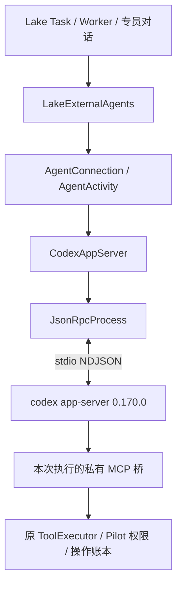

# 本机智能体执行

2026-11-16 按用户要求采用 Tutti 的调用分层，将当前 Codex 外部执行从第三方 ACP 包装器迁移为官方 App Server。Lake 使用 TypeScript 独立实现该设计；没有移植 Tutti 的 Go 业务代码。当前只交付 Codex，不把 Claude SDK 或其他 ACP 智能体写作已支持能力。

## 职责

| 层 | 实现 | 责任 |
| --- | --- | --- |
| 进程传输 | `runtime/typescript/acp/process.ts` | 无 Shell 的 argv 启动、cwd/env、按行 RPC、应答关联、有界消息与 stderr、请求取消/超时、进程组退出 |
| 协议适配 | `runtime/typescript/acp/codex-app-server.ts` | 初始化、线程创建/恢复、异步轮次、事件归一、停止和当前私有工具桥的传输批准 |
| 公共执行合同 | `runtime/typescript/acp/client.ts` | 提供商中立的生命周期与文本/工具/用量事件，不泄漏 Codex 协议帧给任务运行层 |
| Lake 宿主 | `runtime/typescript/acp/service.ts` | Task/Worker/对话身份、当前权限、配置 revision、幂等、持久运行、工具桥和真实业务报告 |
| 运行准备 | `registry.ts`、`codex-local.ts`、`codex-profile.ts` | 固定官方引擎、既有登录来源、模型覆盖、启动与线程配置 |

`acp/` 路径、`acpProfiles/acpProbes/acpRuns`、`kind: acp` 和 `codex-acp` 子类型保留为兼容标识；它们不表示当前 Codex 使用 ACP 协议。已移除 ACP SDK 依赖、第三方 codex-acp 安装、Shell 启动脚本以及适配器专用环境变量。

任务详情按运行来源显示执行器。新记录在官方 App Server 完成初始化后写入运行类型。对于旧 Codex 记录，Lake 只读核对项目 CLI 线程索引中的线程 ID、启动方和执行目录。三者匹配时显示“CLI”，无法确认来源时只显示 Agent 名称。

## 会话与轮次

每个运行独占一个进程。先发送 `initialize`，收到应答后发送 `initialized`；以 `thread/start` 创建任务线程，只有同一冻结执行身份下明确完成的运行才能使用 `thread/resume`。已有线程编号在持久运行中保存，不从模型参数接收。

`turn/start` 应答只确认本次 provider turn ID，随后等待对应 `turn/completed`。应答前到达的通知先有界缓存，确认后只处理同 thread/turn 的内容。外来线程、旧轮次、重复终态和终态之后的输出不进入新报告。恢复时的消息回放不重新投影，也不重放工具。只有具备准确累计用量基线时才发布本轮 token 差值，缺基线保留未知。

停止先撤销原工具执行资格，再请求 `turn/interrupt`；未确认轮次或停止无响应时仍有有界的进程树清理。RPC 或进程退出后不盲目创建新轮次；已派发且未收到明确终态的原运行继续为 unknown，不自动重放。

## 工具和凭据

沿 Lake 已确认的本机登录合同，Codex 直接读取源 `CODEX_HOME`（默认 `~/.codex`）；Lake 不复制 auth.json，不更改用户 config.toml。SQLite、日志、模型目录和本次执行目录保留在当前 Lake Home 下。该准备策略与 Tutti 的私有 Home/凭据投影不同；本轮采用其调用分层，不改变已确认的凭据约定。

连接测试读取登录、配置和 App Server 返回的模型列表。「Agent 执行器」显示本机 Codex 的可选模型和各模型支持的思考强度。两项默认跟随本机 Codex。刷新或重新连接可再次读取目录。只配置了默认模型的服务也可使用该模型。保存后只为该项目的进程与线程注入选定值。新任务优先固定项目选定的模型。模型设为跟随时，使用专员已有绑定或本机默认。修改设置会使该项目的旧连接版本失效。连接测试不创建模型轮次，旧版失败记录会在读取就绪状态时自动重新验证。

执行进程使用与选中模型对应的静态目录。Lake 使用固定引擎的模型元数据或生成保守的元数据，结合启动和线程覆盖关闭原生业务工具、继承 MCP、hooks、notify 和递归。仅本次运行的 `lake` MCP 服务连接私有 Unix socket。App Server 的 MCP 工具批准使用 `mcpServer/elicitation/request`；form 请求可能不携带 MCP 调用 ID，因此适配器在准确 thread/turn/server 下消费一条已观察、在本次允许目录内且尚未消费的工具调用。通用表单、URL 请求、原生工具、未知服务器、外来轮次、重复申请和失效宿主均不获准。该批准只允许进入私有桥，真实 I/O 仍经过同一个 ToolExecutor；没有持久批准或全局自动批准。

## 迁移与交付边界

profile 升级为 schema3，记录 `runtimeKind: codex-app-server`。schema1/schema2 迁移增加 revision，旧 Worker/run 和来源记录保持原样；新的配置不能静默续接旧执行。官方引擎 0.170.0 安装在现有 Lake Home 的运行时目录。固定引擎和模型目录纳入连接版本。

本批继续保持 macOS 的既有开放范围。Windows、Linux、真实远程业务系统以及其他提供商不因该抽象自动成为已验证能力。

## 参考

- [Tutti 固定版本](https://github.com/tutti-os/tutti/tree/207beeea554435618dffd3b579d0ffe112b065c4)：提供商定义、受管理进程、App Server 会话和活动归一分层。
- [Codex 0.170.0](https://github.com/openai/codex/tree/rust-v0.170.0) 提供固定 App Server 引擎及随附的模型元数据。
- [当前任务报告合同](../security/task-confirmation.md)、[本机登录合同](../../plan/refactor-codex-local-login-1.md)、[迁移实施计划](../../plan/refactor-codex-app-server-1.md)。
