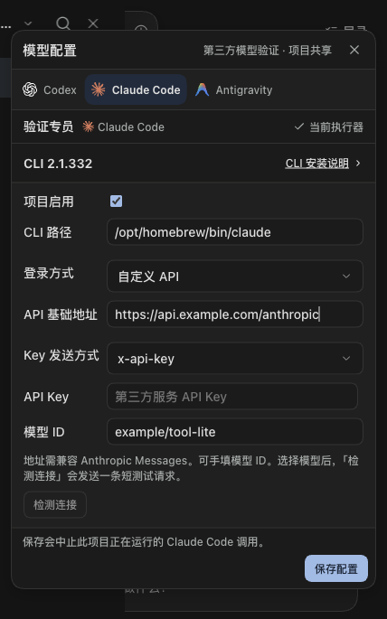
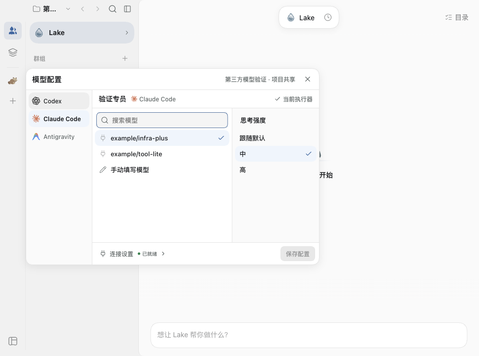

# Claude Code 第三方 API 验证

在隔离项目中打开专员的「模型配置」，进入 Claude Code 的「自定义 API」。Bearer Token 网关返回模型和档位，保存后可将执行器绑定给专员。切换到使用 `x-api-key` 且无模型列表的网关后，手填模型 ID 并保存。「检测连接」发送测试请求，界面随后显示模型和就绪状态。重新打开配置时密钥字段为空。

428 px 深色界面验证了键盘选择认证请求头、Escape 关闭下拉、地址字段焦点和表单边界。970 px 浅色界面验证了模型、思考档位与专员绑定。截图使用隔离项目与示例数据。

`runtime/typescript/external-cli.test.cjs` 使用本地模拟服务检查模型目录、手填模型、认证失败、按地址使用独立密钥和专员实际派发。另用官方 Claude Code 2.1.332 向回环地址发送流式请求，确认两种认证请求头与指定模型均实际生效。验证使用模拟网关。
