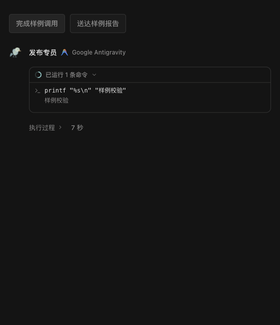
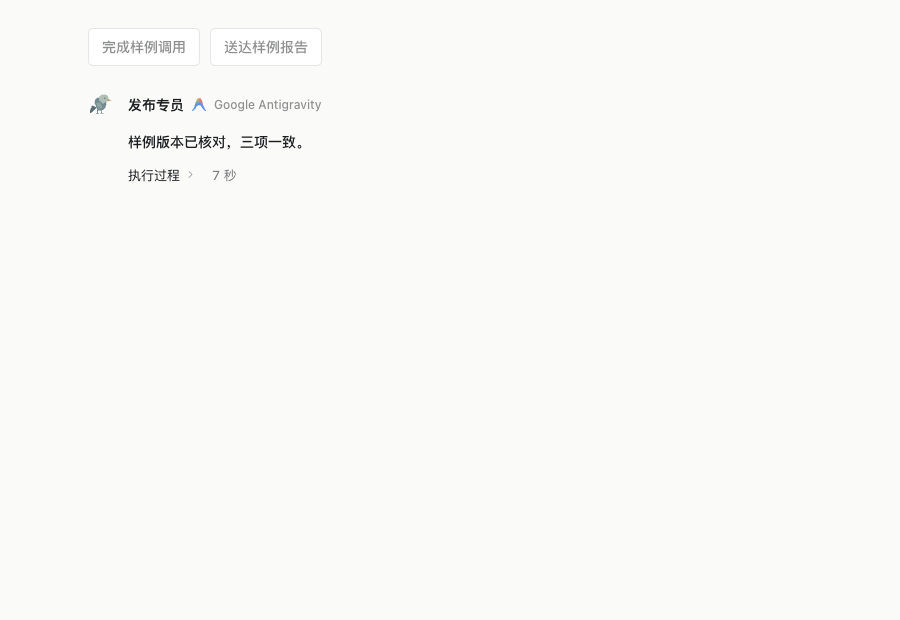

# 外部专员执行过程

隔离项目用 Claude Code 和 Antigravity 测试进程调用私有 Lake 工具桥。检查真实工具开始和结束只更新同一条记录，工具明细随专员报告保存。兼容测试把旧 Antigravity 的工具事件和报告放入隔离数据，回读历史时显示原有标题、状态和时间，并核对原报告记录未改写。

在 560 px 深色窗口中用键盘展开执行中的 Antigravity 样例。命令结束时，原明细保持展开并显示一行样例输出。随后送达报告，「执行过程」收在结论下方，键盘重新展开同一组明细。900 px 浅色窗口核对已折叠的报告、入口和用时。浏览器截图使用本地样例数据。

