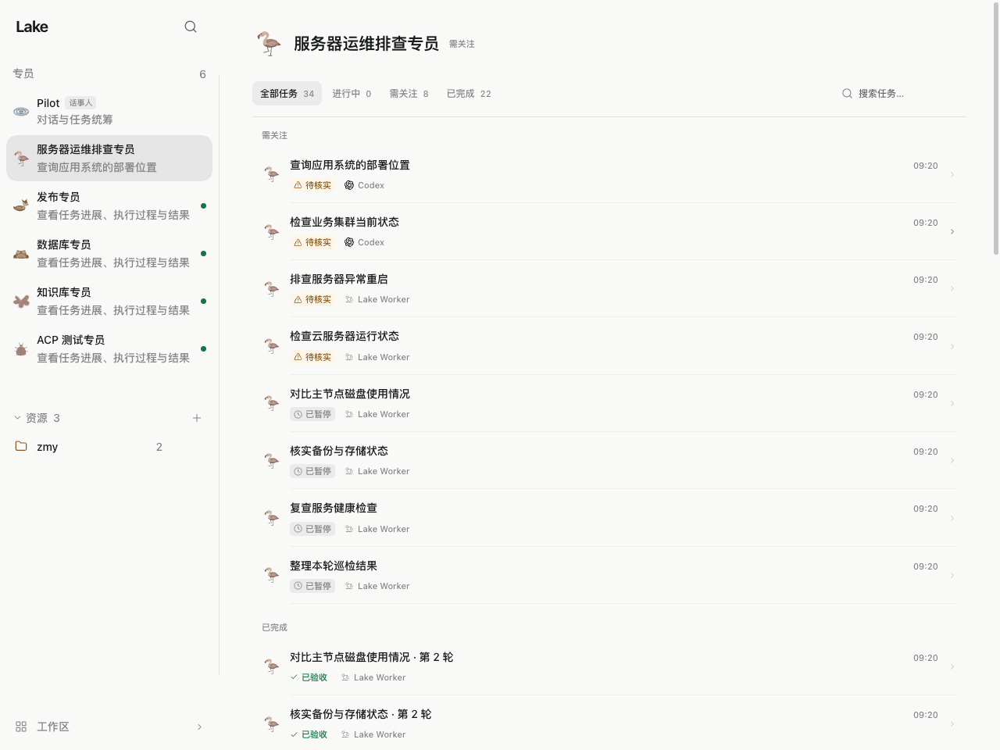
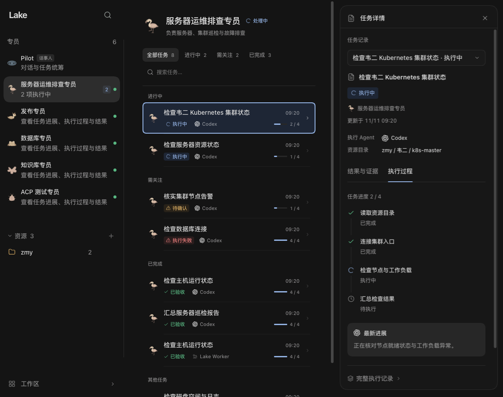
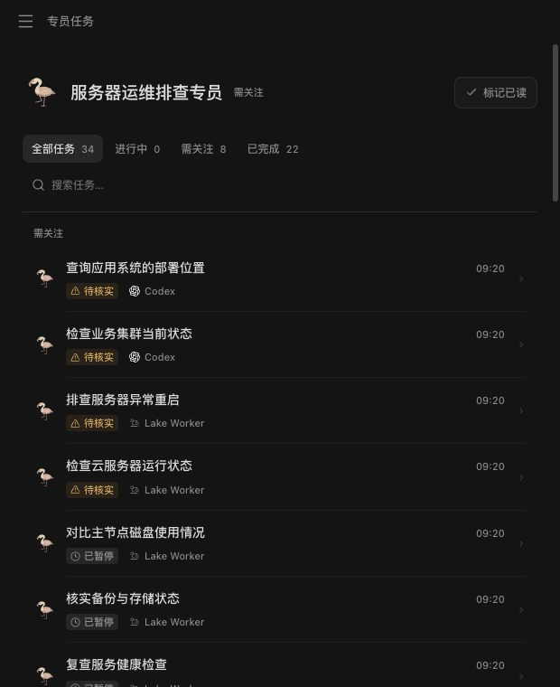
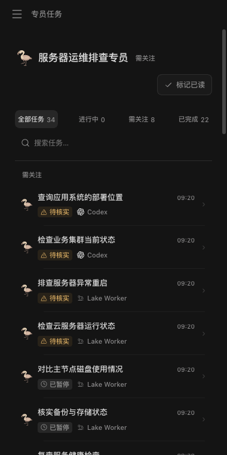

# 专员任务工作台视觉调整

验证源码与已安装签名 Lake Dev：`73e1755c162fde814b57a2f79019cca4770727ac`。日期：2026-11-11，macOS arm64、Node 24.14.0。本次只修改前端任务展示及对应测试，没有修改后端、任务记录、执行权限或本机 Codex 配置。

原页面用带完整外框及列标题的表格展示任务，标题、状态、Agent 和时间横向分散。新版使用无外框的双行任务列表：标题为主，时间置右，真实状态和执行 Agent 收入第二行，实际资源或活动、已报告的步骤进度按空间显示。搜索、筛选、头像、配色及连续圆角仍使用 Lake 原有体系；未知时间及进度不重复占据视觉空间，不编造百分比。

全部任务按现有状态分组，所有非空组完整展开，已停止任务保留；搜索和单一状态筛选使用平铺结果。分组不改变原任务状态或组内顺序。分组标题与任务在同一个列表父节点内平铺，准确 Worker key 在跨组更新时仍复用原行和头像。专员聊天输入与新建任务继续不挂载，派发仍从 Pilot 完成。

## 验证

| 检查 | 结果 |
| --- | --- |
| Web TypeScript | 通过 |
| 完整 Web 单元测试 | **800 通过，0 失败，0 跳过**；新增分组保留准确任务、原顺序、引用及业务状态的检查 |
| Vite 正式构建 | 独立构建与签名桌面构建均通过；保留既有大 chunk 提示 |
| ADK runtime boundary | 通过 |
| 浏览器 | 完整 App + 内存虚构 API；浅色 1280px、深色 1140px 详情、620px 与 380px 窄窗视觉检查通过 |
| 任务交互 | 搜索、空结果、方向键/Home/End 筛选、原详情、问题回复与单任务停止路由通过；关闭恢复原行焦点 |
| 更新稳定性 | 轮询和跨状态组更新保留行、按钮及头像节点；34 项长列表滚动位置 491px 在轮询后保持 |
| 未读与 Pilot | 前台成功总览确认准确通知；其他角色未读保留；专员无输入框/新建，Pilot 草稿跨导航保持 |
| 签名 Dev | 正常停止旧 Dev 后使用 `scripts/build_lake_desktop.sh --dev --install`；准确干净 SHA、Dev bundle ID、build-origin 和深度严格签名通过 |
| 原生实页 | 已安装 Dev 显示实际原有的 34 项任务，8 需关注、22 已完成、4 其他，无表头/表格外框；无业务指令或实际任务操作 |
| 原数据 | 安装前后逐条哈希一致：19 项目、151 可见 Worker、21 角色、18 频道、5 角色变更，以及目标、尝试、操作、验收、报告、ACP、命令与旧版记录；本机 Codex 配置不变 |

详情见 [机器记录](specialist-workbench.json) 与 [浏览器证明](specialist-workbench-browser.json)。本次安装前重新建立小型私有哈希基线，包含用户随后创建的角色；不使用先前配置任务的旧基线覆盖新数据。没有创建 Home/数据库备份，四个已删除备份目录仍不存在。

后端未改，本次不重跑其完整套件。后端 275 通过/4 可选跳过、宿主 199 通过、固定真实 Codex ACP 4 通过的历史测试对应 `afbfe85ed6cff7c1d30a4e48c70d76a64559f1a9`，见 [专员配置验证](pilot-specialist-config.md)，不能当作本次新执行的测试。真实外部模型、实际集群、其他平台、完整迁移等价、Go/race/vet 本次未测。

## 视觉记录

截图全部使用虚构任务，不含实际项目数据。原生真实项目仅本机观察，不将其截图提交仓库。

回退可撤回该前端提交并按原签名流程重新构建 Dev；不回灌旧数据库或重写业务记录。PR 继续指向 develop 且保持草稿；没有合并、手动 CI、发布或生产安装。
