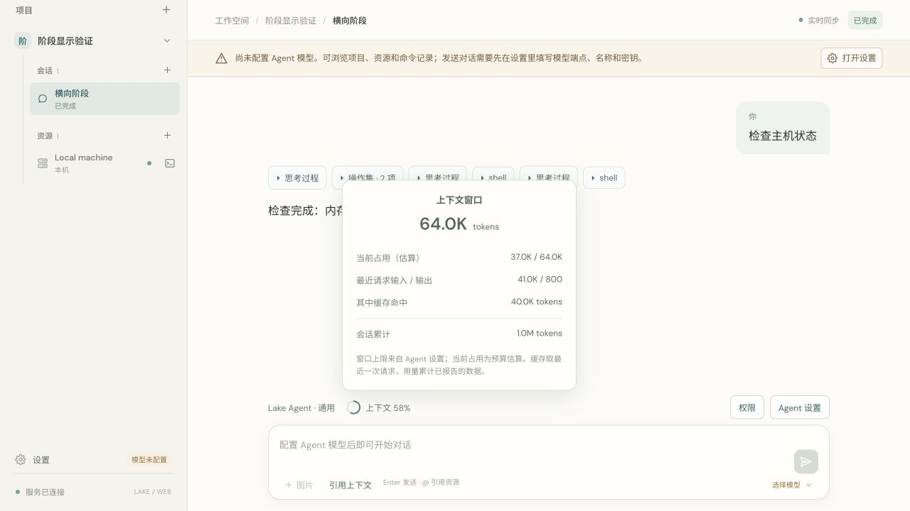

> 2026-10-11 更新：UI 已改为服务商报告输入 / 服务商窗口，详见 lake-real-context-silent-query-send-stop.md。下文为旧估算方案的历史验证。

# Context usage indicator

Completed 2026-10-11. The Agent control row now shows a small occupancy ring and context percentage. Hover, keyboard focus or click opens a panel; click pins it, another click or Esc closes it, and outside clicks dismiss it. The panel separates:

- Configured model context window.
- Current history/tool-schema context budget estimate, explicitly labeled estimated; image costs follow the existing context budgeting heuristic.
- Latest normal request input and output counts returned by the provider.
- Latest request cache-hit input tokens; absent data stays unavailable, while an explicitly reported zero stays zero.
- Cumulative provider-reported conversation usage, including compaction requests.

Provider normalization merges partial/repeated streaming usage frames rather than adding them twice. Claude input includes new, cache-read and cache-creation tokens as specified by [Claude's usage documentation](https://platform.claude.com/docs/en/build-with-claude/prompt-caching). DeepSeek cache counts use [its documented usage fields](https://api-docs.deepseek.com/api/create-chat-completion/). Gemini includes thinking output and provider total tokens using [UsageMetadata](https://ai.google.dev/api/generate-content#UsageMetadata). OpenAI-compatible, Responses and Ollama counters remain supported.

The occupancy estimate is independent of provider-reported latest/cumulative counts. Compaction and history edits invalidate the latest normal-request counters to avoid showing stale cache information as if it belonged to the current history. Clear and rollback preserve cumulative usage. Old sessions have no retrospective cache data until a new request supplies it. No context-compaction transcript notice was restored.

Verification:

- Go race suite, Go vet, React type check/production build and four frontend timeline tests passed.
- Usage regression covers cached zero vs unknown, repeated usage frames, partial Claude frames, Gemini thought tokens, snapshot persistence and clear/restore/rollback/compaction.
- Browser isolated fixture displayed 64K configured window, 37K estimated occupancy, 41K/800 latest input/output, 40K cached input and 1M cumulative usage. A second fixture displayed unavailable cache/output rather than zero. Open/close keyboard behavior passed.
- Built exclusively through scripts/build_lake.sh and verified codesign; signed release works without Node runtime. No production model calls, credentials or production-state edits were used for fixtures.

[Machine-readable report](lake-context-usage.json)
