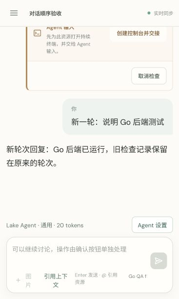

# Lake Go backend migration validation

Date: 2026-10-10. Target: macOS/arm64, Go 1.25, CGO enabled.

## Delivered architecture

`bin/lake` is the signed Go executable. It embeds the React/Vite static output and runs net/http, SQLite, AI Engine, PTY/VT and SSH management in one process. There is no Node launch, Node release directory lookup, node_modules load, stdio AI worker dependency, or legacy runtime fallback in the active entry.

The old Node Web backend and its scripts/tests are preserved in `legacy/web-agent/`. The older independent `agent/` TypeScript implementation, ZCode and desktop code remain historical source. The new CLI operates on the Go Web contract; legacy grants/tasks/workflow commands have not been ported as equivalent contracts and do not silently launch the old runtime. Existing historical Agent files are not deleted or automatically imported.

## Automated verification

- `go test ./...` and `go vet ./internal/web ./cmd/lake`: pass.
- `go test -race ./internal/web ./internal/ai`: pass. Go Web tests cover original prototype schema migration with consistent private SQLite backup, exclusive data ownership, restart without command replay, HTTP Host/Origin/token enforcement, scoped resources, SSE replay/live delivery, real local PTY cwd/env, resize/VT screen, takeover, interactive input, interruption, redaction, model private credential persistence, real isolated SSH with generated fixture keys and host trust rejection, model/tool loop, single-use write approval, history/undo/presets/abort, background PTY jobs and scoped job IDs, and authenticated image delivery.
- `pnpm --dir web-agent test:frontend`: two conversation-order regressions pass. Old pending/resolved action cards remain before the next user turn; millisecond and nanosecond timestamps compare correctly; bridge-generated Go actions are not duplicated as legacy approvals.
- React TypeScript checks and Vite production build pass. Vite reports the existing bundle size warning; it does not prevent runtime operation.
- `LAKE_TEST_SIGNED_BINARY=/absolute/path/bin/lake go test ./cmd/lake -run TestSignedReleaseWithoutNodeRuntime -v`: pass. A real signed executable runs with isolated HOME and PATH pointing at an empty directory, serves embedded React and authenticated HTTP, creates a project/session, and executes a real PTY `uname -s`. No Node is available in PATH and no packaged Node path is referenced.
- Synthetic credential migration test checks private file permissions, idempotence and refusal to overwrite another value. It does not read real Keychain items.
- `codesign --verify --strict bin/lake`: pass. Built only with `scripts/build_lake.sh` using the persistent Lake local signing identity.

The earlier AI protocol/database/Redis/Docker tests remain in `internal/ai/`; the migration reuses that implementation. Commercial model endpoints and user production remote machines were not invoked for validation.

## Browser verification

The signed executable was started with an isolated home, empty PATH and a local Python model fixture. The database contained an old native `vmstat 1 3` pending card and one disconnected terminal record. A new user turn was sent through the real React UI. Accessibility and screenshot inspection verified the old operation precedes the new user message and model reply, and no collapsed terminal summary row appears at the conversation bottom. Cookie exchange, snapshot and SSE were active.

## Local service cutover

Before replacing the prior service, a consistent SQLite backup plus model metadata and AI state was stored privately under `~/.lake/web-agent.before-go-20261010-230531/` (directory 0700, files 0600). No user secrets or conversation content were printed. No terminal command was executing during cutover. The old Node server and worker were stopped; signed Go `lake web --open` now serves `http://localhost:4177`.

Bootstrap verification reports `backendRuntime=go`, `aiRuntime=go`, `terminalMode=pty`, `authenticated=true`. Static entry returns HTTP 200. Existing Web SQLite/model/AI files are reused. Interrupted work is marked failed/interrupted and never replayed; pending effects require a fresh valid confirmation as appropriate.

## Practical limits

Targeted and tested: macOS/Linux POSIX terminals. Windows PTY is not implemented or verified. System OpenSSH and Docker CLI remain system dependencies for their respective operations. Node/pnpm remain React build/test tools only. The active CLI uses the Web contract; archived CLI/workflow APIs and old desktop distributions are outside this migration's compatibility guarantee.

## Pending-operation isolation fix — 2026-10-11

Removed the session-wide `conversationOnly` mode that disabled all tools when a historical native action remained pending. Every new turn receives its normal tool catalog; recognized read-only diagnostics execute automatically, and each new write or dangerous operation retains its own approval. The integration prompt requests fresh diagnostic evidence and treats historical pending operations as proposals to be decided individually, never as commands to replay.

Non-interactive shell checks reuse only idle Agent terminals without pending actions attached. Otherwise they open a separate terminal, preserving user ownership and the frozen terminal context of historical approvals. Bounded macOS `top -l 1 -o cpu/mem -n 10` and Linux `top -b -n 1 -o %CPU` are recognized as read-only; unbounded commands, unknown sort fields and redirection remain subject to approval.

`TestEarlierPendingActionsDoNotBlockFreshReadOnlyTurn` passes for disconnected, user-owned and Agent-owned old terminals. A local model fixture requests real PTY `ps` data (and real macOS `top` data); results reach the next model request without an approval pause. Old read/write proposals keep their original IDs, timestamps and pending status; their terminal ownership/context do not change and the old write does not execute. A subsequent new write receives a distinct approval and produces no effect when rejected. No commercial model or production SSH endpoint was invoked.

`go test -race ./...`, `go vet ./internal/web ./internal/ai ./cmd/lake`, and the two frontend conversation-order tests pass.

Rebuilt with `LAKE_REUSE_WEB_ASSETS=1 scripts/build_lake.sh` (React source unchanged); signature verification and the signed executable's empty-PATH/no-Node test pass. Restarted the idle local service on `http://localhost:4177`, verified authenticated Go bootstrap and embedded HTML HTTP 200, and reopened the authenticated workspace.

## Persistent host session preparation — 2026-10-11

Removing the tool ban alone did not make the configured model collect evidence: it still returned command suggestions without calls, leaving the terminal disconnected. Core host conversations now run a read-only `inspect_host` prelude inside the AI turn before the first model request. An explicit host reference selects the target; an unmentioned later turn uses the remembered host. A session containing only one host can establish that host on its first unmentioned turn. Explicit database/container references do not trigger inspection of a previously selected host.

The prelude establishes an Agent-owned local/SSH PTY, detects the target OS, then collects cwd, uptime, memory/swap and process rankings with fixed, policy-checked commands. Darwin uses `sysctl -n hw.memsize`, `vm_stat`, `sysctl vm.swapusage` and bounded `top` samples (two CPU samples, one memory sample); Linux uses `free -m` and sorted `ps`. Each result includes the actual output, exit status and collection time. The normal AI tool pipeline records the operation and inserts paired assistant/tool messages before model inference. The selected resource and terminal are persisted in session options and the AI config.

Later rounds refresh the same idle Agent PTY and can read its screen directly, preserving working directory and shell state. Disconnected terminals reconnect without replaying old commands. User-owned terminals and terminals reserved by historical pending operations retain their original ownership and approval context. New writes still require their own approval. Core, terminal and database profiles keep their existing boundaries.

Regression tests cover a model that never requests tools but receives live memory/process output on its first request; initial connection, an unmentioned second round with retained cwd and direct terminal screen read; reconnection; old pending actions on disconnected/user/Agent terminals; and two real SSH conversation rounds against an isolated local sshd with synthetic keys. Existing six-protocol stream tests still pass.

DeepSeek thinking-mode assistant history now includes the required `reasoning_content` field even for application-generated preflight calls with empty reasoning. Actual model reasoning remains unchanged. Other OpenAI-compatible providers do not receive empty extensions. This follows the [DeepSeek thinking-mode tool history contract](https://api-docs.deepseek.com/guides/thinking_mode/). Bounded provider error messages are credential-redacted before display/persistence, with a synthetic-key regression test.

Live validation with the currently configured model passed two read-only local-memory rounds: the first explicitly referenced Local machine; the second omitted the reference and reused the same terminal. Both first model requests received eight real Darwin checks, and both final replies contained numeric memory values. The temporary validation sessions and terminals were removed afterward. No production SSH target was accessed. Results are recorded in [lake-host-session.json](lake-host-session.json).

Final `go test -race ./...`, `go vet ./internal/web ./internal/ai ./cmd/lake`, frontend timeline tests, signed executable no-Node test and signing-script build pass. The signed service was restarted idle, retaining the original conversations and historical approvals on the same local URL.
