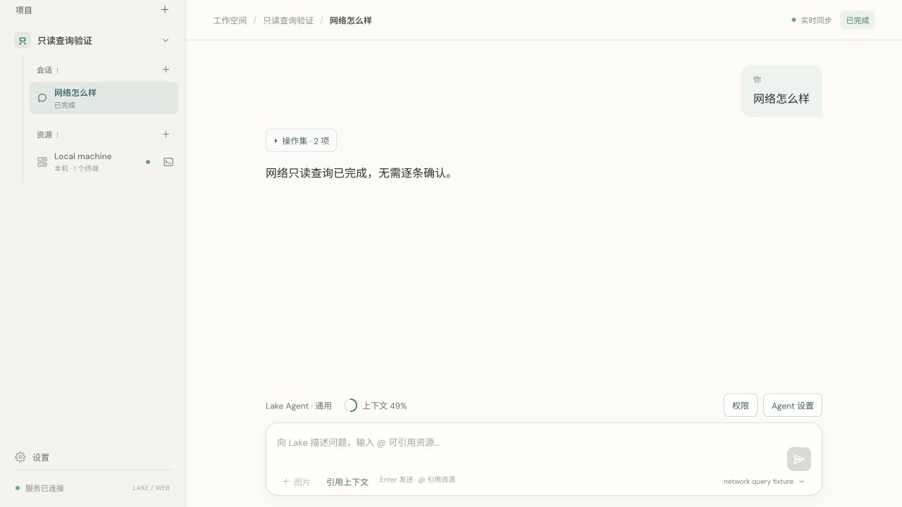

# Readonly diagnostics without repeated approval

Completed 2026-10-11. The reported network pipeline was wrongly escalated because all awk scripts were considered arbitrary execution and env was always considered a command wrapper. The new conversation also had silentCommands=false, which previously required approval even for recognized readonly commands.

Recognized readonly queries now run automatically on an authorized bound terminal, irrespective of the ordinary command silence switch. Resource disambiguation, new/recreated terminal authorization, local/reference restrictions, and destructive single-use target confirmation remain in force. Ordinary state changes still follow silentCommands. Pure stdin awk filtering, field selection and in-memory statistics are validated separately from external execution/file I/O. Script files, named input files, getline, system, pipe/output redirection, environment/argv introspection, unknown function calls and shell-expanded awk programs retain the dangerous gate.

The classifier recognizes passive netstat/lsof/ss, query forms of ip/ifconfig/route/networksetup, no-argument env, and bounded sort options. Network mutations and socket-kill operations retain explicit confirmation. Commands are reconstructed with quoted literal arguments and command -p. Manual commands now fetch the authenticated Go policy endpoint, avoiding divergence from the stale JavaScript classifier; target changes during classification invalidate the review.

Validation:

- Exact screenshot network pipeline classified readonly and ran in a real local PTY with silentCommands=false, without a pending approval.
- Pure awk filter/arithmetic/field handling, text containing the word system, and safe -v variables passed. External command execution, division-based token hiding, file reads/writes, environment/argv access, script files and shell program expansion remained blocked from readonly classification.
- Ordinary write confirmation uses an actual touch fixture, preserving no-effect-before-approval; destructive trash/move confirmations still pass.
- Full Go race suite, final focused network tests, Go vet, React build and four frontend timeline tests passed.
- Browser private fixture completed the full network query with no authorization dialog and the silence switch off. A manually submitted awk sum executed directly, returned 5 and exitCode=0. No production model calls or data mutations were used for verification.
- Signed build and no-Node release runtime checks passed. The previously reported production turn was already completed, so no old commands were approved or replayed.

