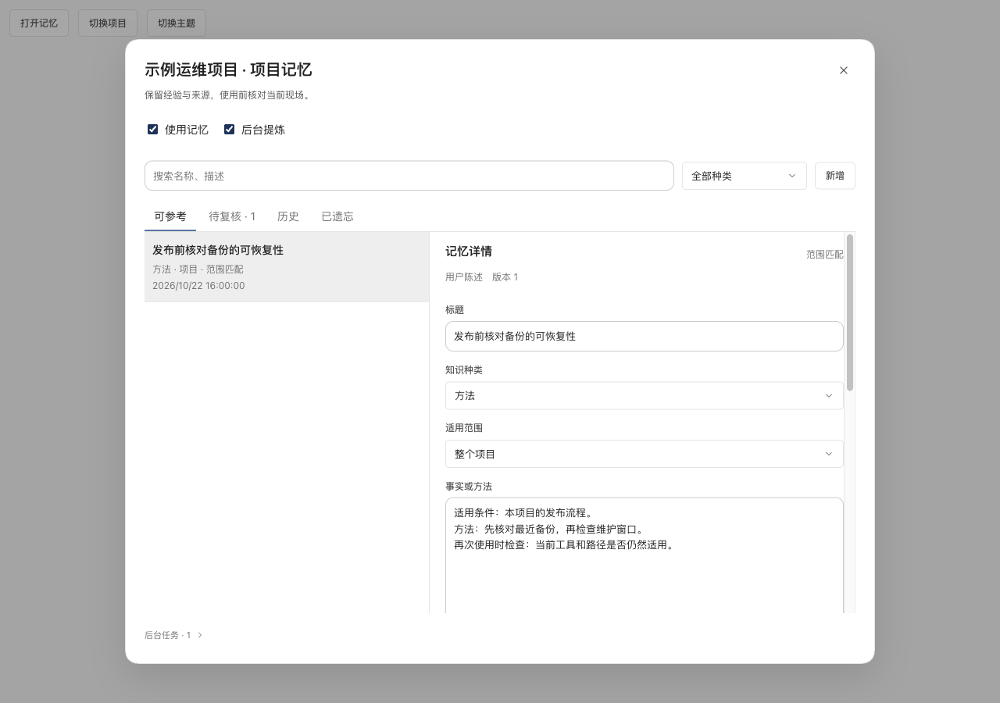
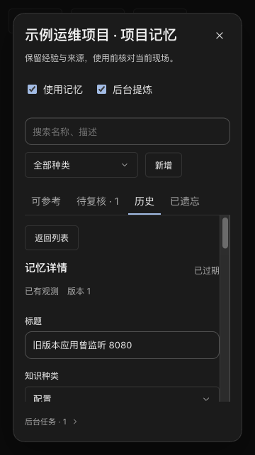

# Lake 运维记忆 V2：门控实现验证

日期：2026-10-23。状态：**开发中，草稿评审，尚未启用**。

代码提交：`69f5ba51f82e727d82ee22993a0179a0dae7884f`。基线：`origin/develop` 的 `eb4d90028b1c2e0b870475f44445f5613b185bba`。本文件及截图在随后仅含文档的提交中补入。

`internal/web/project_memory_v2_schema.go` 中 `operationalMemoryV2Ready=false`。普通签名二进制仍走 V1，不迁移真实 Home。V2 由包内测试注入临时 Home；没有 CLI 或环境变量绕过。本文没有将 fixture、交叉编译或伪 provider 等同于 Lake Dev 原生验收、真实模型质量或 Windows 运行验收。

## 实现范围

- SQLite 独立 V2 表、迁移前备份、旧正文搬迁隔离、无原文删除墓碑、CAS、回执、可重建私有 Markdown 投影。
- 资源 ID 与服务端 generation 绑定；连接变更、登录同步、资源或项目归档恢复使旧绑定失效；资源改名只使索引缓存失效。
- 范围与时效先过滤，NFKC/中文二元组排序；最多 12 条、3 KiB 短索引，正文按 revision 有界读取。当前请求预算包括索引包装；同轮列表和正文共享读取上限。
- 每次 provider 请求前重验旧记忆工具结果；资源切换、遗忘或 revision 变化后删除缓存正文与 Native 负载，保留普通对话与原执行记录。
- 轮次 outbox、无工具提炼、严格 JSON、候选复核、租约与 epoch 校验、前台抢占、每项目每日 20 次实际派发和已知/未知用量记录。被输入预算裁掉的来源不能由输出引用。
- 自动配置事实的首个适配器仅接受已匹配目标的 `observe_cluster` 结构化 Kubernetes API 地址，正文由服务端生成；shell/MCP 文本结论进入候选，不因命令成功自动升级为业务成功。
- 管理界面包含范围、时间、来源、冲突比较、旧条目批量分类、停用与遗忘；会话过程折叠显示实际索引和读取足迹。分页读取同一条记录不重复计为多条记忆。

## 已执行检查

平台：macOS / Apple Silicon（Apple M5）；Go 1.26.6；Node 24.19.0；pnpm 10.33.4。命令从仓库根目录执行。

| 检查 | 命令或操作 | 结果 |
| --- | --- | --- |
| 全包编译 | `go test ./... -run '^$'` | 通过；仅编译，不能称为全仓测试通过 |
| 完整相关包 race | `go test -race ./internal/web ./internal/ai` | 通过；web 344.317 s，ai 使用已通过缓存 |
| 新边界及资源回归 | `go test -race ./internal/web ./internal/ai -run 'TestMemoryV2\|TestMemoryEvidence\|TestMemoryExtraction\|TestContextBudget\|TestResource\|TestNavigation' -count=1` | 通过 |
| Go 静态检查 | `go vet ./internal/web ./internal/ai` | 通过 |
| ADK 边界 | `python3 scripts/check_adk_runtime_boundary.py` | 通过；未增加 Agent 执行循环 |
| 前端 | Node 24 环境执行 `pnpm --dir web-agent test:frontend` | 426 项通过 |
| TypeScript / 生产页面 | `scripts/build_lake.sh` 内部执行 `pnpm --dir web-agent build:web` | 通过；存在既有大 bundle 提示 |
| macOS 签名构建 | `scripts/build_lake.sh`、`codesign --verify --strict bin/lake` | 通过；使用持久 Lake Local Development Code Signing 身份 |
| 签名二进制兼容 smoke | 临时 Home + 空闲 loopback 端口，创建项目、V1 记忆 PUT/GET、检查 SQLite 元数据 | V1 capability=1、CRUD 正常、无 V2 迁移；停止进程并清理临时 Home；无模型/主机调用 |
| Windows 交叉编译 | 分别执行 `GOOS=windows GOARCH=amd64 CGO_ENABLED=0 go test -c ./internal/web` 和 `./internal/ai`，输出到 `/tmp` | 通过；未运行 Windows exe |
| 500 条检索 | `go test ./internal/web -run '^$' -bench BenchmarkMemoryV2ScopedIndex500 -benchtime=1000x -count=1` | 预热 20 次、采样 1,000 次；p50=2.370 ms，p95=2.698 ms；检索模型调用=0 |

Node 24 路径：`/Users/lingyunxieqing/.cache/codex-runtimes/codex-primary-runtime/dependencies/node/bin`；该目录仅作构建工具，没有打包进 Lake。

## 确定性证据与未覆盖矩阵

下表映射[实施计划](../../plan/feature-operational-memory-2.md)的验收项，不将一条测试通过推广为整个矩阵通过。

| 验收项 | 本次已有证据 | 仍需补验 |
| --- | --- | --- |
| TEST-001～TEST-002 | 两次迁移幂等、旧表清空、旧墓碑保留、备份失败/事务中止/投影失败恢复、未来或损坏 schema 拒绝 | 实际旧版本二进制降级读写及再次升级演练 |
| TEST-003～TEST-005 | 并发 CAS 仅一个成功、明确遗忘/恢复、来源和版本清除、符号链接拒绝、投影重建 | 501/101 配额及来源/版本保留上限的完整边界矩阵；Windows ACL/文件替换 |
| TEST-006 | 连接改动失配、改名缓存更新、人工重存不能重绑旧证据；新建/编辑/导入同步/归档恢复已接 generation | 所有资源种类和依赖事件的参数化矩阵 |
| TEST-007～TEST-009 | 失败/未知/运行中/非零退出不视为成功；工具 schema 禁止来源伪造；类型化字段生成正文；过期证据复核不刷新；subject 条件编辑清除旧观测 | 实际模型误解释与多证据语义质量 |
| TEST-010～TEST-014 | 500 条确定检索、中文检索/预算/缓存/完整关系范围/跨项目、历史与普通读取、旧工具结果再校验、前端读取计数 | 已验证 subject 的 +20 排序信号尚未接入；极端工具目录和全部分页/代次竞态组合待补 |
| TEST-015～TEST-019 | 重启保留 V2 队列、前台真实消息抢占阻塞 provider、撤销租约拒绝迟到提交、20/21 次派发限制、冲突候选、六种协议单次无工具请求 | UTC 跨日、30/120 秒退避、7/30 天过期和重试队列上限的可控时钟矩阵；三个提交时点的压力测试 |
| TEST-020～TEST-021 | 包内 API 字段校验、来源消息定位、关闭后缓存拒读、过期搜索响应丢弃；浏览器并发编辑 409 后草稿保留 | 更完整的跨轮关闭/忽略、快速 A→B→A 网络乱序与候选接受失败自动化 |
| TEST-022 | 浏览器真实 React UI / 合成 HTTP fixture：桌面浅色、360×640 深色、键盘与 AppSelect、分类、比较、来源、编辑冲突和遗忘 | 原生 Lake Dev、Windows UI、全部主题与尺寸排列；fixture 没有连接真实后端/模型 |

六种协议为 `openai`、`azure-gpt`、`openai-response`、`claude`、`gemini`、`ollama`；测试捕获伪 provider 请求，没有调用真实供应商。

## 浏览器记录

通过 ego-browser 访问本地 Vite 的 `/test/fixtures/project-memory.html`；数据仅含合成项目、保留地址及固定文本。旧 TaskSpace 失效后，用户明确批准重建，最终 TaskSpace 49 验收完毕后已关闭。

- 桌面 1280×900：列表/详情两栏；AppSelect `ArrowDown → Escape` 关闭菜单，焦点回到种类控件，项目记忆弹窗保持打开。
- 深色 360×640：文档宽 360 px、弹窗宽 324 px，无横向溢出；表单字体 13 px；详情独立滚动。
- 编辑保存、批量确认旧记忆范围、冲突原文/候选比较、拒绝候选均检查了 UI 状态。
- 有效来源跳到 `source-session/source-message`；失效来源提示不可定位，同时保留历史正文和摘录。
- 项目 B 的记忆列表与任务数为空，没有显示项目 A 的条目。
- 模拟另一客户端修改后，保存返回 409，人工草稿仍保留；明确遗忘后，重新建立界面正文为空、没有旧来源。

## 启用前门槛与回退

计划仍为 **In progress**。没有安装或重启日常 Lake Dev，没有接触 `~/.lake` 或复制正式凭据。当前 Dev 集成客户端包含此前未合并的界面工作，本分支只从 develop 起步，不能直接覆盖它并宣称集成通过。

启用前必须完成上述未覆盖矩阵、原生 Dev 与 Windows 验收、真实提炼模型 60 个固定虚构案例各跑 3 轮的质量评测，并接通受信任的当前 subject 排序信号。质量评测尚未执行，不能承诺语义召回率或跨供应商质量。通过后再单独修改编译期门控，并对最终代码复验。

当前门控关闭时，回退代码不迁移用户数据。V2 临时库的恢复测试使用迁移前 SQLite 备份；不要将新 V2 Home 直接交给不了解范围字段的旧二进制。未来实际迁移前，保留完整 Home 的独立备份；需要回退时先停对应后端，在隔离副本恢复并验证，禁止覆盖运行中 Home。没有执行生产回退或发布。
