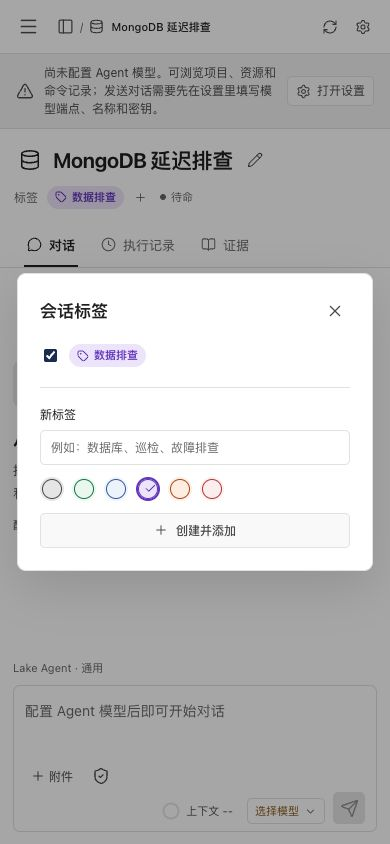

# OxyNote tags and icons follow-up

Validated on 2026-10-14 (Asia/Shanghai).

## Reference library

OxyNote uses shadcn-vue's `new-york` style with a neutral base and CSS variables, Reka UI, Tailwind CSS, Nuxt/Vue, and Nuxt Icon/Iconify icon sets. Its default shadcn icon library is Lucide.

- [Component configuration](https://github.com/oxynote/oxynote/blob/main/web/components.json)
- [Frontend dependencies](https://github.com/oxynote/oxynote/blob/main/web/package.json)

Lake remains a React workbench. This follow-up adds Lucide React icons and reproduces the reference's document header and colored tag navigation; it does not claim to have imported Vue components. The Lucide/Feather license is included in the packaged notices.

## Implemented

- Session header with an editable large icon, title, colored tag chips, status and existing update date.
- Twelve selectable session icons, also used in breadcrumbs and navigation; distinct SSH/local/database/Redis/Docker resource icons and shared Lucide toolbar/tab/agent icons.
- Six tag colors; project-scoped tag creation, rename, color editing and removal. Session tag membership is persisted in SQLite; tags remain attached after refreshing or restarting.
- Sidebar tag groups with association counts, related sessions and toggleable filtering. Following the user's simplification request, project memory configuration is available through Settings → Dialogue; its project navigation row was removed.
- Revision checks protect session metadata against stale concurrent edits. Cross-project tag assignment, duplicate IDs and arbitrary icon/color strings are rejected.

Only the independently signed `Lake Dev.app` was replaced. The release app remains running on its original backend PID. The Dev database and prior Dev app were backed up before installation. Existing synchronized resources, histories, model configuration and private credentials remain independent from release data. The Dev MongoDB conversation now has a database icon and editable `MongoDB` / `运维排查` tags based on its topic.

## Verification

- TypeScript and signed production desktop build passed.
- All 104 frontend regressions passed.
- `go test -race ./internal/web` passed, including the two new presentation test groups covering project boundaries, invalid input, stale revisions, tag rename/delete and restart persistence.
- Real frontend plus signed backend with isolated synthetic data: created and assigned a green tag, selected a database icon, filtered a two-session project down to its matching session, renamed the tag and changed it to purple, then verified persistence after page reload.
- At 390×844, the tag dialog fits the viewport (356px width); document width remains 390px. No browser error logs were observed.
- Native Dev inspection confirmed the large database icon, colored tag chips and sidebar tag groups against copied real data. Its actual screenshot remains outside the repository's validation fixtures.
- Strict signature verification and `git diff --check` passed.

