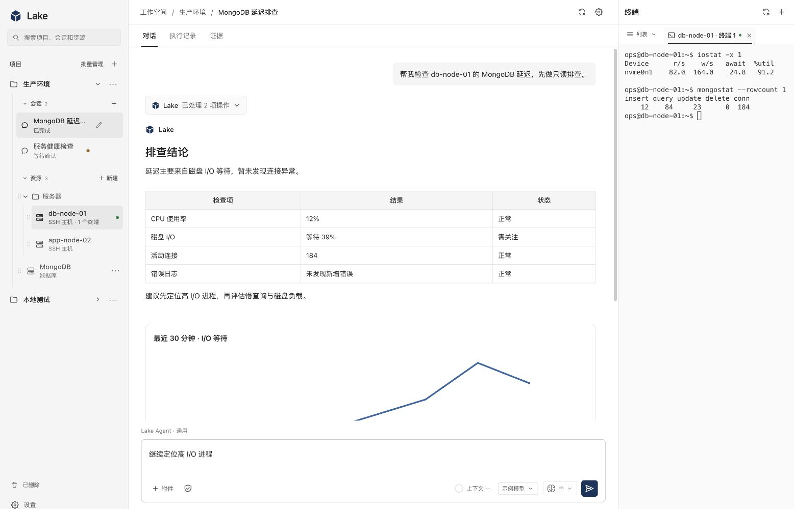
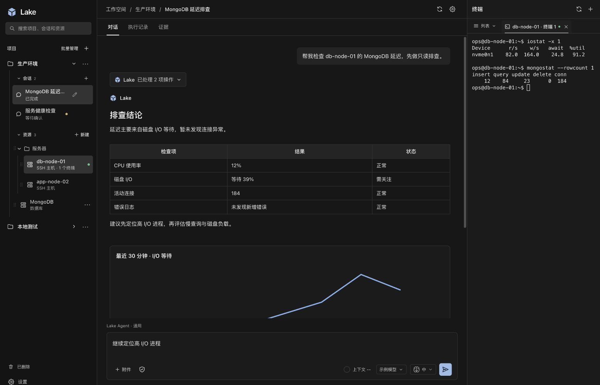

# Lake OxyNote-style UI validation

Date: 2026-10-14 (Asia/Shanghai).

The active React workbench now uses a single neutral theme in `web-agent/web/src/theme.css`. All eight active feature stylesheets were migrated in place; the former cream/teal palette, remote font import, large decorative radii, heavy shadows, and old wave brand markup were removed. No legacy-theme override stylesheet or old-theme switch remains. Historical clients are outside the current release path.

## Implemented surfaces

- Compact project/session/resource navigation, geometric Lake mark, navigation search, and hover actions that do not reserve resource-name width.
- Document-style conversation, full-width scrollable Markdown tables, code surfaces, charts, message composer, pending message queue, and operation/approval cards.
- Conversation, execution-history and evidence tabs. These use persisted session events and evidence, preserve original turn boundaries, and exclude evidence belonging to another session. Unknown tool outcomes remain explicitly unconfirmed.
- Model settings, conversation settings, appearance settings, permission popovers, resource forms, project memory, trash, update dialogs and dormant workflow component styling.
- Neutral xterm palette; xterm updates when the shared theme changes. Native macOS window chrome follows the theme; Windows light caption colors were updated.
- Light, dark and system appearance preferences, persisted per browser origin and in macOS UserDefaults across changing loopback ports. Native sidebar/terminal resizing remains available.

## Validation

- Node 24.19.0 and pnpm 10.33.4: TypeScript and production Vite build passed.
- Frontend regressions: 104 tests passed. Added tests cover resource-search ancestry/project boundaries/cycles, transcript-mode filtering, unknown operation outcomes, evidence deduplication and session boundaries.
- Browser: actual production frontend served by an isolated synthetic API on loopback port 4189. Checked conversation, execution expansion, evidence, resource search, pending approval confirmation enablement, model/appearance settings and new-resource form. No commercial model or real SSH connection was used.
- Responsive viewports: 1600×1000 has three columns; 960×720 uses a terminal overlay; 390×844 has a navigation drawer and visible send/stop controls. No horizontal document overflow was observed. The hidden mobile sidebar is inert and excluded from the accessibility tree.
- Theme: checked light/dark surfaces and terminal switching; preference lifecycle tests also cover a native seed on a new origin, unavailable browser storage, system changes and cross-tab updates. Appearance radios support arrow-key selection. No browser error logs were observed.
- Static audit: active product CSS/TSX/JS contains no hard-coded palette colors outside `theme.css`, no old cream/teal tokens, no former font import, and no old brand markup. Shared CSS variable references resolve to declared tokens.
- `scripts/build_lake_desktop.sh` completed. The embedded backend and macOS app were signed with the persistent Lake development identity and strict signature verification passed.
- Windows desktop client cross-compilation passed with `GOOS=windows GOARCH=amd64 CGO_ENABLED=0`. Windows runtime/caption rendering was not exercised on this macOS host.
- Signed Go backend smoke check: independent home `/tmp/lake-ui-signed-smoke-20261014`, loopback port 4190. Authenticated bootstrap/catalog worked, catalog was empty, and the embedded CSS contained the new theme and no old palette. No production data or credentials were read.
- `git diff --check` passed. Existing unrelated backend changes were preserved.

## Delivery

Local UI test app: `/Users/lingyunxieqing/Applications/Lake Dev.app` (bundle identifier `com.cleanlakes.lake.desktop.dev`).

Recoverable previous app: `/Users/lingyunxieqing/Applications/Lake.before-oxynote-20261014-100529.app`.

Signed development bundle and ZIP/DMG: `dist/macos/0.3.6/arm64/dev/`.

The original release app was restored from the pre-UI backup to `/Users/lingyunxieqing/Applications/Lake.app`. Its native executable and embedded backend hashes match that backup. Release and Dev now run simultaneously with separate application identities, UserDefaults, homes (`~/.lake` / `~/.lake-dev`), data directories, backend processes, free loopback ports and authentication tokens. Dev ignores inherited release home/data/token variables and does not receive release updates. The release retains its original project and two completed sessions; Dev starts with an empty catalog and model settings. Closing and reopening Dev was verified to leave the release backend PID and health unchanged.

Build and install local UI changes with `scripts/build_lake_desktop.sh --dev --install`. Open `~/Applications/Lake Dev.app` to test them. The default build remains the release packaging path; use `--dev` for local tests.

Native desktop profile isolation assertions and existing release/update indicator assertions passed. Both installed app signatures passed strict verification. The actual empty Dev workbench is captured in [lake-dev-independent.jpg](lake-dev-independent.jpg).

After the user's data-sync request, the release workbench was copied into Dev using SQLite's online backup API, durable model/provider/AI files and independent private credential copies. Runtime tokens, process metadata, locks and SQLite WAL/SHM files were excluded. Absolute credential references were adjusted to the Dev credential directory. Integrity and foreign-key checks passed; catalog IDs and active model selection match (1 visible project, 133 resources, 2 visible sessions). Deleted/history records are also retained in the database snapshot. The original Dev home remains at `~/.lake-dev.before-sync-20261014-102807`. The release backend PID and health remained unchanged; both apps continue to use separate homes and tokens. Dev now displays the copied data in the new UI. This was a one-time copy; subsequent edits remain independent.

## Screenshots

All screenshot hosts, model configuration and outputs are fictional UI fixtures.

[Model settings](lake-oxynote-settings.jpg) · [Resource form](lake-oxynote-resource-dialog.jpg) · [Mobile approval](lake-oxynote-mobile.jpg) · [Medium terminal overlay](lake-oxynote-medium.jpg)

## Limits

The mockup's illustrative KPI cards are not a new monitoring backend. Existing chart/evidence data is rendered by the current product contract. Historical standalone clients were not migrated. Vite's existing large JavaScript chunk warning remains; this change introduces no Vue/Nuxt runtime or new frontend packages.
