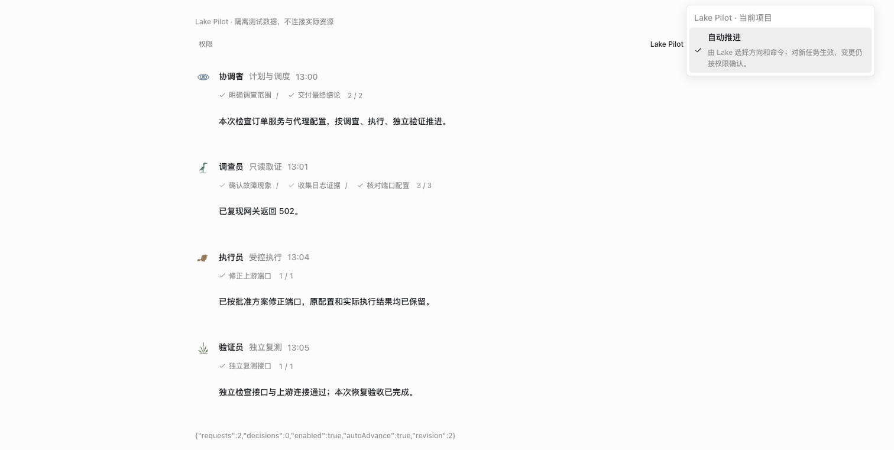
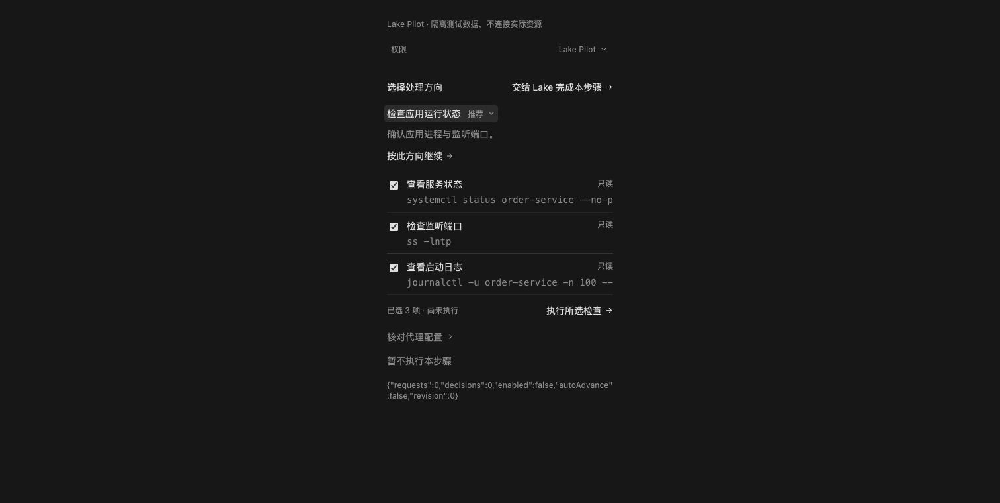
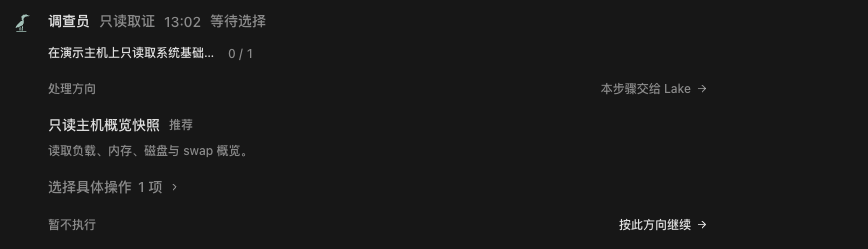
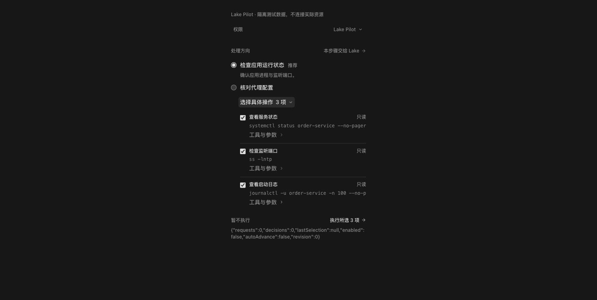

# Lake Pilot 首个工作切片验证

日期：2026-10-25。分支：`codex/lake-pilot-plan-20261025`。目标：`develop`。[草稿 PR #98](https://github.com/Clean-Lakes/Lake/pull/98)。

首个执行切片代码：`7dc7b083fed33a4d4d8d12e23363087c3c9d7e2d`。后续界面收紧的代码和 Dev 验证见文末追加记录。当前仍是开发中的首个切片，不能视为完整方案验收或合并依据。

## 本地检查

环境：macOS arm64、Go 1.26.6、Node 24.19.0、pnpm 10.33.4。Node 使用 Codex 已有运行时路径；没有修改项目依赖。

| 命令或检查 | 结果 |
| --- | --- |
| `go test ./internal/ai ./internal/web -run 'TestPilot\|TestSRETaskStoreIdempotencyIsolationAndRollback\|TestSREFullRolesInheritNormalToolCatalogAndEnabledExtensions' -count=1` | 通过 |
| `go test -race ./internal/ai ./internal/web -run 'TestPilot' -count=1` | 最终代码通过，ai 1.783s / web 7.146s |
| `go test -race ./internal/ai ./internal/web -run 'TestPilot\|TestSRE\|TestADKSRERole\|TestPlanMode' -count=1` | 实现过程通过，ai 9.194s / web 76.653s；最终另补 Pilot race 回归 |
| `go vet ./...` | 通过 |
| `python3 scripts/check_adk_runtime_boundary.py` | 通过 |
| `pnpm --dir web-agent check` | 通过 |
| `pnpm --dir web-agent test:frontend` | 469 / 469 通过 |
| `pnpm --dir web-agent build:web` | 通过；已有单包大于 500 kB 提示 |
| `scripts/build_lake_desktop.sh --dev` | 最终代码签名构建成功，生成 Dev app、ZIP、DMG；未安装 |
| `codesign --verify --strict bin/lake` | 通过 |
| `git diff --check` / 方案结构、标识符唯一性检查 | 通过 |

### 完整 Go 测试的已有本地失败

`go test ./...` 在本机现有的 `internal/ai/output_recovery_test.go` 失败：`TestOutputLimitRetryUsesCompletedHistoryAndNeverRunsTruncatedCalls`，报告 `retry dropped completed work or used incomplete calls` 和 `incomplete history or cards survived recovery`。该测试文件被 `.gitignore` 的 `output*` 规则忽略，未跟踪，不能作为本 PR 文件提交或删除。

将未修改的 `origin/develop` 提交 `c8c91efaf0ab94ce2aa3a08a701d97bf04d99be3` 导出到独立临时目录，只加入同一个本地测试文件后运行此用例，复现同样的两个失败。没有更改该测试、放宽校验或把完整 Go 测试记为通过。基线临时结果位于 `lake-pilot-baseline-kwhjqrp4/local-regression-baseline-result.txt`。

## 执行与恢复行为

- `TestPilotGuidedAndAutomaticRunThroughRealRoleAndEvidence` 使用隔离本地模型协议夹具驱动原 ADK 专员，同时真实读取临时日志文件。guided 等待时没有资源操作和证据；提交所选操作后原专员继续，证据可通过原接口读取。automatic 没有选择等待，并取得同样的真实来源证据。
- `TestPilotChoiceSurvivesProcessCrash` 在原选择等待处实际中断子进程，重开存储后回复原 request；保留原 attempt，只执行一次真实读取。
- 设置测试覆盖一次性升级关闭、旧值迁移来源、重启不重置、部分字段更新、409 冲突、运行中主开关保护、未来任务策略快照，以及旧 SRE API 不覆盖自动推进。
- AI 策略测试覆盖未选择阻止调用、选项/依赖校验、重复决定幂等、实际依赖完成、参数精确匹配、attempt 隔离、无关任务 revision 不使选择失效、自动推进不提升角色权限、没有实际检查不能完成 observe。

这些是合成模型协议下的真实运行时测试，可以证明等待、派发与证据路径；不证明真实模型推荐方向的质量，也不替代真实故障恢复验收。

## 签名后端隔离冒烟

使用最终 `bin/lake`，显式 `web --home <临时独立目录> --port 0`，临时目录为 `lake-pilot-signed-qa-fgixymv1`。仅使用合成测试令牌，未配置模型、复制凭据或连接生产资源。

实际 HTTP 验证通过：bootstrap；新项目 `{enabled:false,autoAdvance:false,revision:0}`；分别保存主开关和子设置；过期 revision 返回 409；正常停止、重启同一隔离 Home 后保留 `{enabled:true,autoAdvance:true,revision:2}`。后端测试进程已停止。

## 界面组件检查

浏览器页面来自 `web/test/fixtures/lake-pilot.html`，挂载真实 React 组件和原 Lake CSS、湖生态头像。全部请求由夹具拦截；测试记录明确标注为隔离演示，不连接后端或真实资源。

- 初始主开关和子设置均关闭；浅色主开关灰色 `rgb(142,143,144)`，开启后为黑色 `rgb(26,28,31)`。使用文字按钮和 `aria-pressed`，没有滑动开关。
- 自动推进使用原菜单 checkbox 项，保存后主开关值保留；Esc 关闭菜单，焦点返回“Lake Pilot 设置”。
- 四个角色分别显示真实组件中的不同步骤导航和各自分母，复用原头像/消息头。
- 深色主题下检查 390px **内容列**，长命令局部横向滚动，内容列自身无溢出；展开/勾选时请求数为 0，提交选择后只有 1 次决定请求。夹具统计文本也已换行。
- 浏览器原生窗口/viewport 保持 1512px，尺寸仿真没有生效，因此上述窄列结果不能冒充 390px 整窗验收。完整窄窗口、输入法、焦点及长导航仍列为待验收。

## 首次 Lake Dev 安装限制与待完成项

首次验证时，`scripts/dev_build_origin.py check` 阻止覆盖已安装 Lake Dev：现有 Dev 来源提交为 `0f1d0d87d59c`，来自另一个工作区，本分支不包含它。遵守来源保护，仅生成签名 Dev 包并使用隔离 CLI Home；没有安装或重启现有 Dev/正式版，没有绕过检查。

待完成：步骤局部“暂停并选择”；方向跨批次持续委托；执行员/验证员多阶段及结构化业务完成条件；真实模型方向质量；Lake Dev 真实故障、变更审批拒绝、独立复测恢复、重启与完整明暗/窄窗口验收。现有自动审批、资源范围、未知操作核实和原验收规则仍保留。

## 迁移与回退

同一 `sreProjectSettings` 增加字段，首次升级将旧 enabled 保存为 `legacyEnabled` 后关闭 Pilot。后续不覆盖明确保存值；旧 API 只改 enabled。历史任务不补造新的选择记录，后台保存工作流保留原自动运行路径。

开发回退前先停止任务并核实在途操作，保留当前数据库、ADK 存储及原账本。旧版本不具备恢复 Pilot 选择等待的能力，不能直接继续新 guided 任务或用旧快照覆盖后续资源效果。此 PR 尚未合并、发布或操作生产。

## 2026-10-25：选择区收紧与 Dev 更新

界面代码 SHA：`ec09bf8244f1b9997d2b24c1aedd7fd9fda80214`。本机 Dev 联调提交：`270d2261d1a6a6dd08ada09d7d5664e4afa1ae7d`。联调分支保留已安装 Dev 来源历史，并合入界面提交；文件树与该界面提交一致。没有合并 GitHub PR 或推送保护分支。

调整：长步骤导航限制显示宽度，完整说明通过步骤检查入口查看；只在首条进度正文与步骤说明重复时去除该段重复呈现，实质发现和实时输出保留。等待 Pilot 选择明确显示“等待选择”。方向改为紧凑的单选列表，仅显示当前方向的简短说明；主执行入口统一放在底部。

“选择具体操作”默认收起。展开后进入具体操作模式，主按钮显示实际选中数量；收起详情仍按已选集合提交，不扩大回整个方向。原工具与 JSON 参数进一步收在“工具与参数”中，真实命令在操作层可查看。委托本步骤和暂不执行保持次要入口。

| 检查 | 结果 |
| --- | --- |
| 前端完整测试 | 471 / 471 通过，含重复说明保留边界与等待选择状态回归 |
| 前端类型检查、生产资产构建、`git diff --check` | 通过；已有包大小提示保留 |
| 浏览器真实组件，浅/深色、390px 内容列 | 默认操作/参数均收起；长导航省略，窄列无溢出；主机示例选择区约 161px 高 |
| 方向切换后提交 | 提交实际选中的 config 方向，只有 1 次决定请求 |
| 展开再收起操作后提交 | 仍提交 command 层的冻结 operationIds；没有退回 direction 层 |
| 展开、切换、勾选、查看工具参数 | 执行请求数保持 0；取消全部操作后主按钮禁用 |
| `scripts/build_lake_desktop.sh --dev --install` | 签名构建并安装成功，来源保护通过；仅重启 Lake Dev |
| 新 Dev 启动与资产检查 | 认证正常，签名后端与构建元数据哈希一致；实际 HTTP 页面加载新选择组件和样式 |

首次 Dev 来源限制通过独立本机联调工作区保留历史后解决；没有修改或绕过来源保护。更新前确认没有运行中的会话、派发操作或忙碌终端。新应用继续使用 `~/.lake-dev`，保留项目与设置，没有执行真实资源命令。

这些截图使用真实组件和隔离演示数据。窄列仍非整窗 390px 验收。后端执行代码本轮未改，前述完整 Go 本地基线失败及完整真实故障矩阵的未验收项仍保留。

## 2026-10-25：稳定进度与范围内自适应

执行策略代码 SHA：`c81f920558331a43e05a423b50bfb75ce431d08a`；最终界面补充 SHA：`502fc272962008ad553931d5db93e608f921ad66`。本节取代前一节“展开操作自动固定命令”和“方向只委托首批操作”的行为描述。

- Lake / 自动推进可在步骤、角色、目标及原权限内调整方向和命令；方向委托保持原方向 ID、标题和目的，后续候选批次仍校验真实工具、参数、风险与依赖。明确的命令选择优先于任务自动默认值。
- 展开查看不改变委托；主动勾选或“仅执行所选操作”才锁定集合，“允许 Lake 调整”恢复方向委托。
- `pilot_read_recovery` 只关联原账本中的真实替代检查：同 attempt、同资源、可信只读、发生在失败之后、成功且有完整来源证据。旧/截断/外部资源/未结束采样、未知变更和固定命令都被拒绝。原失败状态不改写，未补齐仍失败；业务结论继续走原验收。
- 稳定执行正文，实时叙述默认折叠到运行详情；状态批量更新窗口 180ms，阶段/计数局部更新。详情展开区限制自身高度。

| 检查 | 结果 |
| --- | --- |
| `go test -race ./internal/ai ./internal/web -run 'TestPilot\|TestSRE\|TestADKSRERole\|TestPlanMode' -count=1` | 通过，ai 8.939s / web 72.567s |
| 实际 ADK 合成协议 + 隔离临时日志 | 同方向自动改用第二个真实日志文件，无第二次人工问题；保留一条人类决定与新批次，取得真实证据 |
| 替代证据与精确命令策略回归 | 通过；自动默认值不能覆盖明确的命令选择 |
| 前端完整测试 / 类型检查 / 构建 | 474/474 通过；构建通过，已有包大小提示 |
| `go vet ./...` / ADK runtime boundary / diff check | 通过 |
| 浏览器真实组件连续 30 次更新 | 同一导航 DOM、0 次导航变更，内容高 144.28125px 不变，无主正文流式替换/闪烁；0 个执行请求 |
| 运行详情连续更新 | 保留展开状态与键盘焦点 |
| 展开并收起后提交 / 明确锁定后提交 / 恢复委托 | 分别提交 direction / command / direction，每次只有一次请求；夹具拦截全部资源请求 |

Dev 更新前读取全部 18 个会话，相关调查任务保持 paused，专员全部 completed，无 dispatched 操作，终端 ready。没有恢复、重试或改写真实调查的失败历史。完整故障矩阵、真实供应商自适应质量及整窗窄屏仍待验证；原工作区未跟踪的 output_recovery_test.go 基线失败仍保留，不把它记为通过。

签名独立后端冒烟再次通过：随机端口、临时独立 Home `lake-pilot-signed-qa-d88rwsds`，验证 bootstrap、默认关闭、设置部分更新、过期保存 409 和重启持久化，进程已停止。最新界面额外验证：Pilot 正在尝试只读替代时显示执行中，结束后缺口未补齐显示检查未完成；未知变更始终显示结果待核实。

本机 Dev 联调最终来源为 `2e11a6af15f56c58fee8c8ca2207e7459c53da9e`，源码树与上述最终代码一致；原 Dev 来源历史仍保留。该独立受管 checkout 不含原工作区的忽略测试，`go test ./...` 全部已跟踪测试通过（ai 38.270s / web 153.810s）；不等同于消除了原工作区未跟踪测试的基线失败。

`scripts/build_lake_desktop.sh --dev --install` 已签名构建并安装上述最终来源，安装元数据与后端 SHA256 一致。正常退出/重开 Dev 的原生操作遇到 Mac 锁屏，工具明确要求用户手动解锁，尚未完成新进程/实际窗口验收；原运行后端 PID 21131 仍是旧版本，不能把磁盘安装记为已在运行。已向用户请求解锁，没有通过 shell 强停、绕过锁屏或重试实际服务器任务。浏览器夹具与临时后端均已结束。
