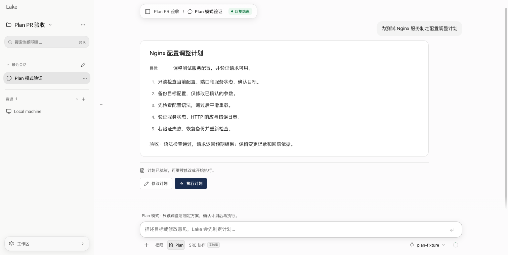
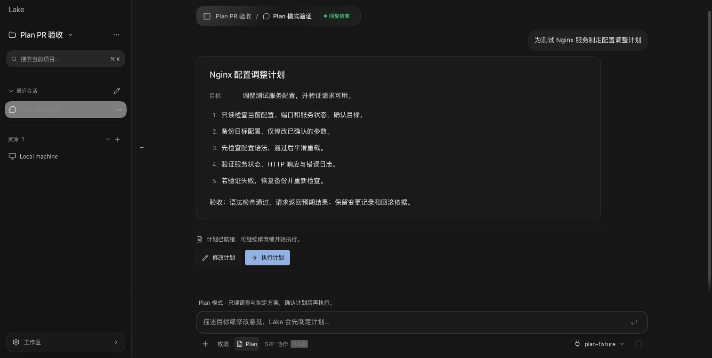
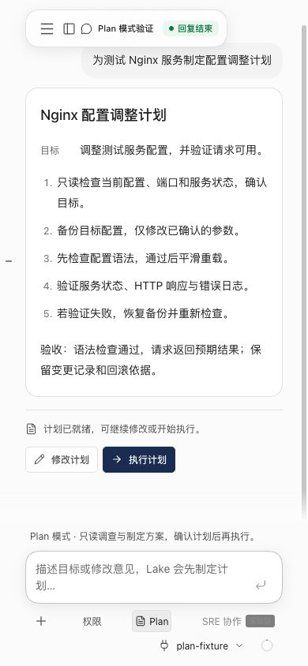
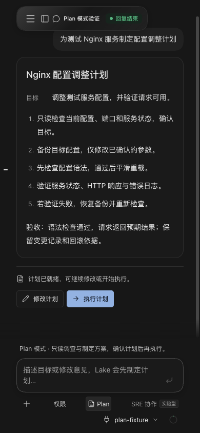

# Lake Plan 模式验收

日期：2026-10-22。

## 行为

- 输入区 Plan 按钮、`/plan` 切换模式；`/plan 目标描述` 开启规划并发送目标，命令本身不进入消息正文。
- 模式按会话保存，旧会话默认普通执行。Plan 阶段保留只读调查、结构化提问和会话内任务进度，暂停自动 SRE 协作。
- 工具目录采用白名单，执行入口再次检查；写文件、未知或写入命令、写 SQL、Redis 写命令、MCP 调用、资源导入、工作流启动和计划任务修改均被禁止，静默权限不能绕过。模型记忆提取也被禁止。
- 模型通过 `<proposed_plan>` 协议提交完整方案，界面保留 Markdown 正文并隐藏协议标记。普通回答、需求澄清及失败/取消的轮次不产生执行入口。
- 方案随 JSON 状态及 ADK 投影保存；修订后只显示最新方案的操作。执行按钮只发送方案 ID，服务端读取已保存内容，校验模式、完成状态、队列和忙碌状态后进入普通执行，沿用原权限。重复及过期执行被拒绝。
- 提问中途进程退出后，回答问题仍以 Plan 模式恢复，完成后保存新的方案；不重放资源操作。

## PR 基线与验证

本次 PR 从 `origin/develop` 的 `51d378c8` 建立独立分支 `codex/plan-mode`，只迁入 Plan 功能。保留新版原子引用输入框、回复展示和策略学习逻辑；Plan 回合暂停记忆提取、策略学习及在线纠错，避免规划结果进入持久学习。

- `go test -race ./internal/ai ./internal/web` 完整回归，结果及最终受测提交记录在 PR 描述。
- `go test -race ./internal/ai ./internal/web -run 'TestPlanMode|TestCapturePlan|TestADKApprovalSurvives|TestADKQuestionSurvives|TestADKCrashAfter' -count=1` 通过，包含真实子进程退出/恢复，以及启用策略学习时的 Plan 约束。
- `go vet ./internal/ai ./internal/web` 和 `python3 scripts/check_adk_runtime_boundary.py` 通过。
- Node 24.14.0 下 TypeScript 类型检查、全部前端测试（包含 5 项 Plan 测试）通过。旧实验工作区的回复渲染失败未在 develop 基线复现。
- `/plan` 携带原子资源/Skill 引用时校正位置，真实消息编码验证引用文字、资源 ID 和 UTF-16 跨度，未改变原草稿引用。
- 使用签名 `bin/lake`、独立 `/tmp/lake-plan-pr-ui-20261022/home` 和本地模拟模型验证命令、刷新恢复、修改聚焦、单一最新入口及执行后切回普通模式。未操作真实服务或使用正式版凭据。
- 浅色/深色桌面及 390px 窄窗口完成截图检查，页面无横向溢出，计划操作按钮保持可用。

## 构建与限制

`scripts/build_lake_desktop.sh --dev` 通过，二进制与 Dev 应用由持久开发身份签名，生成 `dist/macos/0.3.21/arm64/dev/` 下的 App、ZIP 和 DMG。

本次只创建 PR，不安装或重启已安装的 Dev，不操作正式版；新版 Dev 宿主实际启动尚未验证。页面验收运行的是签名后端及相同内嵌前端的隔离实例。模拟模型验证产品流程，真实供应商的规划质量与 Windows 原生宿主尚未验证。

## 数据影响与回退

新增可选的会话模式和计划字段；旧会话默认普通执行，原操作权限保留。退出 Plan 即可恢复普通处理。回退此提交可移除入口与执行能力；不清理会话、计划正文或已有操作审计。

## 界面

