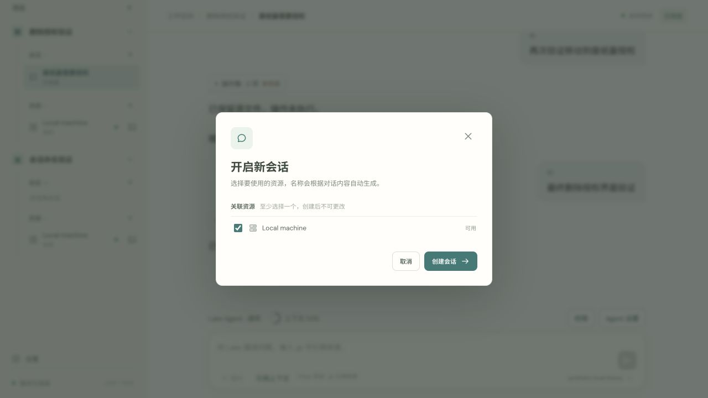
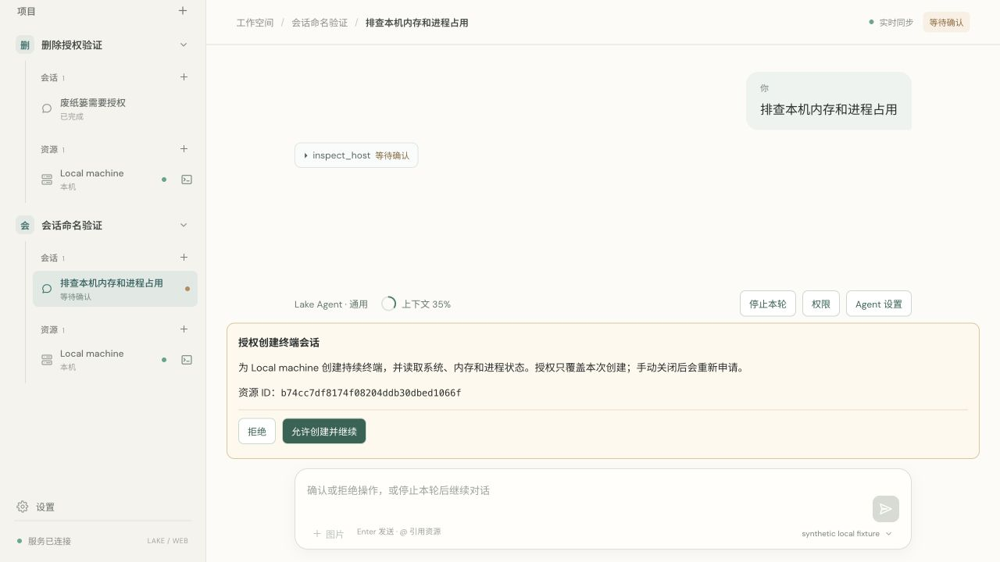

# Automatic session names

Completed 2026-10-11. The new-session dialog now contains only resource selection; no conversation name/goal is required. Its primary create button receives keyboard focus. API clients can omit title or send an empty title. New unnamed conversations start as 新会话.

The first meaningful user message supplies a short topic, with whitespace/Markdown normalization and Unicode-safe truncation to 28 runes plus ellipsis. Plain greetings keep the placeholder until a meaningful message arrives. Leading structured resource mentions are removed from the title seed; image-only default requests use 图片分析. This extraction runs synchronously when the message is accepted, requires no additional model request and works before terminal authorization/model responses. The generated title stays stable across later messages and restarts.

A separate sessionNaming record marks only newly unnamed conversations. Explicit API titles and existing manually named conversations are preserved. Naming records cascade on session deletion. Known model/auth credentials and private-key blocks are redacted from complete title input; sensitive credential-oriented text uses a generic topic rather than copying values. PTY streaming suffix redaction is intentionally not used for complete messages.

Verification:

- Full Go race suite and Go vet passed. Focused tests passed for missing title, greeting delay, first meaningful message, stable names, explicit-title preservation, cascade deletion, Unicode bounds, private title input and restart persistence.
- React type check/production bundle and four frontend timeline regressions passed.
- Signed build through scripts/build_lake.sh; codesign and signed no-Node runtime test passed.
- Browser private fixture: created a session without a name input, observed 新会话, sent 排查本机内存和进程占用 and immediately observed that title in both sidebar and heading while terminal creation was still awaiting authorization. The test turn was stopped without creating a terminal or calling a model. No production conversations were renamed by verification.

