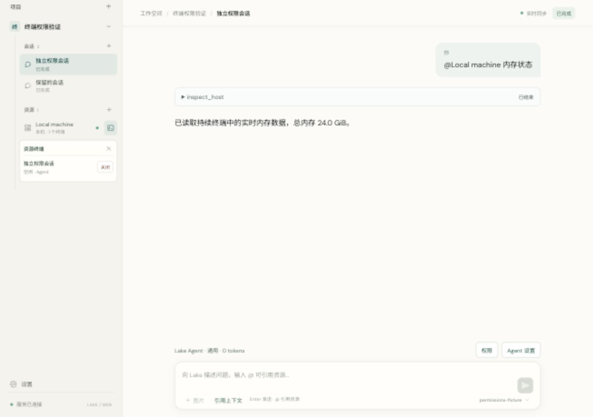
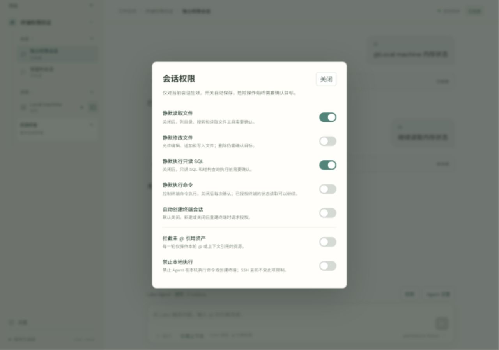
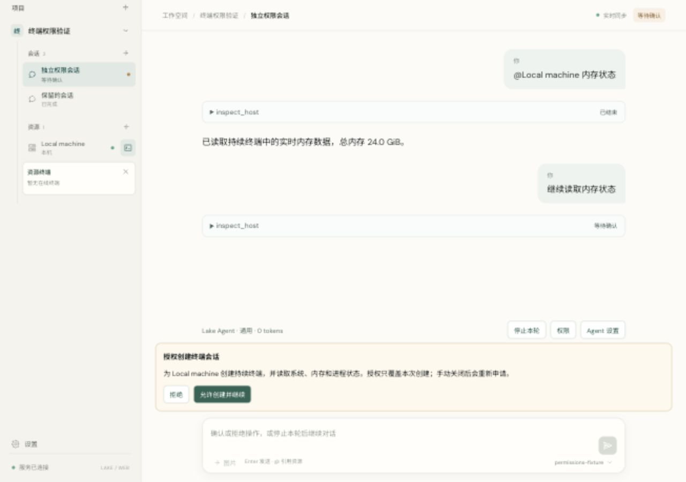

# Session permissions and progressive terminal authorization

Date: 2026-10-11. Runtime: signed Go backend with embedded React.

Resource rows now include a terminal-management button. The menu lists each live terminal with its owning conversation and holder, and closes one terminal or all terminals belonging to the resource. Closing preserves conversation messages and terminal history. Resource-close routes verify the resource/terminal association before stopping a process.

New Agent terminals require creation authorization unless automatic terminal creation is enabled, which is the current default; with it disabled, a replacement after manual closure needs approval again. The approval identifies the target and covers that one opening and bounded initial system/memory/process inspection. Reusing an idle authorized Agent terminal does not request creation again. A rejected creation causes no terminal or command effect. Approval IDs are single-use and context fingerprints detect drift. Existing historical pending actions stay in their original turn and are not replayed.

The permission button beside Agent settings saves options per conversation:

| Setting | Default | Behavior |
|---|---|---|
| 静默读取文件 | On | File listing/search/read tools run without a separate decision. |
| 静默修改文件 | Off | File editing/appending/writing needs a decision unless enabled; deletion retains dangerous-target confirmation. |
| 静默执行只读 SQL | On | Read-only SQL and database structure queries run without a separate decision. |
| 静默执行命令 | On | Recognized read-only commands on an authorized terminal run automatically. Ordinary state changes also run without a separate decision while enabled; dangerous/destructive operations still require single-operation target confirmation. |
| 自动创建终端会话 | On | Opening/reopening proceeds automatically while enabled; otherwise each new connection requests authorization. First-time SSH fingerprint review still applies. |
| 拦截未 @ 引用资产 | Off | When enabled, execution and asset discovery are limited to the current turn's explicit resource/context references. |
| 禁止本地执行 | Off | When enabled, Agent local-terminal creation and command operations are denied; SSH targets are separate. |

Settings can be saved before model configuration, cannot be changed during an active turn, survive reload/restart, and do not carry into another conversation. Credential restrictions remain independent of silent-operation preferences.

Verification passed:

- Go race suite and vet checks; original AI/provider/PTY/SSH tests remain passing.
- Progressive creation: initial request before model inference, reject/no-effect, accepted creation, live reuse, resource-close/history retention, new approval ID for recreation, and rejection of stale decisions.
- Separate command authorization after terminal creation, plus dangerous target confirmation with silent commands enabled.
- Real local file reads, silent file writes and isolated SQLite read-only SQL under the configured flags; unreferenced asset discovery/read blocked before data exposure.
- Resource close across two retained conversations and rejection of a mismatched resource/terminal ID.
- React type/build checks and both timeline ordering regressions.
- Browser flow with a local model fixture: create approval, read real memory after acceptance, close from the resource menu, recreate approval in the retained conversation, and reject without reopening. Permission restrictions save automatically, survive reload, and remain independent across conversations. Default narrow layout and 1280×900 desktop layout were checked; the temporary viewport was reset and the tab/services were closed.
- Signed executable empty-PATH/no-Node runtime test and codesign verification. Built only through scripts/build_lake.sh.

The browser/model fixture and synthetic SSH/SQLite tests do not access commercial model endpoints or production SSH resources. The earlier configured-model host-session validation is recorded separately in lake-host-session.json.

