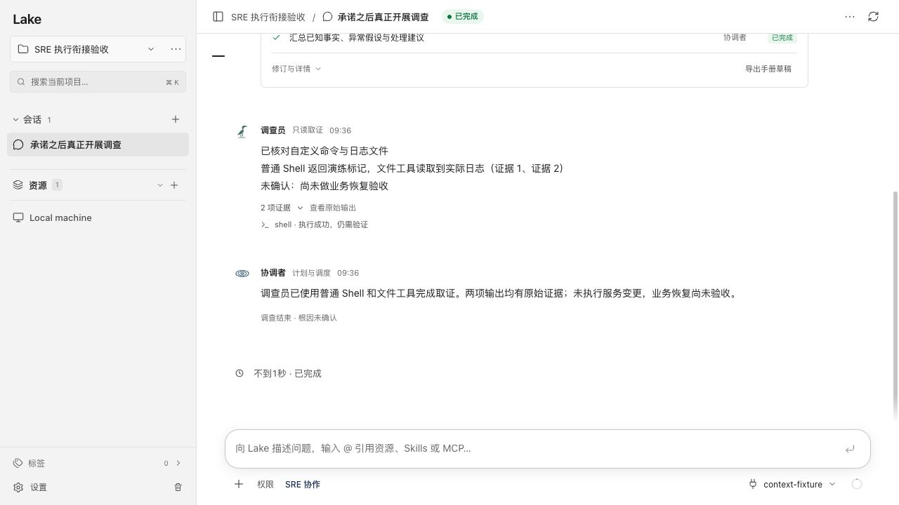
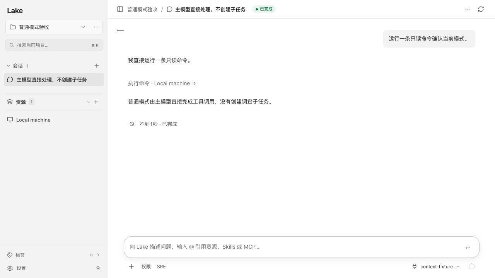

# 统一 SRE 完整工具专员

日期：2026-10-16。

普通聊天默认和历史 `multiAgentMode=auto` 均不再提供旧 `delegate_investigation` 工具；伪造旧工具调用返回不可用，不创建子任务。界面删除第二套多 Agent 调查设置。旧消息和 Scout/Trace/Deep/Beacon 历史继续可读，不补造 SRE 身份。旧运行库仅保留内部兼容测试，不由实际用户配置开启。

SRE 实际专员使用普通工具目录，Shell、持久终端、文件、SQL、Redis、Docker、启用的 MCP／Skills 和项目记忆均按父会话当前权限提供。自动记忆抽取在子专员关闭，避免重复抽取。角色与任务资源隔离；解析终端真实目标后再检查范围。普通不透明或变更工具调用也持久记录准备、审批、实际派发、结果和 unknown。已声明的冻结变更只有匹配工具与参数的成功记录才能算完成；确定性自动验收仍由原运行时采样和计算，不使用模型口头成功替代。

主模型和专员均保留观察、工具调用、更新判断的循环。专员在工具调用前写出的正常进度文本会更新对话中的真实角色消息；思考原文不公开。结束后替换为实际报告、证据和操作结果。

保存工作流不再走旧 Scout/Beacon 链路，改为 SRE 调查步骤和协调者汇总；未启用 SRE 时拒绝启动，模板与历史仍可查看。关闭 SRE 后也不能通过历史 Plan 的继续按钮绕过开关。

回归覆盖：

- 普通模式保存旧 auto/off 两种配置，都由主模型实际运行本机只读命令，任务数、子专员数为零。
- 四个完整工具角色具有普通工具目录、MCP 和 Skills；纯 JSON 计划／报告阶段不提供执行工具。
- 实际执行 Shell 和文件读取，文件操作审批继承父会话设置；其他会话不能批准本专员操作。
- 父会话收紧静默权限、禁止本机执行、限制 MCP 范围即时生效；另一资源终端不能越界派发。
- Skills 实际读取、启用 MCP 的真实桥接策略和来源记录；禁止重复派发 unknown，已有变更拒绝／验证回归继续保留。
- 工作流串行实际执行、取消、跨会话隔离，以及关闭 SRE 的 Plan 启动禁用。

签名二进制隔离 HTTP 与界面验收：SRE 项目中调查员使用普通 Shell 与 `read` 取得两项真实证据，Shell 有成功派发记录，协调者汇总；普通项目保存旧 auto 配置后仍返回有效 off，主模型直接调用工具，无子任务。模型为本地合成 provider，仅执行测试标记命令和临时日志读取；不使用用户模型凭据，不执行用户线上服务器任务。

验证结果：`go test ./...`、`go test -race ./internal/ai ./internal/web`、TypeScript 检查及 166 项前端测试通过。使用 `scripts/build_lake_desktop.sh --dev --install` 签名安装并验证签名。确认没有活跃会话后仅重启 Lake Dev，API 正常、原有八个会话保留；正式版未操作。

