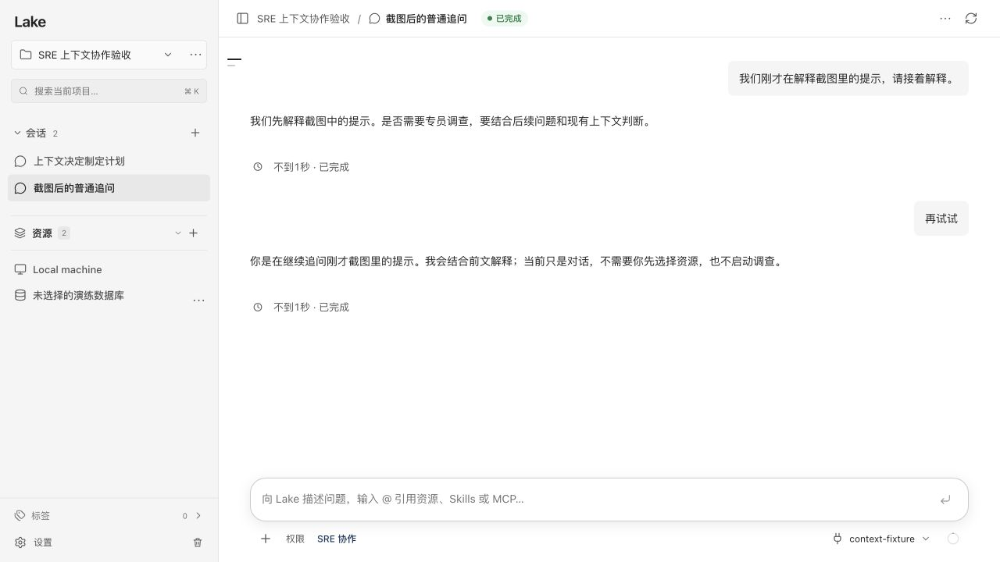
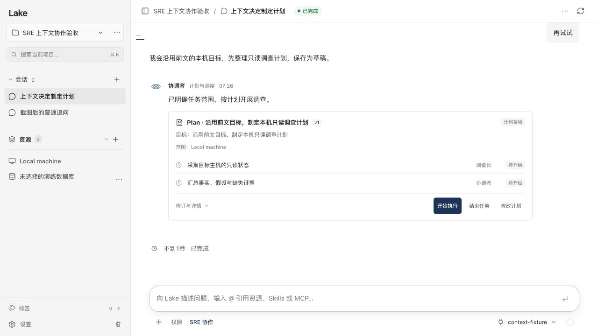

# 上下文驱动的 SRE 协作入口

日期：2026-10-16。

删除旧 sreHumanTurn 入口的固定资源提示和文本分支。主模型使用原 ChatTurn 流式循环、会话历史、可用图片、当前上下文及 LAKE_SRE_CONTEXT，决定正常回应、澄清或调用 sre_collaborate。没有增加单独的意图分类请求。

模型可选择创建任务、继续既有计划、修订计划、请某位专员解释、暂停或结束任务。new_task 明确目标、资源及 assist/plan_only；后者只保存草稿。程序只校验并执行结构化交接：父回复释放会话后消费一次、重验当前权限、不把模型推断写成显式用户授权。协调入口不提供 Shell／文件写入等资源操作工具。

回归覆盖：

- “再试试”“？”和对“只出计划”字样的解释，可由模型直接回答，保留真实上下文，不创建任务。
- 同一句“再试试”在先前已明确调查目标的上下文中，由模型调用协作工具创建草稿；项目具有多个资源，没有 @ 引用，没有资源操作。
- 既有草稿不会因一条解释性问题被程序自动执行。
- 开启拦截未引用资源时，模型工具选择不能新增授权；错误返回模型，由模型自行澄清。
- 交接消费后不能再次取得，不自动重放。
- 指定某位专员解释既有事实时，生成对应专员的真实回复，不运行计划。
- 当前图片及历史图片继续传入主模型，上下文追问不会丢失图片。
- 既有执行审批、拒绝零副作用、unknown、修订和验证测试继续运行。

验证结果：

- `go test ./...` 通过。
- `go test -race ./internal/ai ./internal/web` 通过；补充的专员解释与历史图片用例也已单独通过。
- TypeScript 检查及 165 项前端测试通过。新增服务端实际返回 `runs:null`、`attempts:null` 的草稿渲染回归，修复新计划尚无执行记录时的页面白屏。
- `scripts/build_lake_desktop.sh --dev --install` 成功，安装后的 Dev 签名校验通过。确认无活跃会话后，仅重启 `~/Applications/Lake Dev.app`；Dev API 正常、原有 7 个会话仍在。正式版未操作。

使用本地合成模型及唯一隔离 home 做真实 HTTP／界面验收，不向用户配置的实际模型补发消息。同一项目具有两个资源，开启 SRE：普通追问的“再试试”得到模型回答且任务数为零；已有具体调查目标的“再试试”由模型工具调用生成一个草稿，资源操作数为零。这验证模型输出能驱动两种路径，不代表对实际供应商模型的决策质量做了评估。

