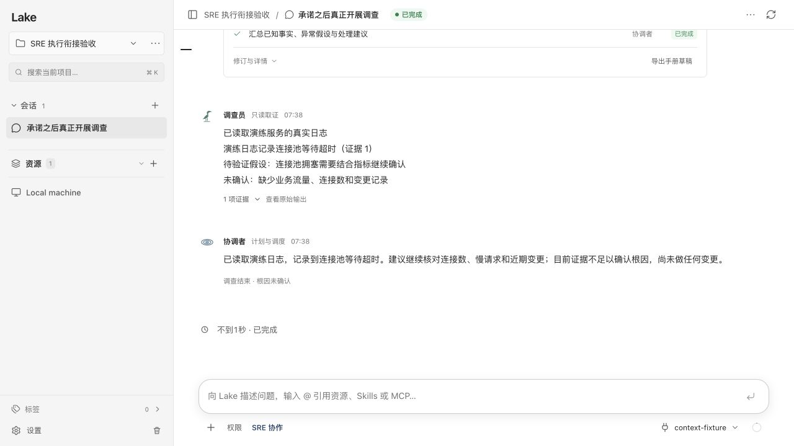

# SRE 只承诺未执行的回归

日期：2026-10-16。

只读检查 Dev 的问题会话，实际记录只有用户请求和“我先在目标服务器上做只读检查……”的模型回复。没有工具调用，没有 SRE 任务，也没有调查结果。原聊天循环把零工具调用的文字视为最终回答，导致显示完成。

修复为明确的模型收尾协议：主模型自行选择 `sre_collaborate` 实际安排工作，或通过 `sre_reply` 给出正式回答／必要澄清。纯文字输出在同一轮获得一次协议提醒，继续原历史和原模型工具循环。再次没有决策则失败，不自动创建任务、不解析关键词、不重放操作。正式回复使用模型提供的全文，工具批次完成后写入历史和消息卡。

回归用例包括：

- 复现截图中的承诺文字、没有工具调用，继续同一轮后由模型调用协作工具；真正生成 Plan、运行调查员读取隔离临时日志、协调者汇总，断言证据原文存在，且不宣称业务恢复。
- 同样先输出承诺文字，后由模型选择直接回答算术问题，资源任务数仍为零。
- 两次未提交收尾决策则失败，模型请求数量有界，不显示本轮成功。
- 正式解释、澄清、图片追问和既有草稿不自动执行的回归继续保留。

使用隔离数据和本地合成模型验证，不重发用户的线上服务器检查请求，不修改其历史回复。

验证结果：定向回归、`go test ./...`、`go test -race ./internal/ai ./internal/web` 全部通过。`scripts/build_lake_desktop.sh --dev --install` 成功，Dev 安装签名校验通过；无活跃会话时重启 Dev，API 正常且原有 8 个会话仍在。

已对签名二进制做隔离 HTTP 与界面验收：先返回一次没有工具调用的检查承诺，同轮继续后创建一个真实协作任务，完成两个步骤并留下真实临时文件日志证据。界面显示调查员取证、证据入口、协调者汇总及“根因未确认”。合成模型只验证协议和执行衔接，不用于评价实际供应商模型的判断质量。

