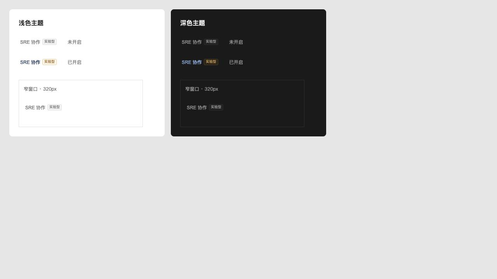
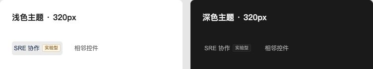

# SRE 协作入口状态

2026-10-16：入口统一显示「SRE 协作 实验型」。未开启时文字、徽标与边框为中性灰色，悬停保留灰色文字；开启后保留主题强调色与实验徽标高亮。沿用原来的项目开关与键盘焦点样式。

验证：TypeScript 检查通过，191 项前端测试通过；使用实际组件与样式生成隔离预览，检查浅色、深色和 320px 容器，未开启的文字和徽标颜色一致，Tab 焦点轮廓可见。通过 `scripts/build_lake_desktop.sh --dev --install` 签名构建、安装并重启 Lake Dev。

## 点击切换稳定性

移除保存期间的「切换中…」替换文案，开启和关闭沿用相同字重；仅用 120ms 颜色过渡表示已保存状态，减少动态效果时禁用过渡。等待保存时通过 `aria-busy` 报告忙碌状态，并阻止重复点击。刷新回调改为无参数调用，避免把保存结果错误地作为请求的 AbortSignal 传入。

在隔离页面挂载实际组件，模拟 650ms 保存及 200ms 刷新延迟，完成浅色、深色 320px 容器内的开启、关闭和保存失败检查。逐帧记录的入口宽度始终为 102.015625px，文案只有「SRE 协作实验型」一种；失败时选中状态保持不变。刷新回调接收参数数量始终为 0。TypeScript 检查和 191 项前端测试通过，已重新签名安装并重启 Lake Dev。

[交互记录](lake-sre-toggle-stable.json)

