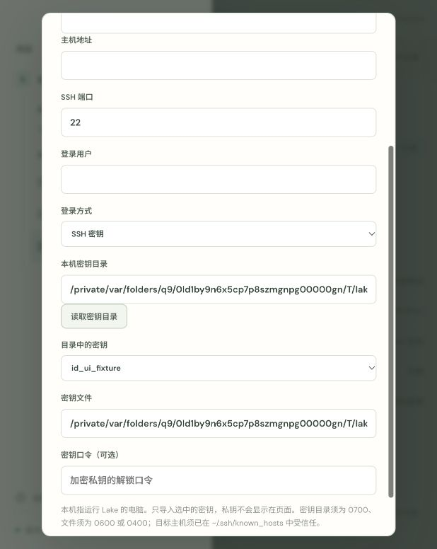
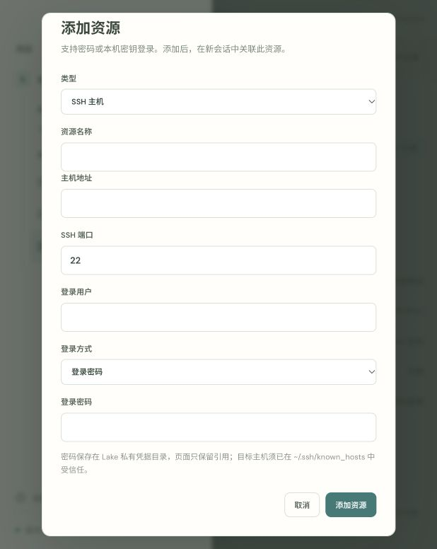

# SSH password and local key credentials

Verified on 2026-10-11, macOS arm64. Updated signed service: http://localhost:4177.

The add-resource dialog supports SSH password login, private-key file selection, and optional encrypted-key passphrases. The directory picker defaults to `~/.ssh`, accepts an explicitly selected local directory, and lists only eligible private-key filenames/paths. Public keys, configuration, symlinks and insecure files are excluded. Only the selected key is imported into Lake secrets. Directory ownership/private permissions and key permissions 0600/0400 are enforced.

Passwords and key passphrases are stored in private 0600 files under `<LAKE_HOME>/secrets`; resource/SQLite/AI configuration contains references only. The signed Go binary acts as the OpenSSH askpass helper. Secret values are absent from process arguments and environment variables, and are redacted from terminal/model outputs. The helper refuses host-confirmation prompts and does not fall back from a key passphrase to password authentication. Host trust remains strict `known_hosts` verification. Normal operation does not access Keychain.

Persistent terminal creation, session permissions, manual close and progressive reopening continue through the existing lifecycle. Online authorized terminals are reused. Remote AI file tools, SCP and SSH tunnels receive the same authentication configuration.

Validation:

- `go test -race ./...`: passed; existing local, SSH, permissions and session lifecycle regressions plus new credential tests.
- `go vet ./internal/web ./internal/ai ./cmd/lake ./cmd/lake-ai`: passed.
- `pnpm --dir web-agent build:web`: type check and production bundle passed.
- `pnpm --dir web-agent test:frontend`: two timeline regressions passed.
- Signed binary built only with `scripts/build_lake.sh`; `codesign --verify --strict bin/lake`: passed.
- `LAKE_TEST_SIGNED_BINARY=... go test -race ./internal/web -run 'TestPasswordAndEncryptedKeyPersistentSSH|TestSSHCredentialStorageAndDirectory|TestSSHAskpassPromptBoundaries'`: passed using the actual signed askpass executable.
- Signed release test without Node in PATH: passed.
- Real OpenSSH authenticated to an isolated Go SSH protocol server using a synthetic password and synthetic encrypted Ed25519 key. Both preserved `/tmp` working directory and a shell variable, reopened after close, and authenticated model-issued remote file reads. Wrong passwords and empty host trust stores failed without local fallback.
- Browser: saved synthetic key and password resources, verified directory selection populated the file input, reloaded final signed assets, observed stored login mode and cleared credential fields. No production hosts/keys, OS account password changes or commercial model calls were used.

[Machine-readable validation](lake-ssh-credentials.json)

[OpenSSH askpass documentation](https://man.openbsd.org/ssh#SSH_ASKPASS_REQUIRE)
