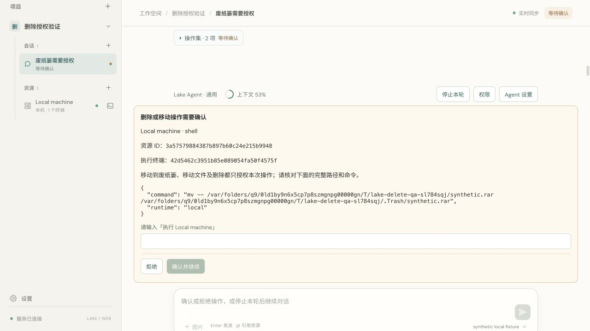

> 删除/移动权限已按用户要求改为遵循 silentCommands，见 [最新验证](lake-silent-delete.md)。以下为原策略记录，目标/终端绑定规则继续适用。

# Destructive operation authorization and terminal target binding

Completed 2026-10-11. The reported trash move was previously classified as an ordinary write, so silentCommands allowed it. Destructive operations now retain single-operation target confirmation regardless of silentCommands/silentWriteFiles. The classifier covers mv (including ordinary moves that may overwrite), rm/rmdir/unlink/srm, trash helpers and gio trash. Arbitrary osascript execution is also in the interpreter/wrapper category requiring target confirmation. The builtin file delete tool follows the same deletion approval kind.

Approval cards show the exact resource ID, terminal ID when applicable, and full command/paths. Confirmation buttons stay visible in the scrollable card. Approval fingerprints bind the current terminal context/resource/options; old approvals are single-use and expire on drift.

Terminal resolution uses:

1. An explicitly retained same-resource terminal binding, when ready and Agent-owned.
2. A unique eligible Agent terminal, if no same-resource binding exists.
3. A user selection when several eligible terminals exist. A model-supplied competing terminal ID cannot override the stored binding.

A closed/busy/user-held/reserved binding never falls through to another ready shell. A closed bound terminal is recreated through terminal-creation authorization rather than borrowing another shell. Explicit terminal references and Agent settings can establish/change the binding. Settings and resource menus display short terminal IDs so same-resource terminals are distinguishable.

An unqualified operation with multiple session hosts no longer defaults to the first local resource. A model-proposed resource requires target confirmation, even with automatic terminal creation/silent commands enabled. Rejecting this choice has no terminal or binding effect; accepting stores the confirmed resource/terminal in both Web and Engine state. Stateless host file tools also enforce target disambiguation. Recent model context labels commands/operations with terminal IDs and lists binding/status metadata; the latest successful inspect_host result overrides a preflight snapshot.

Verification:

- Full Go race suite and Go vet passed. Final focused destructive, lifecycle, multi-terminal and multi-resource tests also passed.
- TestTrashMoveAlwaysRequiresSingleOperationApproval verifies actual synthetic file preservation before approval/rejection, explicit target text, actual approved move and replay rejection.
- TestMultiTerminalBindingDoesNotGuessOrSwitch verifies distinct /tmp and / shell working directories, ambiguous unbound rejection, exact binding reuse, competing-ID rejection and closed-binding creation authorization without borrowing the other shell.
- Multi-host tests verify missing-target rejection and a model-proposed target's mandatory approval under silence settings; both rejection/no-effect and acceptance/retained binding are covered.
- The scripted host lifecycle fixture uses a 131072-token window to avoid incidental context compaction from OS output size; dedicated context lifecycle tests still cover compaction separately.
- React build, four timeline regressions, codesign verification and signed no-Node runtime test passed.
- Browser used only a private synthetic resource/file/model fixture. Silence settings were enabled; trash moves displayed target/terminal/command confirmation. Rejecting preserved the source file. Final signed UI displayed both target input and action buttons. No production file deletion/movement or commercial model calls were performed.

