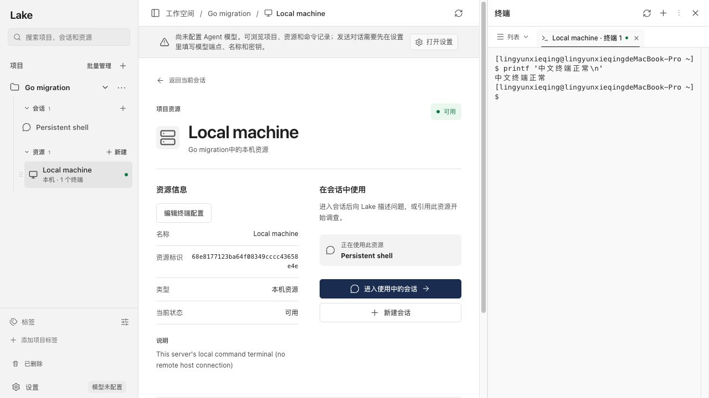

# 终端主目录与乱码修复验证

日期：2026-10-14。

新建、重连的本机及 SSH 终端都执行 `cd -- "$HOME"`；sh 的主目录提示符也显示 `~`。已有终端当前目录不被自动改变。

## 复现与修复

- sh 的旧初始化在安装 PS1 后还执行其他独立行，提前产生 readiness 帧，导致启动输出包含两个提示符。改为单次 eval 初始化，保留 Bash POSIX 模式下隐藏帧的 Readline 宽度标记。
- 隔离 SSH 无 UTF-8 启动环境时，中文输入被 Readline 解释为 Meta 数字参数和快捷键，实际命令变成 `printf '--------\n'`。现在选择已安装的 UTF-8 locale，并显式开启 input-meta/output-meta、关闭 convert-meta。
- 长初始化直接进入 SSH 双层 PTY 时可丢失字节、发生语法错误；reader 启动前写入还可能因回显填满缓冲区而阻塞。完整脚本改走进程环境/SSH 命令通道，清理初始化变量后只在 PTY 触发短 eval；reader 在发送前启动，写入不持有终端锁。
- 中文或 Emoji 分成多个 PTY 读取块时，未经缓冲的残缺字符落库并编码 JSON 会被替换；现在 receive 缓冲最多三个残缺 UTF-8 字节，再交给 hooks、屏幕与输出。
- 真实浏览器首次将 100 列 PTY 放入 400px 窄面板时，长提示符重新换行可留下重复行。对尚未收到实际输入且支持重绘的 Shell，调整尺寸后发送 Ctrl-L 重绘初始提示符；sh 通过受限 9005 能力帧声明 Bash Readline。首次输入/执行命令后永久关闭此启动重绘，保持历史与输入。

## 验证

- `go test -race ./internal/web ./internal/ai -timeout=180s`：通过（web 98.826s，ai 23.844s）。
- 初次宽度重绘修改后，相关交互、hooks、SSH、UTF-8、人工接管和 managed 终端竞态回归通过（12.321s）。
- 新增保留历史与部分输入的缩放测试，以及 SSH 中文输入中途缩放测试通过（9.277s）。
- sh/Bash/Zsh/Fish 本机终端启动仅一个 `~` 提示符；isolated sshd 的 sh/Bash 主目录、缩放和中文输入均通过。SSH 使用临时生成密钥，不接触真实主机或私钥。
- 中文、Emoji、CSI 和 OSC 逐字节传输并每字节落库，输出始终为有效 UTF-8，目录观察 `/tmp/中文` 正确。
- 真实浏览器 fixture 通过（128.03s）：窄面板启动无重复提示符；输入 `printf '中文终端正常\n'`，实际显示“中文终端正常”。截图见下；临时浏览器和服务已关闭。
- `scripts/build_lake_desktop.sh`：签名 App/ZIP/DMG 构建通过。`codesign --verify --strict bin/lake` 及 App 的 deep/strict 校验通过。未安装覆盖 Applications 中的运行版本；未在 Windows 真机执行验证。
- TypeScript 与 Vite 构建、`git diff --check` 通过；保留工作区已有改动。

安装构建好的应用后重新打开终端即可使用新初始化。目标未安装任何 UTF-8 locale 时不会虚构 locale；八位输入仍启用。
