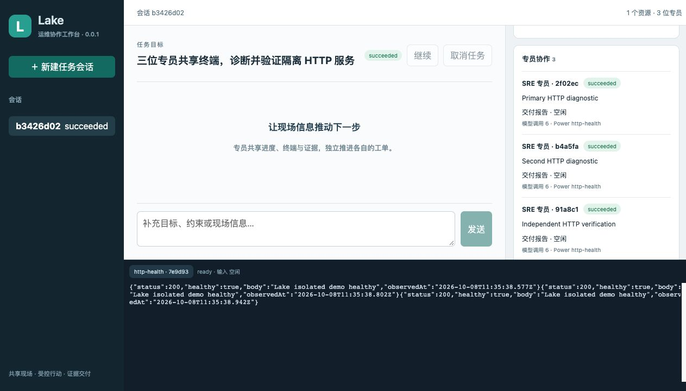

# Lake TS Agent v0.0.1 验证记录

历史验收材料：对应 TypeScript 运行时已退役，源码与旧操作指南于 2026-10-20 移除。以下仅记录当时的验证，不构成当前运行入口；当前架构见 [Go ADK 说明](../experiments/adk-runtime.md)。

日期：2026-10-08。分支：`codex/lake-ts-agent-v0.0.1`。发布门禁通过的本地候选版本，未推送；外部 provider 和生产环境未执行验收。

Agent 循环、历史、上下文、预算、专员工单、共享终端和持久运维执行为本分支新实现。运行时不导入旧 Lake/ZCode/Tianshu Agent 内核。

## 环境与分发

- macOS arm64，Apple M5，10 CPU，24 GiB；Node 24.14.0（官方归档 SHA256 已核对），pnpm 10.33.4。
- Docker Desktop 29.1.5；真实 PostgreSQL 16，kubectl 1.34.1 调用受控 API 夹具；Linux/systemd 目标为虚拟化内一次性 PID 1 systemd 容器。
- macOS launcher、Node、fs-ext 原生模块均使用 `Lake Local Development Code Signing`，逐一验签。入口只由 `scripts/build_lake.sh` 构建。
- 当前 macOS runtime 摘要：`90390c2f9663b275b301717b3c1bd18040ac23d3b0ff36645619581b5f3d9a8f`。
- Linux amd64 在 Apple Silicon 的 amd64 仿真容器编译 Node 目标的核心和原生依赖；复用可移植的完整 Vite JS/CSS 构建结果。仿真中直接 Vite 构建曾因 esbuild 崩溃失败，此路径已明确记录。
- Linux runtime 摘要：`0d0a3039cd1516462d00d48cb96210e83d0be7a1470fe39caecd7de697603406`；归档为 `bin/lake-agent-0.0.1-linux-x64.tar.gz`。
- 两个平台均将分发复制到无源码目录，在仅系统工具 PATH 下启动 CLI、唯一 daemon、API 和 Web，加载内置技能与 fs-ext 通过。
- pnpm 锁文件 SHA256：`6912b7d2f0b537bf23c949bec28179f258fc427e0b3ff51de72ed70b317518bf`。

## 自动验收

| 门禁 | 结果 | 实际覆盖 |
|---|---|---|
| 严格类型与模块边界 | 通过 | 核心/UI typecheck，纯 domain、禁止旧 Agent/框架导入；越层依赖曾被检查拦截并修正 |
| 单元测试 | 5/5 | 领域输入、模型配置、六技能快照、关键状态边、成功必须有证据 |
| 集成测试 | 44/44 | SQLite FK/CAS/事务回滚/WAL 备份；进程锁竞争与 SIGKILL 释放；事件 cursor/重复/缺口；预算共享、价格来源、上下文压缩/恢复、模型重试/取消/半流 |
| 运维与权限集成 | 包含于 44 项 | 真 SSH exec/PTY/指纹，真实 PG 固定只读查询，真实 kubectl/API；授权撤销、审批行动 ID 单次绑定、终端多读单写、人工租约、接替步骤、凭据与跨块 PEM 脱敏、只读容器快照 |
| 业务验收 | 9/9 | Linux 服务恢复、配置替换、备份权限、健康失败回滚、外部漂移拒绝；三专员共用终端/进度；三个 SIGKILL 点；CLI/API ID 与等待退出码一致；签名入口 |
| 独立分发 | 通过 | macOS/Linux 运行时、原生模块、API/Web 在源码目录外启动 |

TEST-001～009 的证据对应 contracts/state-machines/daemon-lock/storage/event-replay/credentials/artifacts/budgets；TEST-010～018 对应 model-protocol、agent-loop、runtime-recovery、runtime-guards、context-compaction、skills、specialist-scheduler/inbox/cancellation；TEST-019～035 对应 authorization、execution-sessions、terminal-concurrency/redaction、handoff、workspace、SSH/K8s/PG/HTTP、approval/action-runner、verification/business-proof/delivery/service-context；TEST-036～040、042～043 对应 acceptance 套件与 verify-release。部分行为规格合并到同一测试文件，不按文件数量伪造覆盖。

真实协议使用合成凭据和固定 HTTP 模型，未读取用户模型 key、SSH 私钥、Keychain 或生产数据库。未知写效果核对前不重派；回滚成功仍保持原变更失败。初次核心验收的外部模型 smoke 为 `not_run`；随后 CLI 增量的真实 DS 验证见文末。其他兼容 provider 不据此推定已验证。

## 浏览器人工验收（TEST-041）

使用 Codex In-app Browser，2026-10-08，真实 localhost 工作台和隔离 Linux 目标：

1. 从空界面选择环境、资源和配置变更类型，新建会话；专员使用真实 SSH/SFTP 生成变更。
2. 查看冻结目标、旧指纹、新配置内容与摘要后审批；等待 HTTP 连续成功，步骤和报告完成。
3. 接管 SSH PTY，发送 `printf` 测试标记；输出写入共享历史并显示。确认停止后交还，持有者清空，epoch 更新。
4. 刷新通过 HttpOnly cookie 重连，保留任务、报告、终端历史；新页面不会自动取得旧输入租约。
5. 主会话追加约束并广播，恢复后由三位专员完成共享步骤；另一个浏览器读者观察相同会话与输出。
6. 最新源码的无凭据 HTTP 演示再次显示三位专员、一个会话终端、三个已验证步骤。截图已留存。

## 性能

macOS 实测 600.3 秒、2000 个业务事件、10 MiB 终端输出、3 active specialists/2 model requests；1000 个快照与1000 个活动样本：snapshot p95 3.20 ms、活动更新 p95 240 ms、峰值 RSS 201.64 MiB。测试是本地投影负载，不把外部模型延迟、生产服务容量或数据库大规模历史算作已验证。

4 CPU/8 GiB Linux amd64 仿真基准完成 600.3 秒，2000 个业务事件、10 MiB 输出、1000 个快照与1000 个活动样本；snapshot p95 21.78 ms、活动更新 p95 260 ms、峰值 RSS 377.54 MiB。CPU 配额为 `400000/100000`，内存上限 `8589934592` 字节。RSS 使用 `/proc/self/status` 的 VmRSS；仿真中 Node 返回 0 的旧测量已作废，收集脚本拒绝零/不可用值。所有性能阈值通过。

## 明确边界

首版 K8s、PostgreSQL 只读；自动变更仅登记的 Linux 配置/systemd 模板和受控本地 patch。专用 VM 断电、生产宿主机、真实 K8s 集群、跨主机发布和数据库写未验收；远端模型仅文末列出的两个 DS 模型通过兼容测试。没有任意插件宿主、桌面安装包或定时自治。未知输出的任意恶意编码不是完整信息流隔离保证。

原有插件未跟踪目录、旧 Electron 客户端和用户旧数据未改写或自动迁移。正式工作与凭据需要按运行说明显式配置。

## CLI 与 DS 增量验收（2026-10-08）

对应 [实施计划](../../plan/feature-codex-style-cli-1.md) 和 [CLI 对照](../lake-cli-compatibility.md)。此增量以当前 macOS 签名入口验收；上述 Linux 分发和性能数据属于初次核心验收，不作为此增量的重新测量。

- `pnpm --dir agent check`：TypeScript、UI 类型和模块边界通过。
- 单元 7/7、集成 48/48、验收 12/12；Go launcher 编译检查通过。
- 入口测试覆盖裸 prompt、stdin、exec/resume/fork、-m/-c/-p/-C/--add-dir、JSONL、最终输出文件、旧 run 单 JSON，以及帮助不启动 daemon。
- 策略测试覆盖只读阻断已授权 patch、本地 never 精确绑定审批、作用域及模型覆盖隔离、fork 不重放行动、空闲模型切换保持原策略；显式运维范围保留原授权与人工审批行为。
- CLI SIGTERM 测试验证模型请求中取消落盘；修复迟到模型结果将 cancelled 任务重新写为 waiting 的竞态。
- 签名 `bin/lake` 在真实 PTY 中完成裸命令目标输入、模型正文与进度输出、`/model` 和 `/quit`。
- 通过 `scripts/build_lake.sh` 构建并校验独立分发，runtime digest：`088fdeecd86ebf5381c9d822a9354414d48ecf54b4088e8e081cc13fcebf6757`。
- 用户授权后接入原有 DS 私有凭据；Pro/Flash 各完成真实流式两轮 mock echo 工具往返，reasoning_content 回填和 usage 均通过。只发送公开测试文字与虚构工具结果，未访问生产资源。API key 未进入 argv、输出或仓库；无 Keychain 调用。
- `bin/lake models` 确认默认 `ds` / `deepseek-v4-pro`，以及 `ds-flash` / `deepseek-flash`；均为 1M window / 8192 output。旧 v2 配置与旧凭据保留。

## 本机查询与空转修复（2026-10-09）

用户指出 CLI 慢，原会话约 139.9 秒、14次模型调用、零行动/终端。主会话误把服务器状态改成项目目录调查；专员没有 Power 清单，猜测 shell/filesystem/read-only/ls 等不存在 ID，且 profileId 混用了技能名。最终 no_progress 等待。

修复包括：准确 Powers/profiles 上下文与枚举、sre-general 显式 ID 回退、匹配工单资源的能力初始化、主会话只读工具、固定本机状态探针、目标澄清工具及 CLI 模型活动时间。变更工具仍限专员，执行网关授权与证据门保留。

- 单元 7/7、集成 51/51、业务验收 13/13；TS/UI 类型和模块边界检查通过。
- 固定探针真实数值与来源、撤权拒绝、两轮 Agent 无 spawn 交付、单轮请求输入、CLI零模型检查均通过。
- 同一 deepseek-v4-pro/high 真模型，本机明确目标 4.189秒、2次调用、1次成功 system.status 行动、1条来源观察、0专员，succeeded。
- 原模糊目标“查看服务器的状态”：8.724秒、1次调用，waiting_user_input；0行动/专员，没有虚构远端检查。
- 签名 bin/lake status --json 实测：冷启动含启动daemon 2.785秒（检查186ms）；后台就绪1.263秒（检查166ms）；均零模型调用。启动开销和检查开销分别记录，以上是单次本机测量，不承诺每次同样延迟。
- 规定脚本签名构建通过，runtime digest：d8ab8e7ef157e0b88d6abdb79711677570b37c3574f19ec475e46f2b1faa15b7。已确认当前后台无在途模型/专员/动作后重启加载，旧会话保留。

## 终端聊天闭环修复（2026-10-09）

截图中的 fcdf4383-eb86-5a08-8a2e-705639b8abc4 实际两轮成功：第一次读本机状态，第二次 task.deliver，两个响应正文都为空。旧交互界面只输出 model.delta，没有读取交付报告；旧后台连接失效后每250ms打印一次通用错误。

- 主会话的 task.deliver.summary 与证据报告一起保存；交互、exec 和输出文件优先展示交付摘要。旧报告回退为可读的真实测量结果，早期进度不遮盖答案。
- 输入区、活动与对话记录独立；支持空白启动、中文编辑、多行粘贴、运行时输入、历史、Tab 补全、取消、连续对话、窗口缩放、挂起恢复和退出恢复终端。
- 私有描述符重连；离线错误一次提示并退避。POST 同 requestId 重试测试模拟服务已执行但响应丢失，实际执行一次；取消的请求不自动重试。
- TS/UI 类型与模块边界通过；单元7/7、集成57/57、业务验收13/13，共77项。真实PTY测试覆盖空白启动不创建任务、多行粘贴不提前发送、运行时草稿保留、最终答案、关联任务、取消、缩放与挂起恢复；离线4.2秒仅一条错误提示，恢复后保留输入。
- 真实签名 CLI + 已配置 DS Pro/high：12.754秒、2次模型调用、1次只读行动、0专员，succeeded；709字最终答案确实出现在PTY记录中，Operation failed计数0。这是包含外部模型等待的单次测量，不保证固定延迟。
- 原成功会话的旧报告已验证可读：包含CPU、内存、磁盘和验收状态。后台更新前核对零在途模型、专员和未完成动作；已有记录保留。

- 最终签名CLI与签名后台在隔离home完成两轮真实API/固定模型交付，4次模型调用；上一轮工具交付的结论已进入下一轮上下文。最终分发digest：e2924a38b283ce9174c3e3680414e2510909156c84aeabbd328b4d3f32ab42e2。

对应 [交互实施计划](../../plan/refactor-cli-conversation-1.md)。本次仍只验收macOS增量，没有重新生成Linux分发或重复Linux性能基准。

## 普通聊天单回合修复（2026-10-09）

用户输入“你好”时，旧循环把无工具的完整文字回复当作无进展，连续调用模型五次。现在非空文字回复结束当前回合，空回复立即报告模型协议错误；只有真正完成证据核对的运维任务才进入 succeeded。追问以最新用户输入结束模型上下文，回合结束边界到达的新输入由持久收件箱唤醒。

- TS/UI 类型和模块边界通过；单元 7/7、集成 60/60、业务验收 13/13，共 80 项。真实 PTY 回归覆盖问候一次回复、空闲无重试、同会话追问一次回复，以及生成中和回合结束瞬间到达的输入。
- `scripts/build_lake.sh` 签名构建与独立运行时校验通过；当前 macOS runtime digest：`118f5633be9eb7f0150fccd91a41e562695961375b31ee42be1f5ab8bcfa1a4a`。运行中后台的实际进程命令已核对为这一版本，避免旧交互窗口重启旧后台造成误测；新版客户端通过当前签名 `bin/lake` 重启后台。
- 签名 CLI + 已配置 DS Pro/high 实测：“你好”约 2.490 秒，1 次模型调用；下一句“我应该怎么使用你？请用一句话回答。”约 2.513 秒，再调用 1 次。持久消息共 2 条；空闲观察 1.5 秒无重试，0 行动、0 专员、0 `no_progress`。这是两轮公开文本的单次本机测量，不代表外部模型固定延迟。

对应 [单回合修复计划](../../plan/refactor-agent-turn-1.md)。此增量仅重新构建并验收 macOS 签名入口；上文 Linux 分发和性能数据属于初次验收。
