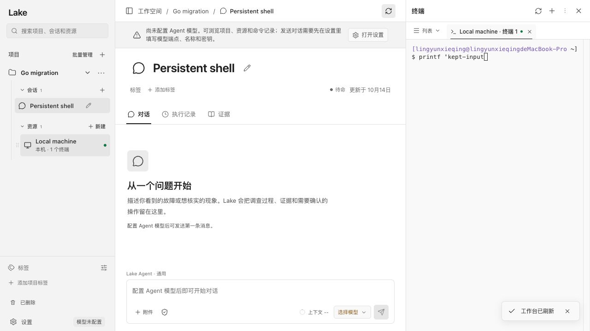

# 工作台刷新按钮反馈

日期：2026-10-14。

旧按钮只刷新 catalog 并重建会话订阅，没有加载、成功或错误反馈。后台数据不变时，点击看起来没有反应。

现在按钮在请求期间显示“正在刷新工作台”、旋转图标并禁用重复点击；项目列表、当前会话及已打开的资源终端数据获取完成后提示“工作台已刷新”。失败明确显示“刷新失败”和原因；认证失效走原登录处理。手动刷新请求总超时为 12 秒，恢复失败订阅；已有正常订阅、终端和草稿保持。

验证：

- TypeScript/Vite 构建通过；106 个现有前端测试通过。
- 隔离浏览器服务对 catalog 延迟 800ms，实测按钮加载及禁用状态、成功提示。
- 服务返回 503 时，显示“刷新失败：隔离测试：刷新服务暂不可用”，按钮恢复可再次点击。
- 打开本机终端并输入未完成命令 `printf 'kept-input`，刷新后输入与原终端保持；服务记录了实际 catalog/snapshot 请求。
- 浏览器 fixture 通过（154.05s），临时页面和服务均已关闭。
- 签名构建并安装 Lake Dev，客户端重启后验证原生标题栏按钮可触发成功提示，后端健康响应 200。

