# 会话问题 #41–#45 验证记录

基线为 `origin/develop` 的 `46a09d743e3adc000e5a0ab1b274a67f66bf5443`，包含 P4 策略学习合并。后端修复提交为 `135b0f66cdd21252eb4f86a9d87a03a37a9d92a5`；之后仅补充前端的结束展示与验证材料。最终测试 head SHA 记录在本次 PR 的验证表中。

## 修复边界

- #41：把正文中的 `§0`、`§5.4` 等章节简写显示为“第 0 节”“第 5.4 节”，覆盖紧邻中文的引用；仅处理 Markdown 正文 AST，代码、链接、转义、用户消息和原始记录保留。
- #42：保留未知变更的防重复派发约束和现有独立只读通道。会话菜单 → 执行记录 → 待核实操作，按需打开原记录；停止当前运行后，由用户选择实际结果并填写依据。复用原有人工核实接口与审计，不自动重试、不猜测结果、不放宽命令分类。
- #43：工作台内按会话保存未发送的文字、原子引用、图片、文件附件及忽略项目记忆选项。发送失败不清空；成功响应只清除原会话所提交的版本，保留其他会话及后续编辑。草稿不持久化，页面刷新或关闭后不保证恢复。
- #44：问答及工具审批显式发布等待/恢复状态；确认结束后及时恢复调查中，有其他待确认项时继续等待。事件载荷传递状态，避免在持有引擎锁的通知回调里反查 Snapshot。
- #45：普通工具会话成功结束且已有真实最终回复时，将工具前的过程播报收进执行详情。原节点以高度和透明度过渡收拢，最终回复保留原节点，取消对应间距以免残留空白。没有最终回复、失败、停止及 SRE 独立角色报告不折叠；不另发总结请求或拼造结论。

## 自动检查

| 检查 | 结果 |
| --- | --- |
| `go test -race -p 1 ./internal/ai ./internal/web` | 两包通过，包含新输入状态事件、问题恢复、并行/连续审批、未知变更只读通道与核实后不可重放回归 |
| `npm --prefix web-agent run test:frontend` | 合并 P5 后 366 项通过（包含资源执行树与中文等级新增回归） |
| `npm --prefix web-agent run build:web` | 类型检查与生产构建通过；存在已有的大分块提示 |
| `python3 scripts/check_adk_runtime_boundary.py` | 通过 |
| `git diff --check` | 通过 |

首次并发运行两个 Go 包时，现有 `TestNetworkQueryRunsWithoutRepeatApproval` 在等待本机网络诊断完成时超时；单项重跑通过，随后 Web 整包重跑通过，再同步最新 develop 后串行执行两个整包亦通过。未调整该测试的等待期限或执行策略来绕过失败。

## 隔离界面验收

通过 `test/fixtures/session-issues.html` 加载真实 App，API 全部由内存中的虚构数据提供，无真实模型、资源或 Dev 后端请求。

1. 在会话 A 输入文字和资源引用，切到会话 B 输入独立草稿，再切回，文字与引用均正确恢复。
2. 延迟 A 的发送响应，切到 B，再释放响应：只清空 A 已提交版本，B 草稿保留。模拟 503 发送失败：文字保留并显示可重试错误。
3. 检查章节简写在正文中本地化，内联代码仍为原文。
4. 人工核实默认折叠；未选结果或未填依据时不能提交。选择“确认未执行”并填写依据后，仅发送对应会话、操作 ID、结果和依据，成功刷新后该记录退出待核实列表。
5. 浅色、深色及 390px 窄窗口可读，窄窗口文档宽度为 390px，无横向溢出。
6. `?final-summary&live-context` 从调查中切到回复结束：两条过程播报收拢，最终节点身份保持不变（`sameFinalNode: true`），过渡为 360ms / 220ms。展开执行过程与“过程播报”可查看原文，最终回复不重建。减少动态效果的 CSS 回退取消过渡。

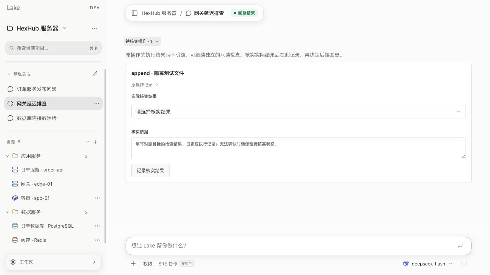

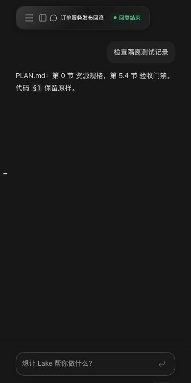

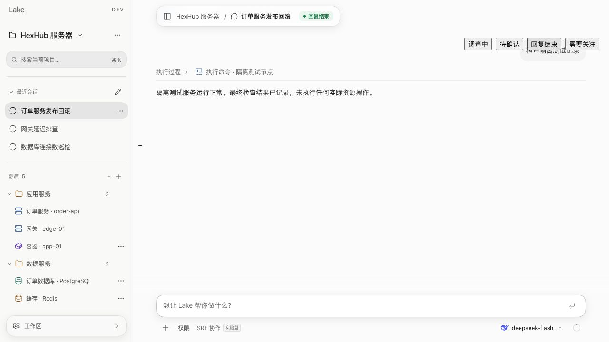

## 补充：回复末尾的小动画

按后续界面反馈，在当前回复末尾加入 Lake 蓝色八向光芒：20px 图形，22px 承载区域，8.4 秒旋转与 2.1 秒轻呼吸。复用当前轮的真实运行/等待判断，只展示一个视觉标记，不增加第二个状态播报。待确认、角色问题、停止、失败、断线和已完成的轮次不继续展示；离场暂停旋转并在 180ms 内淡出收拢。减少动态效果的 CSS 规则关闭旋转、呼吸和过渡。

补充的前端回归覆盖当前轮唯一标记、首包等待、已保存的完成状态优先于延迟快照、历史轮次、待确认/角色问题及执行记录/证据视图。全部 362 项通过，类型检查与生产构建通过。此补充不改 Go 后端，沿用前述完整后端回归结果。

隔离夹具中实际读到旋转矩阵随时间变化；待确认和回复结束后标记数量均为 0。浅色与深色使用主题蓝色，在 390px 窄窗口无横向溢出。没有安装或重启 Lake Dev。

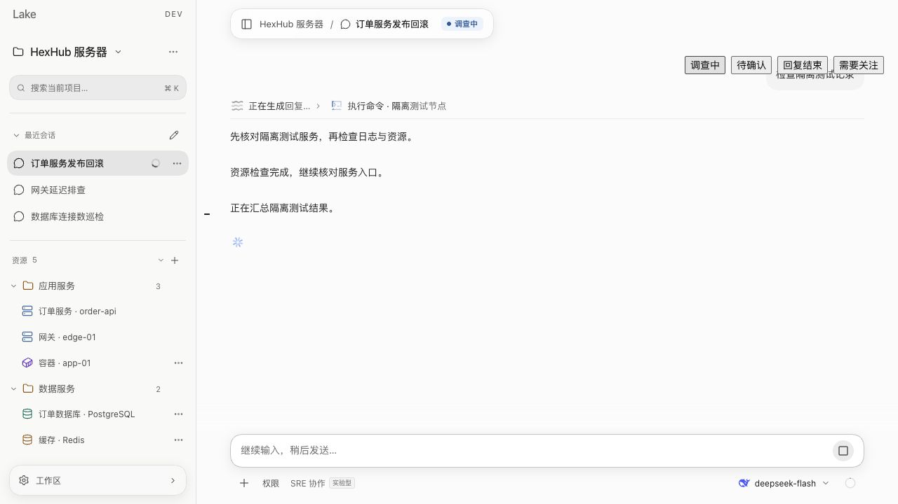

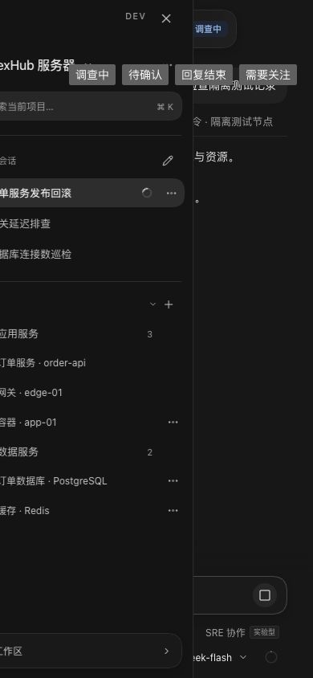

## 未验证项与回退

用户正在 Lake Dev 执行任务，并明确要求不重启。本次未安装、重启或操作运行中的 Lake Dev，未改动其 Home、凭据或任务。原生 WKWebView 的最终集成验收留待任务结束后进行，不将隔离浏览器验证冒充原生验收。

无数据库迁移、权限扩展或操作重放策略变更。通过独立分支向 develop 提交 PR；回退使用同样流程 revert 该 PR，保留原始对话和操作审计。

## 补充：资源执行树与模型级别

运行中的执行区域默认展开；同资源的命令、文件、SQL 等操作按真实 ID 或无歧义的名称归为唯一二级行，仅显示资源名称与类型。资源及三级操作默认折叠，参数和结果按需挂载；新操作追加时保持已展开行和结果原节点。会话结束后 220ms 淡出、360ms 高度及间距收起；保留耗时入口、失败/未知等计数以及原审批控件，点击耗时仍可回看。

模型入口在名称后显示当前会话、当前模型实际生效的中文思考等级。服务端默认级别参与展示；切模型或供应商丢弃不匹配的显示，等级保存完成后重新读取，原生面板与 Web 共用保存回调。无能力、加载失败、未知或非支持级别不造假。

- 前端 364 项回归和类型检查、生产构建通过；纯前端改动未重复运行 Go 整包回归。
- `execution-tree.html` 使用虚构的服务器与数据库验收默认展开、二级唯一、三级折叠、按需挂载、追加操作保持开合状态、结束收起到 0px 与重新打开历史；不连接任何后端或实际资源。
- `session-issues.html?slow-save` 验收 DeepSeek Flash 默认“高”，保存“最高”后入口更新；切到仅支持 low/high 的 Pro 后入口显示其实际默认“高”，不沿用 Flash 的“最高”。

后续 Dev 安装及实际运行 SHA 记录在 PR 验证表；此前“不重启”记录仅描述对应旧轮次的操作范围。

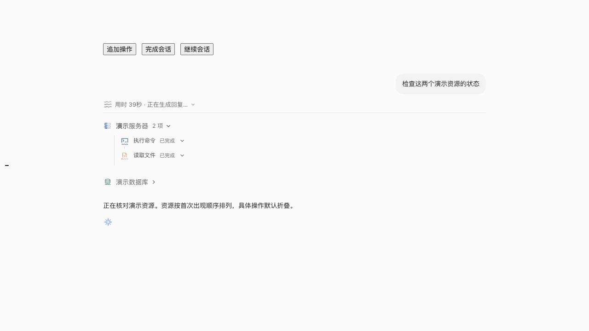

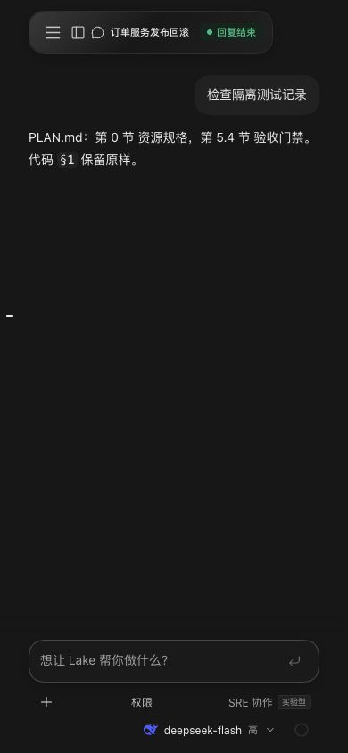

同步 develop 的 P5 合并 `1d2df2ce` 后，前端实际测试提交为 `b7d026460394c6165c8f778c04971568935154fd`：366 项通过，生产构建与 ADK 边界通过；新增同步内容使用既有 develop 验证记录，并补跑本分支人工输入、连续/并行确认和策略实验的 race 回归。合并前原有完整两包结果仅适用于前述历史提交，不冒充新 head 的完整后端回归。

## 补充：阶段结果随资源原位更新

阶段正文归到对应资源标题下面，原始操作折叠时仍显示。每个资源使用固定最新结果槽，后续阶段替换预览；早期阶段收进“此前进展”，只在展开后挂载。原文及原始执行记录保留。以明确资源 ID、精确资源名或唯一前置资源操作范围归属；跨资源和不明范围保留为“整体进展”，不猜测 IP 缩写。真实最终总结回到正文；执行区域下方添加 1px 主题分隔线，完成时随区域收起为 0px。

前端 372 项回归通过，覆盖单资源覆盖、多资源隔离、精确名称和 ID、IP 前缀不误匹配、通用操作切断旧范围、最终总结和失败/SRE 边界、折叠操作下最新结果可见及历史按需挂载。隔离夹具验证追加操作只更新服务器结果，数据库结果保持、阶段历史可回看、完成后只展示最终总结；不连接真实模型或资源。用户截图中的 Dev 仍有任务运行，此轮不安装或重启该客户端。

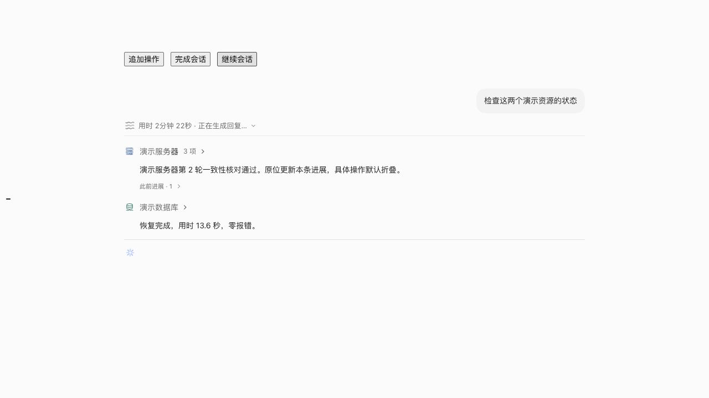

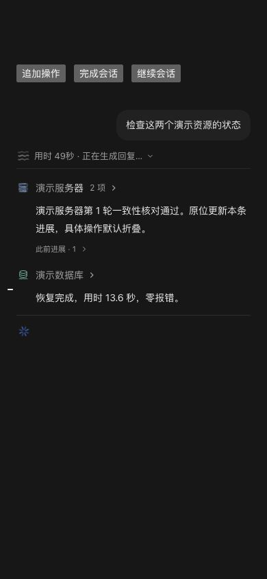

## 补充：结束后的耗时栏与分隔线间距

结束后的耗时栏不再附带“执行命令 · 资源”等最新操作说明或图标，保留耗时、异常计数与历史入口。覆盖成功、失败、取消、中断及已结束但操作卡仍为 running 的延迟快照。分隔线使用与顶部一致的 1px `--border`，对齐正文，线上下各 14px，作为执行区域的内部内容参与淡出与收高，无残留线或间距。本轮不重启运行中的 Dev。

本轮 372 项前端回归与生产构建通过。隔离夹具验收运行折叠时保留最新操作、完成后 latest caption 数量为 0、执行区域高度为 0px；线上下的 12px 行间距与 2px 内距组合为各 14px。无后端改动，未重复运行 Go 整包回归。

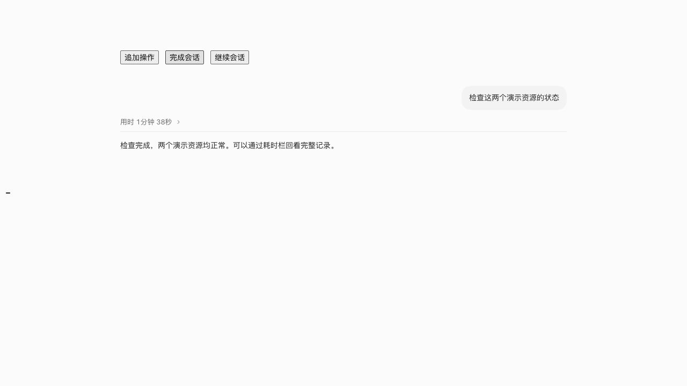

## 补充：移除整体进展卡片，联合阶段归属到资源

不再在执行区域内显示“整体进展”卡片。同一批实际操作涉及多个资源时，阶段结果关联到整批相关资源，每个资源下仍只保留最新结果及折叠历史。明确 ID/名称继续优先；没有归属的整体进度以无标题单条正文在分隔线下方更新，不堆叠旧进度。前期整体播报的原节点保留，结束后可从过程记录回看；真实最终总结保持独立。没有依据 IP 末段猜测唯一目标。

374 项前端回归和类型/生产构建通过，新增源库/目标端批次结果不落入兜底卡片、整体进度位置与唯一槽位回归。实际客户端不为本次变更重启，安装版本和待重启情况记录在 PR 中。

隔离夹具 `?joint-stages` 中，两资源阶段结果均更新为第 2 次检查，分隔线下本轮进度槽数量为 1，没有“整体进展”标题；390px 深色页面无横向溢出。完成后资源区与本轮进度收起，仅保留最终总结。

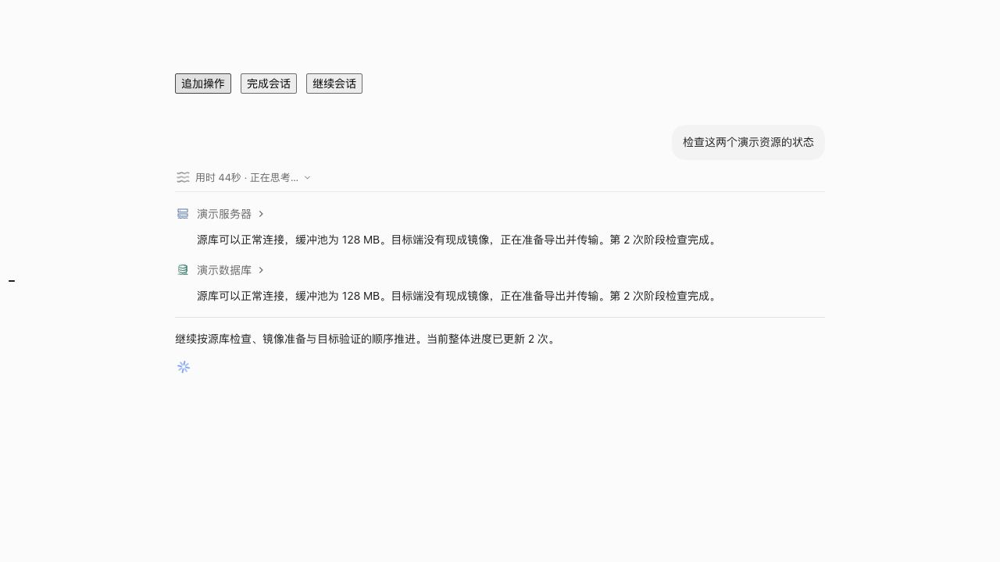

## 补充：窗口缩放时加载标记布局

加载标记使用不可压缩的独立行，12px 间距位于内部裁切层。退场保留这一内部位置，只淡出收高，取消外边距从 0 动画到 -12px 的向上拉动。SVG 使用块布局消除行内基线空隙；展开正文保留实际换行后的固有高度，防止 flex 压缩使文字溢出到图标行。

374 项前端回归与类型/生产构建通过。虚构 UI 夹具 `?joint-stages&resize-proof` 记录真实 DOM 几何，不修改或纠正待测布局；390/480/920px 宽度切换及完成退场共 130 个采样帧，其中含 8 个有可见文字和可见标记的退场帧，图标边界与实际可见正文边界的最小间隔约 8.85px（SVG 旋转边界计入），无重叠；完成后标记数为 0。原文收起时按裁切后的可见边界测量，同时保留未裁切几何供检查。原生窗口仍待加载新包后验收，不为本次修复重启用户正在执行任务的 Dev。

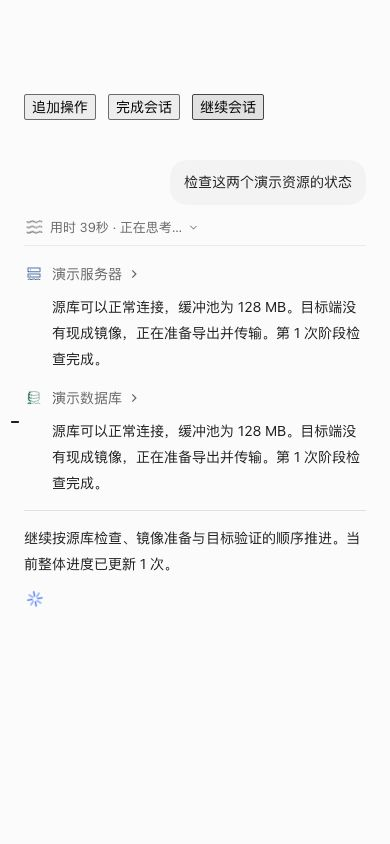

## 补充：底部整体进度随真实执行记录更新

此前底部只取无资源归属播报，资源阶段更新不会触发有效内容变化，因此会停在开头的“先确认当前状态”。现按当前轮每个快照汇总资源数、真实成功操作数、当前运行操作及失败/未知/未执行/后台/停止等事实，并引用最新资源阶段或更新的整体播报；开头的前置说明不能覆盖新事实。联合阶段及重复操作依照原始 ID 去重，数字不冒充完整计划或百分比；复用已有状态与阶段文本，不额外请求模型，不拼造业务完成结论。

379 项前端回归与生产构建通过。新增回归覆盖没有新正文时操作 running→completed 计数更新、资源阶段更新底部、联合结果去重、待确认/问题与异常状态、普通回答和当前轮隔离。`?live-summary` 虚构夹具在整体播报“先确认当前状态”不再变化时，通过状态/阶段追加依次显示 0→1→2 项已完成、当前动作及导出/恢复阶段；`sameSlot: true`，390px 无溢出，结束后仅保留最终总结。新包安装与原生实际加载情况记录在 PR 验证表，不重启正在运行的任务。

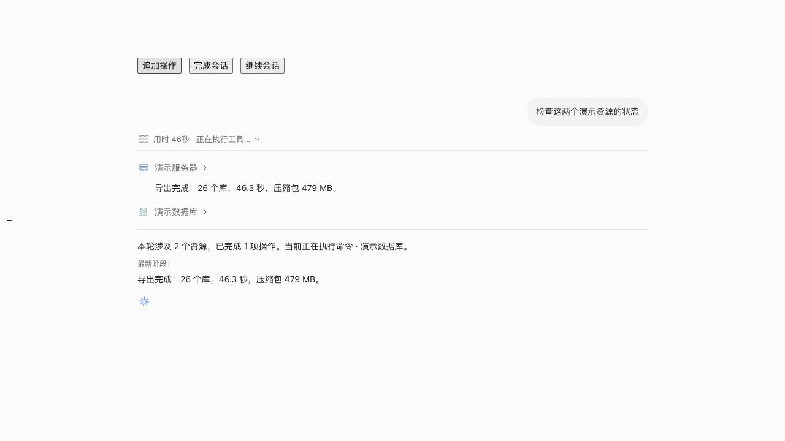

## 修正：整体进度使用综合总结，不重复资源原文

本节取代上一节“计数加最新阶段引用”的展示方案。该方案只是重复资源阶段正文，不符合用户要求，现移除底部资源数/操作数模板、“最新阶段”标签及原文引用。资源区域保留具体结果，分隔线下方只使用一个稳定槽展示一两句综合判断：已确认的结论、当前阶段和实际阻碍。首次生成前显示准确的活动状态；后续生成保留上次总结，不闪空，不因失败重新复制资源段落。

后端从权威当前轮快照中读取已完成的 assistant 阶段正文及操作状态/目标，使用当前配置模型进行单次无工具、无会话副作用的摘要调用；不读思考、原始工具输出或参数，不添加 agent/tool 循环。输入最多最近 16 条（每条最多 600 字），输出请求预算最多 1024 tokens，显示总结不超过 160 字，提示优先 100 字；仅在模型能力支持时为摘要副本选择 none/minimal/low，不改变主任务思考等级。过滤敏感文本，拒绝整段照搬（忽略 Markdown、标点和空白差异）。相同证据复用缓存，单会话至少 8 秒刷新间隔，失败至少 30 秒后重试，全局最多两个并发请求，缓存最多 64 个会话。生成超时 20 秒，旧证据/旧轮次/旧模型的迟到响应丢弃，前端也隔离轮次与请求版本；结束后总结随执行区域收起。

验证：379 项前端测试通过，TypeScript/Vite 生产构建通过（既有大分块提示仍在）；本轮完整 `go test -race -p 1 ./internal/ai ./internal/web` 通过，AI 117.585 秒、Web 306.276 秒。随后对复制检测、失败退避及摘要副本思考等级的小调整补跑 `go test -race ./internal/web -run '^TestProgressSummary'`；包含安全输入边界、复制拒绝、并发合并、过期证据和轮次拒绝、缓存复用、结束不生成及真实 API 非活动轮次拒绝。`go vet ./internal/ai ./internal/web`、ADK 边界和 diff 格式检查通过。

浏览器使用虚构数据和摘要 API 桩验证真实组件：底部从源端检查更新为“源端导出已完成，任务已转入目标端恢复；尚待一致性验证”，再更新为一致性核对，保持 `sameSlot: true`，无阶段原文节点；完成后仅保留最终回答。480px 深色无横向溢出。延迟旧请求 8 秒，先完成新阶段请求，再返回旧请求，页面仍保留新总结。截图仅含虚构资源，不连接真实模型/数据库，不对用户当前任务作实际操作；真实模型生成质量及原生新包加载仍待用户任务结束后验收。安装及签名/运行进程对照见 PR 当前证据。

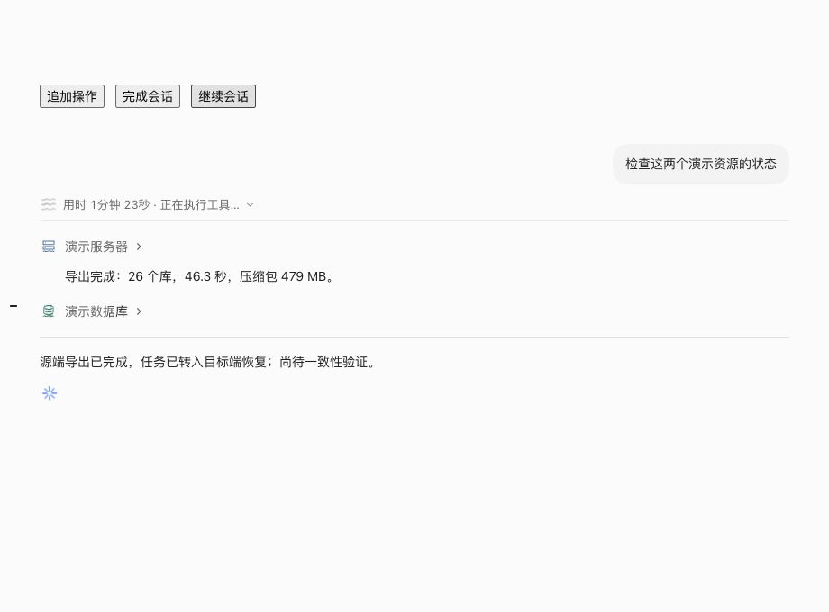

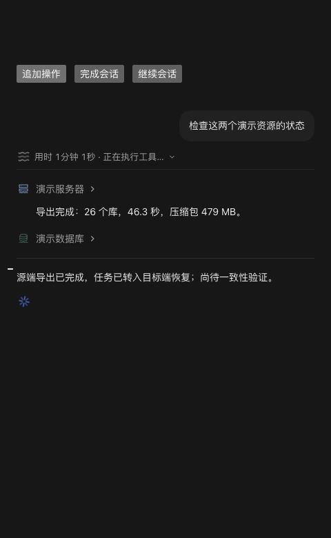

同步 develop P6 `74c242c0` 后，实际测试源码为 `d19f92abe10604a79bdf2421b515dfb9abca5600`：前端 380 项与生产构建通过；`go test -race ./internal/strategy` 通过；`go test -race -p 1 ./internal/strategy ./internal/web -run 'Test.*(ProgressSummary|StrategyOptimization|StrategyExperiment|StrategyLearning)'` 的 Web 相关回归 53.528 秒通过（strategy 包该名称筛选没有用例，故另行整包运行）；`go vet ./internal/ai ./internal/web ./internal/strategy` 与 ADK 边界通过。前述完整 AI/Web 两包结果是同步 P6 前本轮结果，未冒充同步后完整整包回归。此后提交只补充验证记录，应用源码不变。

## 修正：资源阶段唯一归属与跨资源文本去重

用户实际截图仍在两个资源下显示同一段“传完并放好了……”；根因为旧投影把一个多资源操作批次中的整段播报复制给全部参与资源。本节替代先前“联合阶段同时展示于各资源”的方案。现在仅唯一明确资源 ID/名称或唯一资源操作上下文可产生资源预览；联合、歧义或归属冲突的结果只参与现有底部综合总结，不新增整体进展卡片、不猜测源端/目标端归属。资源下保留自己的最新唯一结果。

同时按 NFKC 规范化、忽略空白/反引号/粗体标记后的正文去重，不能只依赖消息 ID。同一资源的重复播报合并为最后一次，不虚增历史条目；不同资源重复同段时撤去资源归属，作为唯一联合证据参与总结，第三次重复也不能恢复任意归属。全部原始消息和证据保留，历史回看不删除数据。

382 项前端测试与 TypeScript/Vite 生产构建通过，既有大分块提示仍在。本轮未改变后端、模型请求、操作或权限，无需重复 Go 回归。新增用例覆盖联合结果不克隆、IP 前缀不误归属、不同消息 ID/Markdown 格式重复、重复回放、第三次播报不恢复冲突归属，以及原始记录保留。虚构真实组件夹具 `?dedup-proof` 故意向两个资源注入同段原文，各资源只展示不同的独有结果；重复段落在资源预览中为零，底部为综合总结。完成后只保留最终回答，480px 深色无横向溢出。未对真实资源发送操作，未重启用户 Dev。

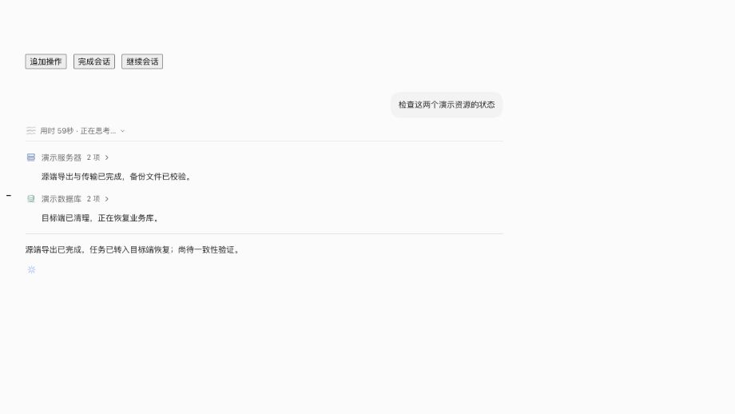

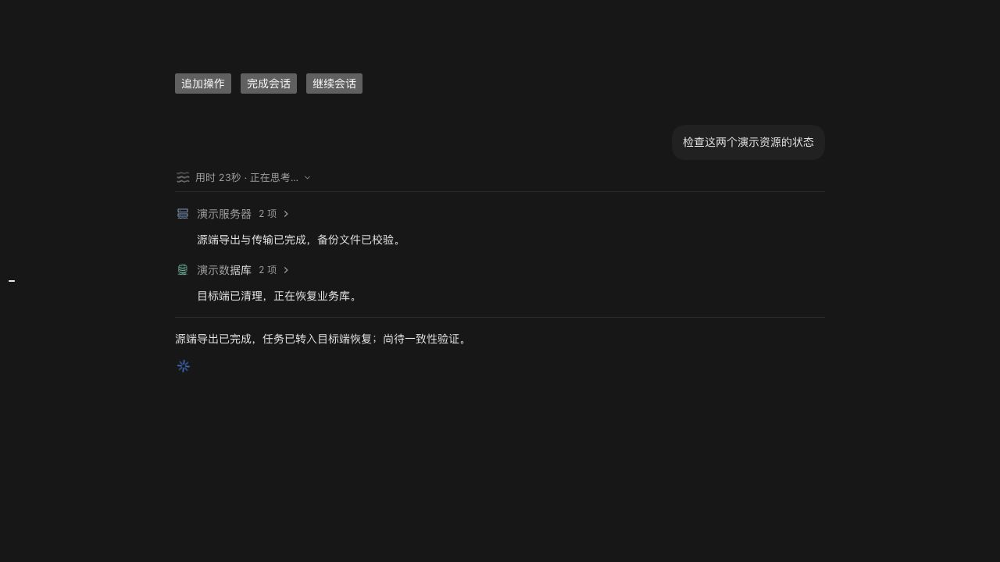
