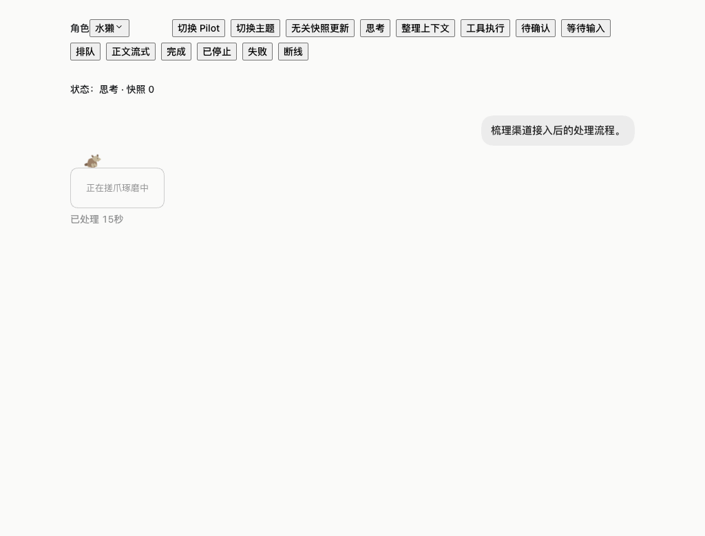
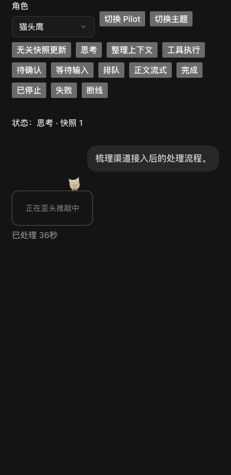
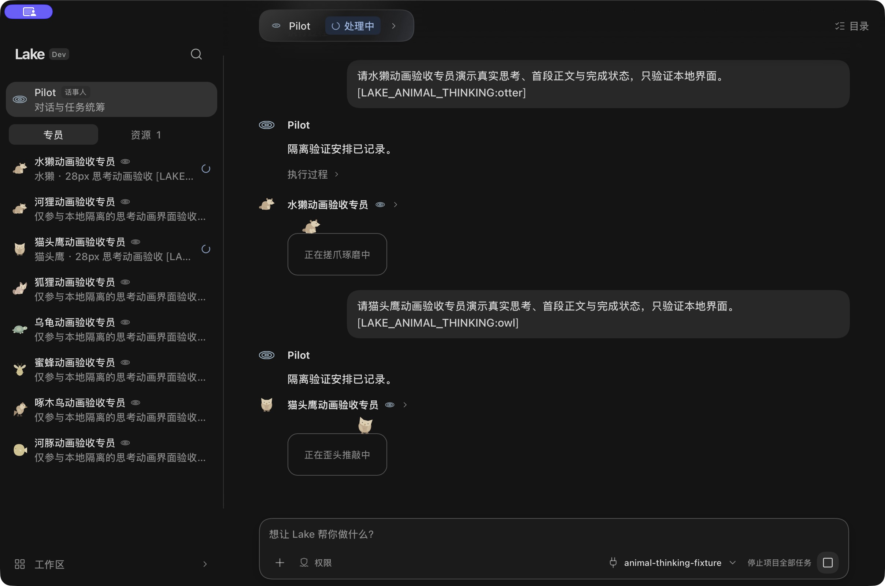
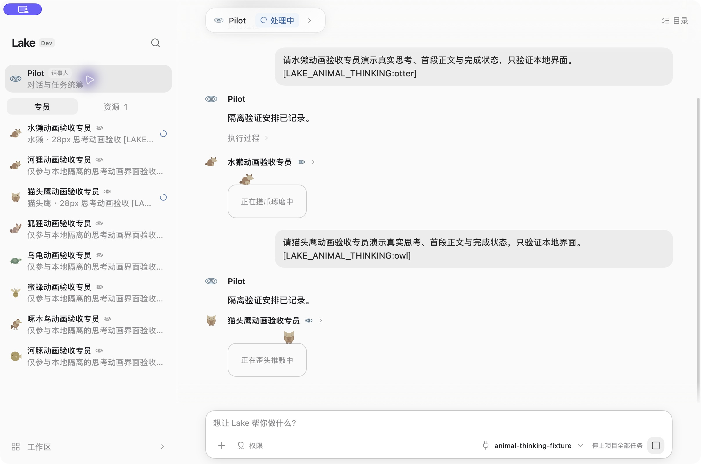

# 28px 角色边框思考验收

日期：2026-11-15。平台：macOS / Apple Silicon。采用用户确认的 Lake 原有角色、28×28px、静态气泡边框方案。

## 来源与隔离

- 功能代码提交：`9d55711e`，从 `origin/develop@dd92cc65` 开始。
- 为保留现有 Dev 渠道功能，验证分支合入 `codex/external-specialist-mcp@64a0187e`；没有直接推送 develop 或 master。
- 已安装并验证的 Dev 构建：`05e01559196722f1e3fc7a6ed5e3dac65a771d59`，`build-origin.json` 的 `dirty=false`、后端 `typescript`。
- 使用 `scripts/build_lake_desktop.sh --dev --install`，后端与应用持久签名验证通过。生产 Lake.app 和 `~/.lake` 未参与本次操作。
- `scripts/verify_animal_thinking_dev.cjs` 使用私有临时 home/data、确定性 loopback 模型及真实 manage_specialist / route_work / work_finish。没有接入业务资源或真实模型供应商；metadata 不含 runtime token。
- 初始仅运行两位专员，遵守每项目 Worker 并发限制；后续角色分批派发。构建后仅验证脚本和验收文档继续完善，产品源码未改变。

## 检查结果

| 检查 | 结果 |
| --- | --- |
| 功能分支前端回归 | `pnpm --dir web-agent test:frontend`：837/837 通过 |
| 与渠道功能集成的前端回归 | 856/856 通过 |
| 类型与前端构建 | `pnpm --dir web-agent check`、`build:web` 通过 |
| Runtime 边界与后端命名 | `check_adk_runtime_boundary.py`、`check_backend_naming.py` 通过 |
| 签名 Dev 构建安装 | 成功；`codesign --verify --deep --strict` 通过 |
| 差异检查 | `git diff --check` 通过 |

新增 17 项回归覆盖完整 100 种 Lake 生态角色目录、明确头像与项目 roleId 身份优先级、接触点、动画暂停/恢复/清理/减少动态，以及回复与 Pilot 实时专员接入。矩阵包含工具、压缩、待确认、待输入、外部等待、排队、断线、历史、预览、正文与终态，并覆盖旧 running 计时/状态不能掩盖等待或停止。

## 真实组件视觉与生命周期

使用 `web-agent/web/test/fixtures/animal-thinking.html` 中的真实 AITranscript / SpecialistAvatarProvider：

- 水獭、河狸、猫头鹰、狐狸、池龟、蜜蜂、啄木鸟、河豚均为 28×28px，文案对应用户确认的八项示例，实际动画处于 running。
- 普通快照更新保留相同 DOM 节点与 Animation 对象，不重启相位。
- 减少动态开启后，该角色所有 WAAPI 动画取消；关闭后恢复。隐藏与 inactive 暂停、角色切换和卸载清理由生命周期回归覆盖。
- 正文出现后思考气泡消失；工具、压缩、等待、排队、断线和终态都不显示动物思考。Pilot 保留原水波反馈。
- 浅色、深色、390px 与 320px 宽度无横向溢出；边框/背景静止，角色接触边框，正文、耗时和详情保持可读。

## 已安装原生 Lake Dev

在已安装 App 的真实 Pilot/Worker 会话中，水獭与猫头鹰分别显示“正在搓爪琢磨中”“正在歪头推敲中”；身份标题保持静止，边框角色活动，未重复出现水波或另一处工作动画。

原生 WebKit 的明暗主题均检查了气泡圆角、角色接触点、边框和文字。专员来源按钮仍可进入对应专员任务，任务详情与完整执行记录可正常打开。

## 范围与限制

- 这是原生 Lake Worker + 本地确定性模型的显示验收；未以真实外部 ACP/MCP 客户端或付费模型完成业务任务。
- 构建输出仍有既有 Vite 大 chunk、Node SQLite 实验性和 Swift build-system 弃用警告，未导致检查失败。
- 日常 develop PR 不自动运行 CI；本地测试与签名 Dev 证据是本次验证依据。
