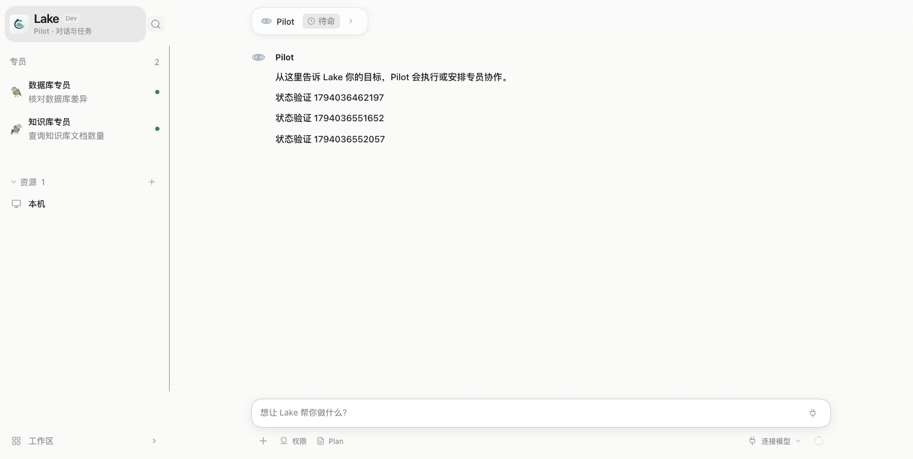
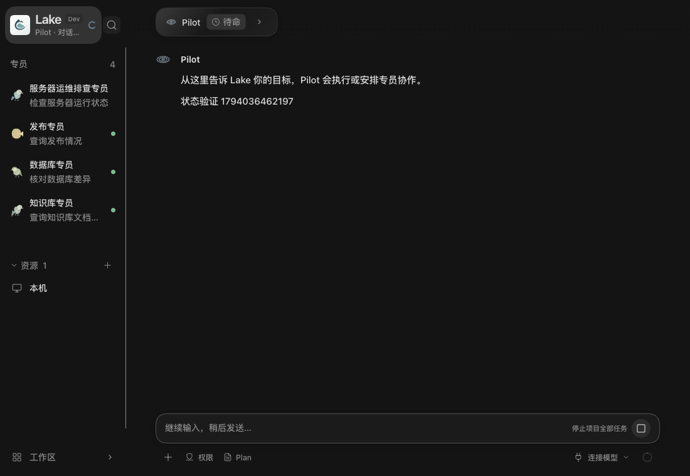

# Lake 品牌与 Pilot 主入口合并

## 当前单行字标

2026-11-07，签名安装的 TypeScript Lake Dev 源码为 `7df1b7db47d8d8966244b31b0cd3aec116a96c46`，构建记录为干净工作区，应用通过 `codesign --verify --deep --strict`。原生浅色与深色均能看到同一行 Lake / Pilot 和 Dev 标记。实测从专员会话打开并关闭搜索后仍在专员页，点击字标回到 Pilot，显示青色下划线。验证后恢复原浅色偏好。

隔离的真实页头组件另外验证了 200px 窄栏、键盘、触摸搜索热区、Windows 的 48px 布局，以及运行、待确认和未读状态的互斥。Windows 布局在浏览器模拟。731/731 项前端测试通过，类型检查、Web 构建、后端命名及 ADK 边界检查通过。

[深色选中态（300px）](brand-pilot-entry/wordmark-dark.png) · [浅色未读态（200px）](brand-pilot-entry/wordmark-light-narrow.png)

## 初始双行入口的验证记录

2026-11-07，macOS / Apple Silicon。测试并签名安装的源码为 `81a14296b03a412568380f0a947f5065c994c9b9`；后续提交只补充文档和验证图片。延续 [PR 199](https://github.com/Clean-Lakes/Lake/pull/199)，本轮未合并。

## 行为

侧栏顶部使用已有 Lake 应用 Logo、品牌名、Dev 标记和“Pilot · 对话与任务”次行，作为当前项目 Pilot 的单一主导航入口；专员列表不再重复 Pilot 行。搜索与移动导航关闭按钮保持同级独立操作，未嵌套在品牌按钮内。

选中、悬停和键盘焦点沿用共享主题与导航曲线。真实运行时显示转圈，等待确认显示提示，空闲且有未读时显示绿点，三者互斥且不改写已读位置。会话暂时切换/连接时主导航保持可用；删除当前专员后回到 Pilot，焦点交还品牌入口。品牌点击不派发任务，不改变草稿或执行权限。

## 检查

- `npm --prefix web-agent run check`、`test:frontend`、`build:web`：通过，**728/728** 前端测试通过。新增 2 项覆盖品牌目的地/唯一按钮与未读/运行/等待优先级；原有角色头像、频道、未读测试跟随入口拆分调整。
- `python3 scripts/check_backend_naming.py`：0 违规；`scripts/check_adk_runtime_boundary.py` 与 `git diff --check` 通过。
- 后端实现自 `9f3073139d55318a53328ff38cd770252f99d5c5` 未改变；本轮未重复执行其 165 项 CJS / 125 项源码回归，不把前端测试当作后端新验收。
- 隔离临时 Home、当前 React 与 TS HTTP 宿主：品牌 Enter 导航至准确 Pilot；搜索保留当前专员；返回专员后未发送草稿仍在；运行与等待时不显示绿点，空闲后可显示未读；删除选中的合成专员后品牌获得焦点。未删除日常专员或调用外部模型/业务服务。
- 浏览器已检查浅色、深色、悬停、选中和实际拖到 **200px** 的侧栏，无横向溢出和重复 Pilot 行。该 QA 任务及临时服务器正常关闭。
- 原生 Lake Dev 已检查点击品牌进入 Pilot、浅/深色绘制、2230×1538 与 1700×1384 物理像素窗口，以及约 299px → 200px 的侧栏拖动。已恢复浅色、原窗口及约 299px 侧栏。Windows 原生未验收，现有 48px 标题栏规则保留。

下面为隔离 QA 界面截图；合成专员数量属于可删除的测试数据，非用户日常目录。

## 签名与保留

Dev 空闲后通过原生“停止内核并退出”停止；私有备份完整 Dev Home、应用及当前两个 SQLite 一致副本。`scripts/build_lake_desktop.sh --dev --ts-candidate --install` 成功，安装位置为 `~/Applications/Lake Dev.app`，原生启动使用独立 `~/.lake-dev`。

包内源码为上述提交，`dirty=false`，运行时 `typescript`；后端 SHA-256 为 `ca8b767f5aec2ed2b13508b2f2df34c9140883562e52fac13895f79a653cbc6e`，实际摘要一致，`codesign --verify --deep --strict` 通过。安装启动后、交互检查前，2949 条原 records 逐项摘要一致，无丢失、改写或新增。

回退可恢复安装前私有 Dev 应用；没有数据格式、权限或操作账本迁移。正式版、发布和完整迁移门禁未变。
