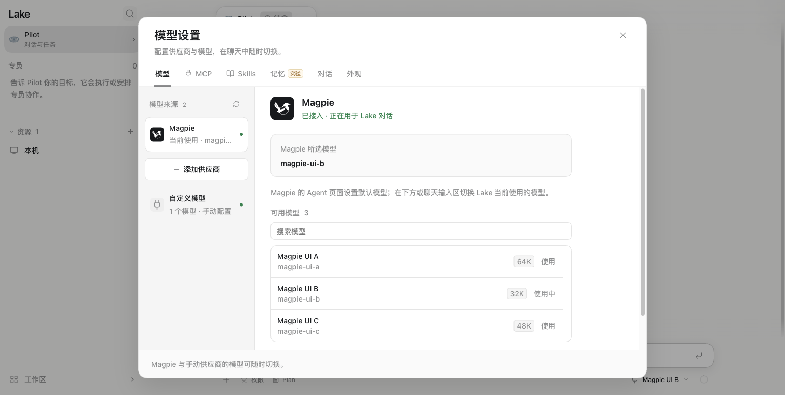
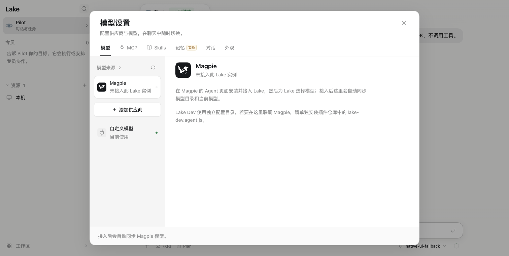

# Magpie 模型来源修复验证

2026-11-07，macOS / Apple Silicon，Node 24.14.0。测试及签名安装的源码提交为 `865c7c0b4cd6fe0b81d7e7ff56885ccfb13b8c56`；后续本记录与计划提交仅增加验证文档。延续 [PR 199](https://github.com/Clean-Lakes/Lake/pull/199)，目标 `develop`，本次未合并。

## 缺陷及修复范围

TS 启动仅导入旧手动供应商目录，没有读取 `secrets/magpie-agent.json`。把实际 `lake-dev.agent.js` 的 `connect()` 输出放入独立 Home 时，修复前模型未配置、发送返回 409、网关请求为零。该插件提供的模型数组字段为 `catalog`。

现在 `magpie.ts` 动态读取显式当前 Home 的配置，提供独立受管理来源，接入现有设置、输入区模型列表、连接测试、SDK 对话和分层记忆模型绑定。保留模型名称、上下文、输出上限、图片输入与明确思考能力。

- 明确选择手动模型后不被插件配置覆盖；选择 Magpie 后允许本地切换目录中的模型。插件默认模型变化会使旧默认下的本地覆盖失效，跟随新默认。
- 断开时回到原有效手动选择，没有手动选择则显示未配置；重连保留来源偏好。旧 `magpie-selection.json` 只读导入一次，之后 TS 选择优先。
- 配置/密钥变化使下一轮重新绑定 SDK；旧提供者快照不能取得新连接的密钥。已运行任务保留原 SDK 快照，不重放历史。
- 插件拥有连接配置和密钥；TS 保存非敏感的选择偏好。启动准备 `0600` 空文件并收紧同一 Home 的已存在普通文件；后续同步拒绝宽权限、符号链接、超限或损坏 JSON 及携带凭据的 URL。配置读取与目录展示不发起模型请求。
- Memory 的提供者屏障同时保留原选择及当前有效来源/连接版本；更改模型不会使原排队整理任务越过旧版本检查。没有改变同意、来源或发布权威。

## 自动回归

| 命令 | 结果 |
| --- | --- |
| `node web-agent/node_modules/typescript/bin/tsc --noEmit -p runtime/typescript/tsconfig.json` | 通过 |
| `node runtime/typescript/build.mjs` | 通过 |
| `node --test runtime/typescript/server.test.cjs runtime/typescript/mysql.test.cjs runtime/typescript/service-resources.test.cjs runtime/typescript/router-context.test.cjs` | 165/165 通过 |
| `web-agent/node_modules/.bin/tsx --test runtime/typescript/*.test.ts` | 123 通过，3 项外部 Claude-Mem 集成未运行，0 失败 |
| `npm --prefix web-agent run check`、`npm --prefix web-agent run test:frontend` | 类型检查及 726/726 通过 |
| `python3 scripts/check_backend_naming.py`、`python3 scripts/check_adk_runtime_boundary.py` | 0 命名违规；边界检查通过 |
| `git diff --check` | 通过 |
| `python3 scripts/check_typescript_parity.py` | 预期退出 1，完整切换仍为 BLOCKED |

7 项新增集成测试覆盖：双来源选择/重启/默认更新/断开恢复；真实 SDK 的模型、鉴权、思考与输出参数及密钥轮换；只有 Magpie 时调用及断开；不安全配置和受管理来源写入拒绝；旧本地选择只导入一次；首次旧 Dev 来源及原手动回退；跨流片段密钥在公共投影与原生 SQLite/WAL 前脱敏。

回归中同步修正了两项原测试假设：`secrets` 目录允许已存在；图片读取测试等待任务完成，避免在刚创建工具卡片时提前断言。Memory 的原始选择变更检查保留在产品代码中，没有删除或放宽该测试。

## 实际插件输出及界面验证

使用本机已安装的 `lake-dev.agent.js` 导出，调用真实 `connect({gateway,model,models})` 生成配置；显式临时私有 Home、随机 loopback 端口、当前 React 产物及本地合成 OpenAI 网关，不写日常 Dev 或正式版的连接配置。

1. 设置页显示 Magpie 已接入、3 个模型（64K/32K/48K），并保留原手动供应商。
2. 点击使用模型 B 后，输入区显示 `Magpie UI B · Magpie`；发送消息得到 `MAGPIE_UI_OK`，网关记录准确 `magpie-ui-b`、合成凭据验证通过、`max_tokens=4096`。
3. 将插件默认改为 C，设置页自动同步并将 C 标为使用中。
4. 配置改为 `{}`，自动显示未接入，手动模型恢复为当前使用；恢复配置后重新显示 Magpie 当前使用。浏览器任务与临时服务正常结束。

## 签名 Lake Dev

先确认 Dev 无运行任务、后台记忆、队列派发或命令；通过原生“停止内核并退出”停止，私有备份完整 Dev Home 和应用，并对当前两个 SQLite 档案执行 backup。使用 `scripts/build_lake_desktop.sh --dev --ts-candidate --install` 安装到 `~/Applications/Lake Dev.app`，随后原生启动并查看模型设置。

- 包内 `build-origin.json`：源码 `865c7c0b4cd6fe0b81d7e7ff56885ccfb13b8c56`、`dirty=false`、运行时 `typescript`。
- 后端 SHA-256：`e675cfeb633d875be0ba76e916d2c22cc39260243954c8181a5a5343fe4d56fd`。
- `codesign --verify --deep --strict` 通过；运行进程来自上述已安装 Dev 包，使用独立 `~/.lake-dev`。
- 更新前 2925 条记录全部保留且值不变，仅新增 `settings:magpieSelectionImported`。4 个手动供应商、当前模型选择和插件空配置原样保留。
- 日常 Magpie 的 **Lake Dev 接入开关原本关闭**，`magpie-agent.json` 为 `{}`。原生设置正确显示未接入；没有替用户打开开关或复制正式版凭据。真实插件已开启后的端到端行为由前述隔离配置验证，不能把这次原生“未接入”状态当作真实 Magpie 启用验证。

本次不涉及头像方案落地、生产安装/发布或自动重派。CLI/stdio、非 macOS、完整 Watchdog 和其他全量迁移缺口继续见[修复计划](../../../plan/refactor-typescript-cutover-repair-1.md)及[既有修复记录](cutover-repair-2026-11-07.md)。
