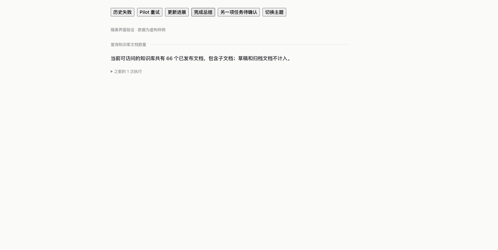

# 专员频道重试结果与实时刷新

2026-11-07，macOS / Apple Silicon。初次验证提交 `8f282f30f861785adbc232d2a1da8cf0bcec595a`；补充轮次发言者/时间并签名安装的源码为 `09258e0e8be58fccd04d8b4486318a477a294e0d`，延续 PR 199。

## 问题与修改

原频道为每个 SDK root 保留一个公开回复。同一任务经 Pilot 重试后，旧失败和新成功并排展示；频道正文也没有消费父组件已有 SSE 快照游标，只等待每秒轮询。进度换句和完成总结直接替换，没有承接动画。

现在按准确 taskId 与 sourceSessionId 选择当前一轮，保留原 root 和报告身份；前次已结束报告收在“之前的执行”。用户进一步要求区分同任务不同轮次，现每轮正文前显示“最新一轮/历史轮次”、原发言者与准确记录时间；保留报告中冻结的历史名称，不随当前角色改名而改写，也不根据已加载分页条数编造全局轮次序号。当前任务节点跨重试、进度与落盘保持稳定，旧历史分页不能重新成为当前答案。独立任务、来源、用户补充、仍在工作的轮次及缺少准确归属的历史记录保持独立。原始记录、任务验收、安全与操作账本未改写。

父频道快照游标变化立即触发频道读取；重叠请求合并为当前请求结束后的再次读取，原有轮询与断线恢复保留，不新增 Worker SSE 连接。真实进度换句与完成总结使用 220ms 淡入/4px 上移，追加 token、未变化轮询和首次恢复不重播。减少动态效果、隐藏页面、断线与重要等待/失败状态直接显示；确认问题仍指向原任务会话。

## 验证

- 前端 `check`、`test:frontend`、`build:web` 通过，**731/731**；新增三项覆盖准确任务重试的当前/历史展示、分页旧报告、稳定任务锚点和独立任务/来源/用户消息/运行轮次，以及每轮准确时间和冻结发言者。
- 命名检查 0 违规，ADK 边界与 `git diff --check` 通过。后端源码自 `9f307313` 未变，本轮未重复其 165 项 CJS / 125 项源码回归。
- 浏览器使用真实 SpecialistChannel 和隔离协议样例，不连接模型、SSH、数据库或知识库。历史失败 → Pilot 重试 → 新进度 → 66 文档总结，当前节点始终相同，最终没有活动进度副本，历史默认折叠且能键盘展开。示例中共观察到三次替换动画，首次加载为零次。
- 从样例点击到可见回复约 20.2ms，仅表示本机 React/样例 API 的游标刷新响应；不表示外部模型或完整 SSE 链路延迟。300ms 旧请求返回前再送入完成状态，新结果仍接续显示。另一独立任务的问题仍可见，已打开的历史不被轮询关闭。
- CDP 实际设置 `prefers-reduced-motion: reduce` 后完整走完三次状态变化，动画次数为零，总结立即可见。浅色和 420px 深色检查通过，窄屏 scrollWidth 等于窗口宽度。尝试用另一页验证 hidden 时该浏览器仍报告 visible，因此**不宣称实际后台页面验证**；代码包含隐藏状态和变化时取消动画的守卫。
- 浏览器任务空间已关闭，临时 Vite 已停止。下图均为虚构数据。

## 签名与 Dev 状态

最初签名候选 `8f282f30` 验证通过。解锁后正常通过原生“停止内核并退出”停止空闲旧 Dev，预检通过；私有备份完整 Dev Home、应用和两个当前 SQLite 一致副本。`scripts/build_lake_desktop.sh --dev --ts-candidate --install` 成功，实际安装到 `~/Applications/Lake Dev.app`。

最终安装源码为上述 `09258e0e`，`dirty=false`，后端类型 TypeScript，SHA-256 `3414a24f29b9e3a4e7450bbd67da78617dd67544c7c4b2ca59d02d0402141955`，实际摘要与记录相同，`codesign --verify --deep --strict` 通过。安装后、交互检查前的 2949 条原 records 逐项摘要一致，无丢失、改写或新增。

原生新版频道默认只展示最新查询结果，历史折叠。展开后实际可见两轮各自的专员和时间；原 11:07 失败不会与 15:06 成功混为当前结果。浅色 2230×1538、深色 1700×1384 物理像素窗口检查通过，文本与元信息正常换行；已恢复浅色、2230×1538、约 299px 侧栏和历史折叠状态。原生未重跑模型或业务资源；动态进度替换验证仍引用上面的隔离浏览器证据，不宣称本轮原生模型执行验收。原生界面的实际业务内容未加入仓库截图。

回退使用安装前的私有 Dev 应用备份，不覆盖已分叉数据。本轮无数据格式、权限或执行账本改造。正式版、发布和完整切换门禁不变。PR 未合并。
