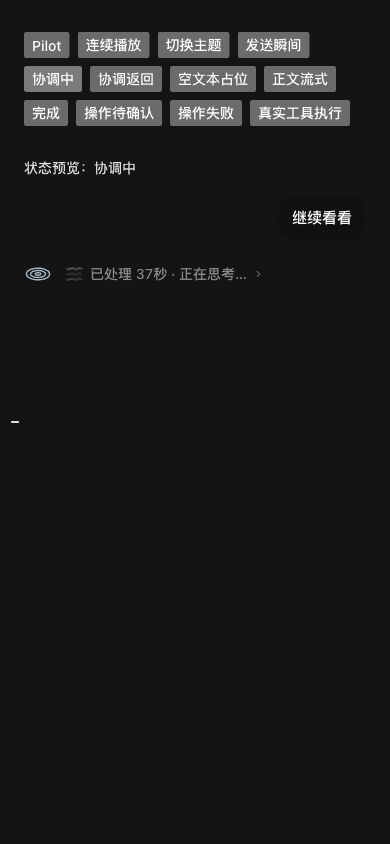
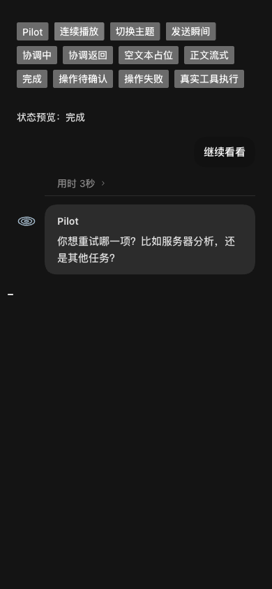

## 思考到正文的显示衔接

命名说明：本文路径和协议名称已映射到当前 TypeScript 后端；历史提交 SHA 保留，原始命令与输出以对应提交为准，此映射不表示重新执行历史验证。

2026-11-05。用户报告 Pilot 在澄清回复前短暂出现“执行中”气泡。只读核对该轮卡片，实际顺序是 `route_work(action=ask)` 后接回复，没有服务器操作。前端将未分类的内部工具按“执行操作”生成进度气泡，同时驱动工具执行状态。

### 修复

按准确工具名识别正常的 Pilot 查阅/路由和 Worker 步骤登记，继续显示共享水波思考；空文字片段不会提前结束等待，首个非空正文片段到达后接替。内部协调不再生成通用执行气泡、最新步骤摘要或自动展开原始步骤。原始卡片没有删除，仍能主动展开查看。

分类仅适用于已知内部工具的 running/completed/succeeded/success；真实资源操作、未知工具、pending/failed/unknown 等状态不被隐藏。本轮仅修改前端展示，没有调整后端路由、任务状态或授权。

### 验证

- 前端类型检查及 **608/608** 回归通过；新增内部协调等待、正文接替、实际/未知工具和异常状态覆盖。ADK runtime boundary 与 diff whitespace 检查通过。
- 使用 ego-browser，在原 fixture 中复现旧通用执行进度。新增 `thinking-bubble.html?scenario=coordination` 受控场景，按发送、协调中、协调返回、空文本、正文流式、完成连续播放。
- 浅色普通窗、深色 390px 窄窗各采集 100 个动画帧：协调与空文本阶段显示水波，没有进度气泡或最新步骤；正文阶段水波收起。窄窗没有横向溢出，完成正文保留原灰色气泡。
- 真实主机检查仍显示操作进度；待确认和失败对照仍显示对应状态。手动展开内部记录可用。验证页面使用合成数据，没有重发用户的旧请求。

### 签名 Dev

构建并安装的干净源码为 `fc4018c3b55cca599e6bbf3ee8ca77e277365228`，使用 `scripts/build_lake_desktop.sh --dev --ts-candidate --install`。实际后端 SHA-256 为 `f901540d593dbb926fa72d1dbeb2062fafa9cb8d69d564ff14187ac591d114ef`，与元数据一致。App 严格签名、ZIP/DMG 摘要、实际 TypeScript/Agent SDK PID/Home/data 检查通过，服务返回的 JS 与本次 Web 构建逐字节一致。

原生 Dev 已重新打开，专员列表、历史与输入区载入。完整动态过渡验证来自上述合成实页；未在用户真实会话发送测试问题。原应用/Home 私有备份保留，旧 Go 主库、ADK 库、providers.json 和 Security control 摘要未变。

后端代码与上一轮相同，沿用 46 项后端回归证据；此次未重跑后端测试。全量迁移仍未完成，本次显示修复不改变切换门禁。
