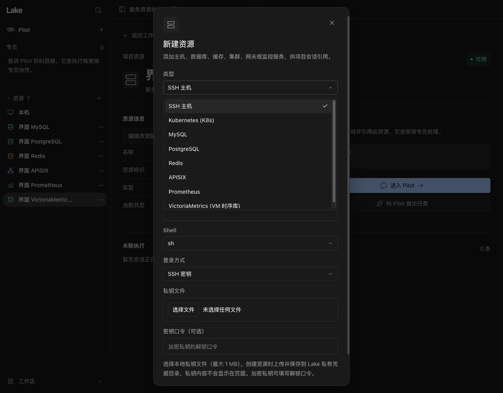
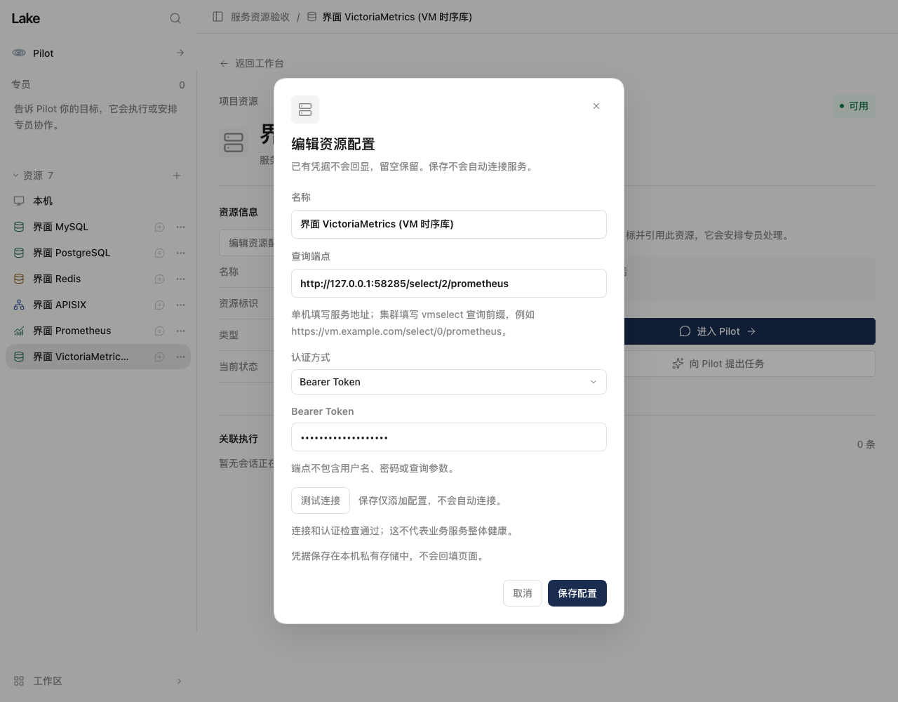
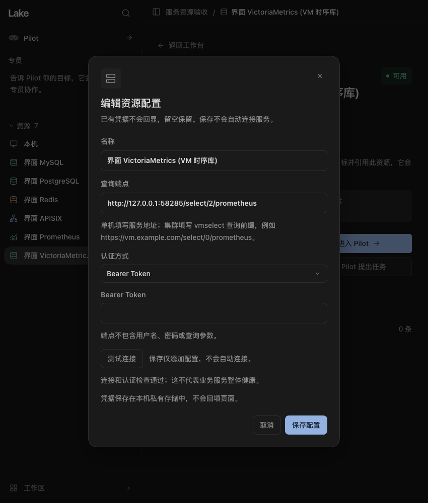

# 六类服务资源新增与连接测试验收

日期：2026-11-06。用户要求开放原先置灰的 MySQL、PostgreSQL、Redis、APISIX、Prometheus 和 VictoriaMetrics 新增入口。本批以 TS/ZCode Dev 为连接测试与编辑验收对象。

## 已实现

- 六类入口可通过共享 AppSelect 选择；表单按类型显示端口、数据库、TLS、认证或 HTTP 查询端点。新资源可保存到当前项目的准确目录，目录父链必须在同项目且无循环。
- 保存只登记配置，无隐式网络请求。资源、目录叶与初始版本在一个事务内提交，失败回滚新增私有凭据。
- 资源详情提供连接配置编辑。留空保留已有凭据，替换、清除及认证切换保留资源 ID 和目录；只有有效配置提交才推进版本。管理型旧凭据不再被引用时清理，清理失败保留持久意图，不撤销已提交连接。
- 密码、Token 和 API Key 存入当前 Home 的私有凭据文件，不回填页面、不进入资源正文。拒绝借用其他资源凭据、外部路径、符号链接、宽权限和错误所有者。
- 点击“测试连接”才发起固定协议读取：MySQL／PostgreSQL `SELECT 1`、Redis `PING`、APISIX 插件列表、Prometheus／VM 常量查询 `1`。VM 保留租户查询前缀。
- PostgreSQL 和 Redis 使用固定版本协议客户端，保留打包许可证。PostgreSQL 不继承环境密码或自动读取 pgpass；TLS 开启时验证证书。HTTP 不跟随重定向，不返回原响应、驱动错误或认证值。
- 测试限时 8 秒、HTTP 响应上限 256 KiB，最多四个并发；取消、关闭、修改配置或安全资格变化会失效或中止测试。保存配置版本和凭据内容在读取前后重新核验，迟到结果不能覆盖新配置。
- 成功测试只报告连接／认证，不修改资源的实时健康、原任务、审批、操作或验收。PostgreSQL 目录条目显示实际 driver，不伪造 MySQL 执行绑定。

## 本地检查

使用固定 Node 24.14.0、ZCode 3.17.2、pg 8.23.1、@redis/client 6.3.1。

| 检查 | 结果 |
| --- | --- |
| 前端全量测试 | 699/699 |
| 前端类型检查／构建 | 通过；保留既有 Vite chunk 提示 |
| TS runtime 类型检查／打包 | 通过，新增客户端及依赖许可已纳入包 |
| server／mysql／router-context／service-resources 集成 | 128/128 |
| tasks／assets／activity／memory／superagent-lifecycle／claude-mem | 70 项：68 通过、2 个需要独立上游检索端点的可选测试跳过；管理型 worker 实测通过 |
| ADK 边界检查 | 通过 |
| Dev 路径／来源／隔离回归 | 19/19 |

新增服务集成使用隔离 Home、真实 mysql2／pg 协议客户端、PostgreSQL 认证协议夹具、真实独立 Redis 进程和本机 HTTP 夹具。覆盖六类型保存和重启、目录归属、私有文件、失败回滚、凭据替换／清除、版本推进、跨项目读取拒绝、重定向拒绝、响应类型核验、取消与迟到结果、原地凭据变化及不继承环境密码。没有访问真实业务服务器。

## 实页验证

Ego Browser 在独立临时 Home 的实际构建页面中，通过界面成功新增全部六类资源。测试后目录含一个本机资源及六个服务资源；切换类型清空秘密并恢复正确默认端口，取消草稿没有新增资源。

VM 编辑页验证 Bearer 认证、显式测试、修改端点立即清除旧成功结果、保存后不回填 Token、用已保存凭据继续测试。整个流程只有三次主动点击测试产生 HTTP 请求，保存及重新打开不连接。键盘打开类型菜单并选择 MySQL，Tab 可到达测试按钮。浅色 1280×1000、深色 850×1000 表单实际截图均检查，无横向溢出，圆角、选择和控件裁切保持一致。截图仅含虚构资源及合成凭据。

## 签名 Lake Dev

待记录干净代码 SHA、签名安装和原生新增表单复核。实际 Dev 只检查及取消草稿，不添加虚构业务连接、不执行真实业务检查。

## 边界

本批交付资源配置、新增、编辑和连接测试，不把其他服务的专用 Agent 查询／运维适配器标为已交付。MySQL 原有 Task 读取继续使用原权限与账本。原任务、未知副作用和验收不由连接测试解除。

共享 Web 为旧 Go 后端保留既有注册参数格式；连接测试和服务配置编辑只在 TS 后端展示，不向旧 API 发送新增控制字段。Go 的专用服务操作、Kubernetes 原流程和完整 TS 产品切换不在本批验收中；原迁移门禁保持。
