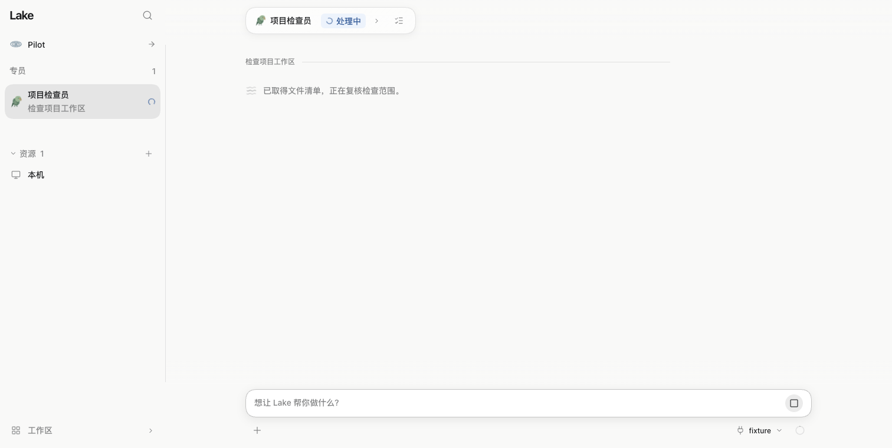
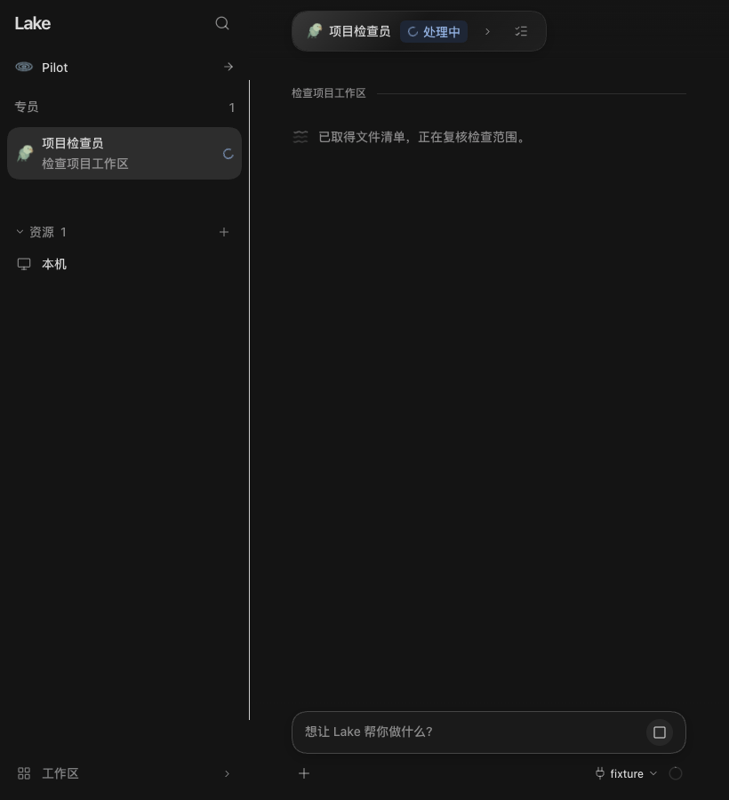
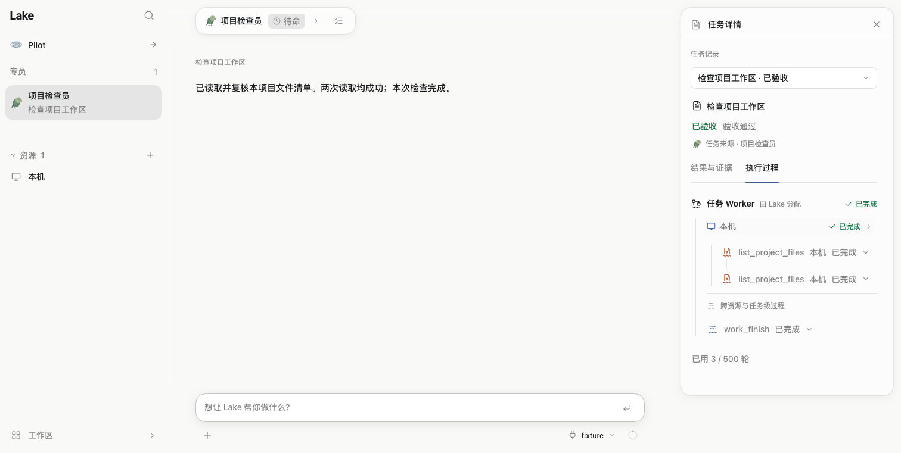
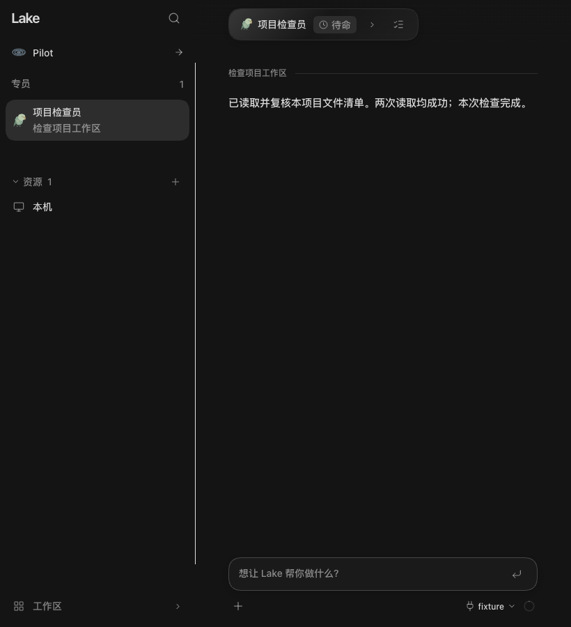

# 专员动态状态与最终总结验收

日期：2026-11-06。范围：PR #188 中 TS/ZCode 专员频道的展示投影，不改变任务、审批、验收或历史操作。

## 行为

- 以来源 Session + SDK RootTurnID 保持一个稳定展示节点；中间播报原位更新，运行时复用水波、文字扫光和流式文字呈现。
- 当前执行结束后显示宿主冻结的本次总结。完成、部分结果、失败和停止保持实际状态；失败接续不能恢复上一次答案。
- 等待确认、离线及结束停止运行动画；减少动态效果下扫光时钟暂停。
- 保留直接输入、计划引用、原任务审批/问题及任务分隔线。原始卡片、操作回执和报告未删除或改写，右栏仍可查看原任务过程。
- 分页和迟到快照不把最终报告降级成过程播报。缺少 SDK 来源元数据的旧记录保留兼容展示。

## 本地检查

使用仓库固定 Node 24.14.0 与 ZCode 3.17.2，未调用真实模型或远端业务资源。

| 检查 | 结果 |
| --- | --- |
| `npm --prefix web-agent run test:frontend` | 692/692 |
| `npm --prefix web-agent run build:web` | 通过；保留现有 Vite 大块提示 |
| `node third_party/zcode/node_modules/typescript/bin/tsc -p runtime/zcode/tsconfig.json` | 通过 |
| `node runtime/zcode/build.mjs` | 通过 |
| `node --test runtime/zcode/server.test.cjs runtime/zcode/mysql.test.cjs runtime/zcode/router-context.test.cjs` | 117/117 |
| 固定 tsx 执行 tasks/assets/activity/memory/superagent-lifecycle 测试 | 57/57 |
| `python3 scripts/check_adk_runtime_boundary.py` | 通过 |
| `python3 -m unittest discover -s scripts -p 'test_dev_*py'` | 16/16 |

SDK 集成用本地协议夹具启动真实 ZCode Worker：连续两次 `list_project_files` 读取隔离临时项目，保留两段进展和两次实际操作。频道只返回一份 canonical 总结，作者绑定准确 RootTurnID；重启后结果相同且无新增模型调用。

旧 outbox 曾把具体回复和频道暂停提示分开保存。按准确 outbox key 读取同一份 Pilot 报告投影完整结论，避免收拢过程后只剩提示、丢失真实发现；原消息与执行记录保持不变。旧 Go 后端通过缺省 API 能力标记沿用原投影，不用 RootTurnID 是否存在猜测宿主类型。

## 实页复核

Ego Browser 使用独立临时 Home、真实应用构建和本地模型协议夹具，在两次读取之间暂停以观察状态。连续更新后展示行和状态文字 DOM 均为同一个节点；结束后展示行仍是同一节点，状态行数从 1 变为 0，主区只显示一份总结。已展开的检查面板保持展开，两次原操作均可见。

浅色正常宽度、深色 820×900 窄窗口均已检查，无横向溢出。`prefers-reduced-motion: reduce` 下状态扫光的 computed `animation-play-state` 为 `paused`。所有截图使用虚构隔离项目，不包含用户凭据或实际业务数据。

## Lake Dev 安装与原生复核

- 安装并测试的源码 SHA：`635f6b5a41be8c72c334105666425da4179a4d86`，构建时工作区干净。
- 通过 `scripts/build_lake_desktop.sh --dev --ts-candidate --install` 构建/安装；固定签名身份、`codesign --verify --deep --strict` 和实际后端 SHA256 均通过，Bundle ID 为 `com.cleanlakes.lake.desktop.dev`，后端为 TypeScript。
- 在 Lake Dev 原生窗口进入现有数据库专员频道，已确认最后一次执行呈现完整结果、运行中间播报收拢、任务分隔线保留。没有发送新消息或重跑业务检查；现有缺少 SDK 来源绑定的历史记录保留原文。
- Dev 原有 144 个资源、4 个专员均保留，运行/排队 Worker 为 0。安装前后 47 条 canonical 目标、尝试、操作、验收与交付记录的整行哈希一致。
- 安装前已停止 Dev 内核并保存私有 Home/应用备份；正式版 Lake 与正式 Home 未改动。

## 限制

完整 ZCode 产品功能迁移与正式版切换沿用现有门禁，本次没有发布或安装正式版，也没有重跑用户的 MySQL 比较任务。日常 develop PR 不自动运行 CI，上述结果均为本地验证。
