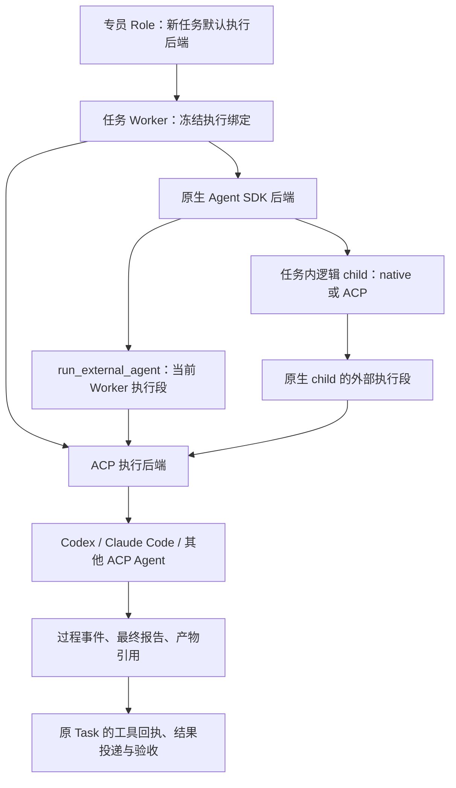

# Introduction

用户要求：专员、任务 Worker，以及任务 Worker 的 subagent，都能通过 ACP 驱动 Codex、Claude Code 等独立 Agent，收集过程和结果。2026-11-10 用户已授权实施，首批范围调整为固定 SDK 的独立 ACP 适配器（runtime-acp）和 Codex；Claude Code 留待后续验证。原分期保留为完整路线图，不能将未完成条目视作本批交付。

设计以 `origin/develop@3f3b88ecddff89a7444e6b9bcd21e0da0aa8bd34` 为源码基线。当前 macOS 使用 TypeScript 后端；`LakeAgents` 通过公开 Agent SDK API 运行 Pilot/Worker 和受管理 child。长期专员是稳定 Role 与频道，新任务另建 Worker/Session。ACP 加在执行后端层，保留这些身份和原任务账本；不在专员频道再启动一个常驻协调循环。

参考 Raven 的 registry、ACP client、session、事件回流分层。Lake 的任务、权限和验收按自身现行合同接入。ACP 的权限请求是 advisory，协议本身不提供进程沙箱；握手、工具通知、最终回答均不能单独证明 Lake 业务操作成功。

## 首批实施记录（2026-11-10）

- 已实现 `acp/{types,catalog,registry,client,private,service,bridge,runtime-server,codex-profile}.ts`：项目配置 CAS、独立子进程、稳定 ACP v1、独立凭据、宿主工具桥及持久运行/事件。
- 专员默认后端冻结到新 Worker；原生 Worker 可创建 ACP child，已有原生 child 可委派外部段；ACP Worker 也通过原公开任务协调端口创建 child。原 TaskLedger/审批/业务回执继续拥有验收。
- 固定 SDK v3.17.2 没有原生 ACP CLI，使用公开 AgentRuntime 的薄 ACP 宿主，未修改上游、未重写模型循环。模型经宿主公开 Model 端口调用，API Key 不进入子进程。
- Codex 固定适配器 2.2.2、引擎 0.160.1；以独立 Home 和静态模型目录禁用原生执行工具，仅暴露任务私有 MCP。仅匹配本轮实际 Lake MCP 调用的 transport permission 才允许进入桥；业务审批仍由原 ToolExecutor 完成。
- 当前外部并发上限为 4 个外部运行（包含等待 child 的父进程），满额直接返回 busy，不排队互等；每次调用最多 15 分钟且不超过原任务期限。计划中的让槽调度、8 进程分离、Codex 运行中补充输入及 Watchdog 主动指导不作为本批完成项。
- 配置界面位于设置的 Agent 页，集中管理连接与专员新任务默认后端。专员对话另提供“执行分配”，显式选择执行 Agent 后由宿主接单并冻结新 Worker；频道和详情从实际运行记录展示分配与回传。见 [专员分配交互实施](feature-specialist-agent-assignment-1.md)。报告本身不生成成功 Operation。
- 连接测试不发送业务 prompt；适配器安装由本机操作者显式触发，不自动安装或复用 Pilot 凭据。启动后 sent/dispatching 的未结执行保留 unknown，不自动重放或切换后端。
- 验证证据、兼容范围和剩余项见 [首批兼容记录](../docs/validation/acp-agent-execution/compatibility.md)。下方 TASK 表保留完整分期，部分实现不等于完整任务验收。

## 1. Requirements & Constraints

- **REQ-001**: 同一执行注册表支持 `native` 与 `acp`。长期 Role 保存新任务默认后端；Worker 冻结后端快照；逻辑 child 可选择自己的后端。省略配置的历史记录保持 `native`。
- **REQ-002**: 提供三种接入：Worker 整体使用 ACP；原生 Worker 通过原生子智能体入口创建 ACP child；原生 Worker 或已有原生 child 调用 `run_external_agent` 完成一个外部执行段。三者共用同一 ACP 服务。
- **REQ-003**: 外部执行始终属于已存在或由原宿主准入建立的准确 Task/Worker。记录 project、Role、Session、generation、父执行、外部 session 和每次 prompt；模型不能填写可信归属。
- **REQ-004**: 原生与 ACP 后端统一提供启动、等待、追加输入能力查询、停止、事件订阅和关闭。外部会话只在同一任务执行身份下复用；新任务不复用旧 ACP session。
- **REQ-005**: 流式正文、工具过程、等待交互、产物引用及最终报告进入原频道和第三联。内部推理不投影；不从外部工具名称推断可信资源、原生 child 身份或业务验收。
- **REQ-006**: 外部运行结束与 Task 完成分开。主 Worker 通过现有 `work_finish`/显式计划路径提交；child 和执行段只回传结果。共同任务继续由全部成员贡献及统一验收收口。
- **REQ-007**: ACP client 使用公开 TypeScript SDK、标准 stdio 与能力协商。首期锁定稳定 v1，不导入 experimental v2/unstable，不改 Agent SDK 上游源码，不自建模型或工具推理循环。
- **REQ-008**: 接入 Codex 与 Claude Code 的固定版本适配器，记录启动来源和实测能力；添加其他原生 ACP Agent 时复用注册与兼容测试，不按产品名称猜 flags。
- **REQ-009**: 先交付可实际验证的任务内委派，再开放整 Worker 后端选择。各阶段分别记录测试 SHA、真实 Agent 版本、平台和未验证能力。
- **SEC-001**: 复用当前 Pilot 分类自动执行偏好、明确 deny、项目/资源范围、Task/owner/generation/期限及 Memory 续接校验。自动执行已开启时不另加 ACP 的产品级确认；关闭时在实际 I/O 前使用现有审批。
- **SEC-002**: ACP 通知为外部报告。只有宿主实际执行并登记的 Lake 工具回执，或宿主独立核实的准确产物/验证结果，能成为原 Task 的业务证据；不将 `end_turn`、退出码 0 或外部“测试通过”文字直接登记为验收 pass。
- **SEC-003**: `session/request_permission` 不能提供完整拦截保证。必须按已验证的适配器工具约束及真实隔离能力判定可执行范围；未经验证的配置只能测试连接，不能标成受 Lake 管理的可执行后端。
- **SEC-004**: 外部模型认证、Lake 资源凭据和桥接认证分别管理。仅解析操作者为该 profile 指定的凭据引用；不自动借用 Pilot 模型 key，不读取 Keychain，不传 SSH 私钥或数据库连接秘密给外部 Agent。
- **SEC-005**: 停止、失联与重启不重放已发出的 prompt 或工具。保留原 `unknown` 与实际派发记录；不得重新引入已取消的“历史 unknown 阻断新 Bash”规则，也不能将未知结果计为成功。
- **SEC-006**: 外部 Agent 不能直接写 Lake 的任务、权限、记忆或控制数据库。跨项目会话、附件和产物按准确身份与当前权限隔离；日志及 UI 沿现有脱敏、Markdown 和资源读取规则。
- **CON-001**: 本次只提交架构文档；实现任务均保持未开始，运行开关与现有数据不变。后续每批使用最新 `origin/develop` 的短期分支和指向 `develop` 的 PR。
- **CON-002**: 原 Task 的绝对期限、停止、显式 Plan 和共同验收不随换后端重置；模型轮次只记录实际可观察数据，不恢复轮次硬上限。
- **CON-003**: 同一任务最多根 Worker 加 7 个逻辑 child，child 只允许一层。ACP 后端段不创建第二个逻辑 child；接受该段的外部 Agent 不再取得任何委派工具。
- **CON-004**: macOS 实测只用签名构建及 Lake Dev；Dev/release 的 Home、数据库、凭据和外部 Agent 配置隔离。原生平台或外部登录未验证时明确记录，不以协议 stub 代替实测。
- **PAT-001**: 保留 `TaskLedger`、`LakeSecurity`、`LakeExecution`、`LakeMemory` 和既有公开 SubagentPort/Runner 的职责；新增表仅保存 ACP 配置、传输与外部执行来源，不成为第二套目标、权限或验收账本。

### 1.1 现状与新增落点

| 现有入口 | 已有行为 | 新增职责 |
|---|---|---|
| `runtime/typescript/superagent.ts:Role/newAssignment` | 稳定角色，任务创建时冻结职责 | 保存默认 Worker/child 后端引用，在新任务准入时冻结实际 profile revision |
| `runtime/typescript/superagent.ts:pump/taskProfile` | Worker 调度、有效权限、任务租约、业务派发 | 解析执行绑定，将两种后端交给同一准入和任务生命周期 |
| `runtime/typescript/agent.ts:LakeAgents.send/runtime` | SDK AgentRuntime、原生权限 broker、事件与停止 | 按绑定选择 native/ACP；原生实现继续使用 SDK，ACP 不构造无用的 SDK Runtime |
| `runtime/typescript/agent.ts:runManagedChild` | 独立 child Session、可信子归属、最多 7 个 child | 抽取共享 child 生命周期；按 child profile 选择 native/ACP |
| `runtime/typescript/agent-host.ts:HostProfile` | tools、allowlist、invoke/invokeControl、任务身份 | 增加只由宿主构造的执行绑定与外部运行授权上下文 |
| `runtime/typescript/tasks.ts:TaskLedger` | Operation、attempt、幂等、验收及共同贡献 | 保存可选 externalRunId 来源；继续只接受真实业务证据 |
| `web-agent/shared/contracts.ts:AgentRun` | 真实 child 和第三联记录 | 增量表示 ACP child 与外部执行段，保留旧原生来源兼容 |

### 1.2 三层使用方式

| 场景 | 配置/调用 | 归属与返回 |
|---|---|---|
| 专员默认使用 Codex | Role 的 `executionDefaults.worker = {kind:'acp', profileId:'codex'}` | 专员频道保持原身份；每个新任务由其独立 Worker 的 ACP session 执行 |
| Worker 内分工给 Claude Code | 原生 `Agent` 使用公开注册的 `claude-code-acp` profile | 创建一层 child、独立 Lake childSessionId 和 ACP session；父 Worker 汇合结果 |
| Worker 直接借用外部能力 | `run_external_agent({agent:'codex', instruction:'修复指定问题并报告验证结果'})` | 原 Worker 的一项外部执行段，返回结构化结果；不新建 Role/Goal |
| 已有原生 child 借用外部能力 | 同一工具与 schema，由宿主绑定当前 child | `callerAgentRunId/childSessionId` 保留；工具卡显示外部段，不新增 child 层级 |
| ACP Worker 组织子工作 | session 中的受管理 Lake 控制桥调用共享 child coordinator | 根 Worker 可以创建一层逻辑 child；ACP child/执行段不暴露该控制桥 |

`run_external_agent` 的模型可见输入固定为 `agent: string`、`instruction: string`、可选 `resume_run_id: string`。agent 必须来自当前宿主公布且可用的 roster。Task、Role、资源、cwd、认证、mode、后端版本和调用者身份由宿主解析，不接受模型覆盖。工具返回 `run_id`、`state`、`summary`、`artifact_refs`、`host_operation_ids`、`verification` 与 `limitations`；`verification` 固定为 `host_verified | insufficient`，不接收外部模型自报的可信 evidence ID。

原生 `Agent` 的 schema 不修改上游：在 `createExploreSubagentPort` 的公开 `profiles` 中注册 `codex-acp`、`claude-code-acp`，由 profile 到后端的可信映射分发。外部执行段不挂载 `run_external_agent`、`Agent`、`Task` 等委派入口；已有 native child 使用外部段不是递归创建第二层逻辑 child。根 ACP Worker 的控制桥与 native Worker 复用抽取后的 coordinator，不另实现一套 child 调度器。

### 1.3 内部契约与存储

以下为待实现 TypeScript 契约；schemaVersion 固定 `1`，记录使用现有 `LakeStore.records`，不新建数据库。新字段缺省兼容原生路径。

| 对象 | 字段与确定规则 |
|---|---|
| `AgentBackendRef` | `{kind:'native'} | {kind:'acp', profileId:string}`；Role 只保存引用 |
| `Role.executionDefaults` | `{worker:AgentBackendRef, child:AgentBackendRef}`；省略时均为 native；角色编辑沿用 revision/CAS，影响未来任务 |
| `ExternalAgentProfile` / `acpProfiles` | id、projectId、revision、schemaVersion、enabled、displayName、trusted executable/argv、package/version/integrity、runtimePath、authRef、isolatedHome、toolProfile、capabilitySnapshotRef；全局包安装可共用，连接 profile 属于准确项目；API 不接受模型提供启动命令，secret 值不进入记录 |
| `AgentExecutionBinding` | kind、profileId/revision、adapterVersion/integrity、toolProfile、scopeHash；Worker 新增 executionBinding 与 childExecutionBinding，在 newAssignment 中冻结；原生不携带外部字段 |
| `ExternalAgentRun` / `acpRuns` | id、requestKey、projectId、roleId、taskId、workerId、lakeSessionId、callerAgentRunId?、childSessionId?、parentExternalRunId?、generation、owner、binding、scopeHash、deadlineAt、state、createdAt、updatedAt；保存 prompt sequence、外部 sessionId 与派发阶段，不保存第二份 Goal |
| `ExternalAgentTurn` / `acpTurns` | runId、turnSequence、requestKey、inputHash、promptRpcId?、dispatchPhase、stopReason?、startedAt/finishedAt、responseRef?、usage?；唯一键 digest(runId,turnSequence)，重复请求只读取原状态 |
| `ExternalAgentEvent` / `acpEvents` | runId、hostSequence、turnSequence、externalToolCallId?、kind、redacted payload、at；hostSequence 由宿主分配，原始协议帧只允许私有、有界、脱敏诊断 |
| `Operation` 可选来源 | externalRunId、externalToolCallId；与现有 agentRunId、childSessionId、originalCallId 一并由宿主填写，不改变原 outputHash 与验收身份 |
| `AgentRun` 增量投影 | 真正的 ACP 逻辑 child 使用 source='acp_subagent'、原 childSessionId 和 externalRunId；native child 的外部执行段只增加工具卡 externalRunId，不改该 child 的 source 或新增逻辑实例；整 ACP Worker 仍显示原 Worker，不补造 child |
| `AcpCapabilitySnapshot` / `acpCapabilities` | profile revision、启动来源 hash、平台、protocolVersion、agentInfo、load/resume/modes/model/MCP/terminal/fs 能力、measuredAt、testedScenarioRefs；自报身份仅作显示，完整工具隔离必须来自实测记录 |

`AgentExecutionBackend` 在新文件 `runtime/typescript/agent-execution.ts` 定义 `start(input, actor, signal)`、`resume(binding, input, actor, signal)`、`wait(runId)`、`cancel(runId)`、`subscribe(runId, sink)`、`capabilities(binding)` 和 `close()`。`actor` 是不可从工具参数反序列化的宿主对象，包含原 Task/Worker/Session/child、当前 generation、guard 回调与绝对期限。`NativeAgentBackend` 调用从原 `LakeAgents` 抽出的 `createNativeRuntime/runNativeTurn`，不回调公开的后端分发 send/runtime，以免递归；`AcpAgentBackend` 调用 ACP run service。方法不自行创建业务 Task 或签发权限。

每个 Worker/逻辑 child 的 backend binding 在任务创建时冻结；按当前权限重新解析有效 scope，不把冻结 permission hash 当作永久许可。修改专员默认值不迁移运行中的任务。profile 被禁用、替换、凭据或控制版本变化时，相关执行停止新派发并显示准确原因；显式后续输入经原任务恢复路径重新准入，不静默换 native、换账号、重建 session 或重发上一条 prompt。

### 1.4 ACP 生命周期

首期每个外部运行作用域独占适配器进程和 ACP session，完成后退出；仅在同一任务明确继续时使用已记录的 session/load 或经过验证的 resume 扩展。首期不跨 Task/项目复用进程。以后若引入池化，必须另验多会话 MCP、取消、认证与工具隔离。

1. 从受信 profile 解析绝对 executable/argv；检查版本/完整性、独立 Home、实际 cwd、认证引用和原 Task guard。使用 `spawn(...,{shell:false,stdio:['pipe','pipe','pipe']})`，不将 instruction 插到 shell 命令。
2. 用 SDK 稳定 `client()` 与 `ndJsonStream()` 连接，发送 `initialize`；protocolVersion 设 1，拒绝不支持版本。仅声明实际实现并经测试的 fs/terminal/elicitation 能力。
3. 按已协商的协议完成认证状态检查；需要登录时记录 `needs_auth`，进入现有设置入口，Task 不伪装已执行。连接测试不发送模型 prompt。
4. `session/new({cwd,mcpServers})`；同作用域续接时先核对任务、凭据、scope 和 capability，再使用 session/load 或实测扩展。重放的历史消息标记为 replay，不计为本轮输出或新证据。
5. 在事务中写入 `acpTurns.dispatchPhase='dispatching'` 后只发送一次 `session/prompt`；写出后登记 `sent`。写出与落库之间崩溃保守保留不确定状态，不自动重发。
6. 按外部 sessionId 与宿主 run binding 路由 `session/update`、权限与提问；同一 session 同时仅一条 prompt。过程事件持久化后再广播，带 hostSequence 供前端去重重连。
7. 收到 prompt 响应后先保存原 stopReason，再汇合已登记的宿主工具/child，登记外部段终态。报告交回原调用者，验收继续由 TaskLedger 判定。
8. 停止时先撤销桥的后续调用资格，再发送 `session/cancel`，最多等待 5 秒；未终结则关闭 stdin 并终止受管理进程树，最多再等 2 秒。记录已确认取消与结果未知的差别，不因 kill 返回成功消除业务 unknown。

传输上限固定：单 JSON 帧 8 MiB；单 run 持久事件正文累计 16 MiB，超过后停止正文保存并保留截断标记，继续消费必要协议控制帧；stderr 只保存最后 64 KiB 脱敏诊断；最终交给模型的 summary 上限 32 KiB，完整报告按私有 artifact 分页读取。到达诊断预算不丢失 run 终态和工具回执。握手期限 120 秒并取原 Task 剩余期限的更小值；prompt 受原 Task deadline 与 AbortSignal 约束，不增加独立模型轮数上限。

`state` 固定为 `queued | starting | running | waiting_approval | waiting_input | stopping | completed | failed | cancelled | interrupted | unknown`。starting/running 只是外部执行状态；completed 表示该段完成协议与子工作汇合，不等于 Task 已验收。退出前没收到可信终态且曾进入 dispatching/sent 时记 interrupted/unknown，保存可能发生的影响。

运行中的补充默认沿现有下一次 invocation 队列；仅对已实测支持的 steering 扩展启用同轮追加，成功送入扩展与下一轮排队必须二选一。重启先保留历史和失联状态；必须有新的真实输入或原明确恢复操作，才能重新准入。不得在启动、Watchdog 或“重试”按钮中盲发旧 instruction。

### 1.5 工具、权限和证据

ACP 连接可用性与业务可执行性分开，分别公布 `transportReady`、`authReady` 和 `executionReady`。每个 profile 必须选择以下工具运行方式之一；没有对应平台验证记录时 executionReady=false。

| toolProfile | 实际执行方式 | 上线条件与证据 |
|---|---|---|
| `lake_tools` | 外部 Agent 经本轮私有 MCP/ACP client fs/terminal 桥调用 Lake 的现有工具；不提供可绕开宿主的原生 Shell、文件、网络或递归委派工具 | 使用经过验证的 adapter 配置或 Lake 维护的薄适配扩展禁用原生旁路；再用运行隔离阻止 Lake 私有目录、任意网络及逃逸执行。标准 ACP capability 自报不能证明这一点。业务 I/O 进入现有 profile.invoke、TaskLedger 和执行器 |
| `isolated_workspace` | 外部 Agent 在宿主验证的隔离环境中使用自身工具，仅访问分配的本机任务工作目录；资源操作经 Lake 工具桥 | 必须实测只读/写入/执行/网络边界及进程树停止；范围不能宽于当前 Pilot 有效分类偏好、明确只读与资源策略。原生工具事件只作过程日志；宿主用受控 Read/测试命令独立核实产物，取得原 Operation 后再提交 |

两类都是待实现能力，当前 SDK 或候选适配器包的安装不证明其满足上线条件。Phase 2 必须为 Codex 与 Claude Code 分别填实版本/平台矩阵：不能禁用原生工具时不提供 lake_tools；不能落实隔离与当前策略时不提供 isolated_workspace。不得以 system prompt、cwd、permission-mode 名称或全量自动批准替代约束。失败时保留 native 后端及准确原因，不静默降级到更宽的外部运行方式。

私有工具桥在 `runtime/typescript/acp/tool-bridge.ts` 实现，与每个 run 一起创建和撤销。桥的凭证只认证本轮 IPC，不承载 Lake 管理权限；不放进 prompt、_meta、事件或模型可见环境。stdio MCP launcher 只取得该 run 的私有端点，桥从宿主登记的绑定恢复 actor；模型参数只能提供原业务工具 schema 的参数。每次调用先核对 Task/Worker/child/owner/generation/有效范围及当前权限，随后走原 `configureTool`、审批与 `invoke`，结果沿原 ledger 返回。桥不能暴露 settings、secret、store、验收写表、跨任务读取或未筛选的全局 MCP。

ACP `session/request_permission` 通过 `permissions.ts` 解析外部请求的准确动作与资源，映射到当前 Pilot 偏好和原审批 ID；不能解析或无法绑定准确动作时拒绝该请求并解释能力限制。`allow_always` 不能获得超出当前 run 的持久权力。已通过桥的同一业务操作不再另弹一次同义审批；外部可执行范围改变需要重新检查，不能复用旧提问。旧的 unknown 不拦新 Bash 的规则继续有效，其他适配器的原合同不被放宽。

ACP Worker 的控制桥可提供当前 Worker 已有的 work_read/work_finish、用户提问和一层 child 控制；显式 Plan 使用原确认协议。ACP child 和外部执行段不提供 work_finish、长期专员管理、任意任务路由、长期 Memory 写入或进一步委派。宿主按允许的只读 Memory 投影构造必要上下文，每次新 prompt 与桥 I/O 前调用原续接校验；Memory 失效时保留原任务和已读依赖，沿当前恢复合同处理，不通过清空上下文或换 Agent 绕过。

`TaskLedger` 不把 run_external_agent、ACP Agent 控制、session/update 或外部 stopReason 加入 businessReceiptTools。bridge 调用和独立验证照常登记 Read/Write/Bash/数据库/MCP 等真实 Operation。外部可见的 operation ID 回显只用于定位，验收必须从原账本重新核对其来源、hash、版本与当前 invocation。仅有报告而缺少业务证据时返回 verification=insufficient，Worker 提交 partial 或说明缺失证据。

独立验证不执行外部回答提供的任意命令。它根据原任务允许范围和宿主验证计划执行真实工具；产物路径先解析到授权根并拒绝 symlink/越界/另项目引用，再由宿主读取。外部 diff、截图或“测试通过”字符串仅为验证线索。若无预定义验证能力，保留不足状态，不伪造可证明的成功。

### 1.6 配置、UI 与分发

设置增加“外部 Agent”列表：名称、固定版本、登录状态、连接测试、当前平台已验证的执行方式。任务设置与模型供应商选择分开；选择 Codex 后显示它自己的模型/模式菜单，菜单来自握手/会话能力，不把 Pilot 的供应商模型名直接传给它。

专员设置提供“任务执行：Lake 原生 / Codex / Claude Code”和“默认子执行”，均使用共享 AppSelect。单项任务的选择在创建前冻结；运行中只展示准确快照。第三联继续以原 Worker 和逻辑 child 为主，工具卡展示执行段与实际外部 Agent。连接中、需要登录、等待权限、执行结束与任务验收不足使用不同状态；重连不重复正文，部分结果、产物及独立验证可追溯。不展示内部推理或原始协议对象。

在当前所选 Lake Home 下使用 `external-agents/adapters/`、`external-agents/profiles/<profileId>/` 和 data 下的 `external-agents/runs/<runId>/`。认证引用留在该 Home 的 secrets，外部配置目录独立；Dev 不读取/复制/链接 release 的配置或密钥。第三方适配器通过显式安装动作下载固定包并验证 integrity；实际任务只运行已安装的绝对路径，不在执行期间临时 `npx -y` 拉取任意版本。

Lake 的 SDK client 编入签名 TS 包；外部适配器的 Node/runtime 通过 profile 明确登记并验证。首期需要操作者配置可用 Node 运行时，不能假设签名 SEA 的 process.execPath 能执行任意 JavaScript。缺失时显示 runtime_missing；适配器更新、认证和运行边界分别验证，不修改全局 npm、Codex 或 Claude 配置。模型认证只进入外部推理进程的必要认证路径，工具子进程环境必须剥离该秘密；无法验证工具侧不可读认证材料时不开放该 toolProfile。

新增设置 API 固定为 `GET/POST /api/projects/:projectId/external-agents`、`PATCH /api/projects/:projectId/external-agents/:profileId`、`POST .../:profileId/probe` 和 `POST .../:profileId/install`。PATCH 请求必须携带 expectedRevision；probe 返回连接/认证/业务能力的独立状态而不提交模型任务；install 返回可查询的安装操作身份，不在 HTTP 重试时重复安装。所有请求使用当前会话鉴权、Origin 及 project/profile 归属检查，返回内容排除凭据。Role 的默认引用继续由现有专员管理入口校验并保存。

## 2. Implementation Steps

### Implementation Phase 1

- **GOAL-001**: 在原生路径不改变行为的前提下建立可信执行绑定和后端接口。完成标准：原生回归通过，老任务缺省仍走原生，外部配置尚不能派发模型或业务工具。

| Task | Description | Completed | Date |
|------|-------------|-----------|------|
| TASK-001 | 新增 `runtime/typescript/agent-execution.ts`，定义 AgentBackendRef、AgentExecutionBinding、AgentExecutionBackend、HostExecutionActor 与 NativeAgentBackend；从 LakeAgents 抽出 createNativeRuntime/runNativeTurn 供原生适配使用，公开 send/wait/abort/steer 保持原合同，避免后端分发递归。 | false | |
| TASK-002 | 在 `runtime/typescript/acp/{types,registry,store}.ts` 实现 ExternalAgentProfile/Run/Turn/Event/CapabilitySnapshot 的 schemaVersion=1 校验、revision/CAS 与 LakeStore 记录；profile 启动路径只接受鉴权设置入口。依赖 TASK-001。 | false | |
| TASK-003 | 修改 `runtime/typescript/superagent.ts:Role/Worker/newAssignment/taskProfile`、`agent-host.ts:HostProfile` 与 `web-agent/shared/contracts.ts`，保存默认引用并冻结新任务实际绑定；不存在配置一律 native，修改 Role 不改变已有 Worker。依赖 TASK-001、TASK-002。 | true | 2026-11-10 |
| TASK-004 | 在 `runtime/typescript/agent-execution.test.ts`、`acp/registry.test.ts` 覆盖历史默认、角色修改、禁止跨项目 profile、模型参数不能覆盖 scope/路径、运行中禁用与 native 行为不变。依赖 TASK-003。 | false | |

### Implementation Phase 2

- **GOAL-002**: 证明固定版本 Codex/Claude Code 的实际协议、认证和工具边界；至少各有一条在 macOS Dev 可执行的运行方式，才进入业务接入。仅握手成功不能完成本阶段。

| Task | Description | Completed | Date |
|------|-------------|-----------|------|
| TASK-005 | 在 `web-agent/package.json` 和 `web-agent/pnpm-lock.yaml` 精确加入 `@agentclientprotocol/sdk@2.5.0`、`zod@4.6.7`，只使用根入口稳定 v1；在 `runtime/typescript/tsconfig.json` 添加公开包入口的 web-agent/node_modules 路径映射并将 include 改为 ./**/*.ts，覆盖新增目录和测试；更新 build.mjs 的解析和许可证归档，不使用 ACP experimental server 入口。 | true | 2026-11-10 |
| TASK-006 | 新增 `runtime/typescript/acp/{client,process,capabilities}.ts`，用 client/ndJsonStream 实现 stdio、握手、严格帧限制、请求关联、fs/terminal/permission handler 注册及进程树回收；能力只在实现完成时公布。依赖 TASK-005。 | false | |
| TASK-007 | 新增 `runtime/typescript/acp/profiles/{codex,claude-code}.ts` 和 `acp/install.ts`：候选固定为 codex-acp 2.2.2、claude-agent-acp 0.94.0，独立 Home/认证引用、显式 Node/runtime、下载 integrity 和无 prompt 的连接测试。升级候选须同步版本/来源和兼容证据，不能自动取 latest。依赖 TASK-002、TASK-006。 | false | |
| TASK-008 | 在 `runtime/typescript/acp/{tool-policy,sandbox}.ts` 实现两类工具运行方式的能力核验；逐 Agent 测试禁用原生旁路、越界文件/符号链接、写入/命令关闭、任意网络、隐藏原生子代理、停止进程树和私有目录隔离。需要薄适配扩展时只增加协议/工具转接，不复制 Agent 模型循环。依赖 TASK-007。 | false | |
| TASK-009 | 新建 `docs/validation/acp-agent-execution/compatibility.md`，逐包版本/运行时/OS 记录 auth、load/resume、MCP session 隔离、fs/terminal 是否真正委托、取消和 toolProfile 结果。Codex 与 Claude Code 均有真实运行通过前保持 executionReady=false；缺失边界不得填为 supported。依赖 TASK-008。 | false | |

### Implementation Phase 3

- **GOAL-003**: 原生 Worker 及其已有 child 可以委派外部执行段，结果绑定同一原任务。完成标准：真实 Agent 调用宿主工具、正确处理开关与停止，并能回传可追溯结果。

| Task | Description | Completed | Date |
|------|-------------|-----------|------|
| TASK-010 | 新增 `runtime/typescript/acp/{runs,events,permissions}.ts` 的 LakeAcpRuns.start/resume/wait/cancel；在发送前登记 dispatching，持久化 turn/run/event，处理 stopReason、replay 与 1.4 节状态及输出上限。依赖 TASK-006、TASK-009。 | false | |
| TASK-011 | 在 `runtime/typescript/acp/tool-bridge.ts` 建立每 run 私有 IPC/MCP bridge；仅使用正式 MCP server 公开包实现标准工具接口，按 DEP-006 固定依赖并归档许可证；从宿主 actor 绑定恢复身份，业务调用统一进入现有 configureTool、分类审批和 invoke；ACP client fs/terminal 也使用此路径。桥在停止/失效后拒绝迟到调用。依赖 TASK-010。 | false | |
| TASK-012 | 在 `runtime/typescript/acp/tools.ts` 提供模型可见 run_external_agent 工具和当前可用 roster；在 `superagent.ts:taskProfile` 与 `agent.ts:runManagedChild` 注册，明确允许原生 child 的终端外部段，并禁止接受该段的 Agent 继续委派。依赖 TASK-011。 | false | |
| TASK-013 | 修改 `tasks.ts:Operation` 与 `superagent.ts:childSource/业务派发` 保存准确 externalRunId 来源；工具不加入 businessReceiptTools。新增 `acp/verification.ts` 以原工具独立读取产物和验证，不执行外部任意命令，不根据通知自建成功 Operation。依赖 TASK-011。 | false | |
| TASK-014 | 在 `runtime/typescript/acp/runs.test.ts`、`tool-bridge.test.ts`、`verification.test.ts` 覆盖 native Worker→ACP、native child→ACP、同名 callId 隔离、开关自动/审批、deny、Memory 失效、原 Task completed/partial 与共同贡献保持。依赖 TASK-012、TASK-013。 | false | |

### Implementation Phase 4

- **GOAL-004**: 同一服务支持 ACP 逻辑 child 和 ACP 整 Worker，保持一层子执行及原 Task 收口。完成标准：两种 Agent 均通过相应真实端到端矩阵，native 无回退或行为损失。

| Task | Description | Completed | Date |
|------|-------------|-----------|------|
| TASK-015 | 新增 `runtime/typescript/child-execution.ts`，从 `agent.ts:runManagedChild/childPort` 抽取 ManagedChildCoordinator 与父事件/通知适配，保留公开 createExploreSubagentPort/Runner、原计数、Session 命名空间及停止。不得创建虚假 SDK parent 来支持 ACP root。依赖 TASK-014。 | false | |
| TASK-016 | 在 childPort.profiles 注册 codex-acp、claude-code-acp，将 runExploreAgent 按可信 profile 分发到 native 或 LakeAcpRuns；`TaskOutput/TaskStop/SendMessage` 使用共享 coordinator，child 结果只贡献原父任务。依赖 TASK-015。 | false | |
| TASK-017 | 修改 `LakeAgents.send/wait/steer/abort/close` 的 live 类型为 native/acp 判别联合；AcpAgentBackend 按冻结绑定运行整 Worker，复用原消息记录、Memory 前检、Host.changed/settled 与失败分类。native 路径不新增模型循环。依赖 TASK-015。 | false | |
| TASK-018 | 在工具桥开放 ACP root Worker 的现有 work_finish、计划/提问和共享 child 控制；外部报告只作提交建议，调用 work_finish 仍经原账本。child 与外部段拒绝目标结清、长期专员管理及进一步委派。依赖 TASK-016、TASK-017。 | false | |
| TASK-019 | 扩展 `runtime/typescript/server.test.cjs` 和新增 `acp/worker.test.ts`，覆盖整 Worker、ACP child、跨任务 session 拒绝、跨项目附件拒绝、同一角色多任务并行、角色后端编辑、显式 Plan、共同任务、仅文字与失败/unknown 不验收。依赖 TASK-018。 | false | |

### Implementation Phase 5

- **GOAL-005**: 停止、恢复、并发和补充输入在新后端保持可核验语义。完成标准：故障注入无自动重放、无等待死锁、无串会话、无 late result 改写新执行。

| Task | Description | Completed | Date |
|------|-------------|-----------|------|
| TASK-020 | 在 `acp/scheduler.ts` 将 ACP prompt 接入现有 Worker 准入；宿主外部 prompt 并发上限 4、进程上限 8。等待子工作的父运行只在已确认的宿主桥等待期间让出计算槽，恢复前重新取得；无法安全让出且容量不足时返回可恢复 busy，不进入互等队列。不改变实际模型轮数合同。依赖 TASK-019。 | false | |
| TASK-021 | 在 `acp/recovery.ts`、`LakeAgents.abort/close`、`superagent.ts:停止/租约` 和 `store.ts:恢复投影` 接入先撤桥资格→cancel→有界退出/进程树停止、原 dispatch 阶段、真实恢复输入和 late generation fence；断线不将外部 prompt 发给另一个后端重跑。依赖 TASK-020。 | false | |
| TASK-022 | 将外部活动纳入 `watchdog-observation.ts` 的来源投影；使用 hostSequence 与真实桥/协议活动区分工作和停滞。仅连接失败且持久证明未发 prompt 时允许现有重试；sent/dispatching 后不自动重派。统计已报告 token，未报告 usage 为 null/unknown，不伪造轮次或费用。依赖 TASK-021。 | false | |
| TASK-023 | 新增 `acp/recovery.test.ts`、`scheduler.test.ts`，注入写出前后崩溃、Agent 退出、取消无响应、宿主重启、两个父 prompt 同时等 child、输入送达不明和恶意迟到帧；同时回归历史 unknown 不阻断新 Bash、原未知不变成功。依赖 TASK-022。 | false | |

### Implementation Phase 6

- **GOAL-006**: 设置、过程展示、分发与两种真实 Agent 的 Dev 端到端可交付。完成标准：准确候选 SHA 的后端/前端/签名 Dev 与故障矩阵有记录，未完成项不宣称支持。

| Task | Description | Completed | Date |
|------|-------------|-----------|------|
| TASK-024 | 在 `runtime/typescript/server.ts` 增加 1.6 节既有鉴权/Origin 保护下的 profile 列表/配置 CAS/连接测试/显式安装接口；在 `web-agent/web/src/api.ts` 与 `web-agent/shared/contracts.ts` 对齐。任何 GET、刷新、连接测试不发送业务 prompt；敏感值只走原 secrets。依赖 TASK-009、TASK-023。 | false | |
| TASK-025 | 新增 `web-agent/web/src/ExternalAgentSettings.tsx`，并在 `SpecialistTaskMenu.tsx` 和现有专员编辑入口接入后端设置；在 `WorkerExecutionTree.tsx`、`workerExecutionModel.ts`、`workerTranscript.ts`、`sessionInspectorModel.ts` 投影准确来源、状态、外部段和验证结果；扩展 runtime-compat.ts 时保持旧原生别名只读兼容。遵守 AppSelect/Glyph/ProviderIcon 及现有圆角。依赖 TASK-024。 | false | |
| TASK-026 | 完成 TEST-001 至 TEST-014；运行 TS/相关后端与前端检查、构建及 `scripts/check_adk_runtime_boundary.py`、`scripts/check_backend_naming.py`；用 `scripts/build_lake_desktop.sh --dev --install` 签名安装，仅在 Lake Dev 验证两种 Agent、三层调用、浅深色/窄窗与停止重启。依赖 TASK-025。 | false | |
| TASK-027 | 更新 `runtime/typescript/README.md`、`docs/lake-pilot.md`、本计划状态和 `docs/validation/acp-agent-execution/`，记录 tested SHA、包 integrity、矩阵与未验证平台；按贡献流程向 develop 提交 PR。取得对应明确授权后才合并，生产发布另行授权。依赖 TASK-026。 | false | |

## 3. Alternatives

- **ALT-001**: 每层直接拼接 `codex exec`/`claude -p`。不采用作为主设计：三层会分别维护启动、输出解析与恢复，ACP client 和能力协商不能复用。已有原生命令执行仍保留。
- **ALT-002**: 把 Codex/Claude Code 当作 OpenAI-compatible 模型供应商。不能交付独立 Agent 的原生工具、会话与生命周期，因此不满足本次目标。
- **ALT-003**: 将每个长期专员频道绑定一个跨任务 ACP session。会混合任务上下文、资源与验收，因此按 Task/Worker/逻辑 child 独立会话。
- **ALT-004**: 全部外部 permission 请求自动批准并从 tool_call 通知补记成功。ACP 不保证通知是宿主执行事实，也不保证所有 I/O 都请求许可，因此不满足当前 Lake 权限与回执合同。
- **ALT-005**: 第一批就跨任务池化多个会话或让外部 Agent 自由递归。需要额外隔离与取消证明，且改变当前一层 child 合同；首期采用作用域独占进程和终端后端段。
- **ALT-006**: 只接 Codex 原生 App Server 与 Claude Agent SDK 两套后端。可保留为适配器内部实现手段，但 Lake 上层统一用 ACP；业务工具约束不足时只增加已验证的薄适配，不复制模型循环。

## 4. Dependencies

- **DEP-001**: 当前 TypeScript `LakeAgents/LakeSuperagent/TaskLedger`、公开 Agent SDK SubagentPort/Runner、原生审批及执行工具；仍以现行源码和 agent.md 新约定覆盖旧 Go 阶段文字。
- **DEP-002**: ACP SDK `2.5.0` 的根入口稳定 v1 与其公开 client/ndJsonStream；zod `4.6.7` 为直接固定 peer。2026-11-10 已核对 npm manifest，v2 仍在 experimental 子路径；不自动采用。
- **DEP-003**: 候选 codex-acp `2.2.2`、claude-agent-acp `0.94.0` 的发布包、许可证、独立认证和已配置 Node 运行时。它们是本方案可追溯候选，不宣称最新，也不代表 Lake 兼容矩阵已通过。
- **DEP-004**: 对两种 Agent 真实可用的工具约束与平台隔离实现。缺失时 Phase 2 不完成，不通过放宽权限来满足后续阶段。
- **DEP-005**: 现有 Items 资源目录/连接版本、LakeSecurity、Memory 来源/续接合同与任务证据校验。不等待未交付的完整新 Items/Security 接口，也不以此打开旧 V2 Memory。
- **DEP-006**: 工具桥使用 `@modelcontextprotocol/server@2.4.0` 的正式公开入口，作为 web-agent 的直接固定依赖；安装前核对发布 manifest/integrity 并纳入 TS 路径映射与许可证。ACP client 只用稳定根入口，不靠 SDK 的 experimental MCP server 导出承担业务桥。

## 5. Files

- **FILE-001**: `runtime/typescript/agent-execution.ts`、`agent-host.ts`、`agent.ts`、`child-execution.ts`：统一执行契约与现有原生/child 生命周期抽取。
- **FILE-002**: `runtime/typescript/acp/{types,registry,store,client,process,capabilities,install}.ts` 与 `profiles/{codex,claude-code}.ts`：可信配置、协议与安装来源。
- **FILE-003**: `runtime/typescript/acp/{runs,events,permissions,tool-policy,sandbox,tool-bridge,tools,verification,scheduler,recovery}.ts`：任务内派发、工具/证据、取消与恢复。
- **FILE-004**: `runtime/typescript/superagent.ts`、`tasks.ts`、`store.ts`、`server.ts`、`watchdog-observation.ts`：任务身份、准入、原回执与公开控制入口。
- **FILE-005**: `web-agent/web/src/api.ts`、`web-agent/shared/{contracts,runtime-compat}.ts`、`web-agent/web/src/{ExternalAgentSettings,SpecialistTaskMenu,WorkerExecutionTree}.tsx` 及相邻执行/Inspector 模型与主题样式：设置和执行过程投影。
- **FILE-006**: `web-agent/package.json`、`web-agent/pnpm-lock.yaml`、`runtime/typescript/{build.mjs,tsconfig.json}`：稳定 ACP client/MCP bridge 依赖、解析与许可证；外部 Node/adapter 不假装由 SEA 自动提供。
- **FILE-007**: `runtime/typescript/acp/*.test.ts`、`agent-execution.test.ts`、现有后端/前端执行树测试与 `docs/validation/acp-agent-execution/`：语义、故障和真实 Agent 证据。
- **FILE-008**: `agent.md`、本计划、`runtime/typescript/README.md`、`docs/lake-pilot.md`：方向、实际状态与验证范围。本次只修改 agent.md 和本计划。

## 6. Testing

- **TEST-001**: 历史缺省 native、同角色不同 Task 独立 session、Role 改名/默认后端修改不改变现有任务；跨项目 profile/session/child/产物拒绝。
- **TEST-002**: 稳定 v1 握手/拒绝不支持版本、out-of-order RPC、非 JSON/超大帧/背压、stderr drain、MCP/fs/terminal 实际能力一致；禁止凭 agentInfo 判断可信启动来源。
- **TEST-003**: 两种真实 Agent 在独立 Home 完成连接、登录检查、模型 prompt、两轮上下文和经过协商的重开；记录精确 Node、包、实际 Agent 与平台版本，连接测试不耗模型 prompt。
- **TEST-004**: native Worker→外部段、native child→外部段、native Worker→ACP child、ACP Worker→child、整 Worker ACP，均只归一个原 Task，执行段不创建长期 Role 或第二层逻辑 child。
- **TEST-005**: 逐 toolProfile 尝试越根、symlink、访问 Lake 私有目录、隐藏 Shell/文件/网络与原生递归工具、任意 MCP、停止后 I/O；拒绝不依赖 prompt 自觉遵守。
- **TEST-006**: Pilot 对读/写/命令/数据库/MCP 自动执行开关分别开关；开启不二次确认，关闭在真实 I/O 前审批；deny、Plan、只读限定、资源版本/凭据/SSH 指纹和 Memory 失效继续生效。
- **TEST-007**: 外部文字“成功”、伪造 callId/resourceId/evidenceId、tool_call completed、空 end_turn 和退出 0 不能验收；只有准确宿主业务 Operation 或独立验证可被原 Task 使用。
- **TEST-008**: Worker `work_finish` 汇合全部 child、宿主后台命令和外部段；partial/failed/unknown 均保留，贡献回执不提前结清共同任务，单段完成不结清 Goal。
- **TEST-009**: 相同原调用/requestKey 幂等、不同 child 相同 RPC/tool ID 不串单；dispatching/sent 后崩溃不重发 prompt/工具；lost stream/取消超时保留 unknown 与原结果。
- **TEST-010**: 停止、角色删除、owner/generation/期限变更、退出与 Dev 重启撤销工具桥和进程树；迟到帧不覆盖新轮次；历史 unknown 不阻断新 Bash，也不当成功。
- **TEST-011**: 四个外部 prompt、八个进程边界、父子互等时槽位调度或可恢复 busy、队列取消；无死锁、跨项目饥饿或活动 Worker 准入旁路。
- **TEST-012**: 补充输入只送达一次，steering 未验证时进入原下一轮队列；replay 不形成新报告，事件重连去重、超限截断保留终态和完整业务回执。
- **TEST-013**: Lake Dev 浅/深色与窄窗，专员默认后端、任务冻结、外部 child/执行段、需要登录/权限、部分结果、产物/验证显示；AppSelect、键盘、角部、第三联分组与原频道保持正确。
- **TEST-014**: 签名 TS SEA 无系统 Node 时准确显示外部 runtime_missing；使用所配 Node 后两种 Agent 正常。Dev/release Home、外部配置、密钥与事件隔离；许可证、构建来源、tested SHA 和真实 Agent 故障矩阵完整。

## 7. Risks & Assumptions

- **RISK-001**: ACP 本身不约束 Agent 自有工具。Phase 2 是真实可执行性依赖；profile 功能和隔离必须逐版本/平台测量，不能让连接成功掩盖不受控 I/O。
- **RISK-002**: 外部 Agent 在自动压缩、续接、原生子代理或自身 MCP 配置中保留额外上下文。新任务独立 session/Home scope、禁用未授权工具与每轮来源重验分别处理，不能只清 Lake UI 历史。
- **RISK-003**: 协议请求写出与持久化不能天然成为分布式原子事务。采用 dispatching 保守窗口；可用性损失通过准确状态与人工新输入解决，不能重发不明 prompt。
- **RISK-004**: macOS/Windows 的隔离与进程树治理不同，SDK 自有 permissionMode 不等于 OS 隔离。未实测的平台或 toolProfile 保持不可执行，分期记录交付。
- **RISK-005**: 外部原生工具没有完整 Lake Operation。通过现有工具桥或独立宿主验证取得真实回执；外部日志保留 observational，不能为统一 UI 补造成功。
- **RISK-006**: 新的后端选择可能被误解为换模型，或把专员频道误当一个共享 Agent session。界面分别显示长期角色、Task 冻结后端与真实运行状态；文档使用既有身份词汇。
- **ASSUMPTION-001**: 用户本次请求是设计三层 ACP 外部执行能力；本次交付设计文件，27 项实现任务没有开始，不含安装登录、开发实现、合并或生产发布。
- **ASSUMPTION-002**: 用户要保留 Lake 的专员、任务、权限、Memory 和三联界面；ACP 提供可选执行方式，不默认替换 Pilot 或现有所有 Worker。
- **ASSUMPTION-003**: 首批以本机 Codex/Claude Code 为范围；远程 ACP daemon、HTTP/A2A、任意动态包安装、跨设备账号同步和任意递归不在本计划中。

## 8. Related Specifications / Further Reading

- [架构归属与最新用户约定](../agent.md)、[贡献规则](../CONTRIBUTING.md)、[开发与发布流程](../docs/development-workflow.md)。
- [任务 Worker 原生子智能体](feature-worker-native-subagents-1.md)、[专员频道](feature-specialist-channel-1.md)、[任务计划与验收](../docs/security/task-confirmation.md)。旧计划与本方案不一致的阶段性限制，以 agent.md 当前约定为准。
- [Items/Security/Memory 归属](../docs/design/items-security-memory-integration.md)、[Security 设计](../docs/design/lake-security-v1.md)、[TS 分层记忆](../docs/design/typescript-layered-memory.md)。本文只扩展执行来源，不宣称完整新安全/记忆能力已交付。
- [ACP v1 Overview](https://agentclientprotocol.com/protocol/v1/overview)、[Security Considerations](https://agentclientprotocol.com/protocol/v1/security)、[TypeScript SDK](https://agentclientprotocol.com/libraries/typescript)。协议定义生命周期；安全页明确协议不提供进程沙箱，权限请求为 advisory。
- [SDK 2.5.0 发布 manifest](https://registry.npmjs.org/@agentclientprotocol/sdk/2.5.0)、[Codex 适配器 2.2.2](https://github.com/agentclientprotocol/codex-acp/tree/v2.2.2)、[Claude Code ACP 适配器](https://github.com/agentclientprotocol/claude-agent-acp)。包版本在实际安装时再核对 integrity 和许可证。
- [OpenAI 官方 Codex App Server 文档](https://learn.chatgpt.com/docs/app-server)：适配器内部使用的 thread/turn、流式事件与审批接口参考；Lake 上层仍使用 ACP。
- [Raven 固定预设](https://github.com/EverMind-AI/Raven/blob/88d6620ee2ef32d84778fd1c895779859f145b5f/raven/agent/subagent/presets.py)、[ACP client](https://github.com/EverMind-AI/Raven/blob/88d6620ee2ef32d84778fd1c895779859f145b5f/raven/acp_client/client.py)、[ACP backend](https://github.com/EverMind-AI/Raven/blob/88d6620ee2ef32d84778fd1c895779859f145b5f/raven/acp_client/acp_agent.py)：传输和运行分层参考，未复制其全量批准策略。

### 本次设计交付的验证边界

本次审计基线为 Introduction 所列 develop SHA；仅文档变更。提交前检查模板、ID 声明唯一性、引用文件、相对链接、必要场景覆盖及 diff 空白；不运行模型、Lake Dev、构建或应用测试，不将设计审阅记为运行验收。
