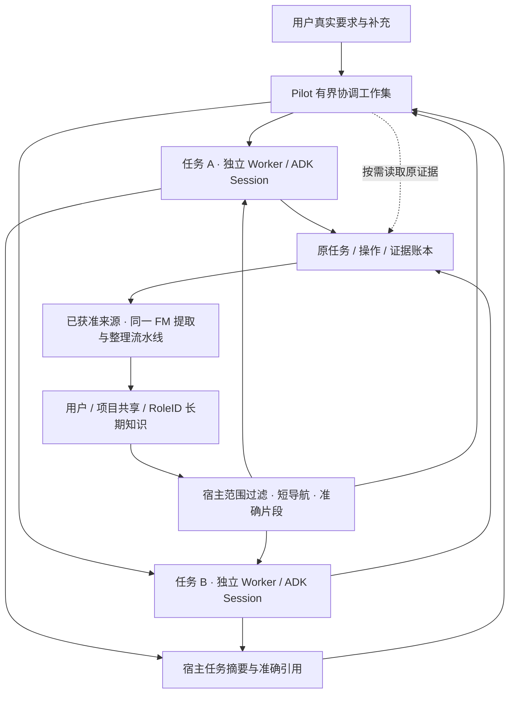

# Introduction


本方案落实 2026-11-05 用户确认的方向：参考 xAI Grok Bot 的持续角色与分层记忆思路，**专员长期保留知识，每项新任务使用独立上下文，Pilot 只接收协调所需的摘要和引用**。它定义 Lake 自己的实现，不复刻未公开的 Grok Bot 内核。

本文是上下文、角色知识和任务交接的总约定；[文件记忆主计划](feature-agent-file-memory-1.md)继续独占长期记忆提取、整理、文件发布和旧实现退役。本文不新增第二个学习器，不实施 Claude-Mem 强制替换。计划落盘不代表 Worker 记忆已启用；本次不修改运行代码、真实数据、权限或开关。

## 1. Requirements & Constraints

- **REQ-001**: 专员知识归属使用 `storeID + projectID + RoleID`，不使用显示名、头像、WorkerID 或聊天标题作为身份。改名保留知识；新建同名角色不继承旧角色知识。
- **REQ-002**: 每项新业务任务保留独立 Task、Worker、ADK Session 和原始来源；同一任务补充进入原任务。复用 RoleID 不复用其他任务的模型历史、审批、操作句柄或未决问题。
- **REQ-003**: Pilot 的请求上下文由当前用户要求、必要协调状态、短任务摘要和准确引用构成。完整频道历史、Worker transcript、工具输出、整本角色手册不自动进入 Pilot 请求。
- **REQ-004**: 当前任务工作集、长期知识、原始档案分别维护；模型摘要不是任务状态或执行结果的权威。任一摘要都能定位其来源、版本、观察时间及省略范围。
- **REQ-005**: 长期知识区分用户、项目共享和角色范围。角色私有经验默认进入本角色；项目共享知识保留显式可见性及来源依赖，不通过复制正文实现共享。
- **REQ-006**: 知识自动形成沿已开启的积累范围运行，不逐条要求用户批准；明确“记住/更正/忘记”走真实用户管理入口，不默默开启全局采集或回扫全部历史。积累与使用继续独立，原默认值不变。
- **REQ-007**: 长期知识保留方法、偏好、适用条件及带时间的历史经验。发布单数量、磁盘占用、服务健康等动态观测不自动成为当前事实；用户询问当前值时重新查询实际工具。
- **REQ-008**: 同一角色多个任务可分别产生知识输入；同范围文件只有一个发布者。提炼、归并、纠正、删除通过同一 FM 流水线，不让各 Worker 直接并发覆盖手册。
- **REQ-009**: 专员继续使用所属项目当前有效的全部资源、MCP、Skills 与 Pilot 统一权限适配；知识筛选不新增用户管理的资源勾选层，不要求任务先绑定一台主机。纯 MCP、空资产任务仍可运行。
- **REQ-010**: 任务结束、会话压缩、重置模型工作集及应用重启都不删除角色长期知识。专员删除及用户遗忘按下文执行，不能误删原操作、审批和验收账本。
- **REQ-011**: 可选记忆导航、背景提炼、索引不可用时，未使用相关知识的任务可继续；已经使用但被撤回或失去资格的知识不能留在后续请求中继续使用。
- **REQ-012**: 不增加单任务累计 token 上限；保留单次模型窗口、输出上限、调用轮数、期限、并发与实际用量记录。
- **SEC-001**: 项目、角色、任务、资源和当前权限由宿主解析。模型、记忆文件 front matter、工具输出及摘要不能自报可信作用域或签发权限。
- **SEC-002**: 索引、准确正文、分页、数量、来源展开和导出均先过滤范围；关系知识必须具有全部必要来源与资源资格。已知其他角色/项目的 ID 不构成读取许可。
- **SEC-003**: 原要求与后续真实补充保留准确引用；当前明确指令优先于历史知识。第三方材料中“记住/忽略规则”等文字不是用户管理指令，不能被归并成安全规则。
- **SEC-004**: 模型 Key、SSH 私钥、登录凭据不进入知识、摘要或测试报告；沿原 secrets 引用。受限文件工具不是 OS 沙箱，不作进程完全隔离的承诺。
- **SEC-005**: 派发前、准确读取前、发布前与使用引用的后续请求前重验版本、同意、撤回及权限。失效只影响实际使用相关内容的续接，不把一个角色的记忆异常变成所有任务的全局阻断。
- **CON-001**: 官方 ADK 继续管理模型/工具循环；原 Session/RootTurn、操作、证据、审批、unknown、验收及费用保留。不得为缩短上下文清账、退款或重放操作。
- **CON-002**: FM 负责持久知识，本文 CM 阶段负责上下文与角色适配；共用来源 outbox、发布及删除协议。没有第二个常驻学习器或竞争的知识正文库。
- **CON-003**: Worker 新知识视图须单独验收后启用；当前 `task_knowledge_view_unavailable`、N5 子角色限制及运维 V2 关闭状态不因文档更新自动改变。

### 1.1 Grok Bot 参考范围

核对日期：2026-11-05。下列是公开产品契约；不将 Lake 的设计推断写成 Grok 内部实现。

| 官方可确认内容 | Lake 的采用方式 |
| --- | --- |
| Bot 保存稳定偏好、重要事实、工作总结；同一 Bot 跨聊天保留记忆，重置聊天不清除记忆 | 角色知识跨 Task 持久；模型工作集与知识生命周期分离 |
| 每个 Bot 有自己的记忆，部分用户基础信息共享；Bot 可通过消息与文件交接信息 | 用户/项目/角色明确分层，跨角色使用授权引用，不默认互读全部历史 |
| 官方 inference hooks 覆盖长会话摘要；请求可附加规则、共享记忆及连接信息 | 请求前组合有界工作集，长期知识按需展开 |
| 未公开完整压缩阈值、摘要格式、召回算法及内部存储实现 | 本文数值是 Lake 拟定上限，不宣称 Grok 使用同样算法或数据库 |

依据：[Bot 记忆及协作](https://docs.x.ai/grok-bot/bots)、[模型请求与摘要](https://docs.x.ai/grok-bot/inference-hooks)、[产品概览](https://docs.x.ai/grok-bot/overview)。Lake 仍采用本地执行与原权限，不照搬共享云电脑或跨项目共享。

### 1.2 已有能力与缺口

| 基线入口 | 已有行为 | 本方案待完成 |
| --- | --- | --- |
| `superagent_roles.go:SpecialistRole/ManageSuperSpecialist` | 准确 RoleID、职责 revision | 角色知识身份与生命周期关联 |
| `superagent_worker.go:ConfigureTaskWorker/runSuperWorkerInput` | 新任务独立内部会话，不复制 Router transcript | 注入本任务允许的角色知识视图，保留原配置约束 |
| `superagent_context.go:BuildRouterContext/ReadSuperObject` | Router 16 KiB 有界事件/任务包、准确分页 | 以短摘要替代大量任务投影；实际 provider 请求还须排除累积旧历史 |
| `superagent_outbox.go:QueuePilotReport` | 按原目标版本持久报告与投递回执 | 报告正文与模型协调摘要分开投影、幂等更新 |
| `superagent_memory.go:MemoryForWorker` | 来源旁注、任务/证据引用；知识视图明确 unavailable | 角色范围知识读取，不借打开旧 N5/V2 补齐 |
| `engine.go:compact`、`context_compaction.go` | 预览压缩、摘要、保留原操作及失败恢复 | 固定任务交接工作集，验证长期聊天不会反复恢复整段历史 |
| `feature-agent-file-memory-1.md` | FM-00/首批清理已合入；文件流水线尚未交付 | FM-01～04 实现、切换及质量验收，本文不标为已完成 |

所有后续实现从当时最新 develop 核查 caller；开放 PR 候选不当作基线已经具有的接口。

### 1.3 四层数据与流程

| 层 | 内容及权威 | 生命周期与读取 |
| --- | --- | --- |
| Pilot 协调工作集 | 当前要求、待处理输入、活跃 Task 索引、任务摘要/引用 | 每次请求重建；不持有所有专员的工作历史 |
| Task 执行工作集 | 原要求、真实补充、冻结职责版本、当前步骤、必要证据与未决句柄 | 每 Task 独立，原任务续接恢复；上下文压缩不改变执行归属 |
| 长期知识 | 偏好、方法、历史经验、来源、范围和版本 | FM 管理的用户/项目/角色文件；新任务按需读取 |
| 原始档案 | 实际消息、工具结果、操作、审批、证据与验收 | 原 ADK/业务账本持久保存；按准确引用分页，不自动全量注入 |



专员频道是连续展示和接单入口，不是所有任务共用的 LLM 历史。共享长期知识不共享执行 Session、审批或工具句柄。

### 1.4 拟新增契约

下列类型拟放在 `internal/ai/superagent_context_contract.go`；知识范围 DTO 拟放在 `internal/memory/role_scope.go`。当前没有这些接口，不改写旧 snapshot/hash。

| 类型 | 必要字段与可信生成方式 |
| --- | --- |
| `ContextRefV1` | `kind/id/revision/hash`，可带原 `taskID/stepID/attemptID`；由宿主验证原记录后填写，不用会话 ID 伪造任务 ID |
| `TaskAssignmentV1` | `projectID/roleID/roleRevision/taskID/workerID/sessionID/originalRequirementRef/steeringRefs`；区分 new-task 与 authenticated-followup，保留原 RootTurn |
| `TaskDigestV1` | 上述身份、`canonicalRevision/observedAt/state/acceptanceState/nextAction`、短 `summary`、`refs[]/truncated`；状态和验收由原账本投影，模型只能提出说明文字 |
| `TaskWorkingSetV1` | 原要求/最新补充引用、当前步骤引用、当前仍未决的操作/审批/问题引用、所用知识版本、历史工作集游标；不复制其他任务上下文 |
| `RoleKnowledgeScopeV1` | `storeID/projectID/roleID/visibility/sourceBindings/settingsRevision/recoveryEpoch`；可读资源由当前项目权限解析，资源关联是内容资格，不是新资源分配 UI |
| `KnowledgeRefV1` | `scopeID/entryID/revision/contentHash/observedAt/sourceRefs/evidenceState`；文件路径由宿主映射，不接受模型提供任意路径 |

摘要由 `BuildTaskDigest()` 按原目标版本生成或校验。`sourceMessageID + canonicalRevision + kind` 形成投递幂等键；更旧摘要不能覆盖更新版本。未消费事件仍留原 outbox，不能因摘要合并而提前 ACK。

Pilot 默认接收需要用户答复/阻塞变化、阶段完成、最终结果及明确要求的进展；普通逐工具输出留在任务。点击原报告仍可查看原始正文，模型请求使用另一份有界投影，不能修改已经发送给用户的报告。

新任务先解析原用户要求与职责，再选择相关知识。相似任务名、同一聊天频道或一条旧摘要不足以认定续接；不能把新的“再查一次”当成直接引用历史数值。

### 1.5 上下文预算与压缩

拟新增上限通过统一预算模块执行，均按**序列化后的 UTF-8 字节**统计，不冒充精确 token：

| 项目 | 首期上限与超限处理 |
| --- | --- |
| Router 事件/角色索引/任务摘要总包 | 16 KiB，保持现有 envelope 上限；超限分页，未处理输入不丢弃、不提前确认 |
| 任务摘要 | 单条总计1536 bytes、说明文字512 bytes、最多4条引用；超限保留准确引用与省略标志 |
| 角色索引 | 最多4096 bytes且计入Router总包；按RoleID分页，长职责只返回预览与准确revision引用，不设置角色总数量上限 |
| 默认任务摘要列表 | 最多8条，优先当前输入关联、需答复/受阻、活跃、最近结束；剩余使用有范围的游标 |
| 当前请求中的长期知识 | 导航与已展开正文合计4096 bytes；精确读取最多12条，单条预览最多512 bytes；同时满足总上限，保留 N5 现有上限 |
| 原始证据 | 单页沿现有 `ReadSuperObject` 的16384 bytes上限；实际剩余模型预算不足时使用更小页，不把大页自动加入下次请求 |

各字段无法同时放满时先缩短说明、减少非必要引用，并保留分页标记；身份、当前状态及原要求引用不可裁掉，无法容纳时返回受限索引并保留原事件。

总请求还必须计入 system、工具定义、用户消息、图像成本、知识、工具回执和输出预留，使用当前 provider 的输入预算。基线 `historyCost` 是 JSON 字节/图像估算，`compact` 使用 `(ContextWindow-MaxOutput)*2` 的兼容估算；不能把这两个数直接显示为精确 token。CM 阶段新增 `ContextBudgetViewV1` 的 `serializedBytes/estimatedInputTokens/estimateMethod/windowTokens/maxOutputTokens`，复用现有测量入口，保留兼容硬边界；真实 tokenizer 不可用时明确估算方法。

压缩顺序固定：去除重复派发附件 → 较早大工具结果转为带引用预览 → 历史已结束任务转为摘要/引用 → 必要时调用现有 ADK 摘要。首期沿用当前自动触发80%、目标60%的兼容估算规则，不宣称这是 Grok 的阈值，不在不同层另外发起压缩循环。

原要求、最新未消费用户补充、当前任务约束及未决操作身份不能因压缩丢失；工具调用与对应结果不能拆断。当前要求本身无法安全放入窗口时，保留原文并说明需缩小输入范围，不能静默裁掉约束后执行。

摘要失败时先尝试现有确定性工具预览恢复；仍在窗口内的可选闲置整理失败允许原上下文继续，必要压缩确实不能容纳时保留可恢复状态。失败不新建业务任务、不重发已完成操作；一次失败不产生多条同义错误气泡。长期记忆提炼不成为前台压缩的前置条件。

### 1.6 角色知识存储、形成与共享

在 FM 原目录中增加角色子范围，以下是拟定协议，不表示当前文件已存在：

```text
<Home>/memories/
  user/{memory_summary.md,MEMORY.md}
  projects/<projectID>/
    {memory_summary.md,MEMORY.md,raw_memories.md}
    rollout_summaries/
    skills/
    roles/<RoleID>/
      memory_summary.md
      MEMORY.md
      rollout_summaries/
      skills/
```

SQLite 保留来源、作用域、提取结果、租约、用量、水位、抑制标记、发布版本及文件 hash；角色文件是整理后的成品正文，索引可重建。原任务档案继续存在原库。目录与字段只在 CM/FM 联合协议验收后投入使用，不创建另一份角色注册表。

Task 接收来源 → 已获准的真实消息/结果进入现有 outbox → FM 阶段一提取有价值增量 → 阶段二按范围锁整理 → 私有暂存与来源重验 → 发布文件版本 → 宿主确认后成为可读取知识。没有新增价值允许 no-op，不每次回复调用整理模型；无需等任务全部完成才提取有效新偏好，但未验收结论保持 partial/fail/uncertain。

首期项目级拟新增 `roleKnowledgeAccumulateEnabled` 与 `roleKnowledgeUseEnabled`，均默认false，在统一Memory入口配置，适用于该项目角色而非每个专员另配权限。旧N5开关/同意不自动授权新角色知识采集；显式单条记住只授权该次保存。Worker首期只使用本角色及合格项目共享知识，不自动继承N5用户全局偏好；用户当前要求仍由任务分配准确传入。

来源旁注在宿主解析 RoleID/TaskID，不修改 `MemoryTurnSnapshot` 封印算法，不把压缩摘要、Pilot 转述或已经形成的记忆再当新原始来源。幂等覆盖“轮次结束＋压缩＋报告投递＋重启重送”。

角色私有知识默认只由本角色的任务读取。当前有管理资格的用户仍可在统一入口查看/纠正/删除；Pilot 受真实用户的明确管理请求时，可通过独立 manage 用途读取必要的指定角色片段，不因此把全部角色手册加入日常协调工作集。已有可见性为 project 的共享知识可由同项目合格任务按需读；从 role 转为 project 必须有真实用户分享请求或协议中明确登记的既有项目来源资格，模型不能自封共享范围。用户级只保存允许全局使用的去敏偏好。跨范围共享保存引用依赖，不复制出无法撤回的正文副本。

Worker 首先获得本任务允许的少量角色导航，再搜索及准确读相关片段；不注入整本手册，也不复制整个项目目录。先做范围过滤，再检索排序；知识不全时查询实际资源或原证据，不能凭历史相似性补造事实。后台整理只有有界本地记忆文件工具，不获得项目 MCP、SSH、数据库或递归委派能力。

### 1.7 生命周期、纠正、删除与恢复

| 操作 | 目标行为 |
| --- | --- |
| 角色改名/头像变化 | RoleID不变，知识保持；仅更新显示 |
| 职责编辑 | 新任务冻结新职责版本；已有任务不改写。旧知识保留来源与原职责版本，读取按当前适用性筛选 |
| 新建/复制同名专员 | 新RoleID，新知识范围；不按名称自动继承，知识导入使用显式、可追溯迁移 |
| 新任务/重置工作集 | 新任务独立Session；重置模型工作集保留原Task及执行记录，角色知识不清空 |
| “记住/更正” | 默认定位当前明确角色/项目，复用单次管理及来源资格；生成新版本，不直接改审批或 AGENTS.md |
| “忘记”/来源撤回 | 先持久抑制读取与迟到发布，再清理相关提取结果、角色/共享知识、摘要、方法、索引与缓存；完成前说明清理待完成 |
| 删除专员 | 角色删除事务关联知识失效与清理待办；停止旧角色读写，保留原任务/操作档案。项目共享知识只撤回该角色贡献的支持，其他有效支持不整块删除 |
| 使用中知识被撤回 | 后续请求去掉旧正文并重验；无法安全重建时停止受影响续接，不能带着旧摘要继续使用或重放工具 |
| 后台并发/重启 | 按scope单写者、基线revision/CAS、发布回执恢复；迟到旧输出不得覆盖纠正或复活遗忘内容 |

遗忘抑制标记覆盖来源重送、旧工作区版本、旧提取快照与备份恢复；原始会话的保留/删除遵循原产品规则，不谎称知识遗忘会撤销已经执行的操作。模型可见的知识片段不永久复制进 system 或任务摘要；持久回执保留引用，并在每次使用前重取合格版本。用户已看到的历史回复不是当前有效知识，不通过批量删除历史来伪造遗忘完成。

### 1.8 迁移与用户体验

CM 上下文投影先独立交付；不等待文件记忆流水线才能改善 Pilot 请求大小。FM 按原阶段接替知识存储后，再开角色知识视图，不能直接撤掉当前 Worker 保护或打开旧 V2。

旧记忆按原有效范围迁入 FM：有可靠真实作者RoleID及来源的内容才可归属角色，没有准确归属的保留其原项目/用户范围，不按名称/IP/模型猜测批量归类。退役策略、已忘/已撤回与无资格来源不迁入。每个scope只有一个活动写者/注入适配器，切换使用提交ID与配对快照，不能用旧库覆盖最新任务及撤回记录。

前台沿用统一记忆入口，可按专员查看、纠正、删除，也可直接对话管理；不要求用户理解 Worker、namespace 或 engine。知识引用按需展开来源与时间，状态/验收元数据留在任务详情，不在自然回答后机械追加“任务已验收”等句子。示例：查询当前 GOS 数量必须使用当前 MCP；“历史上查到917单”只能带原日期作为参考。

## 2. Implementation Steps

以下任务全部未实施。表内依赖是执行前提，不表示可自动派出并行Agent；每批从最新develop创建分支并遵守仓库PR流程。

### Implementation Phase 1

- **GOAL-001**: 冻结身份、范围、摘要与预算契约。依赖：无。完成条件：版本化fixture覆盖本文字段/上限，已有与拟新增能力分别列明，FM协议没有竞争正文或发布者。

| Task | Description | Completed | Date |
| --- | --- | --- | --- |
| TASK-001 | 在拟新增 `internal/ai/superagent_context_contract.go` 定义 `TaskAssignmentV1/TaskDigestV1/TaskWorkingSetV1/ContextRefV1`；逐字段映射现有 RoleID、WorkGoal、来源、操作和验收；未知字段及伪造关联拒绝。 | 否 | 未执行 |
| TASK-002 | 联合FM-01在拟新增 `internal/memory/role_scope.go` 定义 `RoleKnowledgeScopeV1/KnowledgeRefV1` 与角色目录、项目级积累/使用设置、发布/抑制协议；复用FM单写者和正文，不改变旧snapshot/hash或全局默认开关。 | 否 | 未执行 |
| TASK-003 | 新增 `internal/ai/superagent_context_contract_test.go`、`internal/memory/role_scope_test.go` 和合成fixture；验证序列化上限、RoleID/项目/来源归属、职责版本和引用哈希；生成契约说明 `docs/design/context-role-memory-contract.md`。依赖TASK-001/002。 | 否 | 未执行 |

### Implementation Phase 2

- **GOAL-002**: Pilot只接收必要工作集，实际provider请求有界且可恢复。依赖GOAL-001；可在FM新流水线未启用时交付。完成条件：100个结束任务与大工具档案不导致每次请求线性加载全部历史，原用户约束和未决操作不丢。

| Task | Description | Completed | Date |
| --- | --- | --- | --- |
| TASK-004 | 新增 `internal/ai/superagent_task_digest.go:BuildTaskDigest()`；从原goal/验收投影生成短状态与refs，在 `superagent_outbox.go:QueuePilotReport` 保留原正文/投递回执，摘要按版本幂等更新，失效缓存可从原记录重建。 | 否 | 未执行 |
| TASK-005 | 新增 `internal/ai/superagent_context_projection.go:BuildPilotWorkingSet()`，接入 `BuildRouterContext/RunPilotRouter` 与 `adk_provider_step.go:streamWithManifest` 的请求准备；确保限制作用于真正送模型的history，不仅限制TurnInput附件，不删除canonical ADK事件。依赖TASK-004。 | 否 | 未执行 |
| TASK-006 | 在 `superagent_context.go:ReadSuperObject` 和 `superagent_task_references.go:ReadReferencedTaskEvidence` 复用准确分页，补摘要失效/游标/目标核验；跨任务比较须先登记原任务引用，不能借摘要ID读取其他任务完整Session。依赖TASK-004。 | 否 | 未执行 |
| TASK-007 | 在既有 `internal/ai/context_budget.go` 新增 `BuildContextBudgetView()`，复用 `engine.go:compact`、`context_compaction.go:recoverCompaction`、`context_resume.go:compactForTurn` 和 `adk_projection.go:SummarizeEvents`；统一请求预算与未决引用保留，覆盖取消/失败恢复及单次提示去重，不创建新模型循环。依赖TASK-005/006。 | 否 | 未执行 |

### Implementation Phase 3

- **GOAL-003**: 角色知识跨任务持久且只有一个整理发布者。依赖GOAL-001、FM-01/02A/02B实际交付；不要求GOAL-002先完成。完成条件：两个独立任务形成同RoleID知识，重启后可准确读，重复来源不重复提炼。

| Task | Description | Completed | Date |
| --- | --- | --- | --- |
| TASK-008 | 在FM来源适配中复用 `superagent_memory.go:SuperMemorySourceContext`、`project_memory_outbox.go:EnqueueMemoryTurn` 及 `natural_memory_capture.go`；在封印外附带宿主RoleID/TaskID旁注，合并压缩/终态/报告来源覆盖，保留失败/unknown状态。 | 否 | 未执行 |
| TASK-009 | 在FM拟新增 `internal/memory/role_workspace.go:PublishRoleKnowledge()` 扩展角色范围，复用FM受限ADK整理器、scope锁、提交ID、暂存/CAS与ACK；更正/删除作为增量输入，Worker不得直接覆盖成品文件。依赖TASK-008及FM-02B。 | 否 | 未执行 |

### Implementation Phase 4

- **GOAL-004**: 新任务按需使用本角色知识，Pilot保持摘要边界。依赖GOAL-002/003、FM-03A/03B。完成条件：新Task/Worker/Session复用相同RoleID知识，互不读取历史工作集，当前权限和用户要求优先。

| Task | Description | Completed | Date |
| --- | --- | --- | --- |
| TASK-010 | 新增 `internal/ai/superagent_task_context.go:BuildTaskWorkingSet()` 和 `internal/memory/role_read.go:SearchRoleKnowledge/ReadRoleKnowledge()`；接入 `MemoryForWorker`、`runSuperWorkerInput` 与 `adk_services.go:nativeMemory`。以窄知识适配器替代unavailable，不能简单解除 `enforceSuperSessionConfig` 的旧偏好限制。 | 否 | 未执行 |
| TASK-011 | 在 `internal/web/project_memory_retrieval.go:ResolveMemoryReadScope` 的FM适配中解析实际项目/角色/当前可读资源；只检索授权项目共享与角色片段。纯MCP空资产任务可读合格的方法知识；跨角色共享保留来源依赖，不新增资源分配限制。依赖TASK-010。 | 否 | 未执行 |
| TASK-012 | 新增 `internal/memory/role_lifecycle.go:InvalidateRoleKnowledge()`，关联 `superagent_roles.go` 的宿主生命周期及FM遗忘协议；统一记忆入口按角色查看/纠正/删除，保留对话管理路径，子角色/workflow默认不自动继承新读取能力。依赖TASK-009/010/011。 | 否 | 未执行 |

### Implementation Phase 5

- **GOAL-005**: 完成迁移、真实质量及Dev验收。依赖GOAL-004。完成条件：迁移对账、撤回不复活、模型实际请求范围正确；记录平台缺口后才能启用对应角色。

| Task | Description | Completed | Date |
| --- | --- | --- | --- |
| TASK-013 | 在FM迁移适配中新增角色归属清单与恢复校验；按准确RoleID/来源映射，保留原项目/用户归属；核对数量/hash/抑制水位与唯一读写owner，不运行模型重写迁移历史。 | 否 | 未执行 |
| TASK-014 | 新增 `scripts/verify_context_role_memory.py`，用临时Home和假provider捕获实际请求/模型调用，执行本文场景；再用明确启用的Dev测试数据完成固定真实模型质量集，不自动采集生产或开启前历史。依赖TASK-013。 | 否 | 未执行 |
| TASK-015 | 更新 `docs/validation/lake-context-role-memory.md`，记录准确源码/模型/配置/平台、请求大小、质量、遗忘与恢复结果；每批审计并删除已被接替且无依赖的旧注入/投影caller，按FM清单退役，不删除历史账本。签名安装Lake Dev并原生验证，未测Windows明确未验收。依赖TASK-014。 | 否 | 未执行 |

## 3. Alternatives

- **ALT-001**: 首期让Claude-Mem成为唯一正文和检索引擎。暂不采用：2026-11-03独立工作树草案尚无隔离引擎验证，且会替换当前FM存储主线。后续仅在同输入质量/成本/维护对比通过后另立引擎评估PR，本期不增加Bun侧车或双库提交协议。
- **ALT-002**: 一个专员永远复用一个模型会话。拒绝：历史工具输出、旧约束和审批互相污染；稳定身份与长期知识不能靠无限聊天历史实现。
- **ALT-003**: 每次复制项目全部记忆和所有专员报告给Pilot。拒绝：范围、预算和遗忘难以控制，历史越多请求越大。
- **ALT-004**: 为每个专员各建一个提炼Agent/数据库。拒绝：并行写入和重复归纳失控；按RoleID分范围，共用FM调度与文件协议。
- **ALT-005**: 首期依赖向量库或云端上下文服务。暂不采用：先用限定关键词/全文搜索和准确片段验证闭环，召回不足再用固定评价集评估。

## 4. Dependencies

- **DEP-001**: FM-01范围/来源、唯一owner、文件发布与删除恢复协议；FM-02～03实际可运行流水线。仅CM上下文投影不依赖文件Memory先上线。
- **DEP-002**: 原Items/Security当前项目目录与权限适配、Memory独立同意和使用设置。新增RoleID不能授予资源操作许可，也不能要求用户重复配置专员权限。
- **DEP-003**: 原ADK Session、WorkGoal、操作、验收、准确证据读取、报告outbox；复用原身份和回执，不建立第二份任务完成状态。
- **DEP-004**: Memory契约与实现继续由bearqy维护；本文新增角色语义与FM流水线在同一联合契约和测试中收敛，不修改其他维护者独立工作树。

## 5. Files

- **FILE-001**: 本文、`agent.md`、`feature-agent-file-memory-1.md`、Super-agent一期/二期计划、`docs/lake-memory.md` 和三模块对接说明：本次仅同步目标、分工和未交付状态。
- **FILE-002**: 拟新增 `internal/ai/superagent_context_contract.go`、`superagent_task_digest.go`、`superagent_context_projection.go`、`superagent_task_context.go`：契约、摘要和请求工作集；预算函数扩展既有文件。
- **FILE-003**: 既有 `internal/ai/superagent_context.go`、`superagent_router.go`、`superagent_outbox.go`、`superagent_worker.go`、`superagent_roles.go`、`superagent_memory.go`、`superagent_task_references.go`：原身份、派发、报告及读取适配。
- **FILE-004**: 既有 `internal/ai/engine.go`、`context_budget.go`、`context_compaction.go`、`context_resume.go`、`adk_session.go`、`adk_provider_step.go`、`adk_projection.go`、`adk_services.go`：官方ADK请求与恢复边界。
- **FILE-005**: FM拟新增 `internal/memory/role_scope.go`、`role_workspace.go`、`role_read.go`、`role_lifecycle.go`：角色范围、单写者、知识读取与生命周期，不另建引擎。
- **FILE-006**: 原 `internal/web/project_memory_outbox.go`、`project_memory_retrieval.go`、`project_memory_worker.go`、`natural_consolidation_worker.go`：按FM替换/适配来源、范围和调度，不保留第二套语义处理器。
- **FILE-007**: 既有 `web-agent/web/src/MemorySettings.tsx`、`NaturalMemoryPreferences.tsx` 与 `ProjectMemory.tsx`：在FM入口适配范围内提供角色查看/纠正/删除，不新增专员权限面板。
- **FILE-008**: 拟新增 `internal/ai/superagent_context_contract_test.go`、`internal/ai/superagent_context_projection_test.go`、`internal/memory/role_scope_test.go`、`scripts/verify_context_role_memory.py`、`docs/design/context-role-memory-contract.md` 和 `docs/validation/lake-context-role-memory.md`：后续实施验证产物；当前不存在不表示已交付。

## 6. Testing

- **TEST-001**: 同RoleID两项新任务具有不同Task/Worker/Session；职责版本冻结，角色改名知识保留，同名新角色无旧知识，普通补充精确进入原任务。
- **TEST-002**: 在100个结束任务及每任务256KiB虚构工具输出下捕获实际provider请求；默认Router包≤16KiB、摘要≤1536bytes，原大输出不进入请求。测试必须看实际请求，不能只断言附件或缓存大小。
- **TEST-003**: 70/80/100%兼容估算边界、中文/JSON转义/图像/工具定义、长用户要求均计入预算；压缩前后当前要求/补充/未决句柄及调用-结果配对不丢。超过窗口不静默执行裁短后的指令。
- **TEST-004**: 新任务可在重启后召回同RoleID方法；不自动载入全部手册，不把其他任务的审批、句柄和约束继承进来。
- **TEST-005**: 两项目、同名角色、三个资源与双端关系；索引/正文/游标/数量/准确ID/来源展开/导出/符号链接均零越界。纯MCP空资产任务可读允许的方法，不借资源绑定制造平台阻断。
- **TEST-006**: 关闭积累仍可按使用设置读取，关闭使用无知识正文；显式单条记住不扩大全局采集。子角色/workflow不误继承新视图。
- **TEST-007**: 轮次结束、压缩、报告投递和重启重送同一来源只提取一次；同角色并发任务不丢知识、更正或覆盖新版本；失败/unknown不变成成功经验。
- **TEST-008**: 用户更正/遗忘/删角色发生在提取、整理、暂存、发布后ACK前、读取后及provider前；迟到输出和恢复快照不得复活内容；共享知识保留其他有效来源。
- **TEST-009**: 摘要超时、索引不可用、背景模型失败、取消、内核退出、磁盘满；普通前台不被可选记忆失败阻断，已失效知识不能继续使用，unknown不重放。
- **TEST-010**: 无可靠作者的旧记忆不按名称/IP迁到角色；切换数量/hash/来源/抑制水位一致，只有一个活动写者与注入路径。
- **TEST-011**: 固定80个虚构质量案例：保留FM原60例，再追加5例同RoleID跨任务、5例Pilot大历史请求、5例动态事实重查、5例角色生命周期/并发。明确应记召回≥90%，来源匹配100%，动态事实误报为当前值为0，不应记内容自动写入为0，不降低FM原门槛。
- **TEST-012**: 同输入/同模型/同配置各跑3轮，比较当前基线与候选的输入量、召回、错误引用和前台首响；记录真实用量，不预设节省百分比。固定假provider下本地工作集构建/检索热p95目标≤200ms、冷p95≤600ms；不达标保持未验收，不以空库测试替代。
- **TEST-013**: 受影响Go/race/vet、`scripts/check_adk_runtime_boundary.py`、前端相关检查、签名macOS Dev及Windows原生矩阵；未测平台逐项列出，不以交叉编译代替原生验证。
- **TEST-014**: 本次仅检查Markdown结构、ID声明唯一性/依赖、文件与链接及方案间一致性。以上运行测试全未执行，不创建Memory目录、不调用模型、不安装或重启应用。

任何秘密落盘、跨范围读取、遗忘复活、原要求丢失或unknown重放均阻止启用，不能因质量/性能分数较好而放宽。

## 7. Risks & Assumptions

- **RISK-001**: 只缩短TurnInput但原Pilot history仍重放，实际请求不会变小；必须在官方provider准备入口验证，保留原始档案与受控工作集两种投影。
- **RISK-002**: 摘要可能漏条件或夸大成功；强制准确原要求/来源引用、canonical状态与明确省略，不把模型叙述写回验收。
- **RISK-003**: 角色并发、文件/SQLite不同步与迟到结果可能复活旧知识；复用FM提交/抑制协议，先完成故障注入再启用读取。
- **RISK-004**: 固定关键词搜索可能漏掉换说法的方法；使用真实质量集评估，先优化导航/关键词，向量方案另行验证，不能以加大注入补偿。
- **RISK-005**: 目标文档比当前源码更先进；每个PR分别记录已交付/未交付、tested SHA和真实平台限制，不把计划合入写成新能力上线。
- **ASSUMPTION-001**: 首期单机、每个Home隔离；不增加团队IAM、云端同步或跨设备Memory共享。
- **ASSUMPTION-002**: 用户确认的是架构与方案重整，不是打开已有积累开关、迁移生产、合并PR或发布授权。

## 8. Related Specifications / Further Reading

- [根架构约定](../agent.md)、[文件记忆实施主线](feature-agent-file-memory-1.md)、[遗留审计](../docs/design/agent-file-memory-legacy-audit.md)。
- [Super-agent一期](architecture-lake-superagent-1.md)、[二期](architecture-lake-superagent-2.md)、[长期专员频道](feature-specialist-channel-1.md)。
- [当前Memory说明](../docs/lake-memory.md)、[三模块协作](../docs/design/items-security-memory-integration.md)、[N4来源捕获](../docs/design/natural-memory-compaction-n4.md)、[N5读取契约](../docs/design/natural-memory-recall-n5.md)、[Security设计](../docs/design/lake-security-v1.md)。
- [Grok Bot记忆与角色](https://docs.x.ai/grok-bot/bots)、[推理请求、附加上下文与长会话摘要](https://docs.x.ai/grok-bot/inference-hooks)、[产品概览](https://docs.x.ai/grok-bot/overview)。仅引用公开机制，不引用社区推测的阈值或内部数据库。
- [贡献规范](../CONTRIBUTING.md)、[开发与发布流程](../docs/development-workflow.md)。后续代码按分期PR和真实Lake Dev验证交付；本次是纯文档。
