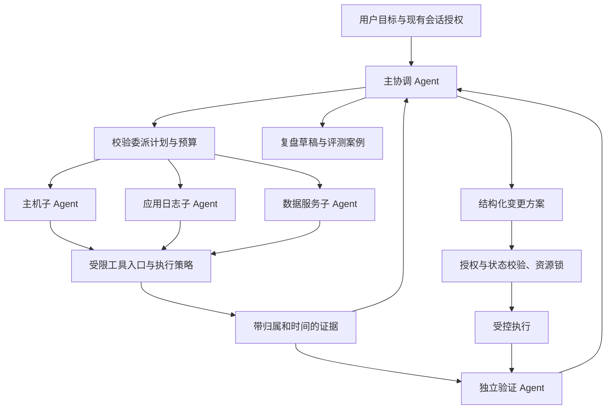

# Introduction

本方案面向当前 Go HTTP/AI/SQLite/SSH 后端、React 工作台与原生 macOS 客户端。交付内容仅为方案；下列任务全部未开始，不执行资源操作，不创建分支、PR、提交或发布。

产品目标：用户提出一次运维问题，Lake 主 Agent 按需要创建具有独立上下文的调查子 Agent，汇总可追溯证据，验证结论，并沿用现有会话权限处理后续操作。简单查询仍直接调用工具。首个可交付版本完成只读多 Agent 调查；生产变更与自主处置分阶段加入。

设计参考 Google 的 AI in SRE 文章：调查推理与确定性执行控制分离，处置后验证恢复，并使用历史事件评测。具体 Agent 名单、预算、接口及实施顺序均为 Lake 的设计选择，不代表 Google 的原始产品规格。

## 1. Requirements & Constraints

- **REQ-001**: 建立一个主协调 Agent 和八种内置角色模板。角色模板按任务创建实例，实例拥有独立模型历史、状态、工具范围和结果；不得用同一会话里的多条工具卡片冒充多 Agent。
- **REQ-002**: 首批交付主机诊断、应用日志、数据服务、独立验证四类；第二批增加网络诊断、变更关联；第三批增加变更方案；第四批增加复盘知识。未交付角色不得显示为可运行。
- **REQ-003**: 子任务必须声明目标、验收条件、资源范围、期限和预算；服务器校验后调度。需要用户选择资源时使用现有交互，不由模型猜测主机。
- **REQ-004**: 无独立调查需求的任务维持单 Agent 路径。多个资源的同一种标准快照使用有界并行工具采集；不同假设、领域或需持续追查的资源使用独立 Agent。
- **REQ-005**: 子 Agent 的事实必须引用服务器登记的证据；假设必须单独标注。未验证假设不得输出为已确认根因，部分任务失败不得被汇总为全部成功。
- **REQ-006**: 主 Agent 统一与用户对话、处理分歧及形成最终结果。独立验证先根据问题和原始证据形成自己的判断，再比较主 Agent 的候选结论。
- **REQ-007**: 全部子任务进度进入原会话，支持停止单个子任务和停止整轮；重启恢复历史与证据，不自动重放被中断或结果未知的操作。
- **REQ-008**: 保留原终端的归属、generation、contextVersion 和输入占用机制。调查默认使用受限的非交互采集，不争抢用户正在使用的 PTY。
- **REQ-009**: 父会话显示父子累计用量；每个子 Agent 单独显示上下文用量。累计 token 与单个模型的上下文窗口必须分别呈现，缺失的服务商用量标记为估算。
- **REQ-010**: 每次调查需要形成带证据的结果，变更阶段需要额外形成具体操作、回滚条件和验证标准；复盘阶段产生人工可修订的案例草稿。
- **SEC-001**: 有效权限取“父会话当前授权 ∩ 委派时的授权上限 ∩ 角色工具范围 ∩ 本次资源范围”。子 Agent 不得配置权限、切换到未分配资源、创建孙 Agent 或替其他实例授权。
- **SEC-002**: 现有 `silentReadFiles`、`silentReadSQL`、`silentCommands`、`silentTerminalCreation`、`blockUnreferencedAssets`、`denyLocalExecution` 及灾难性操作规则继续生效。已有授权不因委派重复询问；缺失的授权通过父会话现有策略处理。
- **SEC-003**: 只读角色不获得任意 shell、任意 SQL、Redis 写命令、文件写入或交互终端输入工具。采集工具使用服务器拥有的固定操作模板，不能凭提示词或模型给出的 `readonly=true` 判定安全。
- **SEC-004**: 子任务身份由服务器生成并通过可信运行上下文传递，不能从模型工具参数接受 parentSessionId、权限版本、credentialRef 或 approved 标志。跨父会话读取 runId、证据或审批返回拒绝。
- **SEC-005**: 模型密钥、SSH 私钥和其他秘密仅通过现有私有凭据设施供执行层使用，不进入子任务消息、前端、事件、日志和计划。运行不得读取 Keychain；所有新状态文件目录为 0700、文件为 0600。
- **SEC-006**: 日志、历史案例、SQL 结果、远端文件和子 Agent 报告均视为数据。它们不能成为扩大权限、绕过检查或调用隐藏工具的指令。
- **CON-001**: 后端使用 `internal/ai` 与 `internal/web`；前端使用 `web-agent/web`。历史 `agent/src`、`lake/workflow` 和旧 Electron/Wails 专员实现仅作为历史参考，不作为当前功能的运行依赖。
- **CON-002**: 当前 SQLite `events.type` 有 CHECK 约束。首版复用 `specialist` 事件通知客户端刷新，增加独立的 agentRuns/agentEvidence 数据，不将新角色硬塞进旧 specialists 状态定义。
- **CON-003**: 不复用 `Server.streamSlots` 作为模型并发限制；它是浏览器 SSE 连接限制。模型请求、Agent 实例和远端采集需要各自的限制器。
- **CON-004**: 保留现有 `core`、`terminal2`、`db-query-editor` 行为；已有会话和旧客户端能继续读取快照。新字段为可选字段，新界面无数据时不显示子任务区域。
- **CON-005**: 实施后的用户版本仍通过 `scripts/build_lake.sh` 和 `scripts/build_lake_desktop.sh` 签名构建，保留纯 arm64 安装包。当前本地未提交的上下文弹窗修复应保留，不混入方案交付或后续无关提交。
- **GUD-001**: UI 展示任务、证据、简明过程说明和结论，不要求公开完整原始思维链。后台记录工具参数、目标、耗时、退出码与状态，支持重建操作轨迹。
- **PAT-001**: 使用“主协调器 + 角色模板 + 独立子会话 + 证据仓库 + 统一工具执行入口”。角色负责推理，执行入口落实策略；模型审核不能替代程序检查。

### 1.1 当前实现与接入点

| 现有位置 | 已核实行为 | 接入要求 |
|---|---|---|
| `internal/ai/engine.go:359`，`Engine.ChatTurn` | 一套 State/History 驱动模型和工具循环 | 创建独立子会话，父历史仅加入结果摘要及证据索引 |
| `internal/ai/engine.go`，`Engine.invokeCalls` | 按顺序调用 `invoke` | 保留现有有副作用调用顺序；新增采集批处理和委派管理工具 |
| `internal/ai/tools.go`，`Engine.invoke` / `policy` | 工具目录、保留参数、权限和审批校验 | 新增角色/资源检查，并在真正执行前重验授权 |
| `internal/ai/catalog.go`，`sessionCatalog` / `Prompt` | 按 profile 暴露工具与提示词 | 再叠加角色白名单；子会话禁止委派工具 |
| `internal/web/agent.go`，`Server.runTurn` / `bridge` / `event` | 构建会话上下文、连接真实资源、更新会话状态 | 子事件映射回父会话，不能把 childId 当成真实 Web 会话 ID |
| `internal/web/store.go`，`OpenStore` / `migrate` / `Snapshot` | SQLite 迁移、恢复和快照 | 增加任务与证据存储，迁移前备份，启动时标记中断 |
| `internal/web/server.go`，`Server.Close`、快照/事件/abort 路由 | 停止后台、发送 SSE、处理整轮取消 | 取消和等待全部子任务后关闭执行设施与存储 |
| `web-agent/web/src/AIPanel.tsx`，`AITranscript` | 呈现父会话工具和回复 | 按 rootTurnId 插入紧凑子任务组，独立展开子任务详情 |

### 1.2 内置角色

| roleId | 显示名称 | 工作范围 | 首版工具能力 | 交付阶段 |
|---|---|---|---|---|
| `host` | 主机诊断 | CPU、内存、IO、磁盘、进程、系统服务 | 主机结构化快照和固定诊断操作 | Phase 3 |
| `application` | 应用与日志 | 容器、应用状态、日志模式与时间线 | 容器只读列表、限量日志、固定服务状态检查 | Phase 3 |
| `data` | 数据服务 | MySQL/PostgreSQL/Redis 性能、锁、连接、复制 | 经过版本适配的固定只读查询与 Redis 信息命令 | Phase 3 |
| `verify` | 独立验证 | 事实校验、假设验证、处置后验证 | 证据读取及对应领域的受限复测操作 | Phase 3 |
| `network` | 网络诊断 | DNS、TCP、TLS、代理、路由 | 固定网络诊断操作；探测目标必须在任务授权范围 | Phase 4 |
| `change` | 变更关联 | 发布/配置/依赖变更与故障时刻关联 | 已接入的版本、发布和变更记录适配器，只读 | Phase 4 |
| `plan` | 变更方案 | 产出有具体参数、影响和回滚条件的方案 | 证据/受支持动作目录读取；不执行方案 | Phase 5 |
| `memory` | 复盘与知识 | 事件时间线、成功/无效尝试、候选操作手册 | 同项目案例读取、复盘草稿生成 | Phase 6 |

MySQL、PostgreSQL、Redis 使用 data 角色下的能力模块。Docker 与 SSH 主机上的 Podman 分别适配，不假设 Docker API 能直接控制 Podman。Kubernetes、Grafana、GitHub 和 Jenkins 未接入时不声明已具备这些能力；角色返回 `missing_capability` 及所需接入项。

### 1.3 调度与运行边界

模式选项 `multiAgentMode` 取 `off | auto | manual`，默认 `off`；在 Phase 3 验收通过后，由会话设置开启。`manual` 由用户选择角色和资源；`auto` 允许主 Agent 提交委派提案，服务器仍验证范围和预算。关闭模式不取消已有审计数据。

调度判定分两步：先满足明确资源和能力等硬条件，再判断是否存在独立的分析目标。只要求相同标准指标、无持续分析的多资源查询使用 `collect_resource_snapshots`。不同诊断路径或不同领域的追查允许 `delegate_investigation`。模型提出的委派会显示明确子任务，不能把其自述当作已经启动。

`Engine.ChatTurn` 取得会话运行权后生成并持久化唯一 `rootTurnId`，父卡片和子任务均携带该ID。父模型没有返回工具调用但仍有未结束的子任务时，Harness等待任务事件而非反复调用模型；全部子任务达到终态后，通过服务器生成并配对保存的 `read_investigation` 工具调用/结果加入摘要，再调用父模型汇总一次。不能注入孤立tool消息，也不能伪造新的用户输入。父会话只有在子任务已终止且最终汇总已保存后才结束；取消优先于等待。

`wait_investigations` 返回pending时，下一次模型请求等待至少一个任务完成、预算/期限结束或用户输入事件，不以轮询触发模型空转。父任务组的complete/partial/unverified展示状态由子终态及验证结果计算，助手正文不能把部分失败组改成全部成功。

| 配置项 | 默认值 | 硬限制及处理 |
|---|---|---|
| `maxActiveRunsPerTurn` | 3 | 可配置 1–4；超额排队 |
| `maxActiveRunsServer` | 6 | 可配置 1–12；按父会话轮转取队列 |
| `maxDelegatedRunsPerTurn` | 8 | 包括验证任务和重试；达到上限拒绝新委派 |
| `maxDelegationDepth` | 1 | 子 Agent 无委派工具，执行入口同时拒绝递归 |
| `maxInflightModelRequests` | 4 | 子请求最多占 3，至少保留 1 个父请求槽；独立于 SSE |
| `childDeadlineSeconds` | 120 | 可配置 30–600；从 queued 入队时开始，父取消优先 |
| `modelRequestTimeoutSeconds` | 45 | 不超过子任务剩余时间 |
| `maxModelCallsPerChild` | 12 | 一次格式修正也计入，不无限重试 |
| `maxOutputTokensPerChildCall` | 2048 | 不超过父模型支持的输出上限 |
| `childTokenBudget` | 32768 | 输入输出累计计账；服务商不报告时估算并标识 |
| `delegatedTokenBudgetPerTurn` | 131072 | 所有子任务共享；额外调整需要新配置，不自动提高 |
| `childInitialContextBytes` | 16384 | UTF-8 字节，超额按证据摘要/分页收敛，不复制整段父历史 |
| `maxResultBytes` | 8192 | 超额结构化结果拒绝；证据正文通过 evidenceId 分页读取 |
| `maxToolOutputBytes` | 16384 | 保存限量摘要、截断标记与可追溯原文位置 |
| `maxConcurrentReadsPerResource` | 2 | 非交互读取并发限制；同一交互终端仍单一占用 |
| `maxReadOperationSeconds` | 10 | 不支持取消的驱动/采集操作不得标为可委派 |
| `eventFlushMilliseconds` | 100 | 状态和结果立即持久化；展示增量合并发送 |

token 预算在请求前预留，响应后用已知用量结算；缺失用量按已记录的请求体字节与输出上限保守估算。请求次数、输出上限、并发、工具范围和期限是程序约束；不声称估算 token 等于服务商实际账单。因预算或期限退出的任务呈现未完成及已采集证据。

父会话模型设置默认由子任务继承；角色不擅自更换供应商或模型。模型请求退避只允许在尚未产生工具执行或模型输出的临时连接失败时进行一次，仍消耗同一期限和请求预算。

### 1.4 状态、契约与持久化

状态集合：`queued | running | waiting_permission | cancelling | completed | failed | cancelled | interrupted | budget_exhausted`。

允许的转换为 queued→running/cancelled/interrupted/budget_exhausted；running→waiting_permission/cancelling/completed/failed/interrupted/budget_exhausted；waiting_permission→running/cancelling/failed/interrupted/budget_exhausted；cancelling→cancelled/interrupted。completed/failed/cancelled/interrupted/budget_exhausted 是终态，不能被迟到事件改回运行中。重试创建新 runId，保留 retryOf，重新计入额度。

| 类型 | 必填字段与验证 |
|---|---|
| `DelegationRequest` | roleId、goal、resourceRefs、acceptanceChecks、clientRequestId；服务器生成 runId、parentSessionId、rootTurnId、childSessionId、scopeVersion、期限和预算；goal ≤2048 UTF-8 字节，acceptanceChecks 1–8 条且每条 ≤512 字节，resourceRefs 1–8 个 |
| `AgentRun` | 上述服务器身份；roleVersion、status、resourceIds、createdAt、startedAt、finishedAt、budget、usage、result、error、pendingApproval、retryOf；所有时间为 RFC3339 UTC |
| `AgentEvidence` | evidenceId、parentSessionId、runId、resourceId、operationId、capturedAt、targetGeneration、parametersDigest、excerpt、contentDigest、exitCode、truncated、sourceLocator；这些字段由采集层登记，模型不能伪造 |
| `AgentResult` | schemaVersion=1、summary、observations、hypotheses、unknowns、nextChecks、verification；最终输出为可直接解析的JSON对象，禁止代码围栏与额外前后文本；summary ≤2048 字节；每个事实引用至少一个本父会话、本授权范围内 evidenceId；数组各自最多16项；nextChecks 最多8项 |
| `Observation` | statement、evidenceIds、observedAt；observedAt 必须由引用证据的采集时间导出 |
| `Hypothesis` | statement、supportingEvidenceIds、contradictingEvidenceIds、state=unverified/verified/refuted、confidence=low/medium/high；verified 必须引用验证结果或确定性检查，不能仅凭模型自评 |
| `Verification` | verdict=supported/refuted/inconclusive、checkResults、evidenceIds；任务 completed 仅表示调查结束，不代表故障解决 |

新增 SQLite 表 `agentRuns`、`agentEvidence`、`agentRunEvents`，通过 `internal/web/agent_store.go` 的 `AgentRepository` 实现持久化。agentRuns 为独立任务实体，parentSessionId 外键指向 sessions；agentEvidence/runEvents 外键指向 agentRuns。资源范围、任务、预算、用量及结果保存为版本化 JSON，状态 CHECK 使用上述完整集合。加入 `(parentSessionId, rootTurnId, clientRequestId)` 唯一索引与 `(parentSessionId, createdAt, id)` 查询索引。

每次状态/结果变更与其事件同一 SQLite 事务提交，再通知 SSE。首次外部采集之前必须已有 queued 记录及已验证的 Scope。父会话删除流程先停止活动子任务，再按外键删除其任务数据；原 specialists 历史保持原样。

子模型历史存于 `<Engine.Dir>/children/sub_<32位十六进制ID>.json`，不创建新的用户项目会话。使用独立子 Engine 与独立 Config，保存过程继续调用现有脱敏/原子写入；不能让父 Configure/Clear/Compact 覆盖子历史。SQLite 保存产品可查询状态，JSON 保存模型历史，启动时两者不一致即标记 interrupted，不猜测已执行操作是否成功。

主 Agent 工具：`delegate_investigation`、`wait_investigations`、`read_investigation`、`cancel_investigation`、`collect_resource_snapshots`。等待单次最多 5 秒，返回 pending 或完成快照；浏览器断连不取消任务。模型不能直接指定 allowlist、权限版本、deadline 或增加预算。

子结果JSON解析或schema校验失败时，允许一次仅用于修正格式的模型请求，该请求不开放工具并计入预算；再次失败记为failed/result_invalid，保留已登记证据，不把普通自然语言替代为已验证结果。

新增受认证的 HTTP 接口：

| 方法与路径 | 行为 |
|---|---|
| `GET /api/sessions/:id/agent-runs` | 按 turnId 可选过滤；分页每页最多50条，返回任务摘要和 nextCursor |
| `GET /api/sessions/:id/agent-runs/:runId` | 校验父归属后返回详情，模型历史另行分页且仅包含脱敏的可展示记录 |
| `POST /api/sessions/:id/agent-runs` | 仅 manual 模式调用；验证同一 DelegationRequest，不允许正文指定服务器身份 |
| `POST /api/sessions/:id/agent-runs/:runId/cancel` | 幂等发起单任务取消，重复请求返回同一终态/取消状态 |
| `POST /api/sessions/:id/agent-runs/:runId/decision` | approvalId、accept、confirmation；映射该子会话的审批，不能代替父审批或别的子审批 |
| `GET /api/sessions/:id/agent-evidence/:evidenceId` | 校验父归属及资源授权，分页返回有限证据内容 |

`SessionSnapshot.agentRuns` 为可选字段，默认只返回当前/最近一轮的最多8条任务摘要。历史任务走分页接口。`AIView.delegatedUsage` 与 `aggregateUsage` 为可选字段；原 usage 继续表示父模型自身用量。子事件复用父会话 existing `specialist` SSE 事件，按现有 cursor 获取新快照；不为每个子 Agent 新开 SSE 连接。

### 1.5 受限采集、验证与处置

采集接口采用 `diagnose_resource(operationId, asset_ref, parameters)`。固定注册表返回 role、支持的资源种类、允许参数、输出上限、超时和风险。初批 operationId：`host.cpu_snapshot`、`host.memory_snapshot`、`host.disk_snapshot`、`host.process_snapshot`、`application.service_status`、`application.container_status`、`application.logs`、`data.connections`、`data.locks`、`data.replication`、`data.redis_info`。

采集模板及查询由版本适配器持有。日志参数仅允许服务/容器的已发现 ID、开始/结束时间、limit≤2000；进程参数仅允许已发现的 PID；SQL 使用固定系统视图查询及绑定参数，并使用数据库只读执行能力、statement timeout 与行数上限。Redis 只暴露固定信息读取。未支持的平台/版本返回 not_supported，不能退回执行模型自由生成的命令。连接、主机密钥、文件路径、资源归属和会话权限检查仍从原执行路径通过。

子 Engine 的 Bridge 在进入 `Server.bridge` 前，由 Manager 以可信 childSessionId 查询 RunScope，映射为真实父 sessionId，同时保留 runId 以登记证据。`Engine.invoke` 中直接走 runtime/services 的路径也必须执行同样的 Scope 检查，不能只在 Web Bridge 检查。

验证 Agent 的第一轮仅接收用户目标、验收条件和原始证据，完成后保存独立判断；第二轮才接收候选结论以比较分歧。处置后的验证必须采集新证据，不复用处置前快照。涉及 CPU 等动态指标时记录采样窗口，允许 verdict=inconclusive，不把不同时刻的差异视为程序错误。

变更方案的阶段性实现：`ActionPlan` 必须包含 actionId、resourceId、operationId、精确参数、evidenceIds、preconditions、权限指纹、目标 generation/version、expectedEffect、rollback、verificationChecks 和 expiresAt。方案最长有效300秒。执行前重新验证状态、权限和并发冲突，已有审批指纹匹配时复用授权；变化后重新评估，不默认执行旧方案。

执行器先接入现有结构化操作，不能创建通用“执行任意修复脚本”入口。仅在适配器确有预览能力时提供 dry-run；不支持预览的操作返回 preview_supported=false，不把一次真实执行包装为 dry-run。每次变更占有对应资源的独占锁，执行完成后释放再进行独立验证；结果未知时先检查现状，禁止自动重试。回滚本身同样经过有效授权和状态检查。

### 1.6 产品界面与发布路线

主会话展示紧凑任务组，例如“并行调查：3/4 完成”，下面每行只显示角色、资源、当前阶段、状态和耗时。完成的任务默认折叠，展开后显示事实、假设、证据、失败原因及用量；按需打开单个子任务详情。默认不增加永久侧栏，不为多个 Agent 同时打开多个聊天窗口。停止整轮按钮沿用现有发送框停止入口，任务行提供停止单个任务。

设置入口显示 off/auto/manual 和可用角色；预算高级设置折叠。创建、排队、采集、分析、等待授权、验证和结束必须来自真实运行状态。界面不能仅根据助手正文中“正在分工”显示已启动任务。新的卡片与上下文弹窗沿用现有视觉体系，在可调分栏内完整呈现。

Phase 1–3 完成形成首个候选里程碑 `v0.4.0`，默认 off；Phase 4–6 分别通过后再启用对应角色/操作。实现阶段使用 `codex/feature-multi-agent-runtime-1` 分支向 master 提交 PR，PR 中附状态/权限/取消/真实多模型调用的验证证据；合并和发布依用户后续指令执行。本方案交付不创建该分支。

## 2. Implementation Steps

### Implementation Phase 1

- **GOAL-001**: 完成角色、Scope、契约和追加迁移。依赖：无。完成标准：旧数据库可备份迁移，非法角色/身份/资源被拒绝，已有单 Agent 测试通过，新功能保持关闭。

| Task | Description | Completed | Date |
|------|-------------|-----------|------|
| TASK-001 | 在 `internal/ai/agents/types.go` 声明1.3–1.5中的配置、状态、DelegationRequest、AgentRun、AgentEvidence、AgentResult、RunScope及Repository接口；实现 ValidateRequest/ValidateResult/CanTransition，禁止模型设置可信字段。 | No | 未开始 |
| TASK-002 | 在 `internal/ai/agents/registry.go` 实现 Registry/AvailableRoles，注册八个带roleVersion=1的模板；host/application/data/verify初期能力为false，按采集适配器就绪情况开启；在 `internal/ai/prompts/agents/` 添加八个职责提示词，保证提示词不产生权限。依赖TASK-001。 | No | 未开始 |
| TASK-003 | 在 `internal/web/schema.sql`、`internal/web/agent_store.go`、`internal/web/store.go` 实现新表、索引与AgentRepository；在OpenStore修改schema前检测新增表并对旧库执行私有备份；状态变更与agentRunEvents事务提交，发父会话specialist事件。依赖TASK-001。 | No | 未开始 |
| TASK-004 | 在 `web-agent/shared/contracts.ts` 添加AgentRun/AgentResult/AgentEvidence摘要及可选快照/用量字段、AICard.rootTurnId；不删除Specialist、SessionEvent或旧AIView字段。同步 `internal/ai/types.go` 新增Config.AgentScope、Config.AgentRole、State.CurrentTurnId、Card.RootTurnId及可选展示字段。依赖TASK-001。 | No | 未开始 |

### Implementation Phase 2

- **GOAL-002**: 建立真正的独立子会话、限制器、取消与恢复。依赖：Phase 1。完成标准：三个子模型调用可重叠，历史相互隔离；取消停止新执行，重启不重放；子终态不改变父会话状态。

| Task | Description | Completed | Date |
|------|-------------|-----------|------|
| TASK-005 | 在 `internal/ai/agents/scheduler.go` 实现Manager.Submit/Wait/List/CancelRun/CancelTurn/Shutdown及公平队列，采用1.3默认限制与每轮去重键；入队前保存RunScope和queued记录。依赖TASK-001、TASK-003。 | No | 未开始 |
| TASK-006 | 在 `internal/ai/agent_runtime.go` 实现ChildRunner，使用独立子Engine、children目录和sub_标识；增加EngineOptions.AllowDelegation，子Engine固定false；子Config过滤Assets并绑定任务角色，模型配置只在内存继承，Emit回调携带可信父/子身份。依赖TASK-002、TASK-005。 | No | 未开始 |
| TASK-007 | 在 `internal/ai/agents/budget.go` 实现原子请求预留、usage结算、期限和请求次数限制；在 `internal/ai/provider.go` 的请求入口增加可注入模型请求限制器，根/子槽位分开且不使用Server.streamSlots。依赖TASK-001、TASK-005。 | No | 未开始 |
| TASK-008 | 在 `internal/ai/engine.go` 的Abort/Shutdown和 `internal/web/server.go` 的Close串接Manager取消、关闭准入与join；先停止子请求/采集并持久化终态，再关闭子Engine、终端和存储；Store启动时将非终态任务标为interrupted。依赖TASK-005、TASK-006、TASK-007。 | No | 未开始 |
| TASK-009 | 在 `internal/web/agent_bridge.go` 实现childId→RunScope→父sessionId映射；在 `internal/web/agent.go` 的event分支将子事件路由至agentRuns，禁止子done更新父session状态，停止使用裸childId查询Store.Session。依赖TASK-003、TASK-006。 | No | 未开始 |

### Implementation Phase 3

- **GOAL-003**: 上线四类只读子 Agent与工作台界面，形成v0.4.0候选。依赖：Phase 2。完成标准：主机/应用/数据调查与独立验证可真实运行，越权与终端争抢测试通过；用户能查看证据、单独取消和停止整轮；功能关闭时无行为变化。

| Task | Description | Completed | Date |
|------|-------------|-----------|------|
| TASK-010 | 在 `internal/web/agent_observations.go` 和 `internal/ai/agents/observations.go` 实现1.5固定操作注册表、参数约束、取消、超时及能力发现，向registry.go报告首批四角色的实际可用能力；复用 `internal/ai/runtime.go`、`services.go` 和 `internal/web/terminal_access.go` 的连接/目标检查，但不获得用户PTY输入权；为MySQL/PostgreSQL/Redis提供版本适配固定只读查询。依赖TASK-009。 | No | 未开始 |
| TASK-011 | 在 `internal/ai/tools.go` 的invoke/policy、`internal/ai/catalog.go` 的sessionCatalog实现角色白名单及执行前Scope重验，覆盖Bridge和直接runtime路径；新增服务器权限快照读取，权限撤销即时拒绝后续执行并取消受影响任务，权限放宽不扩大既有Scope。依赖TASK-010。 | No | 未开始 |
| TASK-012 | 在 `internal/ai/agent_tools.go` 及tool-catalog.json实现五个主Agent工具；新增collector批处理有界并行采集，保留invokeCalls原有写调用串行；在Engine.ChatTurn生成rootTurnId，并按1.3执行父回合结束门、事件驱动等待与配对结果注入；core且模式允许时暴露委派，子catalog始终拒绝递归。依赖TASK-007、TASK-011。 | No | 未开始 |
| TASK-013 | 在 `internal/ai/agents/results.go` 登记证据、验证引用、限制结果大小并汇总已知/未知项；在 `internal/ai/agent_verification.go` 实现两轮独立验证，第二轮只能在第一轮判断持久化后启动；验证报告不得成为新的授权凭据。依赖TASK-010、TASK-012。 | No | 未开始 |
| TASK-014 | 在 `internal/web/agent_api.go` 实现1.4接口；修改server.go快照/abort/删除会话路由，增加分页和父归属验证；子审批分别路由到ChildRunner.Decision，保留父AIView.pending，多个子审批不能相互覆盖。依赖TASK-009、TASK-011、TASK-013。 | No | 未开始 |
| TASK-015 | 在 `web-agent/web/src/AgentRunGroup.tsx`、`AgentRunDetail.tsx`、`agentRuns.ts` 实现1.6紧凑任务组和详情；在AIPanel.tsx接入，api.ts添加请求函数，App.tsx订阅已有specialist刷新；styles.css适配窄分栏、键盘导航与取消状态。依赖TASK-004、TASK-014。 | No | 未开始 |
| TASK-016 | 在ContextUsage.tsx展示父上下文与累计父子用量的区别；在App.tsx会话设置增加off/auto/manual；在 `internal/web/agent.go` defaults/configure校验新配置，子任务权限缺失沿用当前会话流程，不增加逐任务无意义确认。依赖TASK-007、TASK-014、TASK-015。 | No | 未开始 |
| TASK-017 | 在 `internal/ai/agents/*_test.go`、`internal/web/agent_runs_test.go`、`web-agent/web/test/agent-runs.test.ts` 落实TEST-001至TEST-013；用假模型与本机隔离SSH/数据库夹具完成真实多Agent验证，再进行经授权的只读资源验证；执行1.3预算观测、签名打包与UI验收，输出验证记录。依赖TASK-008、TASK-010至TASK-016。 | No | 未开始 |

### Implementation Phase 4

- **GOAL-004**: 增加网络诊断和变更关联角色。依赖：Phase 3。完成标准：支持的适配器返回可追溯证据，缺少集成时明确不可用，不产生越界探测或伪造发布记录。

| Task | Description | Completed | Date |
|------|-------------|-----------|------|
| TASK-018 | 在 `internal/web/agent_network.go` 注册DNS/TCP/TLS/代理/路由固定读取；参数使用授权endpoint集合和已发现服务ID，禁止扫描未授权网段，设置10秒期限、有限探测次数和输出边界；验证IPv4/IPv6及目标归属。依赖TASK-010、TASK-011。 | No | 未开始 |
| TASK-019 | 在 `internal/web/agent_changes.go` 实现ChangeSource接口、AvailableSources及版本/配置记录适配器；首个适配器读取已分配项目的Git和已接入发布元数据；CI外部适配器未配置则返回missing_capability，不自动安装插件或读取任意凭据。依赖TASK-010、TASK-011。 | No | 未开始 |
| TASK-020 | 在registry.go启用network/change能力，增加时间窗口和资源关联的证据核验；在AgentRunDetail.tsx显示变更时间线与“相关但未证实因果”状态，测试跨项目记录不可见与时区转换。依赖TASK-018、TASK-019。 | No | 未开始 |

### Implementation Phase 5

- **GOAL-005**: 接入变更方案与受控执行，保留当前授权策略。依赖：Phase 3；网络/变更来源仅在方案引用该能力时依赖Phase 4。完成标准：精确方案可预览、过期/授权变更/资源冲突被程序拦截，执行后有新证据验证，未知结果不重放。

| Task | Description | Completed | Date |
|------|-------------|-----------|------|
| TASK-021 | 在 `internal/ai/agents/action_plan.go` 定义1.5的ActionPlan、校验器和只读plan角色输出；必须给出operationId与目标参数，允许建议使用的操作只来自已接入动作目录；把缺少预览/回滚能力作为明确字段呈现。依赖TASK-013。 | No | 未开始 |
| TASK-022 | 在 `internal/web/agent_actions.go` 实现EvaluatePlan/ExecutePlan/GetActionState，重用现有policy、approvalKind、危险操作保护与终端generation校验；精确审批指纹保持有效时不重复确认；CAS保存执行状态、采用已有会话授权，不接受模型自批。依赖TASK-011、TASK-021。 | No | 未开始 |
| TASK-023 | 在 `internal/ai/agents/resource_locks.go` 实现资源独占变更锁，并使所有会触及同一资源的父/子执行入口参加检查；多个资源按resourceId排序加锁，取消/超时释放；关闭执行后再触发独立验证，避免持锁调用另一Agent死锁。依赖TASK-022。 | No | 未开始 |
| TASK-024 | 在 `internal/web/agent_action_verification.go` 按verificationChecks采集新证据；支持失败、inconclusive与已授权回滚路径；进程重启后动作unknown先查询现状，不能自动重新执行或无授权回滚。前端在AgentRunDetail.tsx显示预期/实际结果、回滚与验证依据。依赖TASK-013、TASK-023。 | No | 未开始 |
| TASK-025 | 测试TEST-014至TEST-017并建立受支持动作白名单；未达到验收标准的动作继续只输出草案，禁止进入自动执行目录。验收记录必须覆盖成功、失败、未知结果、资源锁及审批过期路径。依赖TASK-021至TASK-024。 | No | 未开始 |

### Implementation Phase 6

- **GOAL-006**: 建立复盘、人工确认案例和离线评测。依赖：Phase 3；涉及变更案例时依赖Phase 5。完成标准：同项目案例可查询，未经确认的草稿不会自动升为已验证手册，离线评测不能操作生产资源。

| Task | Description | Completed | Date |
|------|-------------|-----------|------|
| TASK-026 | 在 `internal/web/agent_memory.go` 与schema.sql/migrate增加incidentCases，保存问题、时间线、证据、方案、结果、版本及draft/reviewed状态；只读取同项目授权案例，memory角色输出草稿，用户修改/确认后记录reviewed及确认者。依赖TASK-003、TASK-013。 | No | 未开始 |
| TASK-027 | 在 `internal/ai/agents/evaluation.go`、`internal/ai/agents/testdata/incidents/` 实现离线Runner/Score，使用合成或脱敏人工确认样本；评分分别记录目标正确性、证据引用、诊断结论、动作参数、取消/越权与未知结果处理；录制结果经夹具注入，执行工具连接器固定禁用。依赖TASK-017、TASK-026。 | No | 未开始 |
| TASK-028 | 建立至少30个reviewed评测样本，覆盖主机/应用/数据/网络、部分失败及证据不足；新角色/提示词/模型版本须通过零越权、零未知写重放和明确验收项。生成docs/validation报告，不凭模型自评分数提升自动化级别；定期运行的调度另行配置。依赖TASK-020、TASK-025、TASK-027。 | No | 未开始 |

## 3. Alternatives

- **ALT-001**: 把已有specialists记录或工具卡片改名为Agent。缺少独立历史和调用证据，不能满足REQ-001，因此不采用。
- **ALT-002**: 每个子Agent创建用户可见的普通会话。容易混淆父会话权限、终端归属与项目导航，首版选择内部childSessionId及父会话任务组。
- **ALT-003**: 子Agent共享父State/History。会产生跨资源信息混入和压缩竞争，选择独立历史加证据索引。
- **ALT-004**: 直接并行所有invokeCalls。会打乱有副作用操作和审批顺序，选择专用只读批处理及任务调度器。
- **ALT-005**: 第一版引入Redis队列、A2A服务或独立进程集群。当前单机桌面Go服务可用内存调度、SQLite持久化和已有模型适配器交付；远程工作节点作为未来独立方案。
- **ALT-006**: 首版开放子Agent任意shell，仅依赖模型承诺只读。无法保证角色权限边界，选择固定采集操作及原执行策略复验。

## 4. Dependencies

- **DEP-001**: 当前Engine.ChatTurn、模型Stream、工具目录、权限和脱敏组件；不更换模型SDK或默认供应商。
- **DEP-002**: 当前SQLite Store、快照、specialist事件和SSE游标；新增表与可选字段兼容旧客户端。
- **DEP-003**: 当前SSH、Docker、SQL、Redis工具及主机密钥/终端授权机制；具体平台能力由适配器检测，未接入能力不可被角色承诺。
- **DEP-004**: React现有AITranscript、ContextUsage和会话权限UI；使用已有依赖完成任务组和详情，不新增UI框架。
- **DEP-005**: 现有持久macOS签名身份与构建脚本；所有用户安装包必须签名。
- **DEP-006**: Phase 4的外部CI/监控数据来源和Phase 6的reviewed历史样本不作为Phase 3启动依赖；缺失时角色能力保持关闭。

## 5. Files

- **FILE-001**: 新增 `internal/ai/agents/types.go`、`registry.go`、`scheduler.go`、`budget.go`、`observations.go`、`results.go`及对应*_test.go，负责角色、调度和数据验证。
- **FILE-002**: 修改 `internal/ai/engine.go`、`types.go`、`catalog.go`、`tools.go`、`provider.go`、`tool-catalog.json`；新增 `agent_runtime.go`、`agent_tools.go`、`agent_verification.go`，负责父子Engine与调用入口。
- **FILE-003**: 新增 `internal/ai/prompts/agents/host.txt`、`application.txt`、`data.txt`、`verify.txt`、`network.txt`、`change.txt`、`plan.txt`、`memory.txt`，负责职责和结果格式。
- **FILE-004**: 修改 `internal/web/schema.sql`、`store.go`、`agent.go`、`server.go`；新增 `agent_store.go`、`agent_bridge.go`、`agent_observations.go`、`agent_api.go`、`agent_runs_test.go`，负责产品状态、资源执行与接口。
- **FILE-005**: 修改 `web-agent/shared/contracts.ts`、`web-agent/web/src/api.ts`、`AIPanel.tsx`、`App.tsx`、`ContextUsage.tsx`、`styles.css`；新增 `AgentRunGroup.tsx`、`AgentRunDetail.tsx`、`agentRuns.ts`与 `web-agent/web/test/agent-runs.test.ts`。
- **FILE-006**: Phase 4新增 `internal/web/agent_network.go`、`agent_changes.go`及对应测试；Phase 5新增 `internal/ai/agents/action_plan.go`、`resource_locks.go`与 `internal/web/agent_actions.go`、`agent_action_verification.go`及对应测试。
- **FILE-007**: Phase 6新增 `internal/web/agent_memory.go`、`internal/ai/agents/evaluation.go`及测试/夹具；迁移新增案例表，保留审计记录。
- **FILE-008**: 新增 `docs/validation/lake-multi-agent-v1.md` 记录实施验收；更新README.md说明已上线能力及实际限制。当前方案文件本身不是功能完成记录。

## 6. Testing

- **TEST-001**: 同轮三个子任务的假模型请求有实际重叠；模型历史只包含各自目标/证据，任一子历史不含其他实例的私有上下文；禁止仅根据UI卡片数量判定多Agent成功。
- **TEST-002**: 第四任务排队，服务端公平轮转；并发、深度、任务数、模型请求与期限上限均生效；等待授权不占用模型请求槽。
- **TEST-003**: 子Agent调用未公开工具、伪造父session、approved、内部参数、资源别名或凭据引用均被拒绝；直接runtime路径与Bridge路径均测试。
- **TEST-004**: 两个父会话不能读取、取消或批准对方任务；子审批互不覆盖；父审批继续使用原指纹和generation机制。
- **TEST-005**: 模型返回写SQL、Redis写操作、自由shell或日志中的越权指令无法通过固定采集入口；父会话silentCommands=true仍不会扩展只读子角色。
- **TEST-006**: 委派后撤销授权，下一次执行被拒绝，运行任务停止；授权放宽不扩大旧Scope；有效授权不产生重复确认。
- **TEST-007**: 取消单任务不影响兄弟任务或用户PTY；整轮取消停止队列、新调用与正在运行的支持取消采集，3秒内显示停止状态；Shutdown等待状态持久化，没有关闭Store后继续写入。
- **TEST-008**: 重启时queued/running/waiting_permission均变为interrupted；仅加载记录，不重新执行；显式重试生成新runId，费用/次数和retryOf正确。
- **TEST-009**: 虚构、跨任务或跨资源evidenceId不能成为有效事实；事实、假设、未知项区别展示；证据截断不显示为完整采集。
- **TEST-010**: verify第一轮未接收到父候选结论；错误结论被refuted或inconclusive；处置后验证引用新证据，动态采样时间清楚记录。
- **TEST-011**: 迁移前备份、老快照兼容、specialist事件cursor续接、分页和并发更新无重复任务；父模型先结束文本而子任务仍运行时父回合保持活动，任务完成后仅一次最终汇总，History不产生孤立tool；等待不造成模型轮询；子completed不使仍运行的父会话变成completed。
- **TEST-012**: Provider报告用量与缺失用量两条路径均测试；父子用量不重复计入；预算到达后不启动新请求，估算明确标识，结果与历史文件无秘密夹具内容。
- **TEST-013**: UI验证取消、失败、部分完成、等待授权、终态折叠、键盘访问及窄分栏；同时打开多个Agent详情不创建额外SSE；上下文弹窗、窗口拖动和终端操作保持可用。
- **TEST-014**: 方案超时、资源generation变化、授权指纹变化、未支持operationId或参数修改在真正执行前被拒绝；dry-run不支持时如实返回，不触发真实操作。
- **TEST-015**: 两个父/子Agent同时修改同资源时只有一个获得执行锁；多资源锁顺序无死锁，取消/错误释放锁，随后独立验证可获取资源。
- **TEST-016**: 变更成功、失败、连接丢失未知结果、回滚失败及验证不确定均分别呈现；unknown不自动重新执行，回滚未获有效授权时不执行。
- **TEST-017**: 模型给出“验证通过”或审查Agent赞同，不能绕过程序授权、预检查和资源锁；已授权的精确计划没有重复审批。
- **TEST-018**: 复盘草稿与reviewed案例隔离，跨项目案例不可检索；恶意历史案例不能改工具权限；离线评测夹具不连接真实资源，也不自动形成生产执行授权。

实施检查命令：`pnpm --dir web-agent check`、`pnpm --dir web-agent test:frontend`、`pnpm --dir web-agent build:web`、`go test -race ./...`、`go vet ./...`、`swift run --package-path client/macos --build-system native LakeUpdateTests`、`python3 scripts/test_lake_macos_installer.py`。Go测试前生成并复制React内嵌资源，用户安装包使用签名脚本构建。新增multi-agent测试使用可控假模型/隔离资源，不靠随机真实模型结果判定稳定性。

性能验收夹具：三个独立模型各延时2秒、各采集操作100毫秒时，三任务从启动到汇总应在4秒内完成；最大同时子模型请求不超过3。执行100轮、每轮8个子任务的取消/完成混合测试后队列、运行句柄和锁数量归零。真实供应商性能另行记录，不将夹具耗时当作用户环境承诺。

## 7. Risks & Assumptions

- **RISK-001**: SQLite产品状态与JSON模型历史之间存在崩溃窗口；采用先落任务再执行、原子JSON写入与启动interrupted策略，不自动补执行。
- **RISK-002**: 模型和工具增量输出可能拖慢SSE/SQLite；状态变化立即提交，内容增量100毫秒合并，正文分页，避免每token写事件。
- **RISK-003**: 多Agent有调用和协调开销；默认off、简单查询走工具批处理、显式预算与独立上下文摘要防止无效扩展。
- **RISK-004**: 父/子事件、审批和终端身份容易混淆；可信身份映射、单独审批接口及跨会话测试是首版上线条件。
- **RISK-005**: 权限判断分散于Web Bridge与AI直接runtime/services路径；新增Scope检查必须覆盖两者，不能仅过滤模型看见的工具目录。
- **RISK-006**: 供应商用量或取消机制不完整；显示估算且依靠期限/次数限制，取消不支持的诊断适配器不开放委派，迟到结果不能改终态。
- **RISK-007**: 检测到相关变更不等于定位根因，短期指标改善不等于事故恢复；验证与证据不足状态必须保留。
- **RISK-008**: 首版只读调查权限收敛不能保证所有应用日志/数据库查询都零负载；限制行数、时间窗口、采集并发和执行期限，禁止无限日志与全表扫描。
- **ASSUMPTION-001**: 当前请求授权方案设计与本地文件交付，未授权实施、启动子Agent、连接生产资源、提交、推送或发布。
- **ASSUMPTION-002**: 当前活跃产品以Go/React/macOS路径为准，用户现有项目、会话、资源、终端和私有凭据继续沿用。
- **ASSUMPTION-003**: v0.4.0是首个实现里程碑的规划目标；本次不修改VERSION或已发布v0.3.1附件。后续实际实施和发布由用户指令启动。
- **ASSUMPTION-004**: 首版角色使用当前配置模型，无自动供应商切换；多模型路由与远程Agent服务不属于首版。

## 8. Related Specifications / Further Reading

- [Google：AI in SRE — How Google is Engineering the Future of Reliable Operations](https://sre.google/resources/practices-and-processes/ai-engineering-reliable-operations/)
- [项目构建与凭据规则](../AGENTS.md)
- [当前Go Agent引擎](../internal/ai/engine.go)
- [当前工具策略入口](../internal/ai/tools.go)
- [当前Web Agent桥接](../internal/web/agent.go)
- [当前SQLite结构](../internal/web/schema.sql)
- [当前前后端契约](../web-agent/shared/contracts.ts)
- [历史工作流规划方案](feature-workflow-planning-1.md)：仅用于了解既往设计，不作为当前Go多Agent的实现依赖。
