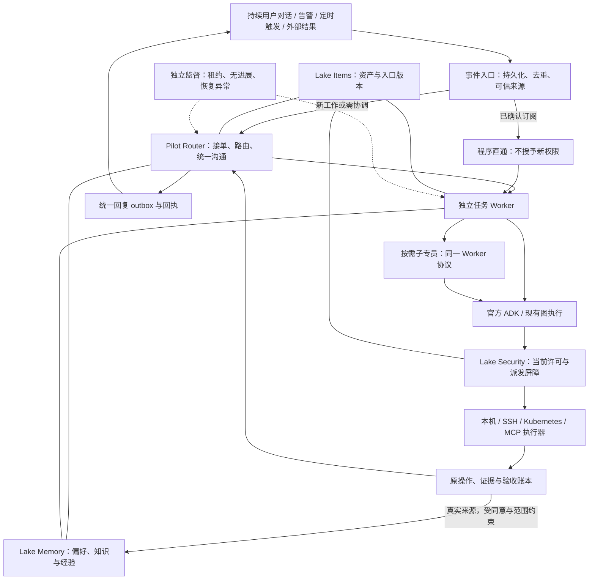

# Introduction

本方案落实用户确认的方向：Lake 统一采用 Super-agent 业务运行架构；用户持续与 Pilot 沟通，由系统创建和协调专员，用户无需创建、命名、切换或维护执行会话。普通操作、Plan、SRE、保存的工作流、定时任务和外部结果逐步进入同一任务与事件链路。官方 ADK 继续承载模型/工具循环和工作流图；Lake Items、Security、Memory 保留各自权威职责。

用户于 2026-11-02 授权完整实施并安装 Lake Dev。当前在独立 `codex/superagent-kernel` 工作区实施，逐项记录完成情况；未完成项保持 false。正式版和 Memory 既有开关继续遵守隔离与分工约束。用户认可 UI 概念不等于原生客户端已经实现；DeepSeek 设计文章、公开原型和 Lake 的实现建议分别标注，不把文章中的未来方向写成原型已有功能。

交付后的主要使用场景：用户说“排查订单超时，构建完成后告诉我”，Pilot 建立两项独立工作；订单工作按需组织应用、数据库和验证专员；构建工作跟踪原编号。用户补充“订单只调查，不改配置”时，原订单工作收到约束，构建继续。相关结果由 Pilot 汇总，详细步骤、证据和原终端在当前 Dev 风格的三联视图中查看。

## 1. Requirements & Constraints

- **REQ-001**: Super-agent 是最终唯一业务运行架构；普通任务、SRE、工作流和后台等待不得保留彼此竞争的接单、调度和结清主链路。迁移开关只控制接入批次，不成为永久用户模式。
- **REQ-002**: Pilot 是持续的 Router 身份，负责交互、新工作路由、跨任务协调与统一回复。纯文本问答可直接回复；资源 I/O、耗时调查和持续跟进必须交给 Worker，Router 工具目录不包含 shell、SQL、终端输入或资源变更工具。
- **REQ-003**: Worker 专注一项工作，拥有独立上下文、可信任务绑定、预算、输入收件箱和检查点。复杂 Worker 可以通过同一受控协议组织子专员；不保留另一套常驻 SRE 总指挥内核。
- **REQ-004**: 专员身份与执行实例分离。同一“数据库专员”处理两项故障时，使用不同 Worker 与执行 Session；角色模板、显示名称和相同资源均不构成共享上下文或授权的依据。
- **REQ-005**: 每个事件先持久化、去重并验证来源。已确认归属的后续事件程序直达原工作；未归属、跨任务和有歧义的要求进入 Router；事件关联不能直接等同于故障归并或操作许可。
- **REQ-006**: Task 的业务状态、操作结果、验收结果分开保存。Worker 报告不是验收凭证；一次命令成功、Memory 总结或其他任务成功均不能结清本任务。
- **REQ-007**: 用户新消息可在模型/工具安全步骤接入当前工作，保持原任务、真实来源和执行记录；外部等待释放活跃执行槽，未变化状态不触发模型空转。
- **REQ-008**: 所有用户可见问题、关键进度和结果通过 Pilot 的输出通道与回执处理；专员详情可查看，向专员补充消息仍经过宿主记录与 Router 归属。界面只展示简明执行过程、工具与证据，不要求公开完整原始思维链。
- **REQ-009**: Lake Memory 作为横向长期知识服务。工作历史召回与长期知识召回分开；Router 使用符合现有规则的表达偏好和工作摘要，Worker 只读取明确允许的任务知识视图。
- **REQ-010**: UI 延续当前 Dev 的 Lake Island、共享底色、Glyph、ProviderIcon、输入栏、资源导航与三联检查；任务、专员、证据和终端均必须关联真实 ID，不能靠显示名拼接。
- **REQ-011**: 客户端关闭、后台内核退出、设备睡眠、执行端离线分别建模。本地首版支持可重连的独立内核；设备离线不能被宣称为仍能执行本机操作。
- **REQ-012**: 持久化记录足以重建任务归属、输入投递、派工、验收与回复去向；重启或回放投影不得产生新的资源 I/O。
- **SEC-001**: 每次 provider 派发、工具执行、子 Worker 委派、观察器读取和恢复续接都通过当前 Security。事件文本、外部评论、日志、记忆、模型参数和模型总结不得生成可信身份或扩大权限。
- **SEC-002**: 有效执行范围取当前项目策略、任务许可、父级委派上限、角色能力与实际资源绑定的交集。保留 `ExecutionOwner`、版本、store/recoveryEpoch、原 RootTurnID 和原审批绑定；不从模型接收这些可信字段。
- **SEC-003**: 保留当前任务提案确认、原生审批和独立人工验收条件。Router 接单仅建立提案；需要实际执行许可的任务沿既有 host 确认和签约路径激活。订阅投递不是新授权，历史许可不自动续期。
- **SEC-004**: 正常运行只使用私有 secrets 引用；模型 API Key、SSH 私钥、原始认证内容不进入事件、上下文、Memory、SDK 状态、日志、文档或测试报告，不读取旧 Keychain。
- **SEC-005**: 结果 unknown 的资源变更先核实原操作和原句柄，不重放。停止 Worker、撤销租约和关闭终端视图均不等于远端命令已停止；只能根据原句柄实际结果记录停止状态。
- **SEC-006**: Memory 采集、使用、管理及后台模型资格分别检查。保持遗忘、撤回、准确 revision、来源、同意 epoch、资产版本和迟到提交检查；不因任务授权开启积累或扩大 Worker 召回范围。
- **CON-001**: 以本文件基线的官方 ADK Go v2.6.0、Go 1.26.6、现有 SQLite 与执行器为基础，不引入 DeepSeek Harness 作为第二运行时，不增加自行实现的模型/工具循环或 DAG 调度器，不导入 SDK 内部包。
- **CON-002**: 任务业务主记录收敛到现有 `native_work_goals` 与 `WorkClosureContract`；`TaskID = WorkGoal.ID`。Super-agent 新表保存路由、Worker 与投递元数据，不能另存一份可独立结清的任务状态。SRE 原数据按分阶段规则兼容。
- **CON-003**: 尊重 `agent.md` 的三模块职责和 bearqy 的 Memory 设计；不改其本地分支，不恢复退役策略资产，不翻转 `operationalMemoryV2Ready`，不把未交付 assetID/连接版本契约写成已完成。
- **CON-004**: 每一实现 PR 从最新 `origin/develop` 开始，目标为 `develop`；记录实际 tested SHA、本地检查与 Dev 结果，取得明确授权后才合并。生产提升、发布、安装与重启继续单独授权。
- **GUD-001**: 首批不新增外部基础设施或通用插件协议。使用同一进程内的宿主接口与持久 outbox，先完成两个独立任务并发、补充要求、外部结果接续和恢复的可验证闭环。
- **PAT-001**: 使用“事件先落库 → 确定性准入/直通 → 必要时语义路由 → 原子派工元数据 → ADK 执行 → 原账本验收 → Pilot outbox 回复”的唯一链路。

### 1.1 已核对的现状与目标差异

| 位置 | 基线已有能力 | 本方案需要的增量 |
| --- | --- | --- |
| `internal/ai/adk_driver.go:runOfficialADK` | 官方 Runner；同一角色工具按模型顺序执行 | Router 与 Worker 共用入口，新增受限 Router catalog 与可信 Worker 上下文 |
| `internal/ai/adk_sre_workflow.go:runSREPlanSteps/executeADKPlan` | SRE DAG 编译与 ADK 节点并行 | 作为复杂 Worker 的图执行适配，移除独立接单和任务结清权威 |
| `internal/ai/work_goal.go:WorkGoal/beginWork`、`work_closure.go:VerifyWorkGoal` | 长期目标、步骤、尝试、独立验收与资源绑定 | 添加入口/Worker 关联，作为统一 Task 权威；保留原安全契约 |
| `internal/ai/adk_work_wait.go:resumeWorkGoal/runMachineInput` | 原 function-response 与 machine input 恢复 | 接入统一 Inbox/Assignment；原句柄与调用 ID 不变 |
| `internal/ai/user_supplements.go:AdmitSupplement/applySupplements` | 安全步骤接入同一轮补充 | 由 Router 明确 task/Worker 后调用，保持来源 ID 与提交后去重 |
| `internal/ai/security_execution.go:invoke`、`security_parent.go:bindCatalogParentRestriction` | 统一执行门禁、真实父子限制 | 新 Worker 协议复用这些边界；不得走 unmanaged 回退逃离受管理任务 |
| `internal/web/project_memory_retrieval.go:ResolveMemoryReadScope/BuildScopedMemoryIndex` | 项目/资源过滤与准确正文读取 | 接可信任务与角色上下文，形成 Router/Worker 两种受限视图 |
| `project_memory_outbox.go:EnqueueMemoryTurn`、`natural_consolidation_worker.go:commitNaturalBatch` | 同意、来源、幂等、整理、前台抢占和提交重验 | 关联真实任务、操作和验收来源；不另建学习器 |
| `docs/lake-memory.md` | N1–N5 自然偏好实验；积累与使用默认关闭；专员/工作流不继承 N5 | 保持当前限制；Worker 任务知识接入单独验收，运维 V2 单独门控 |
| `internal/web/schedules.go:executeSchedule`、`internal/ai/security_schedule.go` | 定时触发与独立日程授权 | 转为 Source occurrence，继续校验原 schedule revision、grant 和到期时间 |

本地日常源码原先落后上述基线；本方案已从抓取后的 `origin/develop` 创建分支并以完整 SHA 定位。基线已有实现不代表三模块对接计划中的新增接口已经全部交付。

### 1.2 目标架构与职责

Router/Worker 是逻辑职责；Worker 内部的应用、数据库、验证专员不是另一套任务内核。一个无资源执行需求的简短回答不强制派 Worker。一个涉及资源 I/O 的“小操作”也不能由 Router 绕开 Worker/任务与 Security。

### 1.3 对象、状态与存储契约

以下类型、表名和函数为**拟新增或扩展的内部契约**，不是已经存在的 API。

| 对象 | 可信字段与归属 | 存储与约束 |
| --- | --- | --- |
| `SuperEvent` | eventID、sourceID、sourceEventID、sourceRevision、projectID、actorRef、receivedAt、threadRefs、payloadRef/hash | 新 `superagent_events`；唯一键 `(sourceID, sourceEventID)`；正文按私有 artifact 引用保存；身份与权限由宿主解析 |
| `SuperDecision` | eventID、partKey、route/create/supplement/stop/ignore/needs_input、taskID、reason、expectedRevision | 新 `superagent_decisions`；事件可拆多条要求；唯一键 `(eventID, partKey, decisionRevision)`，每项分别记录接受/拒绝，不原地改写原事件 |
| `SuperTaskView` | taskID、goal/plan/progress revisions、state、acceptanceState、resourceBindings、sourceRefs | 从 `native_work_goals` 与闭环记录投影；`TaskID = WorkGoal.ID`，不另建权威 Task 表；SessionID 是保留的内部执行锚点 |
| `WorkerIdentity` | roleKey、显示名、模板版本、能力上限 | 新 `superagent_roles`；角色不是 grant；同名角色不能自动跨项目合并 |
| `WorkerInstance` | workerID、taskID、parentWorkerID、roleRevision、sessionID、scopeID | 新 `superagent_workers`；由宿主创建；不同 Task 隔离 SDK session、收件箱、artifact 与预算 |
| `Assignment` | assignmentID、workerID、attemptID、owner generation、leaseUntil、checkpointRef | 新 `superagent_assignments`；租约管理调度归属，不复制操作账本；活动尝试继续使用 `workExecutionAttempt` |
| `Subscription` | source/threadRef、taskID、workerID、mode、revision、closedAt | 新 `superagent_subscriptions`；mode 为 `context_only` 或 `followup`；验证当前范围后才投递，二者均不扩大许可 |
| `InboxDelivery` | eventID、partKey、workerID、assignmentID、deliveredAt、consumedEventID | 新 `superagent_inbox`；唯一消费键 `(eventID, partKey, workerID)`；送达与被 SDK 历史实际接纳分开 |
| `OutputDelivery` | taskID、reportRevision、channelRef、sourceMessageID、kind、receipt、retryAt | 新 `superagent_outbox`；kind 为 ack/result/question/attention；回执幂等键固定，不让重试创建新的对外消息 |

事件、路由、Worker、订阅和投递表使用现有 ADK 私有 SQLite 连接，通过 `Engine.adkStore` 注册迁移；不在 `internal/agent/storage` 引入 AI 领域类型。任务变更与待派工 outbox 在同一数据库事务提交。Web 业务库、Memory 与 SDK session 服务之间不假设分布式原子事务：使用 outbox、稳定 actionID、消费去重和提交前重新校验；先写目标再确认来源游标。源连接器自己的游标只有在事件已持久化后推进。对外通道若不支持幂等写入且发送结果不明，将该投递标为 unknown 并查询原回执或请求人工核实，不盲目重发；不能承诺任意第三方通道消息 exactly-once。

Task 的统一对外状态为 `queued/running/waiting_external/waiting_user/paused/blocked/completed/failed/cancelled`；与旧状态的映射由纯函数 `ProjectSuperTaskState` 定义。原始旧状态与原因保留，不覆盖历史记录。`acceptanceState=not_evaluated/insufficient/pass/fail` 独立；`completed` 只能由任务闭环成功产生。`SecurityTask.State` 管执行许可生命周期，不能据其 completed 推导业务目标已验收。

Task 可保留超过一次执行许可的历史，但活跃许可不得超出现有 24 小时上限或原绝对 deadline。Task 到期转暂停/受阻投影，后续明确续办建立有来源的新尝试与必要的新许可；旧 budget、授权和 unknown 均不被聊天消息静默重置。

### 1.4 路由、上下文与运行规则

| 规则 | 确定行为 |
| --- | --- |
| 工作域 | Pilot 表现为统一身份；Router 上下文按宿主已鉴权的 project 与 owner 范围隔离。当前 Home owner 不冒充跨设备用户身份；未交付跨渠道身份绑定前不按姓名/账号相似度合并权限 |
| 快路径 | 先做来源准入、重复检查、当前订阅和原外部句柄匹配；只有确切归属的事件才能直通。来自其他任务的相关事实可作为 context_only，不能成为控制指令 |
| 慢路径 | Router 用当前事件、可读任务索引与最少相关历史决定创建、补充、停止或询问。单条消息可拆多项要求，不把整条 Pilot 前台对话广播给所有 Worker |
| 事件归并 | 同资源或同时间窗只建立候选关联；合并任务要记录原任务、证据与明确原因，不丢弃各自操作/授权。任务状态初期不物理合并，仅以关联任务供 Router 汇总 |
| 持续补充 | 使用 `AdmitSupplement/applySupplements` 的安全边界；持久记录源消息和原执行 RootTurnID，SDK 接纳后才消费 Inbox。源事件与内部续接消息分开，不能伪造人类授权 |
| 模型并发 | 初值全局最多 4 个模型请求，其中 1 个保留给 Router/人工续接，Worker 总计最多 3 个；后台 Memory/监督只使用剩余 Worker 预算并服从现有前台抢占。活跃 Worker 上限 6，不占浏览器 SSE 槽 |
| 图与子专员 | 依赖和 fan-in 继续由 ADK 图调度。初值最多 1 层子专员，每项 Task 累计最多 8 个 Worker 实例，重试也计数；须通过宿主委派与 Security 校验，子专员不获得无限递归工具 |
| 额度 | 2026-11-03 用户明确取消单任务累计 token 上限，主/子专员的 token 总量只记账不拦截。保留有效 MaxSteps、单次上下文/输出、累计模型轮数、绝对期限和并发约束；新 Worker 共享原任务轮数及用量计数，不归零。分配前记录预留、结果后结算，缺失用量保守记账；Router 自身现有批次与轮数约束保留 |
| 收件与公平 | 同一 Router 域串行提交决策；单次最多 16 个积压事件，停止/审批/真实用户补充优先于自动告警。超量事件留队，任务按项目与等待时间轮转；不通过取消在途变更实现抢占 |
| 等待 | `work_wait` 释放 Runner/活跃槽，实际结果继续通过原 function-response 与 machine input 恢复。新适配器必须校验明确配置与修订；当前仅有的 release-v1 能力不冒充通用 Jenkins 观察器 |
| 上下文 | Router 默认最多 16 KiB 相关摘要，单事件预览最多 4 KiB，单证据预览最多 2 KiB；按 UTF-8 边界截取并附准确 ID/hash/revision 与继续读取引用。权限、任务约束、验收契约不得靠截断隐藏，无法装入则拒绝本次派发 |
| 输出 | 普通进度更新任务投影，只有可用结果、需人回答或明确失败触发 Pilot 通知；用户主动询问状态可立即答复。通知重试与任务执行重试分别计账，不因通知失败重复执行工作 |
| 并发资源 | 保留 PTY generation/contextVersion 与占用检查；同一可写资源由现有执行入口扩展跨 Task 冲突租约，写操作独占，明确兼容的只读采样才共享；目录隔离不冒充远端资源隔离 |

Router 的 Chain of Recall 读取真实 `Event → Task → Worker/Attempt → Evidence` 关系图；对象读取沿当前项目/资源范围检查，知道准确 ID 也不能绕过授权。摘要可重建，原始记录是事实源。不要把所有历史塞进长期 Router session，也不要把检索出的历史操作当作可直接执行的计划。

### 1.5 Lake Memory 专项

| 层次 | 保存内容 | 权威与接入要求 |
| --- | --- | --- |
| 执行工作记忆 | 任务、当前等待、步骤、尝试、操作与验收 | 任务/执行账本；并非新 Memory 数据库，不由模型摘要覆盖 |
| 用户偏好 | 表达习惯、项目报告偏好 | bearqy 的 N1–N5 与真实用户来源；保留同意、角色限制、项目/全局优先级和本轮忽略 |
| 任务知识 | 有时间、来源、资源范围的现场观测与历史线索 | 现有项目记忆接口及受控 Worker 视图；Items 提供资产引用；V2 未验收时不自动开启 |
| 处置经验 | 适用条件、成功与失败路径、证据及验收引用 | 成功经验必须引用当前可验证的任务验收；失败/unknown 可保留带状态的线索，不升级为成功方法或当前健康事实 |

拟新增宿主契约 `SuperMemoryContext` 包含宿主解析的 projectID、taskID、workerID、role、purpose、实际资源引用、sourceRefs 与可用的验收引用。缺失 taskID 的真实用户偏好继续允许原路径，不伪造 goalID。Worker 上下文只收录其任务范围内的信息；给 Router 的表达偏好不作为给执行员扩大 I/O 的指令。

`MemoryForRouter` 复用自然偏好与项目记忆的当前资格检查；`MemoryForWorker` 只暴露 `task_knowledge_read`，首版不自动继承 N5 自然偏好。若新角色知识视图的依赖未交付，返回明确 unavailable 并不附带知识；不能用无条件 allow 桩或复制 Router 全量上下文补齐。

采集链：真实用户消息/已提交操作与证据 → 现有 `MemoryTurnSnapshot` 与 ADK outbox → Web `EnqueueMemoryTurn` 去重 → 现有整理 worker → 来源与权限重验 → Memory 正式记录。没有独立验收不阻碍保存符合原同意规则的长期偏好；形成“成功处置经验”时则必须有对应 acceptanceID。整理前及最终提交分别检查同意、来源撤回、资源版本、recoveryEpoch、预算与租约，保留前台抢占。

SQLite 保存正式记录，Markdown 是可重建投影；Memory 不建立第二份资产注册表、Task 状态机、授权器或并行学习器。扩展新关联字段必须兼容旧快照校验与 hash，不能修改旧来源来伪造新可信字段。原设置、遗忘和撤销对内联缓存、准确正文读取、后续 provider 请求与后台迟到提交全部生效。

### 1.6 兼容、切换与恢复

| 对象/阶段 | 迁移规则 |
| --- | --- |
| 历史普通会话 | 保留原会话、消息、来源、工具对、原审批与文件引用；先只读投影，不根据历史文字自动创建执行许可或恢复任务 |
| 新任务接入 | 按宿主迁移版本激活新入口；单个工作域只允许一个接单写入者。旧 API 只能代理新入口或只读查看，禁止新旧双执行 |
| 既有活跃 WorkGoal | 保留 goalID、原 SessionID/RootTurnID、deadline、尝试、句柄与等待 checkpoint；建立唯一 alias 后由原执行器 drain 或接管，不能同时恢复两份 |
| 既有活跃 SRETask | 排空当前派发/审批；unknown 必须核实或保持受阻。建立 `legacy_sre_id → canonical_goal_id` 唯一映射，导入计划/步骤与可核验记录；历史审批不改绑到新操作。缺少验收证据则投影为未验收，不合成 pass |
| 专用终端/数据库编辑器 | 保留直接使用入口、权限、generation、实际句柄与原结果记录；需要模型执行的指令转成同一 Task/Worker，不强制用户为手动终端操作创建聊天 |
| 保存的工作流/日程 | 使用原定义 revision、occurrence ID 与许可；旧调度停止接单后再启用 Source 适配，去重同一次触发，不从名称推断授权 |
| UI 切换 | 旧会话读取保留兼容；新主入口变为 Pilot 持续沟通。资源管理能力保留；专员列表按真实角色和工作实例投影，详情和终端依原 task/attempt/operation/terminal ID 联动 |
| 内核启动 | 注册迁移 → 检查恢复 gate → 认领带 fence 的租约 → 对账 Inbox/outbox/原句柄 → 恢复合格等待。旧 epoch、过期授权、未决副作用保持受阻；机器结果不能代答人工问题 |
| 回退 | 停止新事件接入、排空并保存最新账本，退回能够读取新 schema 的兼容构建并进入只读/旧展示；不以旧数据库覆盖后来操作、撤回或 Memory 记录。schema 不兼容的旧二进制拒绝打开 |

守护分两层：程序监督检查进程/租约、重复失败和无进展；语义监督仅在受允许的后台预算内判断是否偏离目标，并提交建议或有界恢复请求。监督者不修改自己的权限，不直接改提示词/策略来绕过门禁，也不重试 unknown 变更。首版计算、状态、执行环境在逻辑上分离但仍可同机部署；云端控制面、端侧 daemon 和跨设备认证属于后续独立设计，不在本次首批交付范围。

本地生命周期的目标行为固定为：关闭窗口或“退出界面（后台继续）”只 detach；“停止内核并退出”先 drain 再停止；安装/更新也必须先 drain 并等待原 PID 退出，不让旧后端与新版本争用 Home。复用当前 `Backend.readRuntime/healthy/start` 的私有权限、Home、loopback/token 与后端身份检查，新增 `detach` 不删除 runtime 或结束子进程；明确停止调用经鉴权的生命周期入口并保留未决操作。后台进程退出后保留 checkpoint，下次客户端启动再恢复；首版不安装 LaunchAgent，不承诺无人重启进程或设备睡眠时仍在线。

## 2. Implementation Steps

各阶段按下面的依赖推进；同一阶段内只有声明了依赖的任务必须顺序执行。任务中的新增路径/函数是实施落点约定；现有名称以 1.1 基线为准。`false` 表示尚未完成全部接入及验收，可能已有部分实现。

### Implementation Phase 1

- **GOAL-001**: 固化基线、权威数据和兼容映射；完成条件为入口矩阵覆盖普通/Plan/Pilot/SRE/工作流/日程/外部等待，并验证不修改任何原调用身份。

| Task | Description | Completed | Date |
| --- | --- | --- | --- |
| TASK-001 | 在 `docs/design/lake-superagent-runtime.md` 逐项记录 1.1 入口到当前 catalog、owner、存储和恢复入口的映射；记录基线 SHA 与旧计划差异。依赖：无；验证 TEST-001。 | true | 2026-11-02 |
| TASK-002 | 在 `internal/ai/superagent_migration.go` 定义 `LegacyWorkAlias` 与纯函数 `PlanLegacyWorkImport`，输入现有 WorkGoal/SRETask/操作/审批/验收引用，返回仅元数据的导入计划与不可接管原因；不派发工具。依赖 TASK-001；验证 TEST-002。 | true | 2026-11-02 |
| TASK-003 | 在 `internal/ai/superagent_model.go` 定义 `SuperTaskView` 与 `ProjectSuperTaskState`，以 `work_closure.go:VerifyWorkGoal` 为完成权威，定义旧状态逐项映射与验收状态分离。依赖 TASK-001；验证 TEST-003。 | true | 2026-11-02 |

### Implementation Phase 2

- **GOAL-002**: 建立持久事件入口和唯一投递链；完成条件为重复事件、乱序、重启、部分失败不会重复建任务或丢失未消费输入。依赖 GOAL-001。

| Task | Description | Completed | Date |
| --- | --- | --- | --- |
| TASK-004 | 在 `internal/ai/superagent_store.go` 实现 `superagentModels` 与 `MigrateSuperagentStore`，经 `adk_services.go` 的同一私有库注册 1.3 新表、唯一键、schema 版本及旧版本拒绝规则；迁移前沿既有一致快照路径备份。依赖 TASK-002、TASK-003；验证 TEST-002。 | true | 2026-11-02 |
| TASK-005 | 在 `internal/ai/superagent_intake.go` 实现 `ReceiveSuperEvent`，完成 source/revision/project/actor 校验、幂等插入与游标提交顺序；在 `internal/web/superagent_source.go:ReceiveUserEvent` 适配真实消息身份。依赖 TASK-004；验证 TEST-004。 | true | 2026-11-02 |
| TASK-006 | 在 `internal/ai/superagent_subscription.go` 实现 `RouteSubscribedEvent/HandBackSuperEvent`，区分 context_only/followup、确切归属和跨任务要求；事件正文不授予权限，退回次数每 event/worker 最多一次。依赖 TASK-005；验证 TEST-005。 | true | 2026-11-02 |
| TASK-007 | 在 `internal/ai/superagent_inbox.go` 实现 `EnqueueWorkerInput/MarkWorkerInputConsumed`，接 `user_supplements.go:acknowledgeSupplementEvent`，仅 SDK 实际接纳后消费；保留重复、未送达和未读状态。依赖 TASK-006；验证 TEST-006。 | true | 2026-11-02 |
| TASK-008 | 在 `internal/ai/superagent_outbox.go` 实现 `QueuePilotReport/AcknowledgePilotDelivery`，把 task report revision 与待回复同事务保存；在 `internal/web/superagent_source.go:DeliverPilotReport` 使用固定回执键。依赖 TASK-004；验证 TEST-007。 | true | 2026-11-02 |

### Implementation Phase 3

- **GOAL-003**: 让持续 Pilot 只做路由，普通资源任务也经 Worker 运行；完成条件为订单调查与构建跟进并行、前台补充不互相污染。依赖 GOAL-002。

| Task | Description | Completed | Date |
| --- | --- | --- | --- |
| TASK-009 | 在 `internal/ai/superagent_router.go` 实现 `RunPilotRouter/ApplySuperDecision`，按 1.4 串行提交多项决策、批量上限与优先级，使用当前任务索引进行显式任务绑定；创建提案不产生资源许可。依赖 TASK-005、TASK-007、TASK-008；验证 TEST-008。 | true | 2026-11-02 |
| TASK-010 | 在 `internal/ai/superagent_catalog.go` 实现 `RouterCatalog/WorkerCatalog`，Router 仅获得路由、受限索引和回复能力；接 `adk_driver.go:runOfficialADK` 与当前 `sessionCatalog`，服务端禁止隐藏执行工具与伪造可信参数。依赖 TASK-009；验证 TEST-009。 | true | 2026-11-02 |
| TASK-011 | 在 `internal/ai/superagent_worker.go` 实现 `StartTaskWorker/ResumeTaskWorker`，绑定 canonical goal、原执行 root、受限 catalog、独立 Session 与 Assignment；沿用原 Security 提案、确认与 owner 建立流程。依赖 TASK-010；验证 TEST-008、TEST-010。 | true | 2026-11-02 |
| TASK-012 | 在 `internal/ai/superagent_context.go` 实现 `BuildRouterContext/ReadSuperObject`，按 1.4 Inline/Spill、准确版本引用和 Chain of Recall 读取原记录，超预算保护约束并对每跳重新过滤范围。依赖 TASK-009；验证 TEST-011。 | true | 2026-11-02 |

### Implementation Phase 4

- **GOAL-004**: 收敛复杂协作、长期等待和执行安全；完成条件为 ADK 是唯一图执行器，各种 Worker 不产生重复副作用或独立结清。依赖 GOAL-003。

| Task | Description | Completed | Date |
| --- | --- | --- | --- |
| TASK-013 | 在 `internal/ai/superagent_sre.go:RunTaskInvestigation` 适配 `adk_sre_workflow.go:runSREPlanSteps/executeADKPlan`；SRE 计划和步骤关联 canonical goal，原 SRE 数据仅作业务扩展/历史投影，验收接 `VerifyWorkStep/VerifyWorkGoal`。依赖 TASK-011；验证 TEST-003、TEST-010。 | true | 2026-11-02 |
| TASK-014 | 在 `internal/ai/superagent_worker.go:DelegateTaskWorker` 实现受控同任务子专员，复用 `security_parent.go:bindCatalogParentRestriction` 的真实父子绑定及 1.4 深度、实例数和预算限制；不能把旧不允许递归的 catalog 直接放开。依赖 TASK-013；验证 TEST-012。 | true | 2026-11-02 |
| TASK-015 | 在 `internal/ai/superagent_scheduler.go:AcquireWorkerSlot/ReleaseWorkerSlot` 实现持久 Assignment、公平准入与前台保留槽；不自行运行 DAG，图节点调度继续由 ADK 所有。依赖 TASK-011；验证 TEST-013。 | true | 2026-11-02 |
| TASK-016 | 在 `internal/ai/superagent_wait.go:ParkTaskWorker/WakeTaskWorker` 接 `adk_work_wait.go:resumeWorkGoal/runMachineInput` 与 `external_watch_scheduler.go`，等待释放活跃槽、续接绑定原句柄；在 `internal/web/superagent_observer.go:ObserveBuildRun` 增加显式可信配置的构建观察适配。依赖 TASK-015；验证 TEST-014。 | false | — |
| TASK-017 | 在 `internal/ai/superagent_conflicts.go:ReserveTaskResource/ReleaseTaskResource` 接 `security_execution.go:invoke` 与现有终端占用，记录跨 Task 写冲突、generation 和当前资源版本；锁失效时核实原操作，不自动释放 unknown 变更。依赖 TASK-014、TASK-015；验证 TEST-015。 | true | 2026-11-02 |

### Implementation Phase 5

- **GOAL-005**: 接通 Lake Memory 的受控横向服务；完成条件为原 N1–N5 行为不回归、Worker 不跨范围召回、撤回与资产变化阻止迟到提交。依赖 GOAL-004；Memory/Items 的外部依赖见第 4 节。

| Task | Description | Completed | Date |
| --- | --- | --- | --- |
| TASK-018 | 在 `internal/ai/superagent_memory.go` 定义 `SuperMemoryContext/MemoryForRouter/MemoryForWorker`，宿主绑定真实 task/worker/purpose 与资源；新增字段缺省兼容旧来源，不提供新的授权接口。依赖 TASK-011、TASK-013；验证 TEST-016。 | true | 2026-11-02 |
| TASK-019 | 扩展 `internal/web/project_memory_retrieval.go:ResolveMemoryReadScope/BuildScopedMemoryIndex` 与 `internal/ai/adk_services.go:nativeMemory` 的适配，加入 Worker task_knowledge_read 视图、逐条来源过滤和准确 revision 读取；缺失依赖返回 unavailable。依赖 TASK-018、DEP-002、DEP-003；验证 TEST-017。 | true | 2026-11-02 |
| TASK-020 | 在 `internal/ai/project_memory_snapshot.go:MemoryTurnSnapshot/collectMemorySnapshot` 增量关联真实 goal/attempt/operation/evidence/acceptance；接 `project_memory_outbox.go:EnqueueMemoryTurn`，保持来源 hash、重复覆盖、同意与旧快照语义。依赖 TASK-018；验证 TEST-018。 | false | — |
| TASK-021 | 扩展 `internal/web/natural_consolidation_worker.go:processNaturalConsolidation/commitNaturalBatch` 及现有项目记忆 worker 的任务来源适配，保留前台抢占、来源撤回、资产变化和后台权限重验；成功经验必须核对对应验收。依赖 TASK-019、TASK-020；验证 TEST-019。 | false | — |
| TASK-022 | 更新 `docs/lake-memory.md` 与 `docs/design/items-security-memory-integration.md` 的实际交付矩阵；在 Memory 管理既有来源记录显示准确 task/attempt/acceptance 引用。N5 Worker 继承与运维 V2 继续关闭，只有单独验收的能力才改变对应描述。依赖 TASK-021；验证 TEST-016 至 TEST-019。 | false | — |

### Implementation Phase 6

- **GOAL-006**: 迁移所有入口与前端投影，结束双链路过渡；完成条件为每项工作只有一个活动写入者，旧客户端和历史记录仍可读。依赖 GOAL-004；Memory 未完成时可先不附带可选知识，但不得宣称 GOAL-005 已交付。

| Task | Description | Completed | Date |
| --- | --- | --- | --- |
| TASK-023 | 在 `internal/web/superagent_routes.go` 实现鉴权的消息、Task/Worker、状态和事件投影入口；`agent.go:runTurn`、`sre_service.go:launchSRE/followSREHandoff` 接统一入口，旧执行路由只代理一次；保留真实审批/问题路径。依赖 TASK-013、TASK-016、TASK-017；验证 TEST-020。 | true | 2026-11-02 |
| TASK-024 | 将 `internal/web/schedules.go:executeSchedule` 与保存工作流接到 `superagent_source.go:ReceiveScheduleOccurrence`，使用原 `SecurityScheduleOccurrenceID/ValidateSecurityScheduleTaskSource` 及受控重复触发策略。旧 scheduler 先停止接单后切换。依赖 TASK-023；验证 TEST-021。 | true | 2026-11-02 |
| TASK-025 | 在 `internal/ai/superagent_migration.go:ApplyLegacyWorkImport` 落实 1.6 的排空、唯一 alias、逐条对账和接管水位；旧 SDK Session 和操作 ID 保持不变，缺失来源/验收/明确句柄时保持只读或受阻。依赖 TASK-002、TASK-023；验证 TEST-002、TEST-022。 | true | 2026-11-02 |
| TASK-026 | 在 `web-agent/shared/contracts.ts`、`web-agent/web/src/App.tsx`、新 `PilotWorkspace.tsx` 与 `pilotWorkspace.css` 接真实 Pilot、专员、资源及 Task 投影；使用原 `SessionInspectorContext.tsx`、`PilotHeaderState.tsx` 和终端入口构成 Dev 三联。窄窗、明暗、焦点、资源引用和三栏宽度遵循 `docs/ui-guidelines.md`。依赖 TASK-023、TASK-025；验证 TEST-023。 | true | 2026-11-02 |
| TASK-027 | 在 `internal/ai/catalog.go`、`internal/web/agent.go` 与 `internal/web/sre_service.go` 关闭迁移域的旧创建/恢复写入口，保留兼容读取；在 `docs/experiments/adk-runtime.md` 和 `docs/lake-pilot.md` 写明唯一接单、恢复与结清路径。依赖 TASK-024、TASK-025、TASK-026；验证 TEST-020、TEST-022。 | true | 2026-11-02 |

### Implementation Phase 7

- **GOAL-007**: 完成持续运行、监督和故障验收；完成条件为关闭客户端、重复事件、重启、离线与模型失败均保持真实状态，不重放副作用。依赖 GOAL-005、GOAL-006。

| Task | Description | Completed | Date |
| --- | --- | --- | --- |
| TASK-028 | 在 `internal/ai/superagent_recovery.go:RecoverSuperagent/ClaimAssignment` 实现带 generation/fence 的恢复，默认 lease 45 秒、heartbeat 15 秒；接现有恢复 gate 与原句柄对账，旧 owner 迟到提交被拒绝。依赖 TASK-025、TASK-027；验证 TEST-024。 | true | 2026-11-02 |
| TASK-029 | 在 `internal/ai/superagent_watchdog.go:CheckSuperagentProgress` 实现确定性故障分类、连续无进展记录与有界恢复提案；语义监督仅使用明确后台预算、同一 ADK 与 Security，不自动改策略或重试 unknown 变更。依赖 TASK-028；验证 TEST-025。 | true | 2026-11-02 |
| TASK-030 | 新增 `client/macos/Sources/LakeDesktop/SuperagentConnection.swift`，适配 `Backend.swift:readRuntime/healthy/start/stop` 与 `App.swift`，实现 1.6 的 detach、鉴权停止、重连及更新前 drain；新增 `internal/web/superagent_lifecycle.go:DrainSuperagent` 处理停止接单、checkpoint、outbox 和排空。保持 Swift `LakeDesktop` target、签名 Dev 安装与 Home 独占，不安装 LaunchAgent 或部署云端内核。依赖 TASK-028；验证 TEST-026。 | true | 2026-11-02 |
| TASK-031 | 新增 `scripts/verify_superagent_dev.py`，用隔离 Home、合成供应商与只读可控资源执行第 6 节矩阵；生成 `docs/validation/lake-superagent-runtime.md` 与 JSON，记录精确 tested SHA、平台、原生 Dev 结果及未验证项。依赖 TASK-029、TASK-030；验证 TEST-001 至 TEST-026。 | true | 2026-11-02 |

## 3. Alternatives

- **ALT-001**: 仅隐藏多会话 UI、保持旧调度。不能保证持续路由、工作隔离与原任务接续，不采用。
- **ALT-002**: 在普通 core 与 SRE 内核旁新增一个 Super-agent 模式。造成重复状态、并发与恢复路径，不作为最终架构；临时迁移开关必须按 TASK-027 收敛。
- **ALT-003**: 所有消息和工具进入一个超长 Pilot Session。长命令阻塞交互、跨任务上下文污染、窗口与成本持续增加，不采用。
- **ALT-004**: 全部改用 DeepSeek Harness 并保留 Lake ADK 兼容执行。形成双运行时且要重做现有审批、账本与恢复，不采用；借鉴业务组织方式，保留官方 ADK。
- **ALT-005**: 首批直接上云、Redis/Kafka、向量数据库和 A2A。扩大部署、身份、凭据与恢复范围；本方案先使用现有进程/SQLite 与 in-process 接口，实际负载证明需要后另出计划。
- **ALT-006**: 所有专员默认继承 Router 全量 Memory 或重新实现学习器。违反现有角色、同意与范围限制，不采用。

## 4. Dependencies

- **DEP-001**: 官方 ADK 与现有 provider/executor/审批/工作闭环必须可用；以 `docs/experiments/adk-runtime.md`、`internal/ai/work_closure.go` 和 `internal/security/work_closure.go` 为执行及验收依据。
- **DEP-002**: bearqy 维护的 N1–N5、原项目记忆、来源撤回与检索接口保持兼容。TASK-018 至 TASK-022 涉及其维护边界，实施前提交明确宿主契约与兼容测试供维护者协作核对；依赖未完成不得标记阶段完成或改为默认放行。
- **DEP-003**: `plan/feature-items-security-memory-integration-1.md` 的实际资产/入口版本与资格接口。稳定 assetID 未交付时只使用已核实 resourceID 和实际连接指纹；新通用连接版本不得用 V2 generation 冒充。
- **DEP-004**: 执行当前策略的 Security、任务授权、schedule authority、恢复屏障与受控父子委派。任务到期与 scope 收窄持续生效；新运行路径不能使用 legacy unmanaged 分支绕过它们。
- **DEP-005**: 新构建/告警连接器必须具备明确配置、可信来源身份、稳定外部句柄与版本校验；没有适配器时明确报告能力缺失，不把任意 MCP 输出当作观察合同。
- **DEP-006**: 采用当前 Dev UI 与签名构建；Windows 原生验收使用 Windows Dev。macOS/Windows 未实际运行的矩阵保持未验证，不用交叉编译替代原生结果。

## 5. Files

下列为实施范围，实际进度以上方任务状态及运行架构记录为准。

- **FILE-001**: `internal/ai/superagent_model.go`、`superagent_store.go`、`superagent_intake.go`、`superagent_subscription.go`：领域、持久事件与路由元数据。
- **FILE-002**: `internal/ai/superagent_router.go`、`superagent_catalog.go`、`superagent_context.go`：轻量 Pilot、受限工具目录与准确历史召回。
- **FILE-003**: `internal/ai/superagent_worker.go`、`superagent_sre.go`、`superagent_scheduler.go`、`superagent_wait.go`、`superagent_conflicts.go`：受控 Worker、ADK 适配与并发边界。
- **FILE-004**: `internal/ai/superagent_inbox.go`、`superagent_outbox.go`、`superagent_migration.go`、`superagent_recovery.go`、`superagent_watchdog.go`：投递、迁移、恢复和监督。
- **FILE-005**: `internal/ai/work_goal.go`、`work_closure.go`、`adk_driver.go`、`adk_sre_workflow.go`、`adk_work_wait.go`、`user_supplements.go`：复用并扩展原执行权威，不复制循环或账本。
- **FILE-006**: `internal/ai/superagent_memory.go`、`project_memory_snapshot.go`、`adk_services.go`，`internal/web/project_memory_retrieval.go`、`project_memory_outbox.go`、`project_memory_worker.go`、`natural_consolidation_worker.go`：Memory 增量对接。
- **FILE-007**: `internal/web/superagent_routes.go`、`superagent_source.go`、`superagent_observer.go`、`superagent_lifecycle.go`、`agent.go`、`sre_service.go`、`schedules.go`：统一宿主入口和旧路径切换。
- **FILE-008**: `web-agent/shared/contracts.ts`、`web-agent/web/src/PilotWorkspace.tsx`、`pilotWorkspace.css`、`App.tsx`、`SessionInspectorContext.tsx`、`PilotHeaderState.tsx`：真实任务/专员/终端投影与 Dev UI。
- **FILE-009**: `client/macos/Sources/LakeDesktop/SuperagentConnection.swift` 是 TASK-030 的拟新增生命周期适配文件，修改同目录 `Backend.swift` 和 `App.swift`；沿用 `client/macos/Package.swift` 的 `LakeDesktop` target，不另外启动争用 Dev Home 的服务。
- **FILE-010**: 各 `superagent_*.go` 对应的 `_test.go`、`web-agent/web/test/superagent-workspace.test.ts`、`scripts/verify_superagent_dev.py` 与 `docs/validation/lake-superagent-runtime.*`：真实边界、故障注入与交付记录。
- **FILE-011**: `agent.md`、`docs/design/lake-superagent-runtime.md`、`docs/experiments/adk-runtime.md`、`docs/lake-pilot.md`、`docs/lake-memory.md` 与三模块对接说明：按实际完成批次更新，保留历史阶段边界。

## 6. Testing

下列是未来实现的验收要求，本轮方案检查不构成这些测试已通过。单元测试使用合成模型与假执行器；Dev 验收用显式隔离 Home，不读取生产秘密。

- **TEST-001**: `superagent_contract_test.go` 校验入口矩阵、Router 工具目录和唯一接单路径；运行 `python3 scripts/check_adk_runtime_boundary.py`，不存在第二 model/tool loop 或 graph scheduler。
- **TEST-002**: `superagent_migration_test.go` 覆盖普通/SRE 历史、活跃等待、未答审批、unknown、失效来源、重复迁移和崩溃恢复；原 ID/hash、账本数量及来源不变，导入执行器调用数为 0。
- **TEST-003**: `superagent_model_test.go` 验证旧状态映射；步骤成功但验收 insufficient 时 Task 不 completed，其他任务的成功或 Memory 文字不能触发结清。
- **TEST-004**: `superagent_intake_test.go` 并发提交同一事件 100 次只登记一次；源游标失败可重送；模型参数伪造 actor/project/revision 被拒绝。
- **TEST-005**: `superagent_subscription_test.go` 验证原构建结果直通且 Router 决策数为 0；无关联、context_only、跨任务与超范围事件不会激活或扩大执行资格。
- **TEST-006**: `superagent_inbox_test.go` 在投递前、SDK 接纳前、接纳后 ACK 前注入崩溃；恢复后每条真实补充只进入目标工作一次，原 root 和 source message 不变。
- **TEST-007**: `superagent_outbox_test.go` 覆盖报告保存、实际发送、回执丢失和通知通道不可用；重复提交使用同一回执键，资源操作不因通知失败再次执行。
- **TEST-008**: `superagent_router_test.go` 同一前台对话提出订单与构建两项工作，补充订单条件、查询构建、停止其中一项；任务归属正确，另一项继续，原始约束保留。
- **TEST-009**: `superagent_catalog_test.go` 验证 Router 无执行工具，模型自造 call、workerID、owner、approved 与 resource scope 不能放行隐藏能力；受管理任务不能回退 unmanaged。
- **TEST-010**: `superagent_worker_test.go` 证明所有运行经过 `runOfficialADK`，SRE 经过原图适配，重复接单/恢复不多出第二执行器；Task 完成必须引用同一目标的真实验收。
- **TEST-011**: `superagent_context_test.go` 校验 UTF-8 截断、溢出引用、准确版本、跨项目 ID/分页/缓存读取拒绝；超窗口时不丢弃权限和验收约束。
- **TEST-012**: `superagent_parent_test.go` 覆盖同名角色跨任务隔离、父级权限收窄、子实例上限、递归深度、剩余额度及旧 owner 恢复；全部保留 Security 父子交集。
- **TEST-013**: `superagent_scheduler_test.go` Worker 请求打满时 Router/人工续接仍能取得保留槽；等待释放活跃槽，项目轮转可观测，Memory/监督不抢占前台。
- **TEST-014**: `superagent_wait_test.go` 用原外部句柄模拟 running/success/failure/transport error/配置变化；状态不变时模型调用数为 0，恢复原 checkpoint，旧结果不覆盖新话题。
- **TEST-015**: `superagent_conflicts_test.go` 两项 Task 对同一资源写入不能并发，终端 generation 变化使旧准备失效；断连与 unknown 不自动释放风险或重放操作。
- **TEST-016**: `superagent_memory_test.go` 在积累/使用分别开关、项目/全局、Router/Worker/工作流、无 taskID 偏好条件下验证现有 N1–N5 兼容；默认关闭与角色限制不变。
- **TEST-017**: `superagent_memory_scope_test.go` 验证 Worker 只读取所分配资产的 task knowledge；准确 ID、关系另一端、缓存、导出和跨项目不能越权；V2 未交付时明确不可用。
- **TEST-018**: `superagent_memory_capture_test.go` 重复结束、压缩、outbox 重投和跨库 ACK 丢失不重复采集；保留真实来源及旧快照 hash，模型摘要不生成新可信来源。
- **TEST-019**: `superagent_memory_revoke_test.go` 在读取后、模型派发前与整理提交前撤回同意/遗忘/修改资产/切 epoch，拒绝迟到使用与提交；unknown 和未验收不能形成成功经验。
- **TEST-020**: `superagent_entrypoints_test.go` 逐项覆盖普通、Plan、SRE、保存工作流、日程和专用模型操作；一个输入仅一个接单写入者；历史读取和当前审批仍工作。
- **TEST-021**: `superagent_schedule_test.go` 验证同一 occurrence 只启动一次，日程暂停、grant 撤销、定义 revision/epoch 改变和到期阻止原自动任务派发。
- **TEST-022**: `superagent_cutover_test.go` 在旧执行器排空、alias 提交与新恢复间注入崩溃；活动执行器最多一个，原工具/审批/终端引用可查，不凭文本补验收。
- **TEST-023**: `superagent-workspace.test.ts` 与 Dev 实测验证无手动会话管理的主路径；专员、资源、执行详情与原终端正确关联；明暗主题、窄窗、三栏宽度、键盘返回、Caret 与引用继续输入均正常。
- **TEST-024**: `superagent_recovery_test.go` 覆盖过期 lease、双宿主、旧 owner 迟到、断电恢复、原句柄丢失、未知副作用和到期许可；不出现第二执行或静默续权。
- **TEST-025**: `superagent_watchdog_test.go` 模拟模型空转、重复错误、无新证据、provider 中断和正常长等待；监督不将正常等待判为完成、不改策略、不扩大范围、不无限重试。
- **TEST-026**: `verify_superagent_dev.py` 与原生目标平台验证关闭/重开 UI、正常退出内核、强制终止、执行端离线与设备恢复；分别标注已等待、未执行、运行中或结果未知，不宣称离线仍有本机执行能力。

每个实现批次执行受影响的 Go 测试与 race；涉及执行/持久化时加 `go vet ./...`、ADK 边界检查及恢复测试。前端批次使用 `web-agent/package.json` 中已有脚本执行类型检查、相关测试和 Web build，不发明不存在的 npm 脚本。最终集成执行完整 Go/race/vet、前端检查、签名 Dev 与故障矩阵，记录精确 head SHA；Windows 和跨设备未测项单列。日常 `develop` PR 不自动跑 CI，不把无 checks 写成通过。

最初方案阶段仅做文档验证，没有构建或安装。实施阶段的实际 tested SHA、签名 Dev 与已运行/未运行矩阵统一记录于 [验证记录](../docs/validation/lake-superagent-runtime.md)，不把规划要求当作已通过结果。

## 7. Risks & Assumptions

- **RISK-001**: 旧 SRE 与普通 WorkGoal 的状态、权限和验收粒度不同。先生成只读导入计划，对账通过后单写者切换；无法证明的状态保留未验收/受阻，不合成成功。
- **RISK-002**: 单 Router 产生积压或 token 成本上升。先程序直通、有界批处理、上下文引用与模型并发预留；用真实负载测量后再讨论分片，不承诺论文实验数值可直接迁移。
- **RISK-003**: 专员持续身份可能诱导跨任务复用整段上下文。存储上强制按 task/worker/session 隔离；共享仅经有范围的 Memory 与只读任务索引。
- **RISK-004**: 两个 Worker 接触同一资产、人工 PTY 或配置变更。执行前重验资源版本和占用，写冲突留队；事件关联、目录隔离和模型协商均不替代执行门禁。
- **RISK-005**: Memory 新角色适配与 Items/安全接口交付节奏不同。保持未交付能力 unavailable 与原角色门控；首批运行闭环可不附带可选知识，不能因此标记 Memory 阶段完成。
- **RISK-006**: 跨数据库提交、输入消费和对外通知不能保证任意外部系统 exactly-once。使用稳定幂等键、回执与原句柄对账，明确区分未执行、未知和已验收，不用“重试整个任务”掩盖不确定性。
- **RISK-007**: 关闭 UI 后持续运行涉及原生生命周期与用户对停止行为的预期。先实测既有后端所有权，提供明确停止内核入口；设备睡眠/离线能力如实呈现，不后台安装未授权云端服务。
- **ASSUMPTION-001**: 本计划目标是统一架构，允许按阶段迁移；首批不承诺跨组织 A2A、云端托管、任意自动修复或无限期授权。
- **ASSUMPTION-002**: 本地 Home 的可信用户/项目边界继续由现有宿主确定；跨设备/跨渠道主体映射在有独立认证设计前不得从提示词推断。
- **ASSUMPTION-003**: 用户已确认 UI 与架构方向，但实现、Dev 启用、PR 合并和生产发布仍按实际请求与贡献流程分别推进；本方案的 Planned 状态不代表这些操作已经发生。

## 8. Related Specifications / Further Reading

- [总体架构与三模块协作约定](../agent.md)
- [贡献流程](../CONTRIBUTING.md)与[分支/发布规范](../docs/development-workflow.md)
- [现有官方 ADK、持久化与恢复](../docs/experiments/adk-runtime.md)
- [现有 Pilot 行为与阶段边界](../docs/lake-pilot.md)
- [Memory 当前使用、N1–N5 与角色限制](../docs/lake-memory.md)
- [三模块对接详细说明](../docs/design/items-security-memory-integration.md)及[其待实施计划](feature-items-security-memory-integration-1.md)
- [Security 设计](../docs/design/lake-security-v1.md)、[任务确认](../docs/security/task-confirmation.md)、[检查点与恢复](../docs/security/checkpoint-and-recovery.md)
- [当前 UI 规范](../docs/ui-guidelines.md)
- [DeepSeek Harness：Exploring Super-agent Design](https://x.com/DeepSeekHarness/article/2116857257245987236)：借鉴 Router/Worker、事件过滤与直通、Inline/Spill、Chain of Recall、异步交互、状态/环境分离及监督；文章为设计探索，实验使用合成负载，不能视为 Lake 收益承诺。
- [DeepSeek 研究原型 README，固定参考提交](https://github.com/deepseek-ai/dsh-superagent-prototype/tree/6337fc823ce20251c8de8085948165c81aaa701e)：公开原型与文章/内部版本不同，部分设计未实现。
- [原型领域模型](https://github.com/deepseek-ai/dsh-superagent-prototype/blob/6337fc823ce20251c8de8085948165c81aaa701e/docs/001-domain.md)、[授权边界](https://github.com/deepseek-ai/dsh-superagent-prototype/blob/6337fc823ce20251c8de8085948165c81aaa701e/docs/002-authorization.md)、[执行与恢复](https://github.com/deepseek-ai/dsh-superagent-prototype/blob/6337fc823ce20251c8de8085948165c81aaa701e/docs/003-execution.md)：借鉴概念及投递纪律，不照搬原型以宿主 OS 用户运行命令的权限模型。

## 当前依赖与交付水位（2026-11-02）

2026-11-03 增量审计：角色表与独立任务 Worker 已存在，但侧栏仍按 Worker 列表展示，专员直聊仍直接进入该 Worker 的原任务，尚未交付“一个长期专员入口对应多个任务会话”。`ReadSuperObject` 也仅覆盖 event/task/worker，完整跨任务证据召回未交付。现状证据、75 项 Go / 10 项前端定向回归及增量实施步骤见[长期专员频道方案](feature-specialist-channel-1.md)。上述是实施前审计基线。用户随后授权实施，当前分支已接入长期角色频道、普通消息角色限定路由、历史任务索引和注册证据读取；最终检查及 Dev 验收见该增量计划 TASK-017/018，未通过前不计作已发布能力。Worker Memory 的独立依赖与门控保持不变。

- TASK-016：原受监管 Shell 等待接续已接公共 Worker；通用构建平台缺少当前只读 Security profile，适配器明确 unavailable。不能把通用 MCP 返回或历史批准用于后台自动读取。
- TASK-020 至 TASK-022：已提交宿主只读来源旁注及兼容契约供协作审阅；长期任务来源采集/整理与资产范围 Memory 依赖 bearqy/Items 的接口和联合验收，尚未完成，不改变 snapshot hash、不启用 N5 专员或运维 V2。
- TASK-026/030/031：已完成签名 Dev 安装、真实三联与明暗/窄窗检查、原生退出界面后同 PID 重连和鉴权排空；验收脚本及 [MD](../docs/validation/lake-superagent-runtime.md)/[JSON](../docs/validation/lake-superagent-runtime.json) 已交付。26 项矩阵逐项记录实际边界证据，Windows、睡眠/断电和完整原生故障矩阵仍未验证，不能据此声称整个矩阵通过。
- 全部完成和已启用是不同事实；本计划保持 In progress，不能用部分单测或缺失 CI 声称完整验收。
