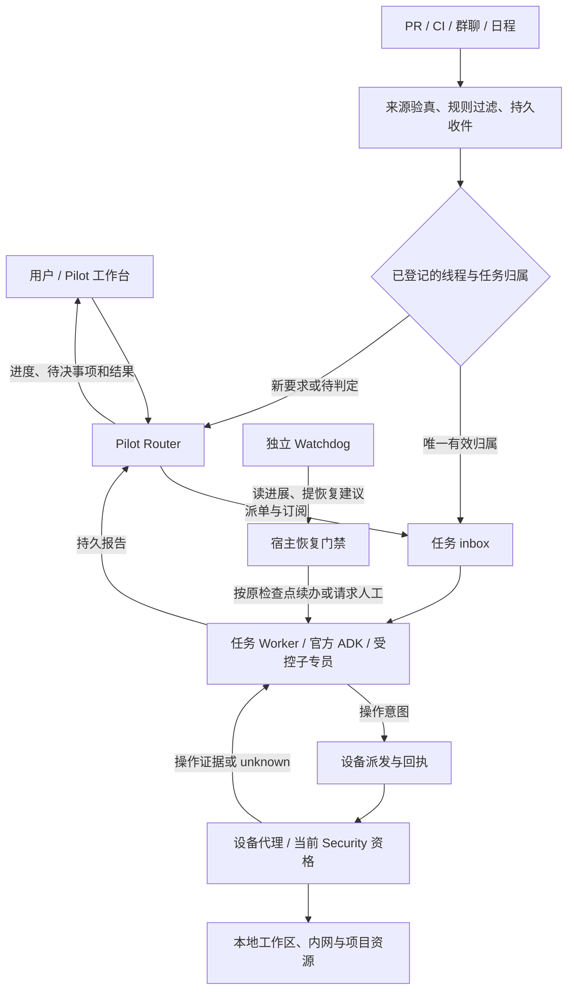

# Introduction

> **Memory 主线调整（2026-11-04）**：后续以 [Agent 本地文件记忆主计划](feature-agent-file-memory-1.md) 为准。旧正文数据库/Markdown 投影及条目管理路线进入分批替换；下文既有行为和测试是历史/当前代码水位，不表示新方案已实现或旧链路已下线。保留真实来源、同意、项目/角色范围、撤回及运行账本；新 Agent 接管后停止旧写入/注入，Worker 读取能力另行验收。

用户在 Pilot 的一个项目入口提出多个目标、查看进展、补充要求或叫停任务。Pilot 负责分派和交付，长期专员保存职责，每个独立目标由自己的 Worker 跟进到验收。外部事件可以带回新线索，设备离线期间控制面仍能收件，需要那台设备的步骤等待重连。用户主要关注三件事：哪个结果可以使用，哪项工作需要自己决定，哪项工作确实卡住了。

本方案承接[本机内核一期](architecture-lake-superagent-1.md)和[长期专员频道](feature-specialist-channel-1.md)。一期仍记录原有任务和兼容义务。这里规划完整产品的剩余交付，所有新阶段均为 Planned。首个可交付闭环选 GitHub PR 与 CI，复用可重放的同一线程来检验路由、权限、成本和恢复。外部参考采用 DeepSeek 的[公开研究原型](https://github.com/deepseek-ai/dsh-superagent-prototype)。下文的云端部署方式、验收负载及服务目标是 Lake 的设计选择。

**2026-11-04 交付水位**

| 机制 | 已核对的基础与证据 | 下一个可验收结果 |
| --- | --- | --- |
| 双层架构与长期专员 | `develop@4c7e9a0c` 已有 Pilot、按任务隔离的官方 ADK Worker、受控子专员与角色频道。此次 #157 增加先建岗、列出、编辑职责、按 RoleID 派单及职责快照。PR head `c42a79b4` 仍开放，固定 Lake Dev 安装为 `d2249c05`。 | 将专员管理作为集成基线。跟踪项目中的多个目标时，同时显示待决事项、等待原因及各自可核验的结果。 |
| Trigger 与筛选 | 人类消息经宿主登记。已授权的日程和保存工作流沿原 occurrence/定义接单。`ObserveTaskBuild` 对缺可信只读配置的外部构建返回 unavailable。 | 一个可关闭的外部来源，能验签、过滤、去重、识别请求者，并用真实只读证据核实 CI 状态。 |
| 订阅直通与批处理 | 已有精确来源/线程匹配、inbox、SDK 消费回执和未消费交回原语。`RunPilotRouter` 在项目锁内尝试直通，从候选事件中取同线程批次，最多 16 条、上下文包 16 KiB。尚缺派单时自动建立订阅的真实外部链路。 | 线程唯一归属时跳过 Router 模型，归属不清时询问。记录节省的调用量、延迟和误派率。 |
| 全双工 | 已有异步接单、后台命令句柄、同任务补充及停止。已有单 Worker 的安全步骤边界，同一 Pilot 的决策仍串行。 | A 的长命令运行期间接 B、给 A 插话、取消 A；分别看到收件、消费及远端效果回执。 |
| 持久与跨设备 | 会话、操作和恢复检查点在本机持久化。macOS 已验证退出窗口后内核继续运行、重开连接同一 PID。 | 常驻控制面运行 ADK；设备代理保管本地环境。双机、休眠、掉线及故障切换分别验收。 |
| Watchdog | `CheckSuperagentProgress` 与 `RecoverSuperagent` 已处理部分确定性故障、过期租约与暂停。 | 只读语义巡检识别重复尝试和目标偏移，再由宿主执行有限、可追踪的恢复动作。 |

## 1. Requirements & Constraints

- **REQ-001**: Pilot 处理意图、路由、追问、跨任务协调与报告。一个 Task 对应一个根 Worker/执行 Session，子专员在该任务的有界子图内取证。职责编辑仅影响新任务的快照。同名角色或相同资源不构成任务归属。
- **REQ-002**: 每个 Trigger 有可审计的去向，包括过滤、补充原任务、提交新提案、等待澄清、完成交付或隔离待查。停止、审批和需要人工回答的问题优先于普通通知。用户可查到来源、原任务和最新有效证据。
- **REQ-003**: 将耗时操作表示为可查询的句柄。前台区分消息已保存、Worker 已接入、停止后续派发、底层操作实际终止四件事。单个 Worker 在安全步骤边界串行消费，Pilot 可以同时接收其他目标。
- **REQ-004**: 提供本机模式与按项目启用的托管模式。托管后，云端服务运行思考循环，数据库持久化事件、Session 与任务状态；关机设备上的未提交工作区、内网连接及本机凭据由原设备持有。设备重新出现时按原句柄核实。
- **SEC-001**: 来源签名只证明事件来自已登记的连接。外部人类账号须绑定 Lake 主体并在当前项目获准提出请求。CI、机器人、邮件正文及会议邀请默认是观察。若需由机器事件主动发起任务，由用户预设带项目、来源、条件、作业模板、允许操作、期限和撤销版本的规则；匹配时复用已授权作业准入。无适用规则时只能提供上下文或提示人工决定。
- **SEC-002**: Items 提供当前资源身份与连接版本，Security 决定每次读写、审批和恢复资格。WorkGoal、尝试、操作证据与验收沿任务运行层保持单一权威。RoleID、订阅、云消息及 Watchdog 报告均无授权效力。
- **CON-001**: 模型与工具循环继续使用官方 ADK。沿用当前项目原资源和权限、并发槽、累计模型轮数、单次上下文/输出限制及任务绝对期限。累计 token 用于计量，保留未知操作和人工验收要求。
- **CON-002**: Memory 依 bearqy 的现有同意、来源、角色和范围规则工作。历史任务引用与运维 V2 分开处理。一期 TASK-020 至 TASK-022 的旧 Memory 实施路线由 [新主计划](feature-agent-file-memory-1.md) FM-02 至 FM-04 承接；主线各阶段允许在 Worker 知识视图 unavailable 时运行。

**目标结构。** 下图表示托管模式的最终布局。本地阶段先以同一组协议跑通事件链，设备侧执行边界从第一阶段保留。

**谁持有哪些状态。** 本机模式沿用现有私有 SQLite 与 Home owner。托管模式按项目选定一个写入方，先迁移受控试点项目。转移范围限定到该项目可导出的行、来源及制品，并引入按项目的 writer epoch；Home 级 owner 继续保护同机数据。

| 记录 | 托管模式写入方（拟建） | 不变量 |
| --- | --- | --- |
| 来源事件、订阅、inbox/outbox、角色资料与职责快照 | 云端项目运行时 | 外部原身份和修订保持稳定；离线队列重投不制造新任务。 |
| ADK Session/checkpoint、Task/Assignment、WorkGoal 与验收 | 云端项目运行时及原验收逻辑 | 每次切换有 owner epoch。模型和 Watchdog 只提交提案；证据不齐或需要人工时保持待核实。 |
| 设备绑定、可领取意图、跨任务资源占用、回执索引 | 云端派发服务 | 一项操作在同一时刻只允许指定设备、指定 generation 领取。已派发的写操作未核实前保留占用。 |
| 原工作区、凭据、本地操作许可检查、执行去重记录、原始输出 | 绑定设备的宿主执行器 | 收件落盘后才响应。实际 I/O 前重验权限、owner、目标/连接版本；回传署名事实和允许出端的证据页。 |
| 工作台、通知及健康面板 | 读取上述权威记录的投影 | 支持从一条用户消息或告警追到任务、设备、操作与验收。关闭窗口、通知已送达均不改变完成状态。 |

**一个可复验的用户旅程。** 用户先请 Pilot 建「发布核实专员」，仅登记职责。已绑定的维护者随后在指定 PR 中请求核对一次失败构建。宿主核实来源，Pilot 选已有 RoleID，为该目标建任务 A 并绑定 PR；CI 的后续结果直达 A，以观察身份进入 SDK。A 等待测试时，用户可同时派发独立任务 B。证据过期时 A 提出新只读观测；需要本机而设备离线时显示「等待指定设备」。确认结果后 A 经原验收流程出报告，两项工作在该专员频道各有记录。多次无实质进展时，Watchdog 引用原证据说明卡点，并按允许的恢复动作处理。

## 2. Implementation Steps

下列任务的路径指向已有实现或明确标为「新增」的建议文件。阶段目标按可演示结果排序；每阶段单独向 `develop` 交付，记录实测 SHA、失败样本和撤回办法。

### Implementation Phase 1

- **GOAL-001**: 固化本机基线与工作台入口。保留现有专员管理、角色频道与任务内核，使后续各阶段可在同一负载下比较。

| Task | Description | Completed | Date |
| --- | --- | --- | --- |
| TASK-001 | 以 `scripts/verify_superagent_dev.py --manage-specialists --inherit-project-access` 场景作为基线。记录目标 `develop` SHA 与 #157 的集成状态；合入依仓库流程取得授权。基线通过 TEST-001 后冻结其脱敏事件夹具。 | false | — |
| TASK-002 | 在 `internal/web/superagent_routes.go:superagentRoute` 投影「待我决定、正在推进、受阻及原因、最近交付」。`web-agent/web/src/PilotWorkspace.tsx` 按准确 TaskID 导航到原问题/审批/报告。依赖 TASK-001，完成条件为两个同角色并行任务的状态、问题与作者可分别核对。 | false | — |

### Implementation Phase 2

- **GOAL-002**: 打通第一条真实外部事件链。交付一个已授权 PR 线程、一个只读 CI 构建和一次可验证的 Pilot 汇报。

| Task | Description | Completed | Date |
| --- | --- | --- | --- |
| TASK-003 | 新增 `internal/web/superagent_github_source.go:ReceiveGitHubDelivery` 和来源配置。Dev 首个真实来源通过独立的窄入口中继接收，只允许该 webhook 路径；Lake 主动领取签名原包，工作台继续绑定 loopback。中继持久收件后应答上游，保留 delivery ID 供重投及缺口对账。固定绑定项目、安装身份与仓库 ID。验证签名后归一化 `sourceID/sourceRevision/externalEventID/threadRef/actorRef/kind/occurredAt/payloadHash`，再交 `internal/ai/superagent_intake.go:ReceiveSuperEvent`。正文/附件按上限分页；事务中记录收件与游标，重复内容冲突隔离。区分连接身份、每事件发言人和项目内主体：核实后将真实人类原文持久化并接入宿主输入解析器，保留原 delivery 引用。机器人沿观察路径登记。批处理回复地址使用项目、来源、安装、仓库、线程的完整元组。先在 Dev 回放，依赖 TASK-001。 | false | — |
| TASK-004 | 在拟新增 `internal/ai/superagent_trigger_rules.go:EvaluateTrigger` 先执行仓库/线程允许列表、机器人自身回声、重复投递、无关事件类型过滤，再由模型判断剩余事件。失效订阅仅解除旧绑定，有效人类消息重新路由。先做只记决定的影子模式。显式 mention 的人类请求按身份进入 Pilot；机器主动工作仅走 SEC-001 预授权作业，未获准时显示建议。依赖 TASK-003，按 TEST-002 审核漏筛样本。 | false | — |
| TASK-005 | 在 `internal/web/superagent_observer.go:ObserveBuildRun` 与 `internal/ai/superagent_observer.go:ObserveTaskBuild` 接入首个固定只读 CI profile，依据可信 run/PR 关联解析线程，同一提交关联多个 PR 时隔离歧义。绑定仓库、run ID、提交、连接 revision 与原 task/step。回调通知作线索，经宿主取回状态和证据才可用于验收。复用原 work_wait/唤醒；凭据撤销即停止。依赖 TASK-003，承接一期 TASK-016。 | false | — |
| TASK-006 | 依赖 TASK-004、005。先以 TEST-002 在隔离项目打通 PR 请求→只读观察→Pilot 报告。外部回复单独开启并按原线程送达，先持久化发送意图和可查询的关联键。回执丢失时查远端，无法唯一核实则保留 unknown。随后按相同协议增加一个群聊线程适配器；邮件/会议邀约排在其后，逐个验签、主体绑定并通过测试才启用。 | false | — |

### Implementation Phase 3

- **GOAL-003**: 让同一线程的后续事件可靠直达对应 Worker，并在长任务期间保持双向接收。

| Task | Description | Completed | Date |
| --- | --- | --- | --- |
| TASK-007 | 依赖 TASK-003。扩展 `ApplySuperDecision` 和 `SubscribeSuperWorker`，外部线程派单提交时原子登记/幂等修复 `(project, source, sourceRevision, thread, task, worker, mode)`。在进入项目级模型锁前认领事件并调用 `RouteSubscribedEvent`，与常规路由共享一次性决定。有唯一有效订阅且确认是原目标的延续才直通（如登记的原 run、对原问题的准确答复）。即使仅有一个所有者，显式新目标、跨范围或指代不清仍交 Pilot，终结、撤销时关闭订阅。共享 Pilot/角色频道继续按消息判定。 | false | — |
| TASK-008 | 依赖 TASK-007。在 `superagent_inbox.go:DeliverSuperFollowups` 旁增加 typed observation 投递、真实 SDK 消费回执与断点对账；机器结果不能合成为人类消息。`HandBackSuperEvent` 只交回未消费输入；已消费后发现越界，追加派回请求与原消费引用。隔离坏订阅并继续处理后续事件。通过 TEST-003。 | false | — |
| TASK-009 | 依赖 TASK-007。沿 `RunPilotRouter` / `BuildRouterContext` 合批同项目、同回复线程的待判定项。先沿用 16 条、16 KiB 上限；试点普通消息最多聚合 250 ms（拟定值），停止、审批、人类控制直接进入高优先级。记录分来源积压和最老事件等待时间，超时先服务最老项。以 TEST-004 对照结果决定保留或撤掉等待窗口。 | false | — |
| TASK-010 | 依赖 TASK-005、008。在 `internal/web/superagent_runtime.go`、`internal/ai/superagent_inbox.go`、`internal/ai/superagent_channel_stop.go` 联通长句柄、补充、停止与最终回执。区分已接单/等待句柄/已接入补充/已请求停止/已核实终态；拒绝过期 owner 推进状态或派新操作。能核实属于原 operation 的迟到结果仍留证对账。通过 TEST-005，同一条长命令只派发一次。 | false | — |

### Implementation Phase 4

- **GOAL-004**: 独立监督 Worker 的实质进展，让可恢复故障自动续办，需要判断的偏航能被解释和纠正。

| Task | Description | Completed | Date |
| --- | --- | --- | --- |
| TASK-011 | 依赖 TASK-001。扩展 `superagent_watchdog.go:CheckSuperagentProgress`，从工作项修订、操作句柄、证据和人工等待类型生成进展快照。将正常等待、等待设备、provider 瞬断、重复无进展、越界建议和不可核实副作用分别归类。心跳/叙述不计业务进展。先只输出带依据的结构化发现。 | false | — |
| TASK-012 | 依赖 TASK-011。新增 `internal/ai/superagent_watchdog_review.go:ReviewProgress`，以独立只读 ADK 角色定时审阅被规则标记的任务。输入仅含原目标、合格证据引用与近期增量。提议默认每分钟扫描，连续 3 次无进展且没有已登记等待才送模型，同一任务每 15 分钟至多一次，可单独关闭。每项目配置独立的后台审查调用额度；耗尽后继续程序巡检。宿主在同一 generation 对同一原因至多自动处理一次，可重投已知未执行的幂等输入、经 `RecoverSuperagent` 续原检查点，或给原 Worker 提交引用原目标的纠偏建议。需扩大范围时暂停并请人决定。超限、偏航和 unknown 各有不同处置。通过 TEST-006 后按项目启用。 | false | — |

### Implementation Phase 5

- **GOAL-005**: 提供可选的常驻控制面与单设备只读执行。桌面休眠后用户仍可在另一已认证客户端查看同一项目、发新要求和停止后续派发。

| Task | Description | Completed | Date |
| --- | --- | --- | --- |
| TASK-013 | 依赖 TASK-008、010。新增设计与适配 `internal/superagent/controlplane`，抽取官方 ADK 会话/制品及 WorkGoal、收件、事务 outbox、CAS 的存储契约。首版选单项目单活服务与持久卷，以现有 SQLite 语义跑通控制循环；迁移试验先用空白 Dev 项目。列出 SQL 与宿主依赖，按同一存储契约测试，编写按项目引用闭包的导出/清点工具。共享 Home 中不得整库上传。用两个同 Home 的项目演练 TEST-007 后才迁移有历史项目。 | false | — |
| TASK-014 | 依赖 TASK-013。新增 `internal/superagent/device` 端侧代理与控制 API。用户配对设备并绑定可执行项目，以短期设备身份主动出站、可撤销和轮换。云端意图带 project/task/attempt/operation、device、generation、policy/connection revision、幂等键与有效期。为现有 `security_execution.go:invokeManaged` 增加端侧适配，核验云端签发的短期任务范围声明，解析本地策略与资源。在 I/O 前检查设备身份、最新 generation、撤销状态及本机审批；无法在线确认有效性时等待设备连接。本地生成当次许可，先落派发意图，再由原执行器操作并按原操作 ID 回传结果。先只开一种只读来源。通过 TEST-008。 | false | — |
| TASK-015 | 依赖 TASK-014。扩展 `internal/web/superagent_lifecycle.go` 和桌面连接入口以选择项目控制面。平台提供用户登录、项目成员授权和设备撤销，桌面 Home token 只用于已有本机入口。用户选择可出端的会话正文、摘录/证据类别及保留期，默认只同步必要标识、状态及已授权摘要。原始日志/工作区留端，按需授权分页。断线显示最近联机时间及等待设备原因，恢复时先查原句柄。通过 TEST-007、008。 | false | — |

### Implementation Phase 6

- **GOAL-006**: 用双机故障演练证明持久性，在能够核实副作用的资源上逐项开放写操作。

| Task | Description | Completed | Date |
| --- | --- | --- | --- |
| TASK-016 | 依赖 TASK-014、015。设备 A/B 同时接入，默认固定操作到资源登记的设备及工作区版本。只有宿主确认资源等价、权限当前、旧 owner 已隔离且原操作状态已核实时才允许换设备。未提交工作树保持原机绑定。将跨任务写占用与本机派发屏障串联；派发后未回执记 unknown，按句柄核实后才能重试或释放占用。先用可查询幂等结果的测试资源，通过 TEST-009 后仅进入故障接管演练。 | false | — |
| TASK-017 | 依赖 TASK-012、016。在 `internal/superagent/controlplane` 实现单活服务故障接管，使用持久状态与强制隔离旧 writer 的基础设施；若不能保证卷与进程双重隔离则停止接管。新增 `scripts/verify_superagent_distributed.py`，记录已确认收件、回复回执、原 ADK/操作句柄、恢复耗时与人工介入项。完成 TEST-009、010、011 后才将这类写操作开放给试点项目。 | false | — |

## 3. Alternatives

- **ALT-001**: 每条通知都由 Router 调模型，作为测量基线保留；有唯一任务所有者的延续消息可直接交付，新意图和歧义仍由 Router 处理。
- **ALT-002**: 每台设备复制整个 Home 并各自跑 Worker，会产生多个执行 owner，也会复制本机私有资料。托管项目使用单一控制面、设备意图与可重投回执。
- **ALT-003**: 首批即迁 PostgreSQL 并上多活会同时改变 ADK 存储、SQL 方言和任务事务。首个试点限定单写者和单活持久卷。后续若容量或恢复目标要求更换数据库，先逐项通过相同的存储/故障合同测试。

## 4. Dependencies

- **DEP-001**: #157 经既有流程集成后，复用其角色管理契约；试点测试可以在含该提交的隔离 Dev 运行。计划文档可独立评审。
- **DEP-002**: 首个试点须有专用仓库、经过绑定的维护者、可信 webhook 验签材料、只读 CI 身份及可核实的真实 run。无外部授权时只进行隔离回放，不标记真实来源已交付。
- **DEP-003**: 托管试点需独立 Dev 环境、允许的数据类别及保留规则、用户/设备认证、加密传输/存储、备份与单写者故障隔离。云侧模型凭据单独配置；部署、发布与生产授权各自按仓库流程执行。

## 5. Files

- **FILE-001**: `internal/ai/superagent_intake.go`、`superagent_router.go`、`superagent_subscription.go`、`superagent_inbox.go` 和 `superagent_outbox.go` 继续拥有来源、路由、订阅、消费及投递语义。
- **FILE-002**: `internal/web/superagent_source.go`、`superagent_observer.go`、`superagent_lifecycle.go` 是现有宿主接点；新增来源与设备端点必须走对应的鉴权和项目域。
- **FILE-003**: `internal/ai/superagent_watchdog.go`、`superagent_recovery.go`、`superagent_scheduler.go`、`security_execution.go`、`work_closure.go` 负责监督、租约、派发及结清。`internal/agent/storage/sqlite.go` 与 `internal/ai/adk_services.go` 是托管存储适配的起点。
- **FILE-004**: `web-agent/web/src/PilotWorkspace.tsx`、`SpecialistChannel.tsx`、`SessionInspector.tsx` 承载用户可见的待决、进展及证据。新增的 `internal/superagent/controlplane` 和 `internal/superagent/device` 仅为后续设计路径。

## 6. Testing

以下数字是建议的 Dev 门槛。计时分别记录入口落盘、归属确定、SDK 接纳、工具实际派发、收到证据、验收及报告送达；按事件/任务追踪，不在指标中记录密钥或消息正文。

- **TEST-001**: 先建、列、改专员并冷重启，角色、职责修订及频道保留。随后发 A/B 两项工作，观测到 1 RoleID、2 Task、2 Worker、2 执行 Session；检查职责修订、真实证据及两个独立验收。
- **TEST-002**: 在同一试点仓库回放有效人类提问、重复/冲突 delivery、伪造签名、机器人回声、撤销的主体、无授权 CI 和已授权 occurrence。核对每条去向、审批/策略版本与副作用数量；只有有效来源可产生对应提案。至少完成一次真实 CI run 的只读取证。通知内容写着「成功」但取证失败时保留缺口。
- **TEST-003**: 同一 PR 只有一个旧订阅时收到独立新目标，另有两个仓库复用同一 PR 编号、两个同名专员、乱序评论、已结束订阅、共享频道发言与已消费后交回。唯一续办交付原任务一次，歧义保留提问，不把整串会话或历史许可复制给另一 Worker。错误订阅不能阻塞下一条有效事件。
- **TEST-004**: 固定同一模型、版本、并发与人工标注的 1,000 条混合事件（400 噪声、300 已知原线程延续、200 新需求、100 歧义/控制）。分别启用全量 Router、规则过滤、再加直通、再加批处理四组，每组跑三次。报告 Router 实际模型请求数/百条输入、每条有效事件 token、总模型成本（含筛选模型）、积压年龄、P95 接单延迟和归属正确率。相同合格事件的正确归属/澄清率不得下降，越权与重复副作用为 0；只有调用和总成本下降且控制消息 P95 不回退才扩大试点。“约 30%”作为待测对照值，实测值以相对全量 Router 的相同负载计算。
- **TEST-005**: 让 A 运行一个可核实句柄的 10 分钟模拟命令。期间经 Pilot 派 B、向 A 插话、再停止 A。宿主在 1 秒内记录控制意图（Dev 拟定目标，不含模型思考）；B 可独立推进，A 在安全边界接入；原命令最多执行一次。无法核实远端停止时界面保留 unknown，B 的上下文/许可无变化。
- **TEST-006**: 注入重复同参数无新证据、偏离交付物、正常等待长构建、等待人工、断网、额度暂停与已派发未知写。独立语义审查先影子运行，人工标注复核；正常等待自动恢复次数为 0，所有建议可追溯到 task/证据/规则版本。仅允许的幂等故障可自动恢复，其他转人工。记录误报率、漏报率、恢复成功率及额外模型开销。
- **TEST-007**: 对停派并排空的试点项目生成一致快照，逐条核对 Task、角色、输入、审批、证据及未决操作；缺少可迁移原句柄的任务继续留原 owner，项目暂缓切换。仅转移项目 A 的 writer epoch；逐项核对项目 B 的行和制品未出端且 B 仍能本地工作。云端和端侧均拒绝 A 旧 writer。失败发生在切换前可回原机；切换后先排空新写入并验证反向迁移，否则保持新权威只读待核实。
- **TEST-008**: 断网前后分别模拟未领取、已派发无回执、已执行回执丢失、设备撤销及连接版本变化。云端仍可收件、回复与处理云侧允许的步骤；本地步骤显示等待或 unknown。包含代理分区期间云端已停派的反例，旧代理重连后必须拒绝过期意图。设备重连按原 operation ID 去重并核实，不因过期租约自动重发。检查端云交换和审计样本，私钥、API key 和未授权原文出端数为 0。
- **TEST-009**: 至少两台独立设备及一个独立常驻控制节点演练。A 休眠，B 的客户端能看到同一任务；B 无原工作树时不能领取 A 的本机步骤。模拟两机争抢、旧 generation 迟到、写操作进程崩溃。已确认收件丢失数、重复写操作数和重复验收数均为 0。
- **TEST-010**: 每期记录方案版本、准确代码 SHA、来源类型与权限、实测样本、失败项及启用开关。分阶段关闭外部 ingress、自动订阅、语义恢复或托管派发时保留已有收件和未决账本。Go/ADK/权限改动运行相应 Go/race/vet 与 ADK 边界检查；UI 改动验证类型、用例、构建和签名 Lake Dev 的明暗/窄窗。分别列 macOS、Windows、睡眠、断电和跨机实测结果。

- **TEST-011**: 强制停止活动控制节点，分别在收件提交前后、设备领取后、验收提交后注入故障。旧 writer 被隔离后才提升备节点；保留原 task/operation/receipt，已确认收件不丢、已执行写不重复。Dev 目标为 5 分钟内恢复接单，单列设备仍离线的步骤及人工核实耗时。

## 7. Risks & Assumptions

- **RISK-001**: 很低的路由调用量也可能来自漏接。以同一标注集同时量化误滤、误派和尾延迟；指标异常先关闭相应快路径。
- **RISK-002**: 将心跳当进展会掩盖死循环，将长外部等待当停滞会打断正常工作。监督必须读取等待类型、最新证据和原句柄，不能放宽权限、增加原任务轮数或自行验收。
- **RISK-003**: 端云网络可在真实副作用与回执之间中断。去重键保护可幂等操作；不具备远端幂等或查询能力的写操作，必须保留 unknown 并人工核实。切换设备、恢复备份或关闭功能开关都不消除该状态。
- **RISK-004**: 会话、日志与模型输出也可能含敏感信息。托管前建立字段分级、按项目的保留/删除与密钥轮换流程；独立备份恢复须连同 epoch/撤销记录演练。服务在线率、设备在线率和任务可执行率分开统计。
- **ASSUMPTION-001**: 建议优先获得可复验的 PR/CI 闭环，再扩展来源和托管范围。阶段 4 的影子巡检可与事件接入并行；跨设备写入依赖单设备只读及故障验证。各阶段默认在隔离 Dev 数据开展，进入生产另行评审。

## 8. Related Specifications / Further Reading

- [Lake 一期内核计划与剩余任务](architecture-lake-superagent-1.md)、[角色频道实施方案](feature-specialist-channel-1.md)、[内核运行架构](../docs/design/lake-superagent-runtime.md)、[内核验收记录](../docs/validation/lake-superagent-runtime.md)。
- [长期专员管理 PR #157](https://github.com/Clean-Lakes/Lake/pull/157)、[该 PR 的定版验收记录](https://github.com/Clean-Lakes/Lake/blob/c42a79b4a8a0c1bcc7c4ae0073a15a8b101f695a/docs/validation/lake-specialist-management.md)。固定 Dev 的后续安装记录位于本机构建产物 `dist/macos/0.3.27/arm64/dev/specialist-install-validation.json`。
- [模块所有权与阶段约定](../agent.md)、[三模块对接](../docs/design/items-security-memory-integration.md)、[Security 设计](../docs/design/lake-security-v1.md)、[Memory 使用与边界](../docs/lake-memory.md)。
- DeepSeek 公开研究原型的[领域模型](https://github.com/deepseek-ai/dsh-superagent-prototype/blob/main/docs/001-domain.md)、[来源与授权](https://github.com/deepseek-ai/dsh-superagent-prototype/blob/main/docs/002-authorization.md)、[执行与恢复](https://github.com/deepseek-ai/dsh-superagent-prototype/blob/main/docs/003-execution.md)。
