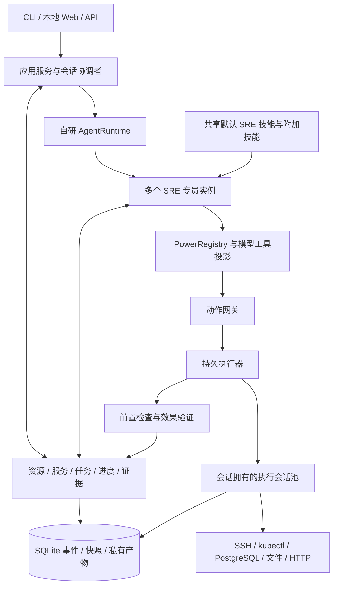

# Introduction


历史规格：本 TypeScript 运行时已由 Go ADK 取代，旧源码与操作指南于 2026-10-20 移除。下文保留当时的设计和实施记录，不作为当前构建或运行说明。当前入口见 [贡献指南](../CONTRIBUTING.md) 与 [ADK 架构](../docs/experiments/adk-runtime.md)。

本方案在 `codex/lake-ts-agent-v0.0.1` 分支上规划独立的 Lake Agent。分支基点为 `7de96a60`，已有未跟踪的插件目录及其他计划不属于本方案。当前文档是实施规格，2026-10-08 已开始执行。57 项实施任务及发布门禁已完成，验证环境、边界和摘要见 `docs/validation/lake-ts-agent-v0.0.1.md`。

用户确认的最终结构为：**一个会话可以由多个专员协作；专员是拥有独立模型上下文的子智能体；所有专员默认拥有诊断、coding、部署、调试、验证、报告技能；专员按任务使用多个 Power；会话统一持有终端会话、任务进度与证据。** SSH、K8s、数据库是 Power，而不是必须切换的专员身份。

本分支从零编写 Agent 循环、模型协议适配、专员调度、上下文管理、工具执行协议和运维状态管理。不导入 ZCode、天枢或旧 Lake Agent 的运行时实现。已有代码只作为数据兼容、签名与许可参考。此目标取代旧计划中“新客户端必须仅使用 ZCode 原生 Agent”的实施约束；旧客户端与旧数据在新版本验收前继续保持可用。

Lake v0.0.1 的产品价值是把业务服务映射、现场事实、共享调查、受控变更和业务验收连接起来。多专员、终端和模型本身是实现基础。首版交付两个完整场景：HTTP 服务故障排查与受控恢复；单机 HTTP 服务配置变更与验证。K8s 与 PostgreSQL 同时提供真实只读诊断能力，用于跨资源调查；其发布、DDL、主从切换等写能力不在首版自动执行范围内。

## 1. Requirements & Constraints

### 1.1 版本范围和明确要求

- **REQ-001**: 在仓库新增独立 `agent/` 工程，产品版本固定为 `0.0.1`；运行时代码使用 TypeScript，领域层不得引用现有 Agent 内核或第三方 Agent 编排框架。
- **REQ-002**: 自研协调者与专员共用的 `AgentRuntime`，完整实现流式模型调用、工具调用、工具结果回填、继续执行、任务交付、取消与预算耗尽。
- **REQ-003**: 支持一个会话内最多三个活跃专员；每个专员有独立工单、模型历史、预算分配、状态及检查点，主会话能够接受后续用户指令并展示各专员进展。
- **REQ-004**: 终端和执行会话归属于主会话。专员可创建、关联、订阅和依次使用同一个终端；专员结束或切换模型不关闭该终端。跨主会话共享终端在首版禁止。
- **REQ-005**: 会话维护唯一任务进度台账。步骤支持负责人、依赖、状态、预期结果、证据引用和版本；共享进度以落盘事件为准，不能以各专员文本中的完成百分比为准。
- **REQ-006**: 所有专员自动获得六个默认 SRE 技能；专员附加技能和受信项目技能采用集合合并，不替换默认技能。技能方法、Power 能力与资源授权分别管理。
- **REQ-007**: Power 通过声明式 manifest、运行时输入 schema、工具集合和适配器接入；首版实现 `local-files`、`ssh`、`k8s`、`postgres`、`http-health` 五个 Power。
- **REQ-008**: 采用三个正交状态维度：任务生命周期、运维阶段、当前动作。状态变化同时记录专员、任务、终端、行动、时间与原因，界面展示每位专员的实际活动和等待原因。
- **REQ-009**: 对模型公开领域资源、服务映射、现场观测、假设、行动和证据接口。模型发现的关系或根因先登记为候选；经过用户确认或观测验证后才能提升为可信事实。
- **REQ-010**: 每次行动经过同一动作网关；网关完成输入校验、范围解析、资源授权、行动摘要冻结、审批检查、前置条件和冲突控制，执行器完成实际派发及结果核对。
- **REQ-011**: 存储派发意图后执行外部副作用；进程重启、超时、断线或取消时，对于无法确认的已派发动作使用 `unknown` 状态，核对真实状态后再决定下一步。
- **REQ-012**: 验证绑定本次行动、资源身份、配置或版本指纹和有效期；HTTP 服务恢复必须满足相应验收配置，进程存在或退出码为零不能单独满足服务恢复验收。
- **REQ-013**: 提供 CLI、无界面 JSON 输出、只监听回环地址的本地 HTTP API，以及独立 React Web 工作台；入口均使用同一应用服务与事件协议。
- **REQ-014**: Web 工作台同时展示会话、共享任务进度、专员状态、终端输出、事实、变更与验收结果；支持等待审批、用户接管、交还终端和会话恢复。
- **REQ-015**: 模型适配首版支持一个明确的 Chat Completions 兼容 HTTP 协议和结构化工具调用；模型名称、地址、能力与价格由配置给出，业务层不绑定具体模型名称。
- **REQ-016**: 记录模型调用次数、输入/输出用量、费用来源、上下文压缩、工具耗时与缓存计量；未知用量及未知价格使用 `null` 和来源标签，不能记录成零或宣称固定缓存命中率。
- **REQ-017**: 新数据使用 `<LAKE_HOME>/agent/` 独立命名空间；默认父目录仍为 `~/.lake`。不得自动迁移、改写或执行旧 Lake/ZCode 的会话、工作流、配置和数据库。
- **REQ-018**: 发布验收同时覆盖合成模型、真实本地 SSH 服务、临时 PostgreSQL、K8s API/CLI 夹具、故障注入和源码目录外启动；真实外部模型与生产环境的验收结果单独记录。
- **REQ-019**: 交付资料包括运行说明、配置示例、Power 契约、技能格式、恢复语义、实际验收记录和第三方许可；首版界面、协议版本及报告不能宣称尚未接入的能力。

- **SEC-001**: API key、SSH 私钥、数据库口令及 kubeconfig 内容只能由执行侧或模型适配器的受控凭据接口读取；不得进入模型上下文、普通 IPC DTO、stdout、事件、异常、产物、截图或提交文件。
- **SEC-002**: 凭据仅保存在 `<LAKE_HOME>/secrets/` 私有文件中，POSIX 目录权限为 `0700`、文件为 `0600`，校验普通文件、所有者、链接和路径边界；普通运行不得读取 Keychain。
- **SEC-003**: macOS 用户入口 `bin/lake` 只能由 `scripts/build_lake.sh` 使用持久 `Lake Local Development Code Signing` 身份构建；身份缺失时明确失败，按现有规则运行一次设置脚本，禁止无签名回退。
- **SEC-004**: 项目文件、技能内容、模型输出、远端日志和工具结果均为数据来源，不能直接授予资源权限、扩大作用域或关闭验证。首版只加载内置技能和用户明确授信目录中的技能，不运行插件安装脚本。
- **SEC-005**: 审批绑定会话、任务、主体、资源身份/版本、行动与脚本摘要、有效期和次数；资源变更、撤权、脚本变更或审批失效后，执行前重新校验并拒绝旧授权。
- **SEC-006**: SSH 必须验证预先登记的主机公钥指纹；K8s 明确绑定 context、namespace 和 kubeconfig 引用；PostgreSQL 使用只读事务和固定查询。禁止默认跳过证书/主机身份校验。
- **SEC-007**: 本地 API 仅绑定 `127.0.0.1`，校验 Host、Origin、一次性浏览器启动票据及访问令牌；无通配 CORS，无 GET 写操作，无凭据值查询 API，浏览器令牌不写入 localStorage。
- **SEC-008**: 模型侧不得直接调用任意本机进程或向终端发送原始按键。首版执行能力仅来自已注册的固定操作和明确授信的冻结脚本；项目代码测试必须在具备工作目录隔离和无凭据挂载的执行环境中进行。
- **SEC-009**: 工具输出按结构化字段和已知敏感值进行流式脱敏；截断、大小限制及日志净化必须标注。脱敏不是针对任意恶意编码输出的完整信息流隔离，首版不接纳未授信可执行插件。
- **SEC-010**: 人工终端输入与模型动作共用资源授权及审计；交互输入使用绑定资源、会话、持有者和有效期的接管授权，不能绕过主机身份校验或任务作用域。

- **CON-001**: v0.0.1 不复制或依赖 `third_party/zcode` 的模型、上下文、子智能体、会话或工作流内核，也不新增 Go 运维业务逻辑。已有 Go 入口仅允许保留启动、信号转发、签名兼容和显式旧凭据迁移边界。
- **CON-002**: 首版不交付 Electron/Tauri/Wails 安装包、CUA、语音、移动端、云端多租户、OAuth 订阅认证、任意 MCP 插件宿主、定时自治巡检或完整工作流编辑器；CLI 和本地 Web 是正式入口，不以模拟界面替代内核验收。
- **CON-003**: 首版只支持单机运行时和本机 SQLite；所有 CLI/Web 客户端接入唯一 daemon，禁止第二个 daemon 独立操作同一个 home。分布式锁和跨机器协作留到后续版本。
- **CON-004**: SSH 首版支持 Linux/POSIX 目标；真实交互 PTY 仅由 SSH 适配器提供，本地执行会话提供结构化命令/输出视图。macOS 为构建与用户端验收平台，Linux 为运行与远端验收平台；Windows 首版不计入验收。
- **CON-005**: 首版 K8s/PostgreSQL 只读；SSH 写能力限定为配置文件替换及 systemd 服务动作的固定模板，并支持备份与验收。跨主机发布、数据库 DDL、主从切换、不可逆数据修改留到后续版本。
- **CON-006**: 既有签名入口和显式 `lake secrets migrate` 兼容路径在切换前保留。新 Agent 启动不触发迁移；方案实施过程中不读取用户 live 凭据、生产库或真实主机。
- **CON-007**: 计划阶段不安装应用、不替换当前 `bin/lake`、不访问生产、不推送分支。本计划所有实现任务初始状态为 `No`，实际完成后逐项记录验证日期。

- **GUD-001**: 先完成一个完整纵向链路，再扩展工具数量；每个阶段以协议、状态和可运行场景验收，不以源码行数或静态测试数量验收。
- **GUD-002**: 业务模块通过显式接口依赖；`domain` 保持纯 TypeScript，外部 IO 只存在于适配器、存储与入口边界，组合入口负责注入实现。
- **GUD-003**: TypeScript 开启 `strict`、`noUncheckedIndexedAccess`、`exactOptionalPropertyTypes`、`noImplicitOverride`；每个公开 DTO 使用运行时 schema，非信任输入不得只依赖静态类型。
- **PAT-001**: 采用“校验命令 → 单事务更新状态并追加事件 → 提交 → 派发副作用 → 追加结果 → 验证”的执行模式；任何模型调用、网络连接和外部进程均不跨 SQLite 事务执行。
- **PAT-002**: 专员运行态与执行会话分别保存；技能正文、终端输出、外部事实和对话历史分别管理，不能以一份无限增长的对话替代所有状态。

### 1.2 总体结构与所有权



图表示责任和调用关系，`DataService` 提供领域上下文与读模型，不能直接执行 shell。专员的生命周期由 `SpecialistService` 管理；对真实资源的动作经 `OperationGateway` 与 `ActionRunner`。每个专员使用同一 `AgentRuntime` 类，独立实例化模型历史和工单。

| 模块目录 | 唯一职责 | 必须公开的接口/函数 |
|---|---|---|
| `agent/src/domain/` | 类型、schema、状态转换、事件、契约与预算规则 | `reduceEvent`、`validateTransition`、`TaskContractSchema`、`ActionProposalSchema` |
| `agent/src/agent/` | 模型循环、工具消息协议、协调者、上下文和预算 | `AgentRuntime.run`、`ContextBuilder.build`、`ModelPort.stream`、`ToolCatalog.project` |
| `agent/src/specialists/` | 子智能体 profile、工单、inbox、调度、状态与结果 | `SpecialistService.spawn`、`send`、`cancel`、`resume`、`SpecialistScheduler.schedule` |
| `agent/src/skills/` | 默认技能、目录授信、版本合并、按需加载与恢复 | `SkillRegistry.resolve`、`SkillLoader.load`、`composeDefaultSkills` |
| `agent/src/sessions/` | 执行会话所有权、连接、订阅、输入队列和用户接管 | `ExecutionSessionService.open`、`attach`、`claimInput`、`handoff`、`close` |
| `agent/src/operations/` | Power manifest 与工具投影、动作准入、授权、审批、资源锁 | `PowerRegistry.register`、`OperationGateway.prepare`、`authorize`、`dispatch` |
| `agent/src/runner/` | 持久队列、派发、超时、取消、崩溃核对、结果归因 | `ActionRunner.tick`、`cancel`、`Reconciler.reconcile` |
| `agent/src/adapters/` | 模型 HTTP 协议、SSH、kubectl、PostgreSQL、文件、HTTP 和沙箱接口 | `ChatModelAdapter`、`SshAdapter`、`KubeAdapter`、`PostgresAdapter`、`WorkspaceAdapter`、`HttpProbeAdapter` |
| `agent/src/verification/` | 有效证据、健康验收、假设核对、交付判定 | `Verifier.run`、`EvidencePolicy.isFresh`、`DeliveryGate.evaluate` |
| `agent/src/storage/` | 单写者数据库、事务、事件、读模型、检查点、产物和私有凭据 | `StorePort.transact`、`EventStore.append`、`ArtifactStore.put`、`CredentialStore.resolve` |
| `agent/src/surfaces/`、`agent/ui/` | CLI/API 传输与展示，不独立维护业务状态 | `createHttpServer`、`runCli`、`EventClient.subscribe` |
| `agent/src/app/` | 服务组合、生命周期、领域 DataService、唯一 daemon | `createLakeApplication`、`LakeApplication.start`、`stop`、`DataService.snapshot` |

`operations/` 内部的 PowerRegistry 足以支撑首版，不新增只转发调用的 `powers/` 包。首版是一个独立工程、一个核心包和一个 UI 子包，不把十二个目录提前拆成十二个 workspace package。

依赖方向：`domain` 无 IO 依赖；`agent`/`specialists`/`operations`/`runner`/`sessions`/`verification` 依赖 `domain` 与 `domain/ports.ts` 中的接口；`adapters`/`storage` 实现接口；`app` 组合；`surfaces` 调用 `app`。适配器不得回调协调者，执行结果通过事件回到上层。

### 1.3 领域对象和共享范围

所有 ID 使用 `crypto.randomUUID()`；时间为 UTC ISO 8601；事件序号和实体版本为 SQLite 整数，API 序号使用十进制字符串避免 JS 大整数精度损失。目标解析必须返回确定资源 ID，模型生成的 IP 或路径不能直接形成授权对象。

| 对象 | 必须字段/规则 | 所有者 |
|---|---|---|
| `Lake` | `id/name/description/revision`，表示一个明确的运维域 | 数据层 |
| `Environment` | `id/lakeId/name/classification/revision`，分类为 `development/test/production` | 数据层 |
| `Resource` | `id/lakeId/environmentId/kind/name/endpoint/identity/credentialRef/revision`，kind 为 `ssh/k8s/postgres/local/http`，对模型隐藏凭据引用 | 数据层 |
| `Service` | `id/lakeId/environmentId/name/resourceBindings/dependencies/healthProfileId/revision`，绑定包含 workload、systemd unit、项目路径等确定定位参数 | 数据层 |
| `Session` | `id/lakeId/environmentId/status/revision/eventCursor/rootTaskId/budget`，绑定在本次会话期间不可暗中改为另一个湖/环境 | 主会话 |
| `TaskContract` | `id/sessionId/objective/scope/constraints/acceptanceCriteria/deadline/status/revision`，判据有机器检查或明确人工确认类型 | 会话 |
| `TaskStep` | `id/taskId/dependencies/assignee/status/expectedVersion/evidenceIds`，领取和更新使用 CAS，同步保存原因 | 共享进度 |
| `SpecialistProfile` | `id/name/instructions/extraSkills/defaultPowers/modelOverride/maxTurns`，内置 `sre-general`；自定义配置增加侧重点 | 全局配置 |
| `SpecialistRun` | `id/sessionId/taskId/profileId/profileDigest/workOrder/modelSessionId/state/powerBindings/budget/revision` | 专员服务 |
| `WorkOrder` | `objective/stepIds/resourceIds/acceptanceCriteria/constraints/skillSnapshot/budget/inboxCursor`，scope 不得超过父任务 | 专员 |
| `ExecutionSession` | `id/sessionId/resourceId/resourceIdentity/powerId/mode/status/cwd/inputHolder/inputEpoch/outputCursor/revision`，kind 由 Power 提供 | 会话 |
| `Action` | `id/sessionId/taskId/stepId/actor/capability/targets/parameters/proposalDigest/status/attemptId/preconditionRefs/verificationRefs` | 网关与执行器 |
| `Observation` | `id/resourceId/source/observedAt/expiresAt/invalidatedAt?/fingerprint/value/artifactRef`，明确来源、采集窗口和截断 | 事实台账 |
| `Hypothesis` | `id/taskId/claim/status/supportingEvidence/refutingEvidence/nextProbe`，status 为 `candidate/supported/refuted/confirmed` | 调查台账 |
| `Evidence` | `id/actionId/resourceId/resourceIdentity/criterionId/source/observedAt/expiresAt/invalidatedAt?/fingerprint/result/artifactRef` | 验证服务 |
| `Approval` | `id/sessionId/taskId/principal/actionDigest/targetDigest/expiresAt/maxUses/consumedUses/revokedAt` | 授权服务 |

模型通过 `task.plan` 提出步骤，通过 `task.claim_step` 领取，通过 `task.report` 报告发现。只有 `TaskProgressService` 校验依赖和验收后更新步骤完成状态。共享的是任务、事实、证据、执行会话和事件，不自动复制其他专员的全部模型历史。

### 1.4 正交状态与转换

`SpecialistState` 必须包含 `status/phase/activity/taskId/actionId?/terminalSessionId?/waitingReason?/since/updatedAt/revision`。状态是公开的活动和阶段，不保存或展示模型内部推理过程。

| 维度 | 枚举 | 更新来源 |
|---|---|---|
| 专员生命周期 `status` | `queued/running/waiting/succeeded/failed/cancelled/interrupted` | 调度器、运行时、恢复服务 |
| 运维阶段 `phase` | `collecting/diagnosing/planning/remediating/verifying/observing/reporting` | 阶段请求经任务规则校验；执行/验收事件辅助确认 |
| 当前动作 `activity` | `idle/model_call/loading_skill/opening_terminal/attaching_terminal/reading_logs/querying_resource/executing_command/editing_config/verifying_health/waiting_input_control/waiting_approval/waiting_dependency/reconciling` | 实际调用和事件 |
| 执行会话连接 `status` | `opening/ready/disconnected/reconciling/closed` | 会话服务与适配器 |
| 行动 `status` | `proposed/waiting_approval/authorized/queued/dispatched/observed/verifying/succeeded/failed/blocked/cancelled/unknown` | 网关、执行器和验证器 |
| 步骤 `status` | `pending/claimed/running/waiting/verifying/succeeded/failed/blocked/cancelled` | 共享进度服务 |
| 任务交付 `status` | `active/waiting/succeeded/qualified/failed/cancelled` | 协调者与交付门禁 |

规则：`activity=model_call` 对外显示“正在分析”；创建/进入终端等活动由对应操作开始事件设置，完成或异常事件清除。`phase` 可重复和跳转，修复任务验证失败回到诊断或修复；只读诊断任务可以从 `diagnosing` 进入 `reporting`。普通问答无需创建修复阶段。

行动的 `dispatched → unknown` 表示已派发但结果未确认；`unknown` 只能经 `Reconciler` 进入 `observed/failed/blocked`，不得直接进入 `queued`。派发前取消为 `cancelled`；派发后请求取消先保存 `cancelRequestedAt`，只有确认未执行或已停止才结束为 `cancelled`，否则保留 `unknown`。专员中断不意味着其外部行动已停止。

阶段请求 `specialist.set_phase({ phase, reason, evidenceIds })` 不允许设置生命周期、行动结果或直接完成步骤。所有状态通过 `domain/state.ts` 的纯函数转换，并保存触发事件。

### 1.5 自研 Agent 循环和多专员协作

`AgentRuntime.run` 依次执行：读取工单和 inbox → 取得共享状态增量 → 构建请求 → 预留预算 → 流式调用模型 → 校验完整工具调用 → 保存本轮模型消息与待执行工具 → 调用工具 → 保存对应结果 → 回填模型历史 → 判断继续、等待、交付或停止。只在消息与工具结果成对、无未结算行动时形成可恢复检查点。

模型流在完整结束前只产生 UI 文本增量，不执行尚未闭合的工具参数。多个工具调用保留 provider call ID、顺序和结果对应关系。外部副作用工具统一转成 `ActionProposal`；领域查询和技能加载走声明的只读路径，仍校验会话 scope。

首版协调者可见工具：`lake.context`、`lake.resources`、`service.context`、`task.plan`、`task.progress`、`specialist.spawn`、`specialist.send`、`specialist.await`、`specialist.cancel`、`evidence.query`、`task.deliver`。协调者通过专员执行现场动作；需要简单任务时也创建一个 `sre-general` 专员。

专员可见工具：`task.claim_step`、`task.report`、`task.progress`、`skill.load`、`power.enable`、`terminal.open`、`terminal.attach`、`terminal.read`、`terminal.execute`、`specialist.set_phase`、`observation.record`、`hypothesis.update`、`evidence.query`、`specialist.deliver`，以及启用 Power 后的具体工具。子专员不能再次创建子专员，递归深度固定为一层。

`specialist.spawn` 先保存工单和 queued 事件，再由调度器启动，立即返回 run ID；`specialist.await` 在服务器等待事件或超时返回快照，不用模型轮询工具循环消耗 token。主会话输入绑定 `sessionId/taskId`，存入有序 inbox，可指定目标专员；取消和撤权立即作用于调度器，不等待模型下一次输出。

所有专员共享 `ModelPort` 接口，但分别维护消息历史。模型默认继承会话配置，profile 的模型覆盖需引用已配置 provider；所有模型用量计入同一 SessionBudget，不通过换模型或创建子专员绕过预算。首版支持通用 profile 与用户自定义 profile，不内置按 SSH/K8s 划分的强制专员切换流程。

### 1.6 技能与 Power 的组合

内置技能位于 `agent/builtin/skills/<name>/SKILL.md`：`sre-diagnosis`、`sre-coding`、`sre-deployment`、`sre-debugging`、`sre-verification`、`sre-reporting`。技能 front matter 包含 `name/version/description/whenToUse`；正文给出输入、步骤、所需证据、验收和受阻处理。正文不包含凭据或环境专属资源地址。

`composeDefaultSkills` 以 `name@version` 去重，组成默认、profile、受信项目技能集合。同名不同内容必须使用不同版本；内置默认技能命名空间不允许项目文件覆盖。创建专员工单时冻结技能内容摘要与信任来源，现有工单恢复使用原快照；用户更新技能影响新工单。

上下文开始时注入精简 SRE 基础说明和完整技能目录，正文通过 `skill.load` 按需读取。加载记录与当前请求是否包含正文分别维护；压缩后仍需的规则根据快照恢复。技能中定义的建议不是动作授权，脚本附件也必须先变成冻结产物再通过动作网关执行。

`PowerManifest` 字段固定为 `id/version/description/inputSchemas/tools/requiredResourceKinds/requiredGrants/effectPolicies/verificationProfiles/adapterFactory`。effect 分类为 `read/change/interactive`，由受信实现决定；模型不能将任意 shell 标为 read。工具投影使用 `powerId.toolName` 命名，启用 Power 只增加候选工具，实际调用仍重新检查工单范围和权限。

| Power | v0.0.1 工具 | 写入与验收边界 |
|---|---|---|
| `local-files` | `file.read/search/propose_patch/apply_patch`、沙箱可用时 `workspace.test` | 仅关联项目根；禁止私有文件路径和链接逃逸；patch 绑定文件旧 hash，新内容生成产物 |
| `ssh` | `ssh.host_snapshot/service_status/read_log/read_config/replace_config/service_action`、终端订阅与交互接管 | 写模板只处理绑定配置路径和 systemd unit；SFTP 临时文件、备份、hash/CAS、语法检查、原子替换、服务与 HTTP 验证 |
| `k8s` | `k8s.get/describe/events/logs` | 固定允许类型与明确 namespace；禁止 Secret、exec、apply、delete、rollout 写操作 |
| `postgres` | `postgres.version/health/activity/replication_status` | 固定参数化 SQL、只读角色/事务、statement timeout；禁止任意 SQL 和 DDL |
| `http-health` | `http.probe/health_window` | 只访问 Service 明确绑定的 URL；控制重定向、响应大小、超时和探测频率 |

`sre-coding` 默认可用不代表任何主机上都允许任意程序执行。首版 `workspace.test` 使用固定容器执行 profile，挂载指定项目、无 secrets/home 挂载、默认无网络；无容器执行环境时返回 `capability_unavailable`，其他能力仍工作。

### 1.7 共享终端与操作控制

`ExecutionSessionService` 保存逻辑会话；适配器持有不可序列化连接 handle。终端模式为 `managed` 与 `interactive`。managed 模式为模型执行，使用带结果边界的 SSH exec channel、固定 kubectl 调用、DB 查询或本地工作目录操作；命令、结果与 cwd 显示在共享终端视图。interactive 模式由用户持有 SSH PTY，真实 shell 的环境不作为可可靠序列化状态。

同一逻辑终端只允许一个输入持有者，可有多个输出订阅者。输入租约字段为 `holderId/epoch/expiresAt/lastAckSequence`；过期或交还提升 epoch，旧持有者请求被拒绝。租约由 daemon 统一裁决，数据库 CAS 保障并发客户端不会重复领取。

受管命令的 cwd 是显式上下文，环境只包含受信配置；不从终端文本猜测 `cd` 后状态。用户交互后产生 `terminal.manual_activity`，绑定资源的前置观测和健康证明标记为需要重新核对。交还时重建 managed 通道并更新确定 cwd；不复制交互 shell 内不明环境变量。

接管顺序：用户请求 → 暂停对该终端的新增派发 → 等待或核对在途行动 → 授予接管租约 → 用户交互 → 用户交还或租约到期 → 核对现场 → 恢复专员。跨终端对同一资源的配置/服务写操作仍使用资源锁，不能只靠终端输入互斥。

人工 PTY 持有期间取得该资源的独占写控制，其他终端不能派发写动作。输出读取继续允许。输入租约过期只撤销输入权限，不代表远端行动停止；关闭 PTY 后进入核对，未知在途效果对应的资源写控制保持隔离，不能仅因 lease 到期让另一个专员开始写。

SSH 连接池按资源身份与凭据引用分区；不共享跨湖身份。连接断开后保持逻辑终端 ID 和历史输出，重新校验主机身份再建立连接。daemon 重启后所有真实连接都重新建立，正在执行的写操作先核对；恢复不宣称恢复了原 PTY。

### 1.8 行动准入、派发与恢复

行动提案字段由 schema 校验后 canonical JSON 序列化，以 SHA-256 冻结。摘要覆盖工具版本、目标资源 ID/identity/revision、参数、脚本/配置内容 hash、前置证据、验收配置、回滚条件及最大尝试次数。资源授权先于审批；审批不能扩大资源 scope。

默认 permission mode 为 `auto`：已授权资源上的固定只读能力自动执行；变更和交互接管需要有效的单次审批或预先登记的明确行动授权。首版不提供跳过全部检查的模式。审批等待是运行时状态，能够从 CLI/Web 完成，模型无需阻塞不断重发。

`OperationGateway.dispatch` 在单事务内消耗审批次数、检查撤权、取得资源锁、保存 queued 动作。`ActionRunner` 在另一个短事务内领取队列、保存 attempt ID 和 `dispatched`，提交后调用适配器。成功返回只形成 `observed`，验证通过后才形成 `succeeded`。

队列和外部系统之间不存在通用 exactly-once 保证。固定只读调用可按策略重试；变更能力只有在后端回执/幂等键或前置-后置指纹能证明安全时继续。任意不明确结果禁止自动重放。`Reconciler` 通过配置 hash、服务启动标识、进程状态和健康证据辨认已发生、未发生或仍不明确的效果。

写锁按排序后的 resource ID 集合取得，避免死锁；全局唯一 daemon 通过 `fs-ext.flock(fd, 'exnb')` 持有 home 的 OS 排他文件锁直到退出，不能通过简单 PID 文件过期来夺取存活进程的锁。文件锁能力不可用时启动失败，不降级为仅检查 PID。v0.0.1 不承诺防止外部人工/其他系统并发写，执行前使用配置 hash 或后端版本前置条件拒绝检测到的漂移。

等待资源锁不会提前消耗单次审批。网关以短事务尝试全部锁；未取得就回滚审批消耗，保持等待原因并由事件唤醒。获锁入队后、真正派发前再次检查前置条件/权限/审批期限；失效则 blocked，不退回 proposed 自动获取替代审批。unknown 写动作的锁只由 Reconciler 在确认效果或明确人工处置后解除。[fs-ext 锁接口](https://github.com/baudehlo/node-fs-ext#flockfd-flags-callback)

### 1.9 事实、诊断与验收

`DataService.serviceContext(serviceId)` 返回环境、确定资源绑定、已确认依赖、健康配置、最近行动和有来源的事实摘要。首次建立服务需要用户或导入文件明确给出映射，首版不宣称自动发现完整拓扑。

Observation 默认有效期：服务状态和 K8s 快照 30 秒；指标 30 秒；日志片段 300 秒且保存采集窗口；配置 hash 在写操作前必须重新读取。过期事实可以用于历史比较，不能直接满足当前前置条件。候选根因与确证根因分开展示，时间相关性本身不能确认因果。

首版健康配置 `http-service-v1` 字段：绑定 URL、允许 HTTP 状态、可选响应断言、超时、连续成功次数、最长观察时间；可选绑定 systemd unit/端口。默认单次超时 5 秒、间隔 2 秒、连续成功 3 次、最长 60 秒。具备指标来源时可增加错误率/延迟阈值；未配置指标时报告“未验证该指标”，不能自动假定正常。

配置变更验收：读取旧 hash → 备份 → 校验新配置 → 原子替换 → 按模板 reload/restart → 检查服务状态 → HTTP 验证 → 观察窗口。验证失败时，只有回滚前置条件成立且未检测到后续外部变更，才执行已纳入审批摘要的回滚。回滚后单独验证；恢复成功不代表原变更成功。

`DeliveryGate.evaluate` 输出 `verified/qualified/blocked` 及逐条判据、证据 ID、未验证项和最短下一步。未知写效果、失败的强制判据和未完成必须步骤为 blocked；因探测能力缺失而无法验证的可选项为 qualified。只读诊断交付要求列明已确认发现、支持/反驳证据与仍待验证假设，不强制执行修复。

### 1.10 数据、事件与目录

```text
agent/
  package.json / pnpm-lock.yaml / tsconfig.json / .node-version
  src/{domain,agent,specialists,skills,sessions,operations,runner,adapters,verification,storage,app,surfaces}/
  builtin/skills/{sre-diagnosis,sre-coding,sre-deployment,sre-debugging,sre-verification,sre-reporting}/SKILL.md
  builtin/powers/{local-files,ssh,k8s,postgres,http-health}.json
  builtin/capabilities/http-service-v1.json
  ui/{package.json,index.html,src/}
  test/{unit,integration,acceptance,fixtures}/
  scripts/{check-runtime,build,verify-release,check-boundaries}.mjs
  config.example.json
<LAKE_HOME>/
  agent/{config.json,agent.db,daemon.lock,checkpoints/,artifacts/,runtime/}
  secrets/{models/,ssh/,kubeconfig/,database/}
```

SQLite 首版 schema version 为 1。表集合：`schema_version/lakes/environments/resources/services/service_bindings/service_dependencies/sessions/session_messages/tasks/task_steps/specialist_profiles/specialist_runs/specialist_inbox/execution_sessions/terminal_chunks/actions/action_attempts/approvals/resource_grants/resource_locks/observations/hypotheses/evidence/events/model_exchanges/model_usage/budget_reservations/skill_snapshots/checkpoints/artifacts/api_requests`。凭据值不进入表；资源私有行可保存引用，所有模型/API 公共视图必须剔除引用。

数据库使用 `PRAGMA foreign_keys=ON`、`journal_mode=WAL`、`synchronous=FULL`、`busy_timeout=5000`。`node:sqlite` 同步操作封装在独立存储 worker，业务代码使用异步 `StorePort`，事务不得跨线程等待网络 IO。backup 使用 SQLite backup/VACUUM INTO 接口，不直接复制处于 WAL 写入中的单个数据库文件。

事件 envelope 为 `{schemaVersion:1,eventId,streamId,lakeId?,sessionId?,sequence,type,aggregateId,aggregateRevision,actor,occurredAt,causationId?,correlationId?,data}`。会话业务使用 `streamId=session:<id>`；会话创建前的资产/授权变更使用 `streamId=lake:<id>`，sessionId 为空。序号在每条 stream 独立单调递增，DB 唯一约束为 `(stream_id,sequence)`，不以 nullable sessionId 做唯一键。事件数据先校验和脱敏；事件与实体投影在同一事务内提交。API 会话订阅按对应 stream sequence 重放和续读，sequence 缺口请求快照与后续事件，不自行猜测完成状态。

资产/授权变化同时向受影响活跃会话追加 `session.context_changed`，携带资源/授权 ID 和新 revision，不包含秘密；同事务失效相关观测、阻止旧排队行动。该会话快照包含当前可见资源与 revision，因此客户端仅消费会话 stream 也不会遗漏任务执行所需的权限变化。Lake 资产列表直接读取当前投影，不混用另一条 stream 的 cursor。

必须事件按聚合列出，实际 type 为点号字符串，由 discriminated union 定义：

| 聚合 | 事件 type |
|---|---|
| 资产与授权 | `lake.created`、`environment.created`、`resource.imported`、`service.imported`、`grant.created`、`grant.revoked` |
| 会话与任务 | `session.created`、`session.user_input`、`session.context_changed`、`task.created`、`task.updated`、`step.claimed`、`step.updated` |
| 专员 | `specialist.queued`、`specialist.started`、`specialist.state_changed`、`specialist.message_received`、`specialist.finished` |
| 终端 | `terminal.opening`、`terminal.ready`、`terminal.output`、`terminal.control_requested`、`terminal.control_granted`、`terminal.control_released`、`terminal.disconnected`、`terminal.manual_activity` |
| 行动 | `action.proposed`、`action.approval_required`、`action.authorized`、`action.queued`、`action.dispatched`、`action.observed`、`action.unknown`、`action.finished` |
| 事实与恢复 | `observation.recorded`、`hypothesis.updated`、`verification.finished`、`budget.updated`、`checkpoint.created`、`recovery.started`、`recovery.finished` |

终端高频输出独立保存在 `terminal_chunks` 或 chunk 产物中，事件只保存 chunk 引用和输出 cursor，避免每个字符触发全局状态写入。模型文本流不作为已完成业务事实；每次模型 attempt 保留独立状态，失败半轮不追加到可恢复的成功历史。

### 1.11 模型上下文、缓存与预算默认值

稳定前缀为身份、SRE 基础规则、工具定义与技能目录快照；任务目标、最新状态、现场证据按请求增量附加；大型日志以私有产物引用及有出处的片段呈现。模型侧稳定排序工具名、JSON 字段和技能版本，记录请求前缀 hash；不能为缓存隐瞒撤权、用户取消或现场漂移。

上下文达到配置窗口的 70% 时建立结构化摘要；目标是降至 45% 以下，保留任务契约、最新工单、未结算调用、关键证据及最新用户指令。主路径会话用量统计压缩请求；原历史留在私有存储，恢复时根据 checkpoint 重建完整工具配对。实际 token count 优先使用 provider 计量，估算必须带 `estimated` 标签。

模型配置必须明确给出 `contextWindowTokens`、`maxOutputTokens`、`supportsTools`、`supportsStreaming`、`supportsUsageInStream`；不得从模型名字猜测窗口。示例窗口为 32768、输出上限为 4096，不作为所有模型的能力声明。未得到实际计量前，以 UTF-8 字节数加每条消息 32 tokens、每个工具定义 64 tokens 的保守估算预留输入预算，并预留完整输出上限；完成后按 provider 用量结算，超出估算的差额使下一次请求停止。失败且无法取得计量的请求保留估算消耗，不退款为零。压缩失败或必需上下文已超过窗口时交回 `context_exhausted`，不丢弃未结算调用或最新用户指令强行请求。

| 配置项 | v0.0.1 默认值 | 触发行为 |
|---|---|---|
| `maxActiveSpecialists` | 3 | 超出进入 queued |
| `maxActiveModelRequests` | 2 | 协调者与专员共用有界队列 |
| `maxSpecialistDepth` | 1 | 子专员无法递归派发 |
| `sessionMaxModelCalls` | 100 | 新模型请求停止派发 |
| `sessionMaxEstimatedTokens` | 200000 | 原子预留；超限等待用户调整预算 |
| `specialistMaxModelCalls` | 30 | 交回受阻状态，保留未完成步骤 |
| `sessionWallTimeMs` | 1800000 | 停止新行动，核对在途动作 |
| `maxMutatingActionsPerTask` | 5 | 变更前停止并报告预算不足 |
| `modelRequestTimeoutMs` | 120000 | 关闭 attempt 并记录未知/估算用量 |
| `readToolTimeoutMs` / `changeToolTimeoutMs` | 30000 / 120000 | 读调用受限重试，写调用核对结果 |
| `maxReadRetries` / `maxModelRetries` | 2 / 2 | 最多三次尝试，250ms/1000ms 退避，仅在合法条件重试 |
| `maxParallelReadsPerResource` / `maxParallelWritesPerResource` | 2 / 1 | 资源队列统一限流 |
| `terminalInputLeaseMs` / `humanLeaseMs` | 30000 / 600000 | epoch 失效旧持有者，人工租约到期停止新输入 |
| `maxInlineToolBytes` / `maxArtifactBytes` | 65536 / 10485760 | 标注截断，大内容保存受限产物 |
| `maxActionScriptBytes` / `maxApiBodyBytes` | 262144 / 1048576 | 超限 schema 拒绝 |
| `maxConsecutiveEquivalentTools` | 3 | 注入已有结果，要求改变探测或报告受阻 |
| `maxConsecutiveNoProgressModelCalls` | 5 | 暂停该专员并交回，不能据此宣称已完成 |

费用预算可选，只有配置价格时才能使用金额硬上限；没有价格时仍执行调用次数、tokens、时长和变更次数限制。暂停续跑不是交付完成。所有默认值可在启动配置中降低，增加上限要形成有主体和时间的预算更新事件。

### 1.12 CLI、API 与工作台契约

开发入口为 `pnpm --dir agent exec tsx src/surfaces/cli.ts`；构建后入口为 `node agent/dist/surfaces/cli.js`，产品命令为 `lake-agent`。macOS 兼容入口切换只在最终发布阶段通过签名的 `bin/lake` 进行。

CLI 子命令：`serve`、`chat --lake --environment`、`run --prompt --json`、`sessions list/show/resume`、`resources import/list`、`services import/list`、`credentials import --kind --id --stdin`、`grants create/revoke`、`budget update --session`、`approve --action --digest`、`cancel --task`、`terminal attach --session --terminal`、`doctor`。私有 credential 导入从 stdin 或文件描述符读取，不使用 argv 值；禁止 `config show` 输出私有字段。

API 前缀 `/api/v1`：`POST /sessions`、`POST /sessions/:id/messages`、`GET /sessions/:id/snapshot`、`GET /sessions/:id/events?after=`、`POST /sessions/:id/specialists`、`POST /specialists/:id/messages`、`POST /specialists/:id/cancel`、`POST /tasks/:id/cancel`、`POST /actions/:id/approve`、`POST /terminals/:id/control`、`POST /terminals/:id/input`、`POST /terminals/:id/release`、`GET /terminals/:id/output?after=`、`GET /artifacts/:id`。POST 包含 request ID 与 expectedRevision，重试同 request ID 返回原结果；身份和 action scope 在应用服务校验。

初始化接口为 `GET/POST /resources`、`GET/POST /services`、`POST /grants`、`POST /grants/:id/revoke`、`POST /sessions/:id/budget`，均置于上述 API 前缀；凭据导入只使用 CLI 私有通道。会话模型配置引用启动配置中的 provider。`POST /api/v1/bootstrap/exchange` 仅接受一次性启动票据，成功后立即销毁；所有其他 API 要求访问令牌。空数据集允许 `resources import` 的 JSON 同时创建明确的 Lake、Environment、Resource，再由 `services import` 引用它们，解决首次使用没有资产的问题。

旧 Keychain 的兼容命令只从签名 `lake secrets migrate --manifest <file>` 调用。manifest 为 `{schemaVersion:1,entries:[{kind:'model'|'ssh',legacyId,newCredentialId}]}`，内容只列映射、不含 secret；默认不删除旧条目。同一 newCredentialId 已存在时仅在值一致的情况下幂等成功，值不同则冲突，不覆盖。新 TS 的显式迁移边界通过已签名 launcher 的 `__legacy_keychain` 私有 fd 读取，普通凭据导入与普通 Agent 启动不走此路径。不提供 manifest 时显示命令说明并退出，不扫描旧数据库，也不读取 Keychain；此兼容命令不迁移模型配置、会话或 schema。

Web 使用 fetch SSE 流并携带 Authorization，不能为了原生 EventSource 把访问令牌放入 URL query。启动票据通过启动时浏览器 URL fragment 交给前端，一次性兑换内存访问令牌后清除 fragment；server/access logs 不记录票据。API Host/Origin 必须与实际回环端口一致。

工作台布局：左侧湖/环境/服务/会话导航；中间主模型对话与事实/行动卡；右侧共享步骤与专员活动；底部执行会话 tabs。专员卡显示阶段、实际活动、资源、持续时间和等待原因；终端显示持有者、连接状态、输出 cursor；报告逐条链接证据和产物，不展示接口名或数据库字段作为用户工作流。

界面不是任务进度权威；重连先获取 snapshot，再消费大于 snapshot cursor 的事件。事件重复去重，乱序补取，不用单一全局 loading 状态阻止新会话或其他专员操作。

### 1.13 错误、等待和续跑语义

公共错误结构为 `{code,message,retryable,actionId?,details?}`；details 仅含白名单定位字段，不含内部 request、环境变量、连接配置或秘密。首版 code 集合为 `invalid_input/not_found/conflict/unauthorized/scope_denied/approval_required/approval_expired/identity_mismatch/precondition_failed/capability_unavailable/prerequisite_missing/timeout/cancelled/unknown_effect/budget_exhausted/context_exhausted/no_progress/model_protocol_error/output_limit/storage_error/daemon_already_running`。不同 HTTP/CLI 入口映射同一 code，不解析自然语言错误来驱动状态。

等待理由采用上述 code 或 `waiting_dependency/waiting_input_control`，保存在 waitingReason，而非新增随意状态。预算/no-progress/context 耗尽使专员和任务 waiting，不是 succeeded 或 failed；用户补充约束、额度或证据后可调用 resume。恢复中的专员先 interrupted，完成检查点和在途核对后再进入 queued/running。已成功/失败的工单不能改写成新的工单，后续工作创建新的 run ID。

用户追加指令先持久化 `session.user_input`，由协调者形成任务契约修订并广播受影响工单；改变 scope/acceptance/允许行动时提升 revision，使旧摘要的排队动作重新校验。模型可以提出契约变更，但不能自行降低用户明确的必须判据。取消立即停止相关新模型与工具派发；若还有未知写效果，任务保持 waiting 并显示 cancelRequested，Reconciler 继续只读核对，确认停止或效果后才形成最终取消结果。

审批过期、现场漂移和 capability unavailable 可以形成行动 blocked，但任务是否最终 failed 由任务契约与可替代路径判断。CLI 的 blocked 退出结果表示本次调用无法继续，不意味着 daemon 丢弃了可恢复任务。诊断报告可交付已确认事实及待验证假设，服务修复报告须经过对应业务验收。

### 1.14 实施决策与验证边界

- 任务契约使用 `contractRevision`，生命周期与预算更新使用普通实体 revision。等待审批和恢复不会使冻结审批失效；用户约束修订会失效旧审批与旧契约的完成证据。新行动与任务 revision 在同一事务更新，交付会复核，避免行动准入与完成判定交错。
- HTTP 连续健康检查同时支持只读业务验收。配置变更要求已验证的实际变更；诊断、恢复、变更在入口明确区分。取消专员停止排队行动，未知效果先核对，再释放未完成步骤供接替。
- 真实 Linux 场景使用 Docker Desktop 的 Linux 虚拟化与一次性、特权 systemd PID 1 容器，绑定回环端口并使用合成密钥。覆盖真实 SSH/SFTP、配置替换、reload、业务 HTTP 与 daemon SIGKILL；不宣称已经覆盖专用 VM 断电、生产宿主机或真实 K8s 集群。
- Linux amd64 验证在 Apple Silicon 的 amd64 仿真容器执行；Node 与原生模块在 Linux 构建。仿真环境中的 esbuild/Vite 崩溃后，Linux 包复用经完整 Vite 构建的可移植浏览器 JS/CSS，核心仍在 Linux 编译与验证。发布记录明确该构建路径。
- 测试文件按行为合并，增加 `domain/dto.ts`、`cli-chat.ts`、`ArtifactDialog.tsx`、环境诊断和负载脚本。无真实 provider 凭据时外部模型 smoke 记录为 `not_run`，不把确定性模型测试当作生产模型兼容性结论。
- macOS 用户入口已按用户的实施授权，通过规定签名脚本切换到 TS runtime；未安装或改写旧 Electron 客户端，未推送，未自动迁移用户旧数据。

## 2. Implementation Steps

任务中的路径均相对仓库根目录。`No` 表示计划任务未实施，不代表验证失败。除明确列出的依赖外，同阶段任务可独立实现；每阶段完成标准须全部满足才进入发布验收。临时 fake 适配器仅用于内核测试，不能作为真实 Power 的交付结果。

### Implementation Phase 1

- **GOAL-001**: 建立独立 TS 工程与领域协议。完成标准：固定 Node 运行时能安装锁定依赖、编译核心/UI 空壳，所有输入/状态/接口有明确类型，依赖边界检查通过。

| Task | Description | Completed | Date |
|------|-------------|-----------|------|
| TASK-001 | 无前置依赖。创建 `agent/package.json`、`pnpm-workspace.yaml`、`pnpm-lock.yaml`、`.node-version`、`tsconfig.json`、`src/version.ts`、`ui/package.json`、`ui/tsconfig.json`、`ui/vite.config.ts`、`ui/index.html`、`ui/src/main.tsx`；核心 ESM/NodeNext，UI Bundler/react-jsx，统一 strict，version.ts 导出 VERSION=0.0.1，首阶段页面只显示产品名与版本。使用 DEP-001 至 DEP-007 固定版本。创建 `agent/scripts/check-runtime.mjs` 的 `assertRuntime()`；Node 不为 24.x 或低于 24.14.0 时拒绝运行。锁文件从空 TS 工程生成，不复用 ZCode lock。验收：`pnpm --dir agent install --frozen-lockfile` 与核心/UI typecheck 成功。 | Yes | 2026-10-08 |
| TASK-002 | 依赖 TASK-001。创建 `agent/src/domain/entities.ts`、`schemas.ts`、`config.ts`，实现第 1.3 节对象、`TaskContractSchema`、`ActionProposalSchema`、`ConfigSchema`；输入 unknown 使用 Zod parse，错误包含字段路径与稳定 code，排除私有字段。创建 `agent/config.example.json`，只包含合成资源与模型配置字段、不含凭据值。验收：合法/非法输入和公共 DTO 的 TEST-001 通过。 | Yes | 2026-10-08 |
| TASK-003 | 依赖 TASK-002。创建 `agent/src/domain/state-machines.ts`、`events.ts`，实现 `validateTransition()`、`reduceEvent()` 与第 1.4/1.10 节全部枚举和事件 schema；非法跳转、旧 revision、缺失 action 证据拒绝。规范第 1.13 节错误 code，禁止把 waiting_reason 混入生命周期枚举。验收：所有允许边及 unknown 禁止重派发边的 TEST-002 通过。 | Yes | 2026-10-08 |
| TASK-004 | 依赖 TASK-002。创建 `agent/src/domain/ports.ts`、`errors.ts`，定义 `ModelPort/StorePort/CredentialPort/ExecutionAdapterPort/VerificationPort/ReconciliationPort/OperationGatewayPort/ClockPort`、`AbortSignal`、`ToolResult`、`PublicError`；ToolResult 包含 status、data、artifactRefs、truncated、retryPolicy；断线后效果不明确必须可表达。验收：fake 实现均编译，业务模块不依赖具体 IO 库。 | Yes | 2026-10-08 |
| TASK-005 | 依赖 TASK-001、TASK-004。创建 `agent/scripts/check-boundaries.mjs` 的 `checkImports()`、`test.mjs` 的 `runSuite()`；检查跨层导入、旧 runtime 导入及 domain 的 Node IO 导入。测试入口递归枚举各套件 `*.test.ts` 后用当前 `process.execPath --import tsx --test` 启动。更新 `.gitignore` 排除 `agent/dist/`、`agent/ui/dist/`、临时夹具与私有验收 home。验收：人为违规导入被拒绝，正常工程检查通过。 | Yes | 2026-10-08 |
| TASK-006 | 依赖 TASK-001、TASK-004。创建 `agent/src/app/daemon-lock.ts` 的 `acquireDaemonLock()`、`release()`；以 fs-ext 对私有普通文件加非阻塞排他锁，fd 持有整个进程生命周期。pnpm 仅允许 fs-ext 的构建脚本。验收：macOS/Linux 两进程竞争只有一个成功、kill 后可重新取得锁，原生模块不兼容时明确失败；见 TEST-003。 | Yes | 2026-10-08 |

### Implementation Phase 2

- **GOAL-002**: 持久化成为共享状态唯一来源。完成标准：空 home 初始化、并发 CAS、事件重放、私有凭据/产物、预算预留及 crash 后数据库完整性全部通过。

| Task | Description | Completed | Date |
|------|-------------|-----------|------|
| TASK-007 | 依赖 TASK-002、TASK-003、TASK-004。创建 `agent/src/storage/schema.ts`、`migrations/001-initial.sql`、`sqlite-worker.ts`、`store.ts`，实现 `migrate()`、`SqliteStore.transact()` 和参数化 worker RPC；按第 1.10 节建表，外键、事件唯一 `(stream_id,sequence)`、attempt 唯一 ID、API request 唯一 `(principal,request_id)`、实体 revision CAS；以 bigint 处理 SQLite 序号。验收：全新 DB schema=1，回滚与并发 CAS 的 TEST-004 通过。 | Yes | 2026-10-08 |
| TASK-008 | 依赖 TASK-007。创建 `agent/src/storage/events.ts`、`projections.ts`，实现 `EventStore.append()`、`replay()`、`getSnapshotWithCursor()`；状态/事件原子提交，按 stream 序号分页 cursor exclusive，快照 cursor 在同一读事务取得；资产/grant 变化向相关会话追加 context_changed。验收：投影重建、会话建立前导入、撤权传播与持续写入时快照无缺口，TEST-005 通过。 | Yes | 2026-10-08 |
| TASK-009 | 依赖 TASK-001、TASK-004。创建 `agent/src/storage/credentials.ts`、`redaction.ts`，实现 `CredentialStore.importFromFd()`、`resolve()`、`StreamingRedactor.push()/flush()`；校验 owner/权限/普通文件/路径/符号链接，以原子写入保存秘密；仅受控调用者持有 secret buffer，不通过消息队列传给模型。脱敏保留跨 chunk 的最长匹配尾部。验收：TEST-006 的合成密钥不出现在输出、DB、错误或产物中，正常运行无 Keychain 调用。 | Yes | 2026-10-08 |
| TASK-010 | 依赖 TASK-007、TASK-009。创建 `agent/src/storage/artifacts.ts`、`checkpoints.ts`，实现 `ArtifactStore.put()/read()`、`CheckpointStore.save()/load()`；SHA-256 内容摘要、私有权限、大小上限、schema 版本、原子 rename；DB 引用提交后清理无引用临时文件，不删除有效产物。验收：中断写入不形成半个有效 checkpoint，越界 artifact ID/链接不能读取，TEST-007 通过。 | Yes | 2026-10-08 |
| TASK-011 | 依赖 TASK-007。创建 `agent/src/agent/budget.ts` 的 `BudgetService.reserve()/settle()/update()`；session 与专员调用、token、deadline 原子预留，无法计量按估算结算，更新有授权主体与事件。验收：两个并行请求只能使用剩余一次额度、失败不退款为零，TEST-008 通过。 | Yes | 2026-10-08 |
| TASK-012 | 依赖 TASK-006、TASK-008、TASK-010。创建 `agent/src/app/home.ts`、`shutdown.ts` 和 `agent/src/storage/backup.ts`；实现 `prepareHome()`、`drainAndStop()`、`backupDatabase()`；启动按 home 锁、权限、DB 顺序，退出先停止新派发再结算和保存。验收：WAL 持续写期间备份可恢复且完整，SIGTERM 不伪造在途完成，TEST-004、TEST-009 通过。 | Yes | 2026-10-08 |

### Implementation Phase 3

- **GOAL-003**: 自研 Agent 完成首条可执行闭环。完成标准：使用合成 HTTP 模型完成“用户目标 → 工具 → 观测 → 下一轮 → 结构化交付”，半截流、工具重复、取消和上下文恢复均有确定结果。

| Task | Description | Completed | Date |
|------|-------------|-----------|------|
| TASK-013 | 依赖 TASK-002、TASK-004、TASK-009、TASK-011。创建 `agent/src/adapters/model/chat-completions.ts`、`sse-parser.ts`，实现 `ChatModelAdapter.stream()`、`parseSse()`；使用 fetch，解析 text/tool-call/finish/usage，工具参数按 index 拼接，仅在合法 finish 后发布完整调用；非 streaming 配置解析完整 JSON 并映射同一事件协议，supportsTools=false 则拒绝 Agent 模型选择；usage stream 字段仅在 provider 明确支持时发送。错误不携带 Authorization 或请求正文。验收：分块 UTF-8、多个 tool calls、非 2xx、半截 JSON、断流的 TEST-010 通过。 | Yes | 2026-10-08 |
| TASK-014 | 依赖 TASK-003、TASK-008、TASK-010。创建 `agent/src/agent/history.ts`、`tool-protocol.ts`，实现 `ModelHistory.commitExchange()`、`ToolProtocol.validate()/settle()`；assistant 的 tool-call 与对应 tool result 成对持久化，外部模型重复 ID 使用运行时命名空间，未完成 attempt 不进入成功历史。验收：恢复后不会漏结果、重复执行或发送孤立 tool result，TEST-011 通过。 | Yes | 2026-10-08 |
| TASK-015 | 依赖 TASK-010、TASK-011、TASK-014。创建 `agent/src/agent/context.ts`、`compaction.ts` 与 `agent/builtin/prompts/{coordinator,specialist,sre-base}.md`，实现 `ContextBuilder.build()`、`compact()`；稳定前缀、事实来源/TTL、按字节保守估算、70%/45% 阈值、摘要计费与未结算工具保护；以确定 schema 保存摘要与保留引用。prompts 分别规定工单分派/汇总、范围内执行/证据回交、六技能的通用 SRE 规则。验收：小窗口强制压缩后最新用户约束与关键证据保留，摘要失败有受阻结果，TEST-012 通过。 | Yes | 2026-10-08 |
| TASK-016 | 依赖 TASK-002、TASK-004、TASK-014。创建 `agent/src/agent/tool-catalog.ts`、`tool-executor.ts`，实现 `ToolCatalog.project()`、`ToolExecutor.execute()`；根据协调者/专员角色和授权投影工具，执行前校验 schema，结果有调用 ID、行动 ID 与标准错误；副作用委派 OperationGatewayPort，禁止模型直接访问 adapter。验收：错误角色/未知工具/越界资源被拒绝，fake gateway 工具闭环通过。 | Yes | 2026-10-08 |
| TASK-017 | 依赖 TASK-013、TASK-014、TASK-015、TASK-016。创建 `agent/src/agent/runtime.ts`、`runtime-recovery.ts`，实现 `AgentRuntime.run()/interrupt()/resume()`；一轮先保存模型 attempt，完成后按模型返回顺序串行执行本实例工具列表再继续，跨专员受调度器/资源队列控制并发；每个工具前读取最新取消/scope 状态；达到预算或 no-progress 阈值交回结构化 waiting。验收：TEST-008、TEST-011、TEST-013 通过，取消立即停止新工具派发。 | Yes | 2026-10-08 |
| TASK-018 | 依赖 TASK-017。创建 `agent/test/fixtures/model-server.ts` 的 `startModelFixture()`、`test/integration/agent-loop.test.ts` 的 `runToolScenario()`；HTTP 夹具用固定场景返回流和工具调用，用 fake gateway 执行确定性探测。验收：无需真实 API key 可重现成功、阻塞、重复调用、取消四条路径，并记录各路径事件与用量。 | Yes | 2026-10-08 |

### Implementation Phase 4

- **GOAL-004**: 一个会话内真正并行工作的多个专员。完成标准：三位专员可从同一 session 领取不同步骤，第四位排队；默认技能齐全、各自上下文独立、共享进度一致、后续用户指令有序到达。

| Task | Description | Completed | Date |
|------|-------------|-----------|------|
| TASK-019 | 依赖 TASK-002、TASK-009、TASK-010。创建 `agent/src/skills/registry.ts`、`loader.ts` 和六份 `agent/builtin/skills/<name>/SKILL.md`，实现 `composeDefaultSkills()`、`SkillRegistry.resolve()`、`SkillLoader.load()`；使用第 1.6 节命名、格式、版本冻结与目录授信规则。验收：每个 profile 始终具备六个默认技能，未授信/版本冲突/内置覆盖拒绝，TEST-014 通过。 | Yes | 2026-10-08 |
| TASK-020 | 依赖 TASK-008、TASK-015、TASK-019。创建 `agent/src/specialists/profile.ts`、`work-order.ts`、`agent/src/agent/specialist-context.ts`，实现 `freezeProfile()`、`createWorkOrder()`、`buildSpecialistContext()`；初始化内置 sre-general，从 ConfigSchema.profiles 加载校验后的自定义 profile；只共享领域摘要、工单、证据和终端引用，不注入其他专员历史；压缩后恢复仍需要的技能正文。验收：独立历史、相同技能快照、profile 修改只影响新工单，TEST-012、TEST-014 通过。 | Yes | 2026-10-08 |
| TASK-021 | 依赖 TASK-003、TASK-007、TASK-008。创建 `agent/src/specialists/task-progress.ts` 的 `TaskProgressService.plan()/claim()/report()/completeStep()`；检查依赖 DAG、owner 和 revision，完成请求必须附证据，先等待 VerificationPort/DeliveryGate 判据结果。验收：两个专员竞争一个步骤仅一人成功，无证据 report 不变成 succeeded，TEST-015 通过。 | Yes | 2026-10-08 |
| TASK-022 | 依赖 TASK-011、TASK-017、TASK-020、TASK-021。创建 `agent/src/specialists/service.ts`、`scheduler.ts`，实现 `SpecialistService.spawn()/send()/await()/cancel()/resume()`、`SpecialistScheduler.schedule()`；先落 queued，三专员和两模型请求独立并发限制，depth=1；取消排队任务无需模型轮次。验收：TEST-016 通过，主会话能在专员运行期间接收输入。 | Yes | 2026-10-08 |
| TASK-023 | 依赖 TASK-008、TASK-022。创建 `agent/src/specialists/inbox.ts`、`state.ts`，实现 `InboxService.deliver()/ack()`、`SpecialistStateService.changeActivity()/setPhase()`；有序 durable inbox、去重消息 ID、执行事件驱动活动；阶段变更不能修改完成状态。验收：消息恢复后不丢失，工具异常清除旧活动，等待原因可读，TEST-017 通过。 | Yes | 2026-10-08 |

### Implementation Phase 5

- **GOAL-005**: Power 和会话终端拥有明确控制权。完成标准：所有工具能追溯到 manifest 与 resource grant；一个终端多读单写、不同终端同资源仍受冲突限制，用户接管可以安全交还。

| Task | Description | Completed | Date |
|------|-------------|-----------|------|
| TASK-024 | 依赖 TASK-002、TASK-016。创建 `agent/src/operations/power-registry.ts`、`power-manifest.ts` 和五份 `agent/builtin/powers/<id>.json`，实现 `PowerRegistry.register()/enable()/project()`；manifest 固定版本、schema、effect 和所需资源类型，不从模型参数决定 effect；adapterFactory 使用内置 ID 查表而非动态 import 路径。验收：相同专员可启用 SSH+K8s+Postgres，启用不赋权，TEST-018 通过。 | Yes | 2026-10-08 |
| TASK-025 | 依赖 TASK-007、TASK-008、TASK-024。创建 `agent/src/operations/grants.ts`、`scope.ts`，实现 `GrantService.create()/revoke()/resolve()`、`resolveTargets()`；绑定 lake/env/resource/identity/revision，任务和工单取权限交集；撤权停止排队派发并触发在途核对。验收：跨环境、IP 冒充资源 ID、撤权前审批重用均拒绝，TEST-019 通过。 | Yes | 2026-10-08 |
| TASK-026 | 依赖 TASK-004、TASK-008、TASK-024、TASK-025。创建 `agent/src/sessions/execution-session.ts`、`connection-pool.ts`、`terminal-output.ts`；实现 `ExecutionSessionService.open()/attach()/read()/close()`、`appendOutput()`，所有权属于 session，逻辑 ID 与连接 handle 分开，输出 chunk 脱敏后落盘。验收：专员完成不关闭 session 终端，跨会话 attach 拒绝，TEST-020 通过。 | Yes | 2026-10-08 |
| TASK-027 | 依赖 TASK-026。创建 `agent/src/sessions/input-control.ts` 的 `claimInput()/renew()/release()/enqueue()`；CAS 输入 holder+epoch、FIFO 请求、30 秒受管租约、超时拒绝旧持有者；执行器持有 lease 到结果结算或核对。验收：两个专员同时请求相同终端只有一个执行，输出被两个读者订阅且不混淆 action ID，TEST-021 通过。 | Yes | 2026-10-08 |
| TASK-028 | 依赖 TASK-023、TASK-025、TASK-027。创建 `agent/src/sessions/handoff.ts` 的 `requestHandoff()/grantHandoff()/returnToManaged()`；接管先停新派发，借 ReconciliationPort 结算/核对在途动作，人工租约需独立授权和资源独占写控制；交还更新 epoch 并使相关观测失效，租约过期不自动释放 unknown 动作的隔离。验收：TEST-022 通过，未知写效果未解决时不声称安全交接。 | Yes | 2026-10-08 |

### Implementation Phase 6

- **GOAL-006**: 五种真实 Power 可执行，且每种边界都可验证。完成标准：local-files/SSH/K8s/PostgreSQL/HTTP 使用真正协议或真实 CLI；无通用任意命令/SQL 后门，连接身份和输出限制生效。

| Task | Description | Completed | Date |
|------|-------------|-----------|------|
| TASK-029 | 依赖 TASK-009、TASK-010、TASK-024、TASK-025。创建 `agent/src/adapters/workspace.ts`、`sandbox.ts` 的 `WorkspaceAdapter.read()/search()/proposePatch()/applyPatch()`、`ContainerSandbox.runTest()`；真实路径检查、旧 hash CAS、patch 先生成产物；固定容器 profile 以无凭据挂载/无网络/CPU 内存超时限制执行。验收：TEST-023 通过，无 Docker 时返回 capability_unavailable 而非本机执行。 | Yes | 2026-10-08 |
| TASK-030 | 依赖 TASK-009、TASK-025、TASK-026、TASK-027。创建 `agent/src/adapters/ssh.ts`、`ssh-templates.ts`，实现 `SshAdapter.connect()/executeManaged()/openInteractive()/readConfig()/prepareReplacement()`；hostVerifier 严格比对 SHA-256 指纹，固定 argv/参数引用和 POSIX 安全引用；结构化 stdout/stderr/exit，SFTP 存取受限路径；写模板只注册，最终准入由 TASK-034/035 绑定。验收：真实 ssh2 测试服务器执行、PTY、SFTP 与指纹拒绝的 TEST-024 通过。 | Yes | 2026-10-08 |
| TASK-031 | 依赖 TASK-009、TASK-024、TASK-025、TASK-026。创建 `agent/src/adapters/kubernetes.ts` 的 `KubeAdapter.executeRead()`；spawn 固定 kubectl argv，不用 shell；绑定 context/namespace，允许 Pod/Deployment/StatefulSet/Service/Endpoints/Event 读取和日志，禁止 Secret；kubeconfig exec 凭据插件默认拒绝，用户授信后冻结命令摘要。验收：伪造 namespace、命令注入、Secret 请求拒绝；TEST-025 的 kubectl/API 夹具通过。 | Yes | 2026-10-08 |
| TASK-032 | 依赖 TASK-009、TASK-024、TASK-025。创建 `agent/src/adapters/postgres.ts`、`postgres-queries.ts` 的 `PostgresAdapter.queryRead()`；固定查询表、参数化输入、BEGIN READ ONLY、statement_timeout=5000ms、TLS 配置验证、最小池；权限不足返回 unavailable evidence。验收：临时真实 PostgreSQL 下固定查询成功，任意 SQL 拒绝，TEST-026 通过。 | Yes | 2026-10-08 |
| TASK-033 | 依赖 TASK-002、TASK-024、TASK-025。创建 `agent/src/adapters/http-probe.ts` 的 `HttpProbeAdapter.probe()`；只请求已绑定完整 URL，重定向默认禁止，响应上限 64KiB、AbortSignal、超时、限频；请求主体和可选断言由 schema 给出，禁止模型临时扫描地址。验收：合成 HTTP 服务的正常、错误、超时、越界重定向、过大响应 TEST-027 通过。 | Yes | 2026-10-08 |

### Implementation Phase 7

- **GOAL-007**: 受控变更、效果核对和验证闭环成立。完成标准：审批不能移用，写派发先落盘，crash 不重放未知动作，健康验收和回滚各有证据，所有在途取消均产生确定状态或 unknown。

| Task | Description | Completed | Date |
|------|-------------|-----------|------|
| TASK-034 | 依赖 TASK-007、TASK-011、TASK-024、TASK-025、TASK-027。创建 `agent/src/operations/action-digest.ts`、`approvals.ts`、`gateway.ts` 的 `canonicalActionDigest()`、`ApprovalService.approve()/consume()`、`OperationGateway.prepare()/authorize()/dispatch()`；冻结摘要，默认读自动/变更审批，审批消耗与队列/锁同事务，dispatch 前重新检查 grant/identity/revision。验收：TEST-028 的参数/脚本/资源变更、重复审批、过期撤销均拒绝。 | Yes | 2026-10-08 |
| TASK-035 | 依赖 TASK-028、TASK-029、TASK-030、TASK-031、TASK-032、TASK-033、TASK-034。创建 `agent/src/runner/action-runner.ts`、`resource-locks.ts`、`timeouts.ts`，实现 `ActionRunner.tick()/cancel()`、`ResourceLockService.acquireOrdered()/release()`；先 persisted dispatched 再 IO，持有终端与资源控制，分开结果/验证；每个 attempt 一次派发，同一资源写互斥。验收：跨终端同资源竞争、queued 取消、dispatched 取消与读重试的 TEST-021、TEST-029 通过。 | Yes | 2026-10-08 |
| TASK-036 | 依赖 TASK-010、TASK-030、TASK-035。创建 `agent/src/runner/reconciler.ts`、`recovery.ts` 的 `Reconciler.reconcile()`、`RecoveryService.recover()`；在启动时将无结算 dispatched 设 unknown，结合旧/新配置 hash、unit 启动标识、当前状态核对；无法证明未执行则不重派。验收：派发前/外部已改但回执丢失/回执后落盘前三个 crash 点的 TEST-030 通过。 | Yes | 2026-10-08 |
| TASK-037 | 依赖 TASK-008、TASK-033、TASK-035。创建 `agent/src/verification/evidence-policy.ts`、`verifier.ts`、`http-service.ts` 和 `agent/builtin/capabilities/http-service-v1.json`；实现 `EvidencePolicy.isFresh()`、`Verifier.run()`、`verifyHttpService()`；证据绑定行动及身份，按第 1.9 节进行连续健康检查和证据记录，缓存旧成功不得复用为本次证明。验收：HTTP 200/500 交替、unit 正常但业务错误、过期证据的 TEST-031 通过。 | Yes | 2026-10-08 |
| TASK-038 | 依赖 TASK-030、TASK-034、TASK-035、TASK-036、TASK-037。创建 `agent/src/runner/config-change.ts` 的 `replaceConfigAndVerify()`、`rollbackIfUnchanged()`；操作步骤固定为旧 hash/私有备份/语法检查/同目录临时文件/权限保持/原子替换/reload 或 restart/健康；失败回滚须属于原摘要，回滚前当前 hash 必须是本次新 hash。验收：成功变更、语法拒绝、验证失败可回滚、外部漂移禁止回滚的 TEST-032 通过。 | Yes | 2026-10-08 |
| TASK-039 | 依赖 TASK-021、TASK-036、TASK-037。创建 `agent/src/verification/delivery-gate.ts` 的 `DeliveryGate.evaluate()`，完成 TaskProgressService 的证据判定绑定；每个 required 判据有 fresh evidence/人工确认，unknown 动作阻止成功，optional 缺证标记 qualified。验收：模型直接调用 deliver 不可绕过，诊断可只读交付，TEST-033 通过。 | Yes | 2026-10-08 |
| TASK-040 | 依赖 TASK-034、TASK-039。创建 `agent/src/agent/coordinator-tools.ts`、`specialist-tools.ts`；将第 1.5 节工具逐一绑定真实服务和动作网关，`terminal.execute` 只接受已投影 capability+参数而非原始 shell。验收：从真实 runtime 发起工具直至行动验证/共享步骤更新，任何副作用工具均可定位 gateway action ID。 | Yes | 2026-10-08 |

### Implementation Phase 8

- **GOAL-008**: 形成 Lake 的运维领域能力。完成标准：一条服务视图能关联多个资源，采集发现有来源/有效期，假设有支持与反证，最终报告逐条可追溯到验证结果。

| Task | Description | Completed | Date |
|------|-------------|-----------|------|
| TASK-041 | 依赖 TASK-012、TASK-022、TASK-026、TASK-036、TASK-040。创建 `agent/src/app/application.ts`、`services.ts` 的 `createLakeApplication()`、`LakeApplication.start()/stop()`；组合全部 ports，先恢复后接受客户端，所有 clients 使用同一 daemon；不从 ZCode 目录动态加载。验收：空 home 启动完成，shutdown 无新派发，真实运行组件无 fake 替代。 | Yes | 2026-10-08 |
| TASK-042 | 依赖 TASK-008、TASK-025、TASK-037。创建 `agent/src/app/data-service.ts`、`imports.ts` 的 `DataService.snapshot()/serviceContext()`、`importResources()/importServices()`；校验明确绑定和引用，不自动发现关系，导入整批失败回滚；事实带 freshness/source。验收：同一服务 SSH+K8s+Postgres 绑定可查询，重复 ID/错环境/失效引用拒绝，TEST-034 通过。 | Yes | 2026-10-08 |
| TASK-043 | 依赖 TASK-008、TASK-037、TASK-042。创建 `agent/src/app/investigation.ts`、`report.ts` 的 `recordObservation()`、`updateHypothesis()`、`buildEvidenceReport()`；区分候选/支持/反驳/确认，报告输出目标、发现、变更、验收、未验证项与恢复结果；confirmed 要求配置的验证或人工确认。验收：相互矛盾事实保留而非覆盖，报告不能把相关性或 rollback success 当原变更成功，TEST-035 通过。 | Yes | 2026-10-08 |
| TASK-044 | 依赖 TASK-019、TASK-038、TASK-039、TASK-041、TASK-043。创建 `agent/test/fixtures/scenarios/http-service.ts` 的 `makeIncidentScenario()`、`makeConfigChangeScenario()`，把默认技能接到两条业务场景；协调者按工单创建不同侧重点专员，独立诊断/验证，复用一个 managed 终端和共享进度。验收：TEST-036/037 在真实受控 Linux 目标上通过，固定模型夹具保证可重复。 | Yes | 2026-10-08 |

### Implementation Phase 9

- **GOAL-009**: CLI/API/Web 共享同一可用内核。完成标准：会话创建、协作、审批、接管、取消、重连和报告可从正式入口操作，无 UI 自建业务状态。

| Task | Description | Completed | Date |
|------|-------------|-----------|------|
| TASK-045 | 依赖 TASK-006、TASK-009、TASK-041、TASK-042。创建 `agent/src/surfaces/auth.ts`、`daemon-client.ts` 的 `BootstrapAuth.exchange()`、`connectOrStartDaemon()`；32 字节随机票据 60 秒有效且单次兑换、访问 token 仅本机内存，私有 runtime 文件只保存 CLI 所需 token/port；既有 daemon 验证 PID/进程 nonce 与连接认证。验收：并行启动只有一个 daemon，无关端口不可冒认，TEST-003/038 通过。 | Yes | 2026-10-08 |
| TASK-046 | 依赖 TASK-008、TASK-025、TASK-028、TASK-034、TASK-041、TASK-043、TASK-045。创建 `agent/src/surfaces/http-server.ts`、`routes.ts`、`event-stream.ts` 的 `createHttpServer()`、`dispatchRoute()`、`streamEvents()`；实现第 1.12 节完整 API、固定 JSON 错误 code、1MiB body limit、Host/Origin/token 校验、idempotency/expectedRevision、受限流式产物读取。验收：旧 revision 返回 409，相同 request ID 相同输入返回原结果、不同输入返回 409；TEST-005/038/039 通过。 | Yes | 2026-10-08 |
| TASK-047 | 依赖 TASK-041、TASK-045、TASK-046。创建 `agent/src/surfaces/cli.ts`、`cli-renderer.ts` 的 `runCli()`、`renderJsonResult()`；实现全部 CLI 子命令，run 的机器结果只写 stdout，进度 stderr；退出码 verified=0、qualified=2、failed/blocked=1、cancelled=130。等待审批时输出待审批事实并保持 daemon 任务，非交互调用返回 3 和 resume 信息。验收：终端外 stdin/fd 凭据导入无回显，CLI/API 结果等价，TEST-040 通过。 | Yes | 2026-10-08 |
| TASK-048 | 依赖 TASK-003、TASK-046。创建 `agent/ui/src/api/client.ts`、`events.ts`、`state/session-store.ts`、`main.tsx`、`App.tsx` 的 `EventClient.subscribe()`、`SessionStore.applySnapshot()/applyEvent()`；fetch SSE 携带内存 token，首次 fragment 票据兑换后清除，不渲染未经净化的 HTML/终端控制序列。验收：重复/乱序/断线后快照恢复 TEST-005/039 通过。 | Yes | 2026-10-08 |
| TASK-049 | 依赖 TASK-048。创建 `agent/ui/src/components/SessionNavigation.tsx`、`Conversation.tsx`、`TaskProgress.tsx`、`SpecialistPanel.tsx`、`EvidencePanel.tsx`、`ApprovalPanel.tsx`；分别实现服务/会话选择、聊天增量、步骤 owner/dependency、正交状态、判据证据与冻结审批摘要。验收：三个专员并行不阻塞主聊天、未知动作有明确核对状态、不得给未验证任务显示完成，见 TEST-041。 | Yes | 2026-10-08 |
| TASK-050 | 依赖 TASK-028、TASK-046、TASK-048。创建 `agent/ui/src/components/TerminalPanel.tsx`、`terminal-controller.ts` 的 `TerminalController.subscribe()/requestControl()/sendInput()/release()`；xterm 只承担显示与人工 PTY，managed 输入按冻结工具执行；底部 tabs 展示 session owner、连接、持有者、epoch。验收：只读订阅、人工接管/交还、重连不伪造 PTY 恢复，TEST-022/041 通过。 | Yes | 2026-10-08 |

### Implementation Phase 10

- **GOAL-010**: v0.0.1 达到可分发和可审查的完成标准。完成标准：全部必需验收通过，macOS 签名入口从源码目录外启动新 runtime，Linux 发布可运行，报告准确记录环境与未覆盖项。

| Task | Description | Completed | Date |
|------|-------------|-----------|------|
| TASK-051 | 依赖 TASK-018、TASK-030、TASK-032、TASK-044、TASK-047、TASK-050。创建 `agent/test/fixtures/compose.yaml`、`ssh-server.ts`、`kube-api.ts`、`fault-injection.ts`，实现 `startFixtures()/stopFixtures()/crashAt()`；使用临时合成密钥和私有 home，提供真实 SSH、PostgreSQL、固定 kubectl API 响应及具备 systemd 的Docker Linux 虚拟化内真实 systemd PID 1 的一次性目标接口；TEST-036/037 的 Linux 目标未提供时必需验收返回 prerequisite_missing，不记为 passed。验收：同一场景可稳定注入三个 crash 点、工具出口无生产地址。 | Yes | 2026-10-08 |
| TASK-052 | 依赖 TASK-051。创建 `agent/test/acceptance/incident.test.ts`、`config-change.test.ts`、`multi-specialist.test.ts`、`recovery.test.ts`、`surface-parity.test.ts`，实现 `runAcceptance()`；运行 Section 6 的场景并写私有事件/计时/证据报告；真实模型 smoke 与确定性模型结果分开。验收：TEST-036 至 TEST-042 的必需场景无 false success、无重复未知写派发、无凭据泄露。 | Yes | 2026-10-08 |
| TASK-053 | 依赖 TASK-005、TASK-041、TASK-048、TASK-052。创建 `agent/scripts/build.mjs`、`verify-release.mjs` 的 `buildRuntime()/verifyRelease()`；核心 tsc 与 UI vite 产出 `agent/dist/`、`agent/ui/dist/`；打包到 `bin/lake-agent-runtime/releases/<version>-<digest>/{node,dist,builtin,ui,node_modules,manifest.json}`，运行依赖与 fs-ext 针对目标 Node ABI 构建，不依赖 bin/zcode；manifest 记录版本、架构、Node、文件 hash，digest 对 manifest 中除自身外字段计算。验收：空 PATH 除系统工具、源码目录外、独立私有 home 启动，TEST-042 通过。 | Yes | 2026-10-08 |
| TASK-054 | 依赖 TASK-053。修改 `cmd/lake/main.go` 的 `launch()` 与 `scripts/build_lake.sh`：Go 以构建时嵌入的相对 release 路径定位新 Node/dist CLI，转发参数/信号/LAKE_HOME；创建 `agent/src/storage/legacy-migration.ts` 的 `migrateFromSignedPipe()`，只在第 1.12 节显式命令/env/签名 launcher 条件满足时使用 fd 私有迁移，不复用旧 runtime。build 脚本先校验身份、构建/签名并校验临时 runtime，安装不可变 release 目录，最后原子 rename 已签名 launcher；旧 launcher 对应 release 不删除。macOS Node 与原生 .node 逐个用同身份签名/verify，签名后生成最终文件摘要。验收：用户入口只能由规定脚本生成，身份缺失不会替换已有可用版本，TEST-043 通过。 | Yes | 2026-10-08 |
| TASK-055 | 依赖 TASK-047、TASK-052、TASK-054。创建 `docs/lake-ts-agent-v0.0.1.md`、`docs/lake-ts-power-contract.md`、`docs/lake-ts-recovery.md`；更新 `README.md` 中新分支入口与旧客户端边界，记录 doctor/install/import/grant/运行/审批/恢复及实际限制；第三方声明写 `agent/THIRD_PARTY_NOTICES.md`。验收：按文档在空 home 完成资源导入和两场景，不引用旧 runtime 作为新实现入口。 | Yes | 2026-10-08 |
| TASK-056 | 依赖 TASK-052、TASK-054、TASK-055。创建 `agent/scripts/collect-release-evidence.mjs` 的 `collectReleaseEvidence()` 和 `docs/validation/lake-ts-agent-v0.0.1.md`，收集 commit、平台、依赖锁摘要、测试结果、签名标识、故障场景、模型 smoke 可用性；不记录秘密或完整模型请求。验收：本节发布门禁全部逐项有证据，失败/缺前置条件不更新为 Completed。 | Yes | 2026-10-08 |
| TASK-057 | 依赖 TASK-056。复核本计划 `status` 与每项 Completed/Date、`agent/package.json` 的版本及发布 manifest；只在所有必需门禁通过后标记 Completed，形成 v0.0.1 候选提交。若真实模型凭据由用户提供，可在明确指定的隔离测试环境完成额外 smoke；没有凭据则验收记录为 not_run，不阻塞确定性内核验收、不宣称已验证该 provider。验收：变更范围只含本方案文件，不夹带原有未跟踪插件；不自动推送、安装或替换用户正在运行的应用。 | Yes | 2026-10-08 |

发布必需门禁：

1. `pnpm --dir agent check`：运行时版本、核心/UI typecheck、模块边界均通过。
2. `pnpm --dir agent test:unit` 与 `test:integration`：全部必需测试通过，无未知写重派发、越权或秘密泄露。
3. `pnpm --dir agent test:acceptance`：两条 Linux/systemd 业务闭环、多专员共享终端、crash 恢复、API/CLI 等价均通过；前置环境缺失返回失败门禁，不以 skip 代替。
4. `pnpm --dir agent build` 与 `verify:release`：完整独立分发物在源码目录外启动，未依赖旧 Agent；macOS/Linux 各自验证目标原生模块。
5. macOS 最终用户入口执行 `scripts/build_lake.sh`，签名 identity 与内容校验通过；不通过其他 go build 命令生成用户入口。
6. Web 浏览器人工验收 TEST-041 留存记录；不是仅以组件编译或 mock 截图代替。
7. 用户旧数据与旧 client 目录未被自动迁移；API token、model key、SSH 私钥与库口令扫描仅使用合成秘密测试。

## 3. Alternatives

- **ALT-001**: 复用 ZCode/Tianshu 的 Agent 内核可以减少首版工作，但与本次“从零使用 TS 编写 Agent”的要求冲突。本分支仅研究契约和模式，自己的循环、持久状态、工具协议与专员调度独立实现；不复制未核实许可的源码。
- **ALT-002**: 使用一个固定 SRE 专员搭配所有 Power，会限制用户要求的会话内并行调查。采用一个协调者和按工单创建的 N 个专员；专员仍是通用 Agent 实例，Power 根据资源和任务组合。
- **ALT-003**: 按 SSH/K8s/DB 固定 N 类专员容易把跨系统诊断拆成上下文切换。首版用 profile 表达“调查、修复、验证”等侧重点，但不强制分工；同一专员可使用多个 Power，简单任务无需创建多个专员。
- **ALT-004**: 一个万能 PTY 由所有模型直接输入会造成命令交错、状态漂移与恢复歧义。采用 session 拥有的逻辑终端、managed 结构化操作、多读单写和人工专用 PTY；保留真实交互体验，同时明确执行结果边界。
- **ALT-005**: LangGraph/通用 Agent SDK 不能取代本次自研运行时目标。首版使用明确状态机、持久队列和 ports；网络/SSH/SQL/渲染仍使用成熟协议库，避免重写通信协议。
- **ALT-006**: Temporal、PostgreSQL 事件库和分布式锁适合后续多节点任务，但会扩大首版部署前提。单 daemon+SQLite WAL 支撑本地恢复，所有派发语义保留后续替换边界。
- **ALT-007**: 首版直接重做桌面壳、OAuth、MCP 和多模型订阅，会推迟运维核心闭环。CLI+回环 API+Web 已是完整用户入口；桌面壳后续只消费同一协议，不拥有另一套 Agent。
- **ALT-008**: 对任意 shell 依赖模型判断“只读”无法形成可靠权限边界。首版采用受信固定能力与冻结脚本；更多 Power 在具备效应定义、范围解析、验证和恢复语义后逐项开放。
- **ALT-009**: 自动生成完整资产拓扑或永久记忆库容易把推测当生产事实。首版服务绑定显式导入，观测与经验保留来源/指纹/有效期；向量库和自动拓扑发现不作为 v0.0.1 依赖。

## 4. Dependencies

以下版本在编写计划时已查询 package registry；它们是首版固定基线，不表示当前“最新”版本。实现时生成并提交 `agent/pnpm-lock.yaml`，禁止无说明自动升版。Node 运行时从独立分发来源取得并核对官方 SHA256；不把现有 `bin/zcode/node` 当新 Agent 的发布依赖。

- **DEP-001**: Node.js `24.14.0`、pnpm `10.33.4`；核心 `engines.node` 为 `>=24.14.0 <25`，`packageManager` 为 `pnpm@10.33.4`。内置 fetch、crypto、worker_threads、node:test、node:sqlite；仓库当前 shell Node 22.22.0 不作为验收运行时。该版本的 node:sqlite 仍处于 active development，SQLite 驱动封装版本差异，不把实验接口宣称为完全稳定。[固定版本文档](https://nodejs.org/download/release/v24.14.0/docs/api/sqlite.html)
- **DEP-002**: TypeScript `5.9.3`、tsx `4.22.0`、`@types/node` `24.10.0`；开发/测试依赖，生产核心输出为 ESM JavaScript，发布不要求 tsx 或 TypeScript 编译器。
- **DEP-003**: Zod `4.3.6`、yaml `2.9.0`；运行时 schema 与技能 front matter/config 解析。YAML 禁止自定义可执行 tag，技能正文按文本保留。
- **DEP-004**: ssh2 `1.17.0`、`@types/ssh2` `1.15.5`；SSH exec、PTY、SFTP 和 host verifier。SSH key 由临时夹具或受控私有凭据接口提供。
- **DEP-005**: pg `8.16.3`、`@types/pg` `8.15.5`；PostgreSQL 只读诊断。kubectl 是明确版本的外部 CLI，doctor 检查路径/版本/摘要；协议回归夹具基线为 Kubernetes/kubectl `1.34.1`，不是生产版本推荐。实际 cluster 前使用其 server minor ±1 范围内的 kubectl，版本未知则诊断为待配置。[官方版本偏差规则](https://kubernetes.io/releases/version-skew-policy/#kubectl)
- **DEP-006**: React/React DOM `19.1.0`、Vite `7.0.0`、`@vitejs/plugin-react` `5.0.0`、`@types/react`/`@types/react-dom` `19.1.0`；UI 子包构建产物由 daemon 提供，生产不启动 Vite dev server。
- **DEP-007**: `@xterm/xterm` `5.5.0`、`@xterm/addon-fit` `0.10.0`；Web 终端显示。fs-ext `2.1.1`、`@types/fs-ext` `2.0.3`；唯一 daemon OS 文件锁，需要目标 Node ABI 的本机 C/C++ 构建工具及 Python，纳入分发与签名验收。其传递依赖由 lock 固定，不允许运行时下载编译。
- **DEP-008**: Docker 引擎用于隔离 workspace.test、临时 PostgreSQL 与可重复服务夹具；Docker Desktop Linux 虚拟化内的 systemd 一次性容器用于真实配置变更验收。目标只使用合成凭据和受控测试资源；开发者没有 Linux 目标时可运行基础测试，但不能宣称完整发布门禁通过。
- **DEP-009**: macOS 持久 `Lake Local Development Code Signing` 身份与仓库现有 `scripts/build_lake.sh`、`scripts/setup_lake_signing.sh`。当前身份缺失时按 AGENTS.md 设置一次；没有签名身份不生成 unsigned 用户入口。
- **DEP-010**: 用户明确配置的 Chat Completions 兼容 endpoint/model/窗口/能力和私有 credential reference。基础测试用本地 HTTP 合成模型；真实模型测试需单独配置的隔离环境，不假定可访问用户已有凭据。

## 5. Files

下列文件已在本分支实施；实际验证与发布摘要见 `docs/validation/lake-ts-agent-v0.0.1.md`。

- **FILE-001**: `plan/architecture-lake-ts-agent-v0.0.1.md`：当前自包含实施规格、任务状态和验收门禁。
- **FILE-002**: `agent/package.json`、`agent/pnpm-workspace.yaml`、`agent/pnpm-lock.yaml`、`agent/.node-version`、`agent/tsconfig.json`、`agent/src/version.ts`、`agent/config.example.json`、`.gitignore`：独立工程与生成目录规则。
- **FILE-003**: `agent/src/domain/{entities,schemas,config,state-machines,events,ports,errors}.ts`：领域契约、状态与 ports，全部外部输入边界 schema。
- **FILE-004**: `agent/src/storage/{schema,sqlite-worker,store,events,projections,credentials,redaction,artifacts,checkpoints,backup,legacy-migration}.ts`、`agent/src/storage/migrations/001-initial.sql`：事件/投影/预算/凭据存储与显式迁移边界。
- **FILE-005**: `agent/src/agent/{runtime,runtime-recovery,history,tool-protocol,context,compaction,budget,tool-catalog,tool-executor,specialist-context,coordinator-tools,specialist-tools}.ts`、`agent/src/adapters/model/{chat-completions,sse-parser}.ts`：自研 Agent 与模型协议。
- **FILE-006**: `agent/src/specialists/{profile,work-order,task-progress,service,scheduler,inbox,state}.ts`、`agent/src/skills/{registry,loader}.ts`、六个 `agent/builtin/skills/<name>/SKILL.md`、`agent/builtin/prompts/{coordinator,specialist,sre-base}.md`：profile/工单/默认技能和进度协作。
- **FILE-007**: `agent/src/operations/{power-registry,power-manifest,grants,scope,action-digest,approvals,gateway}.ts`、五个 `agent/builtin/powers/<id>.json`：能力与授权准入。
- **FILE-008**: `agent/src/sessions/{execution-session,connection-pool,terminal-output,input-control,handoff}.ts`：共享终端、输入控制、输出和接管。
- **FILE-009**: `agent/src/adapters/{workspace,sandbox,ssh,ssh-templates,kubernetes,postgres,postgres-queries,http-probe}.ts`：真实资源 IO。
- **FILE-010**: `agent/src/runner/{action-runner,resource-locks,timeouts,reconciler,recovery,config-change}.ts`、`agent/src/verification/{evidence-policy,verifier,http-service,delivery-gate}.ts`、`agent/builtin/capabilities/http-service-v1.json`：持久执行、核对、变更、回滚与验收。
- **FILE-011**: `agent/src/app/{daemon-lock,home,shutdown,application,services,data-service,imports,investigation,report}.ts`：daemon 生命周期、领域读模型与报告。
- **FILE-012**: `agent/src/surfaces/{auth,daemon-client,http-server,routes,event-stream,cli,cli-renderer}.ts`：CLI/API 协议与鉴权。
- **FILE-013**: `agent/ui/{package.json,tsconfig.json,vite.config.ts,index.html,src/main.tsx,src/App.tsx}`、`agent/ui/src/api/{client,events}.ts`、`agent/ui/src/state/session-store.ts`、`agent/ui/src/components/`：正式本地工作台。
- **FILE-014**: `agent/test/{unit,integration,acceptance,fixtures}/`：Section 6 的状态、协议、真实适配、故障与业务验收；不提交合成测试生成的密钥及私有 home。
- **FILE-015**: `agent/scripts/{check-runtime,check-boundaries,test,build,verify-release,collect-release-evidence}.mjs`：编译、测试、边界及独立分发校验。
- **FILE-016**: `cmd/lake/main.go`、`scripts/build_lake.sh`：最终切换到新 TS runtime 的签名启动器；`scripts/setup_lake_signing.sh` 沿用，除实际签名兼容问题外不改动。
- **FILE-017**: `README.md`、`docs/lake-ts-agent-v0.0.1.md`、`docs/lake-ts-power-contract.md`、`docs/lake-ts-recovery.md`、`docs/validation/lake-ts-agent-v0.0.1.md`、`agent/THIRD_PARTY_NOTICES.md`：用户说明、开发契约、恢复承诺和真实验证记录。

## 6. Testing

使用 Node test runner、临时私有 home 与合成模型。以下定义验证行为，不要求对可逆 UI 文案或实现细节逐行编写测试。各 TEST 在对应任务完成时运行；新修改/失败/未解决风险才扩大或重复测试。实际覆盖与结果以验证记录中的矩阵为准；TEST 编号是行为规格，部分测试合并在同一个文件中。

- **TEST-001**: `agent/test/unit/contracts.test.ts`：资源身份/工单 scope/输入 schema/错误 DTO；合法配置通过，未知字段按 schema 策略拒绝，model/public projection 不包含 credentialRef 或 secret 值。
- **TEST-002**: `agent/test/unit/state-machines.test.ts`：验证状态边、非法成功跃迁、unknown→queued 拒绝、终端活动异常清理、取消在途动作不伪造 cancelled。
- **TEST-003**: `agent/test/integration/daemon-lock.test.ts`：同 home 两个进程竞态、启动 CLI 并发、kill 后重启；只有一个 daemon 能执行业务，锁失败没有 PID 时间阈值抢占分支。
- **TEST-004**: `agent/test/integration/storage.test.ts`：FK、CAS、事务回滚、WAL crash、backup 恢复、bigint 序号往返；事件和投影始终一致。
- **TEST-005**: `agent/test/integration/event-replay.test.ts`：会话创建前 Lake stream 导入、grant 撤销产生 session context_changed、持续写期间 snapshot+cursor、重复/乱序 SSE、断线续读、终端 chunk cursor；最终客户端状态与 DB read model 相同。
- **TEST-006**: `agent/test/integration/credentials.test.ts`：0600/0700、owner、symlink、秘密跨 chunk、stdout/error/model payload/DB/artifact 扫描；用生成的合成值，禁止读取真实 secrets 作为测试输入。
- **TEST-007**: `agent/test/integration/artifacts.test.ts`：超限、半次写入、rename crash、无引用临时文件、路径越界和摘要错误；引用有效的产物不被错误 GC。
- **TEST-008**: `agent/test/integration/budgets.test.ts`：主/子并行预留最后额度、unknown usage、模型重试计费、预算更新、deadline；总额度不能因压缩、换模型或新专员绕开。
- **TEST-009**: `agent/test/integration/shutdown.test.ts`：SIGTERM 时有排队读与在途写；停止新派发、可核对结果保存、未知结果进入 unknown，退出后可恢复。
- **TEST-010**: `agent/test/integration/model-protocol.test.ts`：SSE 拆 UTF-8、多工具 interleave、finish/usage 顺序、provider 4xx/429/5xx、timeout、截断 arguments；半截调用不执行，retry 形成新 attempt 而非拼接坏历史。
- **TEST-011**: `agent/test/integration/tool-history.test.ts`：重复 tool ID、工具后 crash、重启模型历史；一个 gateway action 只派发一次，模型看到合法配对结果或确定错误。
- **TEST-012**: `agent/test/integration/context-compaction.test.ts`：小窗口、压缩失败、技能加载标记与正文分离、原工单恢复；最新撤权/用户指令、未完成动作与关键证据不能消失。
- **TEST-013**: `agent/test/integration/agent-loop.test.ts`：read→诊断→deliver、循环工具防护、model cancel、无进展/预算 waiting；无外部 API key 仍可稳定重现。
- **TEST-014**: `agent/test/unit/skills.test.ts`：默认六技能继承、合并去重、版本冲突、受信目录、项目覆盖拒绝、snapshot 冻结与按需加载。
- **TEST-015**: `agent/test/integration/task-progress.test.ts`：两个 worker 抢同一步、依赖环、旧 revision、非 owner 更新、无证据完成；共享状态只接受合法领取和判定。
- **TEST-016**: `agent/test/integration/specialist-scheduler.test.ts`：三 active 一 queued、两模型请求上限、父/子预算共享、depth 拒绝、queued cancel、主会话追加输入；不是仅比较数组长度。
- **TEST-017**: `agent/test/integration/specialist-inbox.test.ts`：有序消息/重复 request/崩溃后 ack、阶段状态、实际 activity；工具报错后卡片没有永久“执行中”。
- **TEST-018**: `agent/test/unit/power-projection.test.ts`：同一 worker 多 Power、输入 schema、effect 不由用户覆盖、adapterFactory 受限；enable 无 grant 仍不可执行。
- **TEST-019**: `agent/test/integration/authorization.test.ts`：不同 lake/env、资源身份替换、撤权、旧 grant/工单范围、用户交互授权；新派发拒绝，在途写核对结果。
- **TEST-020**: `agent/test/integration/execution-sessions.test.ts`：session 拥有终端、两 worker 输出订阅、worker 退出保留终端、跨 session 拒绝、重启重建连接/逻辑 ID 保留。
- **TEST-021**: `agent/test/integration/terminal-concurrency.test.ts`：两个 worker 共享 T1 轮流执行，旧 epoch 拒绝；T1/T2 对同资源同时变更仍只一写；无输出归属错乱、无重复输入。
- **TEST-022**: `agent/test/integration/handoff.test.ts`：人工接管先暂停派发/核对、未授权输入拒绝、租约到期、交还更新 epoch/现场事实；未结算 unknown 不被 UI 表示为安全完成。
- **TEST-023**: `agent/test/integration/workspace.test.ts`：路径/链接/旧 hash/秘密文件阻断、patch 产物、容器超时/无凭据/无网络、sandbox unavailable；不得退回执行用户项目中的本机任意进程。
- **TEST-024**: `agent/test/integration/ssh.test.ts`：真实 SSH exec/stdout/stderr/exit、PTY/SFTP、正确/错误 fingerprint、断线、私钥不进入公共视图、参数引用注入拒绝。
- **TEST-025**: `agent/test/integration/kubernetes.test.ts`：真实 kubectl 调用受控本地 API fixture，namespace/context 显式、输出截断、Secret/exec/apply 拒绝、exec plugin 无授信拒绝；这不宣称真实集群已验收。
- **TEST-026**: `agent/test/integration/postgres.test.ts`：真实临时 PG 中 health/activity/replication 固定 SQL、role 不足、timeout、readonly、TLS 配置；拒绝任意 SQL/DDL。
- **TEST-027**: `agent/test/integration/http-probe.test.ts`：绑定 URL 正常、错误、timeout、重定向、响应上限/频率；不得访问模型随意构造的新地址。
- **TEST-028**: `agent/test/integration/approval.test.ts`：冻结摘要、变更参数/脚本/目标版本、过期、撤销、单次 consume 并发；旧审批没有可复用的新行动效果。
- **TEST-029**: `agent/test/integration/action-runner.test.ts`：派发先落盘、资源锁排序、只读受限 retry、queued cancel、dispatched cancelRequested、超时 unknown；退出码零仅 observed。
- **TEST-030**: `agent/test/acceptance/recovery.test.ts`：外部写前、写成功回执丢失、回执返回落盘前杀 daemon；重启检查配置/服务指纹，未确认副作用不会重复执行。
- **TEST-031**: `agent/test/integration/verification.test.ts`：连续三个成功规则、波动健康、unit 正常业务失败、已过期或旧版本证据；验证绑定本次 action 与 criterion。
- **TEST-032**: `agent/test/acceptance/config-change.test.ts`：Linux/systemd 上 backup/语法检查/替换/reload/health 成功；故障可回滚；人为改 hash 后拒绝回滚；回滚成功仍报告原动作失败。
- **TEST-033**: `agent/test/integration/delivery.test.ts`：必须判据/必须步骤/unknown write 阻止完成，optional 缺能力产生 qualified，只读诊断有证据可交付；不因模型输出“已修复”变成功。
- **TEST-034**: `agent/test/integration/service-context.test.ts`：一个服务跨 SSH/K8s/PG 绑定、导入事务、错误环境/引用、source/TTL；候选关系不自动加入 confirmed 拓扑。
- **TEST-035**: `agent/test/unit/investigation-report.test.ts`：互斥观测、支持/反驳假设、因果不足、报告逐条 evidence ID/未验证项；业务恢复与根因确证分别表达。
- **TEST-036**: `agent/test/acceptance/incident.test.ts`：受控 HTTP 服务故障 → 三专员分头调查 → 证据与假设 → 冻结恢复行动 → 审批 → systemd 恢复 → HTTP 连续验证 → 主会话报告；全链路事件与必要证据齐全。
- **TEST-037**: `agent/test/acceptance/multi-specialist.test.ts`：两个任务步骤复用同 session 的 T1，第三位独立验证；追加用户限制、第四位排队、用户接管、专员 cancel；共享进度/终端历史一致且无交错输入。
- **TEST-038**: `agent/test/integration/http-auth.test.ts`：无 token、错 token、错 Host/Origin、bootstrap 重放/超时、非回环绑定、过大 body、artifact 路径攻击；全部受限访问拒绝，不泄漏敏感错误。
- **TEST-039**: `agent/test/integration/http-idempotency.test.ts`：同 request ID/相同输入重复创建仅一个对象，不同输入冲突；事件 reconnect 缺口恢复，不重复审批/派发。
- **TEST-040**: `agent/test/acceptance/surface-parity.test.ts`：CLI/API/Web 消费同一 session/action/step IDs，run JSON 退出码与 pending approval 一致，stdout 不混入 token/日志。
- **TEST-041**: 在真实浏览器打开本地 Web，人工完成新会话、多专员状态、主会话追加输入、双终端订阅、审批、接管/交还、刷新重连和证据报告；以一次完整操作记录列出浏览器/时间/结果。自动测试覆盖事件状态，不能把人工项标成自动通过。
- **TEST-042**: `agent/scripts/verify-release.mjs`：复制产物到无源码目录，清空 LAKE_ZCODE_DIR/PATH 依赖并使用合成 home，启动 Node/CLI/Web、加载 builtin 与 fs-ext；Linux/macOS 目标各验一次，不要求生产 kubectl/Docker 凭空存在。
- **TEST-043**: `agent/test/acceptance/signed-launcher.test.ts`：只通过 `scripts/build_lake.sh` 生成用户 launcher；校验 persistent identity、Node/原生模块/launcher 的签名，缺身份失败且不覆盖旧分发，普通操作不触发 Keychain migration。显式迁移使用合成 signed-pipe fixture 验证 manifest/权限/幂等冲突，不读取用户真实 Keychain。

非功能验收在固定环境执行：3 active specialists/2 model requests，10 分钟共 2000 个业务事件及 10MiB 终端输出；无模拟模型延迟的 snapshot API p95 < 300ms、活动更新 p95 < 500ms、daemon RSS < 500MiB。环境为 macOS Apple Silicon 或 Linux amd64、4 CPU、8GiB 内存、本地 SSD；记录实际平台和数据，缺少基准记录不得宣称性能门禁通过。远端 SSH/模型延迟不计入上述本地投影耗时，仍单独记录端到端耗时。

## 7. Risks & Assumptions

- **RISK-001**: 从零 runtime 比包壳工作量大。按阶段先交付 fake 模型纵向闭环，再加入协作/真实 Power/界面；阶段未达标不提前切换旧用户入口，避免同时重做全部外围能力。
- **RISK-002**: 外部副作用无法通用 exactly-once。派发前写入 attempt、unknown 核对、配置指纹和受限写模板降低歧义；对无法证明的结果保留受阻，不能用自动 retry 掩盖。
- **RISK-003**: SSH 通道终止不能证明远端子进程停止。cancelRequested 与 unknown 分开，等待服务/config 核对；不要把 AbortSignal 成功触发解释为远端效果撤回。
- **RISK-004**: 本地单 daemon/资源锁只能串行 Lake 自己的操作；其他运维系统、用户或 controller 仍会更改现场。写前 CAS、验证有效期与回滚漂移检查是必需条件，不能承诺全局分布式隔离。
- **RISK-005**: node:sqlite 与 fs-ext 有运行时版本/原生 ABI 差异。固定 Node24、封装 DB worker、提前验证 native lock，分别制作目标平台分发；不可用时明确失败，无静默降级。
- **RISK-006**: 共享模型预算和错误上下文压缩可能让某位专员独占成本或丢失用户限制。全局预留、每 worker 限额、强约束保留与 no-progress 防护纳入必需测试，缓存只记录实际 provider 能力。
- **RISK-007**: 日志/技能/项目内容可携带提示注入或敏感文本。权限与 effect 由程序裁决、技能目录授信、固定工具/沙箱和脱敏组合控制；任意可执行插件与秘密挂载不在首版能力中。
- **RISK-008**: 只有进程存活/HTTP 200 可能不足以证明用户业务恢复。任务开始冻结验收配置，缺少可选指标标 qualified，业务断言可配；用户没有明确判据时先形成诊断交付，不编造业务健康。
- **RISK-009**: 本地 Web token 被 URL/日志/持久存储泄漏或跨站请求利用。fragment 一次票据、内存 token、Host/Origin 校验与 CLI 私有 runtime 文件；绑定回环仍需认证。
- **RISK-010**: 历史 Go/桌面文档与新分支入口同时存在会造成误用。新 docs 明确 TS 分支、命令、数据命名空间和最终切换时点；不在未验收阶段移除旧 runtime。
- **RISK-011**: 两个业务闭环中的 systemd 真实验收需要真实 Linux/systemd，普通 SSH mock 不足以覆盖 reload/服务恢复。此实现使用 Linux 虚拟化内的 PID 1 systemd 一次性容器，缺少该目标时报告 prerequisite_missing，不能发布“完整可用”结论。
- **RISK-012**: 六技能不等于六类运维操作已实现。deployment 技能可制定方案，首版只有单 Linux 服务配置/恢复写模板；K8s 发布/数据库写/跨机发布必须明确留到后续能力版本。

- **ASSUMPTION-001**: 首版由单一可信本机用户管理 home，所有 clients 连同一个 daemon；不提供组织级 RBAC、远程公网 API 或跨机器共享 SQLite。
- **ASSUMPTION-002**: 用户显式提供 Lake/Environment/Resource/Service 绑定和允许的资源范围；服务上下文并不自动发现未知生产主机、账号、依赖或完整 CMDB。
- **ASSUMPTION-003**: 目标 SSH 主机为 Linux，具备受控绑定目录、SFTP、POSIX 操作和配置文件/服务操作所需权限；权限不足形成 blocked，不建议自动扩大 sudo 权限。
- **ASSUMPTION-004**: 健康 URL、systemd unit、配置路径、语法检查命令均由服务配置中的受信模板给出；模型只能填充允许参数，不临时生成无验证语义的高权限 shell。
- **ASSUMPTION-005**: 真实模型兼容性需要逐 provider 验证。合成模型测试证明 Lake 协议和状态行为，不证明任意宣传“OpenAI compatible”的服务完全兼容。
- **ASSUMPTION-006**: 本分支没有从旧会话恢复的要求；若后续要求迁移，另建显式、可预览、有备份的迁移任务，不自动复用旧 schema 编号或连接 handle。
- **ASSUMPTION-007**: 此处 v0.0.1 是从零内核的可用首版，CLI/本地 Web 和两条运维闭环为验收范围；桌面安装、多节点、多租户、持续自治及通用插件宿主在后续版本单独设计。

## 8. Related Specifications / Further Reading

仓库约束与历史参考：

- [Lake 构建与凭据规则](../AGENTS.md)：本分支继续执行的签名与秘密处理要求。
- [现有 Lake 设计](../docs/lake-design.md)、[现有 ZCode runtime 接入](https://github.com/Clean-Lakes/Lake/blob/c894965e973a8cb92842ddbb2210fb9d0efdf521/docs/zcode-runtime.md)、[旧原生客户端计划](https://github.com/Clean-Lakes/Lake/blob/c894965e973a8cb92842ddbb2210fb9d0efdf521/plan/refactor-native-zcode-client-1.md)：理解已有用户入口和数据边界；本方案 Introduction 明确替代旧“仅 ZCode Agent”约束。
- [现有签名启动器](../cmd/lake/main.go)、[规定构建入口](../scripts/build_lake.sh)、[一次签名设置](../scripts/setup_lake_signing.sh)：只复用发布/兼容边界，不复用 Agent 内核。
- [ZCode profile 参考](https://github.com/Clean-Lakes/Lake/blob/c894965e973a8cb92842ddbb2210fb9d0efdf521/third_party/zcode/apps/zcode-cli/packages/core/src/subagent/profile.ts)、[子智能体 context 参考](https://github.com/Clean-Lakes/Lake/blob/c894965e973a8cb92842ddbb2210fb9d0efdf521/third_party/zcode/apps/zcode-cli/packages/core/src/subagent/context-builder.ts)：专员独立上下文与 profile 的研究参考，首版新源码不得 import 这些文件。
- [Tianshu harness](https://github.com/huiliyi37/Tianshu-harness)：用户最初提供的项目参考；不把未核实的能力声明当作 Lake 的验收结果。

协议、库与运维原则：

- [Node 24.14.0 SQLite API](https://nodejs.org/download/release/v24.14.0/docs/api/sqlite.html)、[Node permission model](https://nodejs.org/api/permissions.html)：运行时与驱动接口；permission model 不作为执行恶意项目代码的沙箱边界。
- [SQLite WAL](https://www.sqlite.org/wal.html)、[synchronous pragma](https://www.sqlite.org/pragma.html#pragma_synchronous)、[SQLite backup](https://www.sqlite.org/backup.html)：单机持久化与备份语义。
- [ssh2 官方仓库](https://github.com/mscdex/ssh2)、[fs-ext 官方仓库](https://github.com/baudehlo/node-fs-ext)、[node-postgres 官方文档](https://node-postgres.com/)：真实执行协议、OS 锁与数据库驱动。
- [Kubernetes API concepts](https://kubernetes.io/docs/reference/using-api/api-concepts/)、[Kubernetes version skew policy](https://kubernetes.io/releases/version-skew-policy/)：resourceVersion、读取语义与 kubectl 版本约束。
- [SRE 监控](https://sre.google/sre-book/monitoring-distributed-systems/)、[SRE 事故响应](https://sre.google/workbook/incident-response/)、[SRE 发布验证](https://sre.google/workbook/canarying-releases/)：业务症状、协同调查和效果验证；首版不宣称已经实现全套 SRE 自动化。
