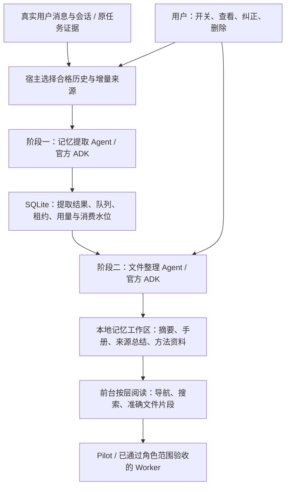

# Lake Agent 本地文件记忆主计划

本计划落实用户确认的新方向：由后台 Agent 提取和整理长期记忆，前台 Agent 按需阅读本地摘要、手册和来源总结。用户主要控制是否积累、是否使用，以及查看、纠正和删除；不建设逐条审核、采用、晋升的资产平台。

本计划替代旧项目记忆、运维 V2、自然记忆及其旧实现对接路线。历史交付与验收记录保留，未交付任务不再按旧设计推进。旧实现可以下线，前提是实际链路已被接替或证明无依赖；不要求为退役体系补齐全部旧功能。

本 PR 只更新计划与架构约定，不更改运行代码、数据库、开关、真实 Home 或正在执行的任务。全部 FM 任务尚未实施；后续各批从最新 develop 建分支，经 PR 与本地验证交付。

## 1. 目标与架构



- 程序负责资格、持久调度、并发、成本、中断恢复和文件访问边界；模型负责判断什么值得记、如何合并及组织知识。没有新价值时允许不写。
- 阶段一优先提取用户反复强调的工作习惯、已验证的方法、定位线索及失败经验。临时指标、凭据、普通进度和未采纳的助手设想不提升为长期结论。允许 success/partial/fail/uncertain 总结；摘要不得修改真实任务结果。
- 阶段二以当前选中的提取结果、原记忆和变更差异为输入，更新手册和导航。删除或撤回的输入也必须进入差异，清理其独有支持内容；多来源支持不整块误删。
- 复用官方 ADK、现有模型适配和后台准入；不增加第二 model/tool loop，也不让记忆工作经过 Pilot 创建用户业务任务。后台模型失败只影响记忆状态，当前任务继续。
- 初版无需向量模型、外部数据库、插件运行时、端云同步或长期自动纠错。全文/关键词搜索和按层展开先完成可验证闭环。

### 数据职责

| 数据 | 权威与维护者 |
| --- | --- |
| 原始消息、工具调用、操作、审批、unknown 与验收 | 原业务/ADK/安全账本；原始证据不由记忆 Agent 修改或复制为第二账本 |
| 同意、使用开关、来源资格、删除抑制、提取结果、队列、租约、用量、水位 | 宿主 SQLite；不是仅保留一个可随意丢弃的索引库 |
| 提炼后的长期知识与导航 | 本地记忆工作区，由专门整理 Agent 维护；不再把所有成品作为旧偏好表的 Markdown 投影 |
| 搜索索引、读取缓存与工作区差异 | 派生数据，可从当前合格输入及文件重新生成 |
| 项目连接、资产身份、执行许可 | Items / Security 原入口；记忆中的文字没有修改这些记录的能力 |

拟定目录（路径在 FM-01 冻结，不表示已有文件）：

```text
<Home>/memories/
  user/
    memory_summary.md
    MEMORY.md
  projects/<project-id>/
    memory_summary.md
    MEMORY.md
    raw_memories.md
    rollout_summaries/
    skills/
    extensions/ad_hoc/notes/
```

项目私有事实只进入对应项目目录。用户层仅接收符合全局范围的去敏偏好，不能复制项目原文、名称和私有证据。项目 ID、角色与资源范围由宿主解析，不信任模型或 front matter 自报。

summary 是简短导航，MEMORY 是可搜索手册，rollout summaries 是来源总结，raw memories 是阶段二输入；不把整个目录塞进每次请求。skills 初版仅是方法资料，不自动安装到扩展注册表，不获得可执行权限。人工规范及项目 AGENTS.md 不由记忆整理自动改写。

### 调度、读取与用户体验

1. 保留现有轮次结束和压缩前来源捕获；历史扫描只处理明确允许积累、已空闲的来源。开关默认关闭；旧积累同意不授权重扫开启前的全部历史，额外回填单独明确选择。
2. 有界提取、前台优先、失败退避、无变化零整理。两阶段共用既有后台容量和用量记录，阶段二无需每轮调用。关闭积累取消未来准入，已保存内容仍可按独立使用开关读取。
3. 前台先获得当前允许范围内的短导航，自行决定是否搜索手册和展开少量引用。搜索与准确读取都走宿主受限文件工具；不授予目录通配、跨项目、符号链接逃逸或全量原始会话读取。
4. 前台用户明确要求纠正时写一条小更新说明，由整理 Agent 消费；不要求用户审批每条记忆。直接本地编辑作为有变更依据的输入保留；格式异常或与后台写入冲突时保留修改并暂缓发布，不覆盖用户内容。
5. 删除/撤回先使派发和读取失效，再清理受影响的提取正文、总结、手册、摘要、方法副本、缓存和工作区历史残留。成功提示以清理完成为准；排队说明不能伪称已遗忘。保留必要无正文抑制标记，防止同源再次提取复活；用户自行导出的离线副本另行说明。
6. 后台 Agent 只获得当前工作区的有界本地文件工具；除配置的模型请求外无网络/资源工具、无递归委派。模型派发与发布前复核取消、同意和来源。当前明确要求优先，历史方法在真实资源操作前仍需核实。

## 2. 旧体系保留、替换和下线

| 现有位置/能力 | 处置 | 接替/退出条件 |
| --- | --- | --- |
| `internal/ai/natural_memory_capture.go`、`project_memory_snapshot.go` 与 Web outbox | 保留并适配 | 来源身份/hash、压缩前增量、覆盖水位与幂等不丢；旧快照可读 |
| `project_memory_worker.go`、`natural_consolidation_worker.go` | 调度基础复用，旧内容整理算法替换 | FM-02 新两阶段通过；按范围单写者切换，不维持第二常驻学习器 |
| `natural_preference.go` 及旧正文/支持/冲突表、V1 project memory | 过渡读取/迁移，停止新功能扩建 | FM-03 对账后停止该范围旧写入与旧注入；原表仅受控只读/撤回清理 |
| `project_memory_files.go` 的 Markdown 投影发布器 | 替换 | 不能再覆盖新工作区；停用旧发布前新读取已接管 |
| `natural_recall.go`、`project_memory_retrieval.go`、AI 记忆工具 | 接新导航与受限文件读取 | FM-03 证明每个入口只使用一种成品记忆，不同时注入两套正文 |
| `internal/ai/adk_services.go:nativeMemory`、`superagent_memory.go` | 保留调用边界，替换适配 | 不移除 ADK 服务或放开 Worker 全项目读取；范围能力未交付继续 unavailable |
| 旧条目/候选/分类/版本管理界面及独占 API | 逐批退出 | 简单开关、查看、纠正、删除路径可用；旧客户端得到明确退役响应，不静默成功 |
| 运维 V2 及仅为其存在的 API/UI/schema/工具 | 冻结后按依赖删除 | 不再推进完整 V2 放量，不翻转 `operationalMemoryV2Ready`；证明无调用再删代码，旧库 reader/拒绝规则按兼容需要保留 |
| 来源撤回、抑制、费用与未知模型用量、权限资格检查 | 保留并迁入新链 | 不能随旧页面、算法或表名一并删掉 |
| 操作/证据/审批/验收、历史任务召回、会话压缩、普通 Skills | 保留 | 与长期记忆退役分开测试，不复活 Harness² 资产/在线纠错 |

每个退役 PR 必须先给出实际 caller、工具目录、HTTP、后台启动、原生页面与兼容 reader 清单。没有调用证据不能因为名字包含 memory 就删除。原 schema/hash 与历史成功/失败/unknown 不改写，删除用户派生正文不等于删除必要执行审计。

旧数据迁移不调用模型：仅导入仍有效、来源可用且用户允许使用的内容，标为带来源的迁移输入；模型后续整理受新后台资格约束。旧候选/拒绝项/撤回项/遗忘项/退役策略资产不自动晋升。生成清单与数量/hash 对账；兼容回退使用包含最新撤回和操作的配对备份，禁止旧库覆盖新执行事实。

每个范围维护唯一模式/切换代次：legacy → file。先排空或隔离旧后台租约，准备新文件并验证，然后切换读取/写入 owner；崩溃重启根据提交回执续办。跨 SQLite/文件系统不承诺原子事务：使用稳定 operation/commit ID、私有暂存工作区、比较基线、验证后发布与幂等确认。文件已发布但 DB 未确认时对账，不重新调用模型。失败或半成品不得进入前台。具体发布协议必须在 FM-01 冻结并通过故障注入。

## 3. 分批实施

所有任务初始未完成。FM-00 是本次计划替换；后续阶段各自提交小 PR 到 develop，不以本次文档代替代码验收。

| 编号 | 交付 | 依赖 | 状态 |
| --- | --- | --- | --- |
| FM-00 | 更新主计划、架构索引和旧计划替代关系；保留历史交付；列出下线边界 | 无 | 本文档交付，待 PR 合入 |
| FM-01 | 审计当前所有 caller/设置/角色/API/数据库版本；冻结工作区、来源 DTO、唯一 owner、发布/删除与恢复协议。新增 `internal/memory` 为拟定共享模块，禁止 ai/web 循环依赖 | FM-00 | 未实施 |
| FM-02A | 复用原捕获/outbox/租约建立有界阶段一；经 ADK 生成 raw memory、summary、来源及 outcome，脱敏、无信号 no-op、失败退避 | FM-01 | 未实施 |
| FM-02B | 实现全局/范围整理锁、增量差异和受限 ADK 整理 Agent；更新 summary/MEMORY/来源总结，原子发布可读快照并处理删除输入 | FM-02A | 未实施 |
| FM-03A | Pilot 新导航、搜索和准确读取；简单开关、查看、纠正、删除。旧读路径经适配保持运行，文件读取不自动继承到 Worker | FM-02B | 未实施 |
| FM-03B | 隔离 Home 迁移、数量/hash 对账与原生 Dev；按范围切换单写者；移除该范围旧采集算法、旧注入/投影与 UI/API，保留所需兼容和撤回清理 | FM-03A | 未实施 |
| FM-04A | Worker 任务/资源范围知识视图；只加载分配范围片段，保留原任务历史证据读取；不默认复制全部项目文件 | FM-03B | 未实施 |
| FM-04B | 真实模型质量、成本、前台耗时及原生平台矩阵；删除余下无依赖 V2/旧兼容运行代码，交付最终退役清单 | FM-04A | 未实施 |

FM-03 后即可试用 Pilot 闭环；FM-04 未验收的角色明确不可用，不阻塞 Super-agent 外部事件主线。云端控制面以后经独立数据出端设计接入本接口，本期不上传 Home 或跨设备同步记忆。

## 4. 旧计划承接

| 旧计划 | 新定位/去向 |
| --- | --- |
| `feature-project-memory-1.md` | 已替代；V1 历史交付保留，迁移/读取适配归 FM-03 |
| `feature-operational-memory-2.md` | 已替代；停止 V2 放量任务，项目/资源/时间隔离作为新方案约束；无依赖代码退役归 FM-03B/04B |
| `feature-natural-memory-1.md` | 已替代；N1–N5 交付记录保留，采集/同意复用归 FM-02，读取和旧数据迁移归 FM-03 |
| `feature-items-security-memory-integration-1.md` | 旧 12 项实施路线已替代；资产和安全职责保留，必要宿主接口在 FM-01/04 冻结，不为旧条目管理补建平台 |
| Super-agent 一期 TASK-018/019 | 已交付的边界/不可用结果保留，不冒称 Worker 知识已可用 |
| Super-agent 一期 TASK-020/021/022 | 不再按旧算法实施；来源关联归 FM-02A，整理归 FM-02B，读取/说明归 FM-03/04 |
| Super-agent 二期 | 主线不变；原 Memory 依赖改指本计划，允许未接知识的 Worker 正常执行 |
| Harness² 清理及旧策略档案 | 已退役结论继续有效，不重新导入成品记忆或可执行 Skill |

## 5. 实施范围

- **共享模块（拟新增）**：`internal/memory` 的来源/工作区协议、差异、文件发布、限定搜索与删除恢复；具体文件由 FM-01 审计冻结。
- **AI 层**：`natural_memory_capture.go`、`project_memory_snapshot.go`、`natural_memory_recall.go`、`project_memory.go`、`adk_services.go`、`superagent_memory.go` 与新后台角色适配。
- **宿主**：Web outbox、后台 worker、旧 preference/project store/retrieval/files/routes、Security Memory 恢复与来源桥。
- **前端**：`MemorySettings.tsx`、`NaturalMemoryPreferences.tsx`、`NaturalMemoryNotice.tsx`、`ProjectMemory*.tsx` 和 API 适配；不捆绑主工作台重写。
- **文档**：根 `agent.md`、当前使用说明、三模块对接、Super-agent 一/二期引用和逐阶段验证记录。

## 6. 验收

| 编号 | 必须验证 |
| --- | --- |
| T01 | 三种模式：只积累、只使用、全部关闭；不继承任务许可或开启前全库历史；前台任务不等待整理模型 |
| T02 | 轮次结束、压缩、重启重送只提取一次；保留覆盖缺口、来源 hash 和旧快照兼容 |
| T03 | 无价值输入 no-op；重复输入无重复整理；稳定偏好、已验证经验、临时状态、秘密和助手设想分类正确 |
| T04 | 同项目与跨项目、用户层、Pilot/Worker、准确路径/分页/符号链接均按范围读取；工具无外部 I/O 与递归委派 |
| T05 | 关闭、来源撤回、遗忘和用户纠正发生在提取/整理/发布期间时，迟到输出不覆盖、不复活 |
| T06 | 提取后、发布前、文件发布后 DB ACK 前、删除中崩溃；双进程/旧 owner 恢复无重复模型派发和半文件注入 |
| T07 | 外部编辑、更新说明、冲突与格式错误可恢复；无支持来源的摘要/方法清理，多来源保留合理内容 |
| T08 | 旧有效内容迁移数量/hash 对账；拒绝、已忘、归档策略不导入；切换后旧 worker、注入和投影均不再写该范围 |
| T09 | 普通/Plan/Pilot、频道/任务、保存工作流、日程、终端/SQL、MCP、Skills、审批、长等待/压缩及 unknown 恢复不回归 |
| T10 | 固定质量集：稳定偏好、可复用方法/失败经验、不应记内容、更正/遗忘、换说法召回，分开计遗漏、误记、过时引用、串项目和成本 |
| T11 | 固定 60 个虚构案例：15 偏好、15 方法/失败经验、10 不应记、10 更正/遗忘、10 项目/角色边界；实际配置模型各跑三轮，明确应记召回目标至少 90%，不应记自动写入为 0。任何秘密落盘、跨范围读取、遗忘复活或 unknown 重放均阻止启用；目标为待验收门槛，不能看结果放宽 |
| T12 | macOS/Windows 各自原生验证文件权限、替换/占用、重启及 UI；未执行平台单列，不以交叉编译冒充 |

每批运行对应 Go/race/vet、ADK 边界、前端相关检查与签名 Dev 直接运行；记录 tested SHA、数据格式、模型及协议、失败项和回退方式。不为纯文档运行应用/模型；不触发日常 CI。手动 Windows CI 需届时明确授权。

## 7. 风险与决策

- 两阶段可能增加模型用量：有界历史、前台优先、只在输入变化时整理、无信号 no-op，共用可审计后台额度。
- Agent 可能错误归纳：优先真实用户与验证结果；保留证据线索及 uncertain，当前要求优先；不把所有知识强制做成 observed 资产事实。
- 文件与数据库可能不同步：提交 ID、单写者与故障恢复先于实际切换，不承诺跨介质事务；失败保留原可用读路径。
- 过渡可能无限延长：FM-03B 必须交付停旧写/停旧注入清单，FM-04B 删除无依赖实现；历史文件保留不等于旧运行入口继续有效。
- 本期没有向量库、云同步、自动策略优化和逐条资产审核。以后有真实缺口再独立评估，不为接框架扩张主线。

## 8. 参考与当前水位

- [根架构约定](../agent.md)、[当前 Memory 使用与退役说明](../docs/lake-memory.md)。
- [Super-agent 一期](architecture-lake-superagent-1.md)、[二期](architecture-lake-superagent-2.md)。
- [Codex 记忆说明](https://learn.chatgpt.com/docs/customization/memories)、[公开两阶段实现](https://github.com/openai/codex/blob/main/codex-rs/memories/README.md)、[整理提示词](https://github.com/openai/codex/blob/main/codex-rs/memories/write/templates/memories/consolidation.md)。参考其机制，不宣称逐文件复刻某一 Codex 版本。
- [贡献规范](../CONTRIBUTING.md)、[分支与发布](../docs/development-workflow.md)。

本次基线仅核查源码调用关系与计划状态；新流水线、下线动作和真实质量均未执行。旧 Memory 当前仍按现有代码工作，运维 V2 仍关闭。计划替换不删除历史交付证据，也不将历史测试当作新方案验收。
