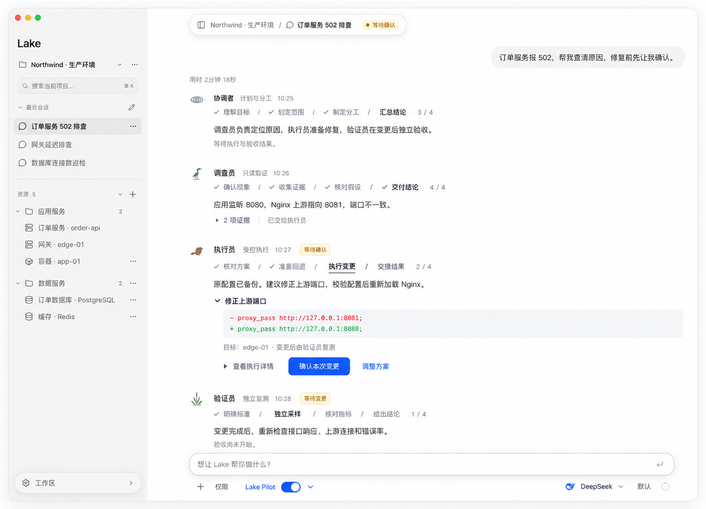

# Introduction


Lake Pilot 是统一的运维协作入口：继承现有 SRE 专员协作能力，每个 Agent 按自己的职责提供“步骤 → 方向 → 命令/动作”，让用户选择参与深度。在 Lake Pilot 下提供“自动推进”子开关，配置是否默认由 Lake 选择方向和命令并直接推进。各角色的步骤导航、方向、动作与完成条件不同，不共用一套通用排障导航。

本版替代原方案中“Pilot 与 SRE 两个互斥开关、两条执行路径”的设计。界面只保留一个 **Lake Pilot** 主开关；SRE 专员是其执行能力，不再作为另一个用户模式。

核心约定：**步骤承载任务进度，方向承载处理路径，命令承载实际操作。切换方向或选择不同命令，不改变步骤的身份、顺序、总数和已有完成记录。步骤完成由实际完成条件决定。自动推进只免去路径选择，不改变操作权限。**

本文件记录方案及开发进度，功能按任务逐项实现并验收。调研基线为 `origin/develop` 提交 `d94fa315d167055b57f64e661a1b813aeca7b68a`。下文“新增”的类型、函数和接口是拟议设计；既有 SRE 名称可以继续用于内部代码及兼容 API。

交付范围包括设置、角色工作项、路径选择、执行与恢复、原有 UI 集成及验收。实现优先跑通“一个调查员的一次选择 → 原工具调用 → 可核对结果”，随后接入多角色和自动推进；不从一套新仪表盘或单纯改按钮名称开始。

## 1. Requirements & Constraints

### 1.1 产品入口与设置

- **REQ-001**: 将输入区现有“SRE 协作”入口升级为 **Lake Pilot**。主开关控制统一协作能力，默认关闭；按钮沿用原 SRE 的文字开关：关闭为主题灰色、开启为主题前景色（浅色黑、深色浅色），不添加蓝色滑动开关。旁边提供小型展开入口；不同时展示第二个 SRE 开关，不提供 SRE/Pilot 二选一模式。
- **REQ-002**: 展开入口展示“自动推进”子开关。说明为“默认由 Lake 选择方向和命令并执行；变更仍按当前权限确认。”关闭时逐步骤等待选择，开启时默认直接推进。
- **REQ-003**: 主开关关闭时，子开关保留保存值但不可用于派发任务，提示“开启 Lake Pilot 后生效”。新项目主开关默认关闭，自动推进默认关闭；无须用户先配置完整资产资料。
- **REQ-004**: 主开关和子开关均按项目保存。新项目和首次升级到 Pilot 的旧项目均默认 enabled=false、autoAdvance=false，不根据旧 SRE enabled 自动开启。首次升级保留旧值的迁移来源但不沿用开启状态；迁移只执行一次，后续不得覆盖用户明确保存的 Pilot 设置。
- **REQ-005**: 新任务创建时固定 `interactionPolicy = guided | automatic`：取自主开关开启时的自动推进设置；guided 等待选择，automatic 默认由 Lake 推进。修改子开关只影响新任务，当前任务保留原策略；设置旁注明“对新任务生效”。
- **REQ-006**: 当前任务允许通过“交给 Lake 完成本步骤”临时委托本步骤，也允许在自动推进时点击“暂停并选择”。两者只改变当前任务/步骤的参与方式，不反向改写项目默认设置。
- **REQ-007**: 自动推进开启后，用户仍可查看方向、具体命令、真实结果和进度；界面无需用户点击选择才能继续。任何设置、委托和路径选择都不能跳过现有审批或扩大资源范围。

入口示意：

```text
输入区： [Plan]  [Lake Pilot ● ▾]

点开 ▾：
  Lake Pilot
  Lake 规划步骤，你掌握方向。

  自动推进                                  ○
  默认由 Lake 选择方向和命令并执行。
  变更仍按当前权限确认；对新任务生效。
```

| 主开关 | 自动推进 | 新任务行为 |
| --- | --- | --- |
| 关闭 | 任意保存值 | 普通 Lake 会话；不启动协作任务 |
| 开启 | 关闭 | 专员按计划工作，在资源检查/操作前展示方向和命令，等待选择 |
| 开启 | 开启 | 专员在任务范围内自行选择方向、组织命令并推进，必要时等待审批 |

### 1.2 层级、任务与执行能力

- **REQ-008**: 工作层级为 `任务 > Agent 工作项 > 步骤 > 方向 > 命令/动作`。每个 Agent 工作项有自己的目标、范围、交付物和步骤导航。用户可只选择方向并交由该专员制定具体命令，或展开方向选择具体命令。展开、收起和勾选不执行资源操作，提交按钮明确表达“按此方向继续”或“执行所选检查”。
- **REQ-009**: 方向和命令属于当前步骤的可替换执行路径，不生成额外任务步骤。尝试不同方向时，保留此前所有证据、失败与实际变更记录，不重置步骤进度，也不重复已完成操作。
- **REQ-010**: 自动推进关闭时，每个需要资源执行的就绪步骤先等待选择。纯计划整理、解释和读取既有证据不机械地要求选择。步骤委托结束后，后续步骤按任务原策略处理；guided 继续等待，automatic 继续自动推进。
- **REQ-011**: 继承现有协调者、调查员、执行员、验证员的分工、独立核对、证据共享与依赖执行。每个实际工作项显式展示 Agent 身份、职责、目标、自己的步骤导航与结果；原始执行记录按需展开。角色按需参与，不强制四人到齐，不为未启动角色生成虚假进度。
- **REQ-012**: 保留现有 SRE 的 SQL、Redis、Docker、文件、SSH、Kubernetes 与已启用扩展等能力，不因品牌合并删减原功能。初版把可受控的本机/SSH 检查和文件操作接入命令选择；其他工具用同层级“操作”展示真实工具及参数，不能伪装成 Shell。
- **REQ-013**: 原终端 AI 侧栏和数据库专用会话继续保留现有入口；不将其静默改成 Pilot 会话。已有工作流和定时只读巡检继续使用已授权的运行方式，不因新增交互选择而挂起等待无人值守的人工输入，也不继承额外变更权限。
- **REQ-014**: 页面刷新、断线或应用重启可恢复任务、候选、选择等待和真实操作状态；恢复展示本身不执行命令。手动接管暂停相关步骤后续派发，继续前先对账并重新检查现场。
- **REQ-015**: 各 Agent 按其职责和本次任务生成不同的步骤、方向与候选；角色模板仅作参考，不能把“确认现象/定位原因/执行修复/验证恢复”复制给所有 Agent。协调者的计划/分配动作、调查员的检查、执行员的变更、验证员的验收分别呈现。
- **REQ-016**: Agent 工作项进度与总任务进度分别计算并标明归属；切换查看另一 Agent 只切换工作视图，不切换执行所有权，不重置进度、不触发调用、不批准或扩大其他 Agent 的操作。
- **REQ-017**: 必须保持原 Lake UI 风格：在现有专员对话消息内增加步骤导航、方向和操作，不另建四角色仪表盘；沿用现有头像、正文、计时、审批、输入框和工具栏。具体样式以当前代码和 `docs/ui-guidelines.md` 为准，概念图只说明布局与关系。
- **REQ-018**: 初次生成计划后显示真实工作项与就绪步骤。没有资源、目标含糊、没有模型、后台不支持选择或无法制定有效候选时，显示具体阻碍，不伪造步骤/命令、不静默转成自动执行。

### 1.3 简洁呈现与选择规则

保留原 Lake 专员消息的“小头像 + 角色名/职责/时间 + 正文”结构，只在消息头下方插入该工作项的轻量步骤导航。方向和命令在同一条消息内逐层展开，使用原有证据与详情入口。各 Agent 继续按真实发言顺序出现在同一对话中；不按四种角色重新分区或重排历史。

原有界面参考：[Lake 工作台](../docs/images/lake-workbench-light.jpg)。功能布局参考如下，图中数据与状态为演示，不能作为真实执行或验收证据：



```text
调查员 · order-api
职责：收集证据并定位原因
✓ 确认现象  /  收集证据  /  定位原因  /  交付结论      本工作项 1 / 4 已完成

收集应用运行证据                      交给 Lake 完成本步骤 ↗
取得进程、端口和相关日志证据，供后续判断。

▾ 检查应用运行状态   推荐                 按此方向继续 →
  确认进程与监听端口，判断上游是否可达。

  ☑ 查看服务状态
    systemctl status order-service --no-pager
  ☑ 检查监听端口
    ss -lntp
  ☐ 查看启动日志
    journalctl -u order-service -n 100 --no-pager

  已选 2 项 · 尚未执行                     [执行所选检查 →]

▸ 核对代理配置
▸ 核对近期发布
```

以上是 guided 示例；automatic 显示当前采用的方向和已执行操作，替换选择按钮为真实运行状态与“暂停并选择”，不能留下必须点击才能继续的伪自动状态。

- **GUD-001**: 选择时展示 1–3 个真实可用方向，最多推荐一个，说明当前证据和推荐依据；不凑数。自动推进也保留采用理由，供用户回看。
- **GUD-002**: 命令/操作显示目的、目标、真实工具与完整参数、可信风险、依赖、状态和原始输出入口；只读项可默认勾选，变更项默认不勾选。选择方向和设置自动推进均不等于批准具体变更。
- **GUD-003**: 独立检查允许多选，互斥方案用单选，有依赖操作按依赖组展示；缺少依赖时拒绝提交，不偷偷补选变更。尚依赖前一步结果的候选注明“根据检查结果制定”，不能执行占位内容。
- **GUD-004**: 命令层提交只执行冻结集合；新增命令重新等待选择。方向委托允许制定同一方向内的新批次，需要换方向时重新选择；步骤委托及 automatic 可在当前步骤范围内更换方向。
- **GUD-005**: 正在执行的集合不被流式更新替换。浏览其他方向不改变执行路径；改变路径先暂停，等待在途操作对账。已发生的变更不会因切换方向撤销。
- **GUD-006**: 自动推进设置不替代任务进展。分别展示等待选择、等待批准、执行中、暂停、结果待核实和完成；等待审批时不能显示仍在自动执行的动效。
- **GUD-007**: 开关沿用现有 `aria-busy`、`aria-disabled`、保存失败重试与焦点反馈。主入口保持紧凑，子设置放在展开层；使用 `Glyph`、共享主题和圆角，表单下拉沿用 `AppSelect`，不增加可见原生 select。
- **GUD-008**: Agent 标题显示职责与实际资源，例如“调查员 · 应用服务”和“调查员 · 数据库”；同一角色的不同工作项不能合并成一个含糊的进度。每个工作项仅显示其自身步骤、候选和结果；同伴证据可引用，并保留来源。
- **GUD-009**: 协调者等不需要命令的步骤展示具体“动作/交付物”，如确认调查范围、制定依赖和汇总结论；不生成无意义的 Shell 命令或空命令列表。只有影响范围、处理路径等需要人决定的节点才等待选择。
- **GUD-010**: 同一工作项的步骤导航只挂载在其唯一的进度消息锚点；后续发现消息不重复插入整条导航。新状态原位更新，不重建之前正文、不抢焦点；用户上滚阅读时保持滚动位置。

### 1.4 进度、生命周期与并发

- **PAT-001**: 复用 `SRETask`、`SREPlanRevision`、`SREPlanStep`、`SREStepAttempt`、`SREOperation` 和验收记录。新增方向候选与决策挂到原任务/计划/步骤，不创建第二套 PilotTask、计划执行器或操作账本。
- **PAT-002**: 每步方向有独立候选版本。更换方向、勾命令、重新采样或切换当前步骤的参与方式，不改计划版本、步骤 ID、顺序或总量。
- **PAT-003**: 任务进度统计当前计划实际完成的步骤，不按命令数、选项数或回复完成推算。某命令成功或某方向检查结束不代表步骤完成。步骤结果需满足声明的交付/核对条件；恢复结论必须通过现有确定性验收。
- **PAT-004**: 目标、资源范围、步骤结构或完成条件变化才修订计划，向用户展示差异并明确采用。保留旧计划及已完成证据；普通路径选择不触发计划重建。
- **PAT-005**: 保留现有 ADK 依赖图、角色串行、变更独占及资源锁。独立步骤仍可并行；有多个等待选择的步骤时按实际就绪顺序展示，每份决策绑定具体步骤，不能用一个步骤的选择放行其他步骤。
- **PAT-006**: 选择等待复用 `waiting_input` 并新增 `inputKind='pilot_choice'` 区分普通追问。运行、暂停、完成等生命周期继续由既有 SRE/ADK 记录投影，避免添加另一套相互矛盾的任务状态。
- **PAT-007**: 工作项使用稳定 `assignmentId` 关联原计划中的步骤，同一角色可有多个不同目标的工作项；执行 attempt/agentRun 更换不改变工作项身份。工作项进度按其拥有的原步骤计算，总进度按当前计划的唯一步骤计算，不能平均角色百分比、重复统计共享步骤或用角色回复完成冒充任务完成。工作项是计划归属与视图分组，不是新的调度器。
- **PAT-008**: 原任务 revision 用于审计和快照排序，当前步骤的 `choiceRevision` 用于提交选择。无关 Agent 新增消息/证据只递增任务 revision，不使另一个 Agent 的有效候选失效；计划、目标权限、同一步骤候选、现场前置条件或人工接管变化才使其失效。

| 配置/行为 | 生效范围与限制 |
| --- | --- |
| 主开关 | 项目级。运行或有在途操作时拒绝关闭，提示先暂停；暂停后关闭不删除任务，重新开启才允许继续 |
| 自动推进子开关 | 项目级默认值，仅新任务采用。可在当前任务运行时保存，不中断、授权或改变当前任务 |
| 暂停并选择 | 仅当前任务的目标步骤；等待在途操作收尾后进入 guided，当前步骤结束后按原任务策略处理后续步骤 |
| 交给 Lake 完成本步骤 | 仅当前步骤；记录明确委托来源，不继承到其他步骤、任务或项目 |
| Plan 开关 | 保留独立只读规划模式。Plan 时不派发 Pilot 资源任务；已有任务先暂停，原等待或审批不能被跳过 |
| 多窗口保存 | 主/子设置共用 revision；过期保存返回 409，展示最新值，不用迟到响应覆盖新配置 |
| 旧历史任务 | 沿用原任务、原状态、原执行习惯；缺少 interactionPolicy 的历史任务按 legacy automatic 恢复，明确标注来源，不插入新的 guided 等待 |

### 1.5 权限、执行与持久化约束

- **SEC-001**: 自动推进只消除路径选择等待。真实操作始终遵守资源授权、可信风险、会话审批设置、危险操作确认、SSH 指纹、资源锁及原操作账本；不得额外开启静默写权限。
- **SEC-002**: guided 客户端只提交保存的任务/计划/步骤/候选 ID、修订号和命令 ID，不直接提交任意可执行正文。冻结工具、目标和参数指纹后执行；参数变化产生新候选，原审批不能复用。
- **SEC-003**: automatic 的授权依据是用户保存的子开关及任务创建时的设置快照；步骤委托依据人工决策记录。模型不能自行生成或扩大委托。两类记录都不代替变更审批。
- **SEC-004**: 所有专员在工具派发前执行选择门禁，包括现有 `FullTools` 路径和审批恢复。guided 必须匹配有效命令选择或方向/步骤委托；automatic 绑定原任务策略和范围。禁止普通 Shell、MCP 或其他专员绕开门禁。
- **SEC-005**: 选择、操作绑定、审批和真实派发保持持久关联。重复提交幂等；未知变更先核实，换方向、开自动推进、清上下文和重新命名命令均不能重发原未知操作。
- **SEC-006**: 证据保留资源、调用与时间来源，跨方向共享不重复采集冒充独立验证。手动接管后的旧候选失效；恢复验收按原验证规则取得新采样，不能用旧日志证明已恢复。
- **SEC-007**: 沿用当前 Lake Home 的私有存储权限；凭据不进入选项、事件、摘要或截图，不读 Keychain，不复制正式版秘密到 Dev。
- **SEC-008**: 职责由服务端执行策略约束：协调者负责计划、依赖、分配和汇总，不直接变更资源；调查员只读取证；执行员在批准的具体动作范围内变更；验证员独立只读核对，不顺手修复。工具目录完整性不等于所有角色均有写权限。所有 FullTools/普通 Shell/扩展路径都执行角色与用户授权的交集，自动推进不提升角色权限。
- **CON-001**: 复用官方 ADK 主 Agent、SRE 专员及 WorkflowAgent，不增加模型循环、轮询调度器、SDK 内部依赖或生产回退。品牌合并不要求重命名整个 `sre_*` 代码体系。
- **CON-002**: 主开关沿用 `sreProjectSettings` 作为唯一启用来源，新增 `autoAdvance` 与 `revision` 字段；旧 SRE API 读写经同一设置服务。不能同时保存互相独立的 SRE/Pilot enabled。
- **CON-003**: 设置与任务创建使用一致锁序 `messageMu -> Store.update`；创建时固定策略快照。旧 API 只更新 enabled，不隐式修改 autoAdvance；所有启动入口均重新检查主开关和原权限。
- **CON-004**: 已开始实现；方案和布局参考随开发分支保存。实现从最新 `origin/develop` 建功能分支，普通 PR 指向 develop；本地/Dev 验证后等待明确合并授权。发布、安装或重启生产另行授权。

### 1.6 拟议接口与数据增量

| 新增/扩展对象 | 约束 |
| --- | --- |
| `PilotSettings` | `{enabled:boolean, autoAdvance:boolean, revision:number}`；由现有 SRE 项目设置扩展；首次迁移后不重算默认值 |
| `SRETask.pilot` | 可选 `{schemaVersion:1, interactionPolicy:'guided' 或 'automatic', settingsRevision, assignments, directions, decisions, stepOverrides, operationBindings}`；旧任务没有该字段，维持原恢复方式 |
| `PilotAssignment` | `id, taskId, planRevisionId, role, title, goal, resourceIds, deliverables, stepIds`；每个原计划步骤恰好归属一个工作项；重试关联现有 attempt/roleRunId，不创建新的进度分母 |
| `SREPlanStep.assignmentId` | 新计划的可选归属字段；绑定 PilotAssignment，不按 agentRunId 推断归属。旧冻结计划不回填该字段以免改变 ADK 指纹；仅以现有 plan/step/role 生成兼容视图 |
| `SREPlanStep.actionPolicy` | 新 Pilot 计划可选 `pilot_candidates`，按第 1.10 节由冻结候选批次执行；缺失字段始终沿用旧的 Step.Action 校验，不放宽历史动作匹配 |
| `SREPlanStep.pilotCheckIds` | 新计划可选，仅列出该步负责采样/核对的原 acceptance 项；明确标准/交付报告步骤不触发整套采样 |
| `SREPlanStep.pilotCompletionRules` | 新计划可选结构化完成条件；kind 为 `artifact`、`operation`、`probe`、`manual`。分别校验带来源的真实交付物、所需原操作结果、指定验收项和明确人工确认。保留原 CompletionChecks 描述，但不只凭模型自报完成 |
| `PilotDirectionRevision` | `id, taskId, planRevisionId, assignmentId, stepId, choiceRevision, evidenceIds, directions, createdAt`；方向含 title、rationale、recommended 和候选列表；同一步骤候选版本独立于任务 revision |
| `PilotOperationCandidate` | `id, directionId, resourceId, tool, arguments, fingerprint, purpose, risk, dependsOn, selectionGroup, selectionPolicy`；风险由可信策略计算 |
| `PilotDecision` | `id, requestId, observedTaskRevision, expectedChoiceRevision, planRevisionId, assignmentId, stepId, attemptId, interruptId, directionRevisionId, directionId, level, operationIds, actor, deliveryStatus, createdAt`；level 为 step/direction/command；deliveryStatus 为 pending/resumed/reconciled，记录跨库恢复交接，不驱动资源调度 |
| `PilotExecutionBatch` | `id, taskId, assignmentId, stepId, directionRevisionId, decisionId或policySnapshotRef, candidateIds, fingerprints, operationIds, status`；固定真实工具/参数及依赖顺序；与原账本关联，不保存第二份资源效果状态 |
| `PilotStepOverride` | `stepId, policy, sourceDecisionId, createdAt`；仅当前步骤参与方式变化，不重建步骤；automatic 主动接管也保存依据 |
| `PilotOperationBinding` | `assignmentId, stepId, attemptId, batchId, decisionId或policySnapshotRef, candidateId, fingerprint, operationId`；引用原 SRE/native operation，不复制账本 |

| 接口 | 行为 |
| --- | --- |
| 新增 `GET /api/projects/:project/pilot` | 返回主开关、自动推进与修订号 |
| 新增 `PUT /api/projects/:project/pilot` | 请求 `{expectedRevision, enabled?, autoAdvance?}`，至少包含一个布尔更新字段；在同一事务内只更新指定字段。只更新子开关不受运行中关闭主开关的限制；冲突返回 409 和当前设置 |
| 保留 `/api/projects/:project/sre` | 与 Pilot 共享 enabled；保留原 `{enabled}` 格式，旧 API 不改变 autoAdvance。新 UI 不再展示“SRE 协作”开关 |
| 保留 `/api/sessions/:session/sre/tasks` 及任务详情 | 继续分页读取原任务，包含可选 Pilot 数据；无需复制为第二套任务接口 |
| 新增 `POST /api/sessions/:session/sre/tasks/:task/pilot-decisions` | 请求携带 requestId、expectedChoiceRevision、assignmentId、stepId、attemptId、interruptId、计划/候选版本及所选 ID；同一事务校验角色、工作项、依赖和等待，再只恢复原专员。相同 requestId/内容返回原决策；同 ID 不同内容返回冲突 |
| 新增 `POST /api/sessions/:session/sre/tasks/:task/pilot-guided` | 请求 `{requestId, assignmentId, stepId, expectedChoiceRevision}`；响应区分 `pausing`、`waiting_choice`、`needs_reconciliation`，不以已收到暂停请求冒充远程已停 |
| 沿用既有任务暂停、继续、修订和结束接口 | 增加选择等待/委托的校验，不新建并行生命周期 |

模型仍通过现有 `sre_collaborate` / `sre_reply` 决定协作或直接答复，避免解释问题也强制建任务。新增专员工具 `pilot_offer_directions` 保存当前步骤候选；guided 使用官方 ADK 人工输入等待，automatic 记录选取依据后继续。等待绑定原角色、attempt、计划和步骤；不得在会话外另起 Agent 绕过等待。

### 1.7 各 Agent 的职责、步骤与交接

下表是同一次服务故障中各角色的示例步骤，不是固定四段模板；步骤由协调者结合具体目标制定并冻结到计划。每个工作项可有不同数量、名称和依赖的步骤。

| Agent | 工作职责 | 自己的步骤导航示例 | 方向/命令或动作示例 | 完成交付 |
| --- | --- | --- | --- | --- |
| 协调者 | 确定目标、范围、优先级及分工，处理依赖并汇总 | 理解目标 → 划定范围 → 制定分工 → 汇总结论 | 优先查应用或网络；安排独立调查；等待验证后收尾 | 明确计划、任务归属、决策依据、最终结论与缺口 |
| 调查员 | 只读取证，区分事实、假设和证据缺口 | 确认现象 → 收集证据 → 定位原因 → 交付结论 | 查进程/端口、日志/配置、近期发布；对应只读命令 | 带来源的证据、原因判断与置信边界，交给执行员 |
| 执行员 | 制定并执行获准变更，记录实际效果 | 核对方案 → 准备回退 → 执行变更 → 交接结果 | 修改配置、回退版本等具体方案；展示差异、影响与批准动作 | 真实变更、执行结果及回退材料，交给验证员；不自行宣布恢复 |
| 验证员 | 根据验收条件独立取得新证据并判断 | 明确标准 → 独立采样 → 核对指标 → 给出结论 | 应用接口、端口/进程、错误率等独立检查及时间窗 | 验收结果、证据和未通过条件；未通过交回协调者，不能自动变更 |

交接基于计划依赖和实际产物：调查结论不等于变更授权，变更成功不等于恢复，验证失败不允许验证员自行修复。协调者在缺少证据或验收时保留未确认状态。自动推进仅决定是否等待用户选择，各角色仍执行自己的计划和权限边界。

协调者在计划生成前的目标澄清作为普通对话展示，不能给尚未存在的计划伪造已完成步骤。计划保存后，确实存在产物且经过条件核对的前置步骤才能显示完成。角色收到别人的交付物后，仅获得事实和建议，不获得对方的操作授权。

| 交接 | 必需内容 | 接收方的责任 |
| --- | --- | --- |
| 协调者 → 调查员 | 目标、明确资源、现象、证据缺口、完成条件 | 在分配范围内只读采集，提出可核对的结论 |
| 调查员 → 执行员 | 事实与假设分开、证据 ID、采样时间、建议处置及未知项 | 重新确认现场前置条件，制定具体动作/影响/回退，不直接执行文字建议 |
| 执行员 → 验证员 | 实际执行的 operation ID、参数指纹、时间、前后版本及未执行项 | 等待所依赖动作真实完成后，取得独立新采样，不能仅复述执行员报告 |
| 验证员 → 协调者 | 逐项验收结果、证据、时间窗及未通过项 | 如实收尾或提出新修订；修复后再验证不得沿用旧的通过结果 |

### 1.8 原 Lake UI 的具体保留规则

| 界面部分 | 必须沿用 | 允许增加 |
| --- | --- | --- |
| 应用与工作区 | 原生窗口、侧栏、资源树、顶部会话气泡、正文宽度及输入框 | 只替换原 SRE 入口文案并增加子设置 |
| 专员身份 | `AgentIcon` 的涟漪/苍鹭/海狸/芦苇头像，最大 22px、无底色；原角色名/职责/时间消息头 | 同角色多工作项时补实际目标名称，保持字号和字重 token |
| 正文 | `SRERoleMessage`、`SREProse`、`SREReport`、`SRECheckpoint` 的原文字层级与发言顺序 | 在唯一消息锚点的消息头下插入该工作项步骤导航 |
| 证据与详情 | `DisclosureSummary`、原证据分页和执行记录入口 | 步骤的方向和命令展开内容，保留原来源与时间 |
| 代码与审批 | `MarkdownCodeBlock`、`AIPending`、已有文件差异/命令确认 | 绑定当前步骤及候选说明，不新增第二份可批准同一调用的控件 |
| 计时与运行反馈 | 原耗时行、`StatusText`、真实运行/等待状态 | 提供实际局部进度及当前步骤提示，继承减少动态效果设置 |

- **GUD-011**: 保持 `theme.css` 的 `--font-size-ui`、`--font-size-toolbar`、字重与黑/灰层级，不为 Pilot 建独立标题字号或字体；颜色与尺寸以实际主题为准，不照抄生成图像中的近似蓝色与字距。
- **GUD-012**: 步骤导航是短文字轨迹；完成项小型 Glyph 勾选，当前项用文字强调，未来项次要文字。禁止编号圆点时间线、全宽角色分割板块、四角色大卡片、通用大图标和重复品牌标题。
- **GUD-013**: 点击步骤只查看对应内容，不能跳过依赖、重新运行或设为完成；未来步骤可查看目标与等待原因。当前步骤使用 `aria-current="step"`，按钮可键盘聚焦，读屏提供名称、序号和实际状态。
- **GUD-014**: 狭窄窗口导航单行在本区域横向滚动，代码也仅在自身区域滚动；不能造成整个窗口横向溢出，不强制同时展开所有 Agent。更新同一条消息不自动切换用户正在看的步骤。
- **GUD-015**: 主开关与展开按钮有独立点击目标：切主开关不误开菜单，展开设置不误开关 Pilot。设置层沿用共享弹层、焦点约束、Escape 与返回入口、窗口边界和曲线规范；子开关不是额外的顶层模式。
- **GUD-016**: 旧轮次恢复和历史查看默认只读。历史选择显示当时的方向/命令与结果，不显示可提交的过期执行按钮。当前活动锚点在更新中保留身份；修订计划后旧锚点仍可查看原版本。

### 1.9 用户路径与状态反馈

| 场景 | 屏幕反馈与允许动作 | 运行行为 |
| --- | --- | --- |
| 新建 guided 任务 | 原对话出现实际专员、其步骤和“等待选择”；展开方向看命令 | 先保存计划/工作项及选择等待，未选前不派发资源检查 |
| 按方向继续 | 当前方向高亮，显示将检查什么 | 在该方向范围内连续组织检查，执行集合记录到原账本；换方向重新等待 |
| 执行所选检查 | 显示本次固定集合和真实逐项状态 | 依赖失败则后续未派发项标未执行；缺证据可继续选，不直接完成步骤 |
| 选择一项变更 | 使用原审批卡展示目标、差异、影响和验证 | 选择成功不代表批准；按原权限决定是否等待，不出现两个有效批准按钮 |
| 交给 Lake 完成本步骤 | 当前步骤标“由 Lake 推进”，可暂停 | 保存步骤级委托，允许步骤内换方向；结束后恢复任务策略 |
| automatic 任务 | 原专员消息展示正在采用的方向/结果与“暂停并选择” | 无路径选择等待；真实审批、资源锁与依赖等待正常保留 |
| 暂停并选择 | 先“正在暂停”；随后显示等待选择或真实未知/在途状态 | 只为目标步骤设持久 hold，阻止其下一次派发；不取消无关专员，不把当前远程调用当成已停 |
| 无有效方向或没有取得新证据 | 当前步骤保留进度，显示缺口和补充要求入口 | 结束当前探索并暂停该步骤；不反复展示相同选项制造假推进 |
| 用户补充要求或询问某 Agent | 沿用输入框和点名/引用入口 | 解释直接答复；改变约束时显式生成新候选/计划，不能将普通问句当作执行或批准 |
| 核对失败或变更失败 | 原消息中明确失败、实际影响和后续建议 | 不自动扩大范围或连试其他写方案；保留既有证据及原失败记录 |
| 验证未通过 | 验证员列出未通过条件，协调者等待修订 | 初版不新增自动多轮修复循环；用户采用新修订后才能继续相关处置 |
| 页面断线/重启 | 重连后恢复原工作项与等待，标明结果来源 | 有句柄就观察原调用；未知效果先核实，不靠新候选重放 |

同一角色重复提出完全相同候选、且没有新证据/前置条件变化时，运行时返回已有候选，不新建选择版本或重新执行。跨步骤或跨任务的合法重复采样仍需有独立调用身份与来源。

任务最终回复沿用原对话样式，给出结论、证据、实际变更和未确认项。调查报告交付、根因确认、变更完成和恢复验收是独立事实；允许“服务恢复已验证、根因未确认”，也允许“原因已定位、修复尚未执行”。

### 1.10 与现有执行代码的关键适配

代码核对发现以下限制必须显式处理，不能仅新增前端选择按钮：

| 现状 | 本方案适配要求 |
| --- | --- |
| `sre_orchestrator.go:runSREStep` 对所有执行员步骤注入同一冻结动作要求 | 新 Pilot 计划区分 `observe/analyze/act/summarize`：核对方案、只读准备、交接报告按实际 kind 执行，不能要求每一步都有写操作；备份若涉及写入，作为显式受控动作处理 |
| `sre_lifecycle.go:sreAttemptOutcome` 目前按执行员角色一律要求匹配 `step.Action` 的成功操作 | 旧任务保持精确动作校验；新 Pilot 只在 act 步骤校验有效冻结批次、所需操作与验收。分析/报告步骤核对声明交付物，不因没有变更被误报失败 |
| `checkSRECall`、角色目录和旧执行器围绕单个 `Step.Action` 工作 | 新计划显式采用 `actionPolicy='pilot_candidates'`；具体动作由已保存候选批次冻结，执行前精确匹配工具/目标/参数/审批。不能为切换方向而改旧 Step.Action 或跳过冻结校验 |
| ADK 缓存原步骤结构的指纹与成功输出 | 步骤 ID、目标、资源、完成条件和归属先固定，候选/批次在步骤外保存；等待选择和未完成条件不能返回可缓存的成功节点输出，只有完成条件通过才结束原节点 |
| `runSREStep` 对每个验证员步骤调用完整 `EvaluateVerification` | 新 Pilot 按 kind/交付物拆分：明确标准与报告不重复跑全部验收；采样/核对按当前步骤绑定的验收项运行；最终 verdict 聚合原同次验证记录，不把“明确标准完成”当恢复通过 |
| 同一任务的所有消息与证据共用 revision | 提交选择用 choiceRevision/interruptId/候选版本和范围指纹校验；事务内读最新任务写入，不因同伴无关进展拒绝仍有效选择 |
| 当前任务暂停/失败可能取消同伴工作 | “暂停并选择”是步骤派发前的局部 hold，完成当前调用后由同一角色进入官方人工输入等待；不调用全局取消充当单步骤暂停。全任务停止仍沿用原取消与退出语义 |
| 用户等待可能占住执行资源 | 人工选择等待前释放本步骤已无在途操作的执行锁；保留计划依赖，恢复时重新获取锁并检查现场。不能靠继续持有资源锁阻塞其他合法工作 |

原 `sre_collaborate` / `sre_reply` 协议、模型/provider 边界、角色执行循环、操作账本和官方 ADK 调度均保留。新业务状态只解释谁在等待、允许什么动作及结果是否满足条件，不成为第二套节点调度事实。

### 1.11 决策提交、兼容与交付切片

选择提交按下列顺序执行；任何校验失败均不得先启动资源工具：

1. 按 session/task 校验访问，并查相同 requestId 的既有决策；相同内容返回原结果，不同内容拒绝。
2. 在原任务事务中读取当前计划、工作项、attempt、interruptId 和候选；校验 choiceRevision、资源/权限指纹及步骤就绪状态。
3. 固定选择范围与候选参数指纹，在业务事务内保存决策/批次并原子认领该等待的处理权；同一步骤两个窗口只允许一个决策成功。
4. 提交事务后通过原 ADK 角色等待恢复，更新 deliveryStatus。业务数据库与 ADK Session 数据库没有共同事务，必须通过持久 interruptId/原函数回复和交接状态对账；失败或崩溃后恢复同一回复，不能重建执行意图。实际派发前再次执行角色、权限、审批与账本检查。
5. 发布真实事件；按原调用结果更新批次投影、步骤与交付物。响应丢失可重取原决策和原句柄，不能重发变更。

补充服务端能力标记 `SRESnapshot.pilotFeatureVersion: 1`。缺少该标记时，客户端保留原 SRE 能力与兼容提示，不把不支持选择的后台伪装成已支持的 Lake Pilot，不把 guided 静默降级为自动执行。完整升级后仅显示一个 Lake Pilot 入口。

对 choice 接口，409 返回结构化 `code`，固定为 `choice_stale`、`already_decided`、`scope_changed`、`step_not_ready` 或 `reconciliation_required`，并返回最新任务/候选引用。设置冲突返回 `settings_stale` 和当前设置；字段不合法为 400，真实越权按既有服务规则处理。客户端用这些字段刷新状态，不根据错误正文猜测是否已执行。

| 交付切片 | 必须形成的完整行为 | 启用条件 |
| --- | --- | --- |
| A. 单专员纵向链路 | 一位调查员一个工作项，步骤下选择方向/命令，执行真实隔离只读检查并恢复等待 | 决策、原账本、ADK 恢复和基本 UI 均通过；此前不对外展示可用的 guided 开关 |
| B. 多角色与变更 | 各角色独立导航、交付依赖、候选冻结、原审批、独立验收 | 单专员链路通过，角色与跨工作项隔离用例通过 |
| C. 默认自动推进与兼容 | 子设置、迁移、任务策略快照、步骤接管、历史/后台任务兼容 | 同一底层任务链在 guided/automatic 均通过完整用例后统一交付 |

初版不增加新的自动修复循环、角色数量配置页、四角色工作台、全局免审批选项或另一套任务系统；这些不作为完成本方案的前置条件。

### 1.12 首个工作切片的实际实现

开发分支已同步到 `origin/develop` 的 `c8c91efaf0ab94ce2aa3a08a701d97bf04d99be3`，草稿 PR 为 #98。以下是当前代码事实，前述完整目标中未列为完成的部分仍需实现：

- 设置及一次性默认关闭迁移已实现；主开关使用原文字按钮，自动推进通过原 NavigationMenu 的 checkbox 子项配置。旧后台没有 `SRESnapshot.pilot` 时回退原 SRE 入口，该可选设置对象同时承担当前版本能力标记。
- `SRETask.pilot` 保存 `autoAdvance/settingsRevision/decisions`，`SREPlanStep.assignmentId` 表示工作项归属。未建立第二套任务/调度器。工作项导航按原计划/attempt 归属计算；旧计划缺少归属时按角色、领域和资源分组，只作视图兼容。
- 候选使用原 `QuestionRequest.pilot` 和 ADK 人工输入等待，原 request ID 与候选 ID 绑定当前计划/步骤/attempt。决策事务写入原任务，操作参数冻结后按指纹检查；不另建 choice HTTP API 或重复的中断 Runner。普通同伴消息不使有效选择失效，原等待重启恢复已有进程崩溃回归。
- 目前方向选择只委托当前候选集合。步骤委托与自动推进可继续当前步骤；跨批次持续方向委托、步骤局部 hold、多阶段执行/验证与结构化业务完成条件尚未实现。
- 只读取证的 guided/automatic 真实操作、设置冲突/迁移/任务快照、角色/attempt 隔离和前端真实组件夹具已有测试。签名构建可完成；全量 Go 本地测试存在基线失败。首次 Dev 来源保护曾阻止覆盖，现已通过保留安装来源历史的本机联调分支安装验证。选择区已改为紧凑方向选择、单一主执行按钮和按需展开的操作/参数，长步骤与重复说明收紧。完整 Dev 故障验收仍未完成，不能合并草稿。详见 [实际验证](../docs/validation/lake-pilot.md)。

## 2. Implementation Steps

按阶段推进；任务依赖显式列出。任务仅在真实实现及验证后更新为完成；草稿 PR 不表示全部能力已交付。

### Implementation Phase 1

- **GOAL-001**: 统一品牌与设置，建立与原任务兼容的数据增量；完成标准为迁移、设置 revision、策略快照、工作项唯一步骤归属及旧任务兼容测试通过。

| Task | Description | Completed | Date |
| --- | --- | --- | --- |
| TASK-001 | 在 `internal/ai/sre_types.go`、`web-agent/shared/contracts.ts` 和新增 `internal/ai/pilot_types.go` 定义第 1.6 节增量：工作项、步骤归属、结构化完成条件、动作策略、choiceRevision、批次和决策交接状态；新增 `pilot_state.go` 的 `PilotProgress`、`PilotAssignmentProgress`、`ValidatePilotDecision`，验证每步唯一归属。旧冻结计划只作视图兼容；历史指纹不改。新增 `pilot_state_test.go`。无前置依赖。 | No | — |
| TASK-002 | 在 `internal/web/schema.sql`、`store.go:migrate` 扩展 `sreProjectSettings` 的 autoAdvance/revision，通过一次性迁移统一默认关闭并保留旧设置来源；新增 `pilot_settings.go:GetPilotSettings/SetPilotSettings`，统一锁序和活动校验；`sre_store.go:SREEnabled/SetSREEnabled` 与旧 `sre_routes.go:sreRoute` 经同一服务读写。新增 `pilot_settings_test.go`。无前置依赖；设置所需类型已随本切片实现。 | Yes | 2026-10-25 |
| TASK-003 | 扩展 `internal/web/sre_store.go:CreateSRETask/MutateSRETask` 保存策略快照、方向、决策、批次及操作引用；新增 `pilot_store.go:SavePilotDecision/SavePilotDirections`，按第 1.11 节在业务事务内认领等待并幂等保存，校验 session/task/assignment/step/interrupt 归属与 choiceRevision，不以无关 task revision 失效选择。新增 `pilot_store_test.go`。不建第二套 pilotTasks 表。依赖 TASK-001、TASK-002。 | No | — |

### Implementation Phase 2

- **GOAL-002**: 在原专员执行链加入选择与自动推进，保持官方 ADK 编排及审批；完成标准为 guided/automatic 使用同一任务与账本，各 kind 不误判完成，跨库恢复与步骤局部 hold 不重放资源效果、不取消无关专员。

| Task | Description | Completed | Date |
| --- | --- | --- | --- |
| TASK-004 | 在 `internal/web/agent.go:runTurn`、`sre_service.go` 创建任务时固定交互策略；在 `internal/ai/adk_sre_roles.go:sreRoleCatalog` 注册新增 `pilot_tools.go:pilot_offer_directions`，调整 `prompts/sre-coordinator.txt`、`sre-investigator.txt`、`sre-executor.txt`、`sre-verifier.txt`，按第 1.7 节生成真实工作项、不同步骤、完成条件及交接。保留 sre_collaborate/sre_reply 收尾与独立验证。依赖 TASK-003。 | No | — |
| TASK-005 | 新增 `internal/ai/adk_pilot.go:runNativePilotChoice`，参考 `adk_questions.go:runNativeQuestion` 在原角色调用中使用官方人工输入中断；在 `pilot_policy.go:ValidatePilotDispatch` 校验策略、角色/工作项/步骤及选择记录。在 `sre_execution.go:checkSRECall` 的 FullTools 放行前、`adk_operations.go:dispatchNativeOperation` 及 `adk_approval.go` 恢复路径执行 SEC-008 与用户授权的交集；automatic 仅省略选择，保留原审批/锁/账本。依赖 TASK-004。 | No | — |
| TASK-006 | 按第 1.10 节修改 `sre_orchestrator.go:runSREStep`、`sre_lifecycle.go:sreAttemptOutcome`、`sre_verification.go:EvaluateVerification` 与 `adk_sre_roles.go`，适配 Pilot 各 kind、候选批次和验收项子集；旧单动作计划保留原分支。在 `adk_sre_workflow.go` 仅真正满足完成条件才输出成功检查点；扩展 `adk_recovery.go` 恢复跨库交接、局部 hold、原等待及在途句柄。新增 `pilot_runtime_test.go`、`pilot_recovery_test.go`。依赖 TASK-005。 | No | — |

### Implementation Phase 3

- **GOAL-003**: 交付原 Lake UI 内的单一入口、子开关与分层操作；完成标准为原专员头像与消息呈现保持一致，各 Agent 导航/进度独立，默认设置与当前步骤委托分离，多窗口有效选择不互相误伤。

| Task | Description | Completed | Date |
| --- | --- | --- | --- |
| TASK-007 | 新增 `internal/web/pilot_routes.go:pilotRoute` 并由 `server.go` 注册第 1.6 节接口；在 `sre_service.go:sreSnapshot` 增加 `pilotFeatureVersion:1` 与实际等待/交接投影，API 返回第 1.11 节结构化冲突。扩展 `web-agent/web/src/api.ts`；修改 `message_queue.go`，使普通补充消息不冒充选择、Plan 阻止派发、原后台工作流保持原授权行为。依赖 TASK-006。 | No | — |
| TASK-008 | 新增 `web-agent/web/src/LakePilotControl.tsx` 和 `pilotSettingsState.ts`，在 `App.tsx` 原 SREModeToggle 位置提供一个主开关与独立设置入口；子开关按 REQ-002/005 生效，部分字段更新不覆盖其他设置。按能力标记处理旧后台，不提供虚假 guided。更新 `PlanMode.tsx`、`planConversation.ts` 的入口说明，保留历史文案事实。依赖 TASK-007。 | No | — |
| TASK-009 | 新增 `web-agent/web/src/PilotTaskView.tsx`、`PilotAgentWork.tsx`、`PilotDirection.tsx`、`PilotCommandList.tsx`、`pilotPresentation.ts`、`pilot.css`，作为现有 `SRERoleMessage.tsx` 消息内的增强；复用 `AgentIcon`、`DisclosureSummary`、`MarkdownCodeBlock`、`AIPending` 与 StatusText，不新建四角色仪表盘。按第 1.8 节设置唯一锚点/独立导航，按第 1.9 节呈现状态；进度、焦点和历史保持实际归属。依赖 TASK-007；可与 TASK-008 独立实现。 | No | — |

### Implementation Phase 4

- **GOAL-004**: 完成兼容与行为回归、隔离 Dev 验收和使用文档；完成标准为第 6 节全部用例有结果并记录实际 tested SHA。

| Task | Description | Completed | Date |
| --- | --- | --- | --- |
| TASK-010 | 新增 `internal/web/pilot_routes_test.go`、`pilot_mode_test.go`、`web-agent/web/test/lake-pilot.test.ts`、`pilot-presentation.test.ts`，覆盖第 6 节的设置、真实操作、工作项隔离、双库中断、各 kind、旧版本与视图行为；特别覆盖 TEST-014 至 TEST-020。运行原 SRE/Plan/工作流/定时任务/终端回归，按切片 A/B/C 验证，不能只测标签。依赖 TASK-008、TASK-009。 | No | — |
| TASK-011 | 执行 `go test ./...`、`go test -race ./internal/ai ./internal/web`、`go vet ./...`、`python3 scripts/check_adk_runtime_boundary.py`、`pnpm --dir web-agent check`、`pnpm --dir web-agent test:frontend`、`pnpm --dir web-agent build:web`；失败修复后才进入 Dev 验收。依赖 TASK-010。 | No | — |
| TASK-012 | 使用 `scripts/build_lake_desktop.sh --dev --install` 签名构建，仅安装/重启 Lake Dev。按 TEST-021 在隔离环境演练真实故障，记录原 UI 与新 UI 在同一主题/窗口下的对照、每角色操作与待确认状态及实际 SHA。新增 `docs/lake-pilot.md`、`docs/validation/lake-pilot.md`，更新 `docs/sre-collaboration.md` 与 README；注明模型方向质量和合成协议测试的区别。普通 PR 指向 develop，合并等待明确授权。依赖 TASK-011。 | No | — |

## 3. Alternatives

- **ALT-001**: 原方案的 SRE/Pilot 互斥双入口已由用户后续决定替代；统一 Lake Pilot，专员能力与人机选择在同一任务内工作。
- **ALT-002**: 仅把 SRE 按钮改名缺少人机选择能力；必须同时接入方向/命令决策及执行门禁。
- **ALT-003**: 用独立 PilotTask、Runner 和数据库复制 SRE 能力会产生两套恢复与权限事实；扩展现有任务和 ADK 专员。
- **ALT-004**: 将自动推进解释为跳过审批会扩大权限；它只决定是否等待路径选择，操作权限继续独立判断。
- **ALT-005**: 子开关即时改变运行任务会使已展示选择失效或意外执行；采用新任务策略快照，当前任务使用明确的临时步骤操作。
- **ALT-006**: 用命令数量计进度或将所有步骤画成嵌套卡片会造成回退与视觉负担；采用真实步骤进度及轻量文字层级。
- **ALT-007**: 把四个 Agent 排成新的仪表盘会改变原 Lake 风格；采用原专员消息锚点内的独立步骤导航，保留头像、正文、计时与审批组件。
- **ALT-008**: 直接用整任务 revision 校验所有选择，会使同伴正常进展不断打断操作；使用按步骤的 choiceRevision 和等待身份校验，任务 revision 继续承担审计与事件排序。

## 4. Dependencies

- **DEP-001**: 官方 ADK Go、既有 `adk_sre_roles.go`、`adk_sre_workflow.go`、人工输入与审批恢复；不升级依赖或重建调度器。
- **DEP-002**: 现有 SRE 项目配置、任务 JSON、MutateSRETask、快照事件和消息队列锁；设置迁移必须先于新任务派发。
- **DEP-003**: 原资源授权、可信工具风险、SSH 主机信任、持久终端输入所有权、资源锁与操作账本。
- **DEP-004**: 原独立验证、确定性验收、工作流/定时巡检兼容、主题与 Glyph/AppSelect 等共享 UI。

## 5. Files

- **FILE-001**: 新增 `internal/ai/pilot_types.go`、`pilot_state.go`、`pilot_tools.go`、`pilot_policy.go`、`adk_pilot.go` 及对应测试：选择与策略增量，不建立独立任务执行器。
- **FILE-002**: 调整 `internal/ai/sre_types.go`、`adk_sre_roles.go`、`adk_sre_workflow.go`、`sre_orchestrator.go`、`sre_execution.go`、`sre_lifecycle.go`、`sre_verification.go`、`adk_operations.go`、`adk_approval.go`、`adk_recovery.go` 及四份角色提示词；各 kind 和候选执行必须与旧冻结动作分支区分。
- **FILE-003**: 新增 `internal/web/pilot_settings.go`、`pilot_store.go`、`pilot_routes.go` 及测试；调整 `schema.sql`、`store.go`、`sre_store.go`、`sre_routes.go`、`sre_service.go`、`server.go`、`agent.go`、`message_queue.go`、`plan_mode.go`。
- **FILE-004**: 调整 `web-agent/shared/contracts.ts`、`web-agent/web/src/api.ts`、`App.tsx`、`AIPanel.tsx`、`SRERoleMessage.tsx`、`SREPlanCard.tsx`、`PlanMode.tsx`、`planConversation.ts`；原 `SREModeToggle.tsx` 从新 UI 移除，按引用检查决定保留兼容导出或删除。
- **FILE-005**: 新增 `web-agent/web/src/LakePilotControl.tsx`、`pilotSettingsState.ts`、`PilotTaskView.tsx`、`PilotAgentWork.tsx`、`PilotDirection.tsx`、`PilotCommandList.tsx`、`pilotPresentation.ts`、`pilot.css` 和前端测试。直接复用 AgentIcon、DisclosureSummary、MarkdownCodeBlock 与现有审批组件，不重写其视觉系统。
- **FILE-006**: 本次实际交付 `plan/feature-lake-pilot-1.md` 和 `docs/design/lake-pilot-original-style-concept.png`；后续实现再新增 `docs/lake-pilot.md`、`docs/validation/lake-pilot.md` 并更新使用说明。概念图不作实际验收截图。

## 6. Testing

以下为实现验收要求。执行结果与实际测试 SHA 单独记录，未运行的检查不得宣称通过。

- **TEST-001**: 新项目与首次升级的旧项目均 disabled/autoAdvance=false；旧 SRE=true 也不自动启用 Pilot；重启不覆盖用户保存值。新 UI 只有一个 Lake Pilot 入口，旧 API 与新入口共用 enabled。
- **TEST-002**: 子开关关闭的新任务在操作前等待选择；开启的新任务无选择点击即可推进；两者都经过相同专员、账本与审批。运行中修改默认值不改变当前任务；下一新任务采用新设置。
- **TEST-003**: 主开关关闭时不派发协作任务，子设置保留；运行/在途时关闭被阻止，暂停后关闭保留历史。跨窗口 revision 冲突明确显示最新值；迟到响应不回滚设置。
- **TEST-004**: guided 在命令层只执行所选集合，方向层只推进该方向，步骤委托允许换方向；到下一步骤按任务策略处理。automatic 的“暂停并选择”只作用指定步骤，不意外改默认或其他并行步骤。
- **TEST-005**: 四步计划完成第一步后，在第二步更换方向、勾命令、采样、刷新、临时委托，持续为 1/4；条件通过才变成 2/4。模型回复结束、单命令成功和方向检查结束均不代替业务完成。
- **TEST-006**: 缺少依赖、同时选择互斥项、伪造 ID、其他任务/资源、篡改指纹、过期版本全部拒绝。FullTools 专员、普通 Shell、MCP 与审批恢复均不能绕过选择或权限；自动推进不能代替危险确认。
- **TEST-007**: 模拟决策保存后派发前、派发后收尾前、成功后步骤保存前崩溃；恢复原 attempt/等待/操作身份，不重复执行。未知变更不能通过自动推进、换方向或新候选重发；在途操作按原句柄观察。
- **TEST-008**: 多个就绪专员保持原依赖与资源锁；不同步骤的选择相互隔离；变更独占和验证时序保持。选择方向不改变 ADK 步骤指纹，不强制每个任务启用四个角色。
- **TEST-009**: 历史 SRE 任务继续查询/暂停/恢复，不复制任务、不插入新选择或重放命令；现有工作流和定时巡检按原授权继续。专用终端/数据库入口不被静默迁移；Plan 只读限制保持。
- **TEST-010**: 手动接管暂停后续派发，保留仍在运行的远程句柄；修改现场后旧候选失效，继续重新采样；旧证据不能证明新恢复。候选浏览不触发调用，用户普通消息不能当作按钮决策或批准。
- **TEST-011**: 主开关和子设置支持键盘/读屏、保存失败重试及稳定焦点；guided/automatic 在浅色、深色、窄屏正确展示。检查简洁步骤导航、无多层套框、命令折叠、溢出滚动与实际圆角，不只检查 computed style。
- **TEST-012**: 执行 TASK-011 的检查并完成隔离 Dev 演练：服务启动失败、上游端口不通、磁盘异常；记录真实选择/自动策略、调用、证据、验收与 tested SHA。合成协议测试与真实模型方向质量分别记录，未恢复时如实保留缺口。
- **TEST-013**: 同一任务的协调者、调查员、执行员、验证员分别显示不同步骤/方向/动作及独立完成条件；同角色两个工作项按资源和目标区分。切换视图不执行命令或影响另一 Agent；角色重试不增加进度分母。调查员/验证员写操作、协调者直接变更及跨工作项套用决策均在 FullTools 与恢复路径被拒绝；执行成功不能冒充验证通过。旧计划视图兼容不改 ADK 指纹，无命令步骤不生成假 Shell。
- **TEST-014**: 对照同窗口原 Lake UI，确认使用原 AgentIcon 与消息头、正文宽度/字体 token、计时及审批；每个工作项仅一个导航锚点，后续发言不重复插导航。无四角色大面板、通用角色图标、竖向时间线和重复品牌标题；历史及事件更新不重排发言、不丢焦点或展开状态。
- **TEST-015**: 两位独立 Agent 同时等待时，A 新增证据/消息使 task revision 更新，但 B 原有效选择仍可提交；B 自己候选更新、权限收紧、计划变化或被接管后，旧选择必须拒绝。双窗口竞争同一 interrupt 只有一次成功；相同 requestId 不同内容返回冲突。
- **TEST-016**: 执行员 analyze/observe/summarize 不因没有写操作失败；act 缺少所需成功原操作或参数不匹配不能完成。新候选批次可以在固定步骤中更换方向，历史 Step.Action 精确匹配仍保持；选择等待/报告未交付不能形成 ADK 成功检查点。
- **TEST-017**: 验证员“明确标准”不触发全套资源探针；采样/核对只运行所分配 checkIds，最终结果聚合同次真实验收。变更未完成不提前采样，报告阶段不重复所有探针；独立采样失败不能由文字结论补成通过。
- **TEST-018**: 在业务决策已提交但 ADK 回复未写入、ADK 已恢复但业务交接状态未更新的两个窗口模拟崩溃；按原 interruptId/函数回复恢复。不能假设跨库事务，重复 HTTP 或重启不产生第二次资源效果。
- **TEST-019**: A 步骤“暂停并选择”时其当前调用按原句柄收尾，A 的下一调用受 hold 阻止；无关 B 可继续。选择等待释放无在途操作的资源执行锁，恢复重新获取并验证现场；全任务停止仍等待所有专员退出，行为与局部 hold 区分。
- **TEST-020**: 无方向、同候选无新证据、无模型、无目标、旧后台无能力标记和断线分别显示真实阻碍；不造假步骤或静默自动执行。重复同候选返回原版本；设置部分更新不覆盖其他字段；所有 409 code 均有对应客户端恢复路径。
- **TEST-021**: Dev 真实验收至少覆盖一次 guided 只读、一次 automatic 只读、一次变更待批准/拒绝、一次变更后独立验证、一次角色局部暂停与应用重启。浅/深色、1440/1024/390px、长步骤导航、长命令及键盘/输入法通过；验收材料逐项记录命令、状态、操作 ID、证据、实际源码 SHA 与未验证项，不以生成图证明功能完成。

## 7. Risks & Assumptions

- **RISK-001**: 用户可能把自动推进理解为免审批。设置说明、运行状态与审批卡持续区分选择和权限；不新增静默写授权。
- **RISK-002**: 首次升级按用户要求默认关闭，旧 SRE 的开启值不再自动启用 Pilot。保留迁移来源与历史任务，用户主动开启后按子设置开始新任务。
- **RISK-003**: 运行任务与项目默认值可能不同。输入区说明子设置仅影响新任务，当前任务展示实际策略；临时接管/委托绑定步骤和来源。
- **RISK-004**: 专员并行时错误共享决策会放行未选操作。所有选择绑定 task/plan/step/attempt 和参数指纹，门禁覆盖 FullTools 与恢复路径。
- **RISK-005**: 候选与现场不同步。保存版本、来源时间及冻结参数，接管后失效；先检查再执行。检查报告与恢复验收分开判断。
- **RISK-006**: 老客户端只能看到原 enabled，不能配置自动推进。保留同一设置源和旧 API，旧写入只改 enabled；按能力标记区分后台支持。旧二进制无法恢复新选择等待，回退前停止并对账在途操作，保留当前数据库和完整账本；不能用旧快照覆盖后续实际效果，不能用旧程序继续新 guided 任务。
- **RISK-007**: 只更换角色名称却复用同样步骤会造成分工假象。将职责、步骤归属、候选、交付和交接绑定到真实工作项，并在服务端执行角色边界；总任务进度不能被某个 Agent 的局部完成覆盖。
- **RISK-008**: 原执行员/验证员生命周期假设每步就是一次动作或完整验收，直接加导航会造成假失败或重复采样。按第 1.10 节适配 kind、完成条件与新计划动作策略，不能删除旧校验解决兼容。
- **RISK-009**: 业务数据库与官方 Session 库之间存在崩溃窗口。用持久决策交接和原输入/操作身份对账，不把两个库当作同一事务，不把恢复回复当作重新授权。
- **RISK-010**: 效果图中的近似字体/按钮/配色可能带偏实现。组件和主题代码是视觉事实来源，图只说明信息关系；用实际 Dev 与原界面的同尺寸对照验收。
- **ASSUMPTION-001**: 用户已确定统一 Lake Pilot、默认执行子开关、不同 Agent 的明确分工与各自步骤，并要求保持原 Lake UI。项目范围、子开关名“自动推进”、新任务生效及兼容迁移默认值是本方案提出的明确实现选择。
- **ASSUMPTION-002**: 用户已授权按方案开始开发、提交推送并创建指向 develop 的 PR；本轮以草稿 PR 跟踪实现。未授权合并、发布或生产操作。

## 8. Related Specifications / Further Reading

- [仓库约束](../AGENTS.md)
- [贡献与本地联调](../CONTRIBUTING.md)
- [分支与发布规范](../docs/development-workflow.md)
- [前端 UI 规范](../docs/ui-guidelines.md)
- [现有 SRE 协作能力与恢复](../docs/sre-collaboration.md)
- [官方 ADK 运行时](../docs/experiments/adk-runtime.md)
- [现有 Plan 模式方案](feature-plan-mode-1.md)
- [终端命令策略](feature-terminal-command-policy-1.md)
- [原 Lake 工作台界面](../docs/images/lake-workbench-light.jpg)
- [保持原风格的 Pilot 功能布局参考](../docs/design/lake-pilot-original-style-concept.png)

历史方案仅用于理解现有能力；贡献、权限与发布规则以当前 AGENTS、CONTRIBUTING 和 development-workflow 为准。
